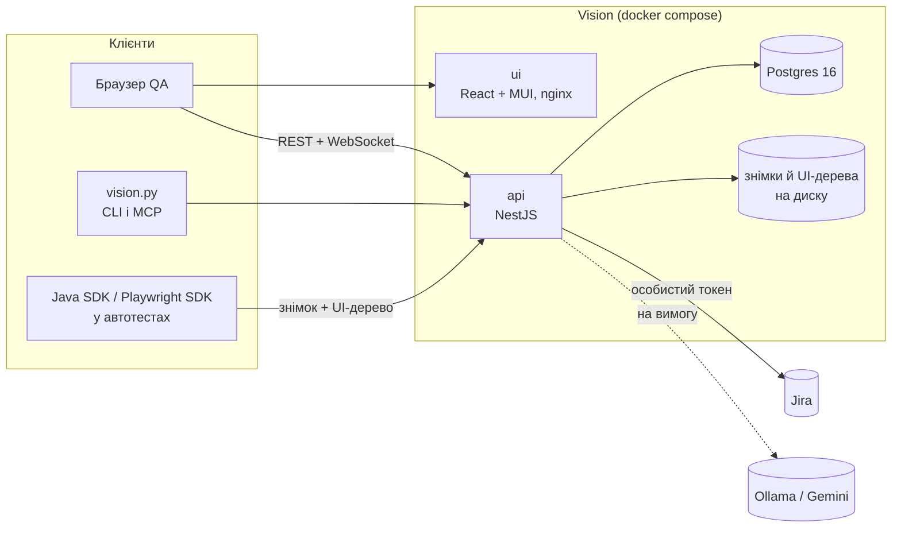

# Vision

**Візуальні перевірки для QA мобільних застосунків і вебу.** Автотести надсилають знімок екрана
разом з його UI-деревом; Vision порівнює його з еталоном на рівні елементів, а не лише пікселів,
перевіряє доступність, заводить баги в Jira без дублів і показує, які екрани нестабільні.

Android і iOS — через Appium, веб — через Selenide і Playwright. Розгортається у своєму контурі
через Docker Compose, нікуди не надсилає дані без явного налаштування.

> **Банку, що приймає Vision:** почніть з [пакета передачі](docs/handover/README.md): вимоги,
> налаштування, експлуатація, безпека, ліцензії й чек-лист приймання.

## Що вміє

| | |
|---|---|
| **Порівняння з урахуванням UI-дерева** | годинник у статус-барі, суми, зсув списку банером не дають хибних змін; правила «ігнорувати», «терпіти», «порівнювати лише» для елементів; нестабільний текст — регулярним виразом |
| **Групи змін** | одна зміна спільного компонента — одна картка й одне рішення на всі екрани; Undo |
| **Доступність** | підписи, зона тапу, контраст, поля вводу, VoiceOver; нове / наявне / виправлене відносно еталона |
| **Jira без дублів** | стабільний ID проблеми: той самий баг не заводиться двічі ні з іншого екрана, ні іншою людиною |
| **Insights** | застарілі еталони, нестабільні екрани, найчастіші проблеми доступності |
| **Ручні перевірки** | `vision.py` знімає поточний екран пристрою (adb, Appium, симулятор) з CLI або як MCP-сервер для AI-асистента |
| **AI на вимогу** | підсумок групи змін, підписи для іконок — лише коли людина попросила; Gemini або локальна Ollama |
| **Доступ і безпека** | проєкти за доступом, LDAP або SSO поруч із локальними акаунтами, знімки за підписаним посиланням, секрети зашифровані |

Повна карта фіч — в [огляді продукту](docs/product/overview.md).

## Як це працює



1. Тест робить `track(...)` як звичайно і додає UI-дерево екрана (Appium page source або дерево вебсторінки).
2. API розбирає дерево, прибирає шум за правилами, порівнює пікселі в пулі воркерів і знаходить, які
   саме елементи змінились; заодно перевіряє доступність. LLM на цьому шляху не викликається.
3. QA в інтерфейсі приймає або відхиляє зміни групами й заводить баги в Jira.

Детальніше — [архітектура](docs/architecture/overview.md), [модель даних](docs/architecture/data-model.md), [API](docs/architecture/api.md).

## Швидкий старт

Потрібні Docker з Compose v2, git, bash. Для розробки — Node 24.9+ (`.nvmrc`), Python 3.8+, JDK 11.

```bash
cp .env.demo.example .env.demo
# задати JWT_SECRET і VISION_SECRET_KEY: openssl rand -base64 32 (кожному — свій)
./scripts/vision.sh up -d --build
```

Інтерфейс — http://localhost:18080, API — http://localhost:14200 (`/health`). Перший вхід —
`admin@vision.local` з паролем із `DEFAULT_USER_PASSWORD` (типово `123456`, змініть одразу).

Docker compose запускаємо **лише через `./scripts/vision.sh`**: він закріплює назву проєкту й
нічого не робить, якщо поруч є чужі контейнери ([ADR-0002](docs/decisions/0002-production-is-read-only.md)).
Повне розгортання, копія даних з робочого VRT і підключення автотестів — у [DEPLOY.md](DEPLOY.md);
сценарій показу — у [DEMO.md](DEMO.md).

## Підключити автотести

```java
Vision vision = new Vision();          // адреса, ключ і проєкт — з VISION_* або vision.json
vision.start();
vision.track("Login screen", screenshotBase64,
        VisionOptions.builder()
                .device("Pixel 7 emulator").os("Android 15")
                .uiTree(driver.getPageSource())   // Appium page source; SDK стискає сам
                .build());
vision.stop();
```

Jar SDK збирає `./scripts/build-sdk-jar.sh` → `dist/sdk-java/vision-sdk-1.0.0.jar`. Maven, Gradle,
Selenide і Playwright — [DEPLOY.md §7–8](DEPLOY.md), [sdk-java](sdk-java/README.md),
[sdk-playwright](sdk-playwright/README.md).

## Складові репозиторію

| Папка | Що там | Для розробника |
|---|---|---|
| `backend/` | API: NestJS 12, Prisma 7, PostgreSQL 16, Node 24 | [AGENTS.md](backend/AGENTS.md) |
| `frontend/` | інтерфейс: React 18, MUI 5, Vite; CLI і MCP `public/cli/vision.py` | [AGENTS.md](frontend/AGENTS.md) |
| `sdk-java/` | Java SDK `ua.vision:vision-sdk` (Appium, Selenide) | [AGENTS.md](sdk-java/AGENTS.md) |
| `sdk-playwright/` | Playwright SDK `@vision/sdk-playwright` | [AGENTS.md](sdk-playwright/AGENTS.md) |
| `web-tree/` | збір дерева вебсторінки, спільний для обох SDK | [050](docs/specs/050-web-ui-tree/spec.md) |
| `scripts/` | `vision.sh`, копія даних, бекапи, перехід, перевірки | [AGENTS.md](scripts/AGENTS.md) |
| `docs/` | продукт, архітектура, специфікації, рішення, гайди, безпека, пакет передачі | [docs/README.md](docs/README.md) |
| `audit/` | SAST-звіт і сирі дані сканерів | [звіт](audit/report-sast-2026-11-09.md) |

## Документація

| Хто ви | Читайте |
|---|---|
| Банк, що приймає продукт | [пакет передачі](docs/handover/README.md) |
| Адміністратор | [вимоги](docs/handover/requirements.md), [налаштування](docs/handover/configuration.md), [DEPLOY.md](DEPLOY.md), [експлуатація](docs/handover/operations.md) |
| Інформаційна безпека | [безпека](docs/handover/security.md), [SECURITY.md](SECURITY.md), [аудит](docs/security/audit-2026-11-04.md), [ліцензії](docs/handover/third-party-licenses.md) |
| QA, власник продукту | [огляд](docs/product/overview.md), [словник](docs/product/glossary.md), [CHANGELOG](CHANGELOG.md) |
| Розробник | [docs/](docs/README.md), [локальний запуск](docs/guides/development.md), [тести](docs/guides/testing.md), [як ми працюємо](docs/guides/agentic-workflow.md) |

## Розробка

Нова фіча чи зміна поведінки проходить цикл **специфікація → дизайн → реалізація з тестами →
перевірка**: специфікація в `docs/specs/NNN-…/spec.md`, кожна вимога має тест у `design.md`
([agentic-workflow](docs/guides/agentic-workflow.md)). Рішення з наслідками — ADR у
[docs/decisions](docs/decisions/README.md).

Перед «готово» — одна команда, що запускає все: unit-тести, Playwright, типи, lint, міграції,
тести скриптів і перевірку документації:

```bash
python3 -I scripts/verify.py
```

Незмінні правила (діють і для людей, і для AI-агентів, хук `.claude/hooks/guard.py` їх забезпечує) —
у [AGENTS.md](AGENTS.md): міграції лише додавальні, жодних скидань бази, робочий VRT лише читається,
секрети не виходять із сервера, LLM лише на вимогу.

## Ліцензія

Apache-2.0 ([LICENSE](LICENSE)). Vision — похідна робота від Visual Regression Tracker; атрибуція —
у [NOTICE](NOTICE). Сторонні компоненти — у [переліку ліцензій](docs/handover/third-party-licenses.md).
