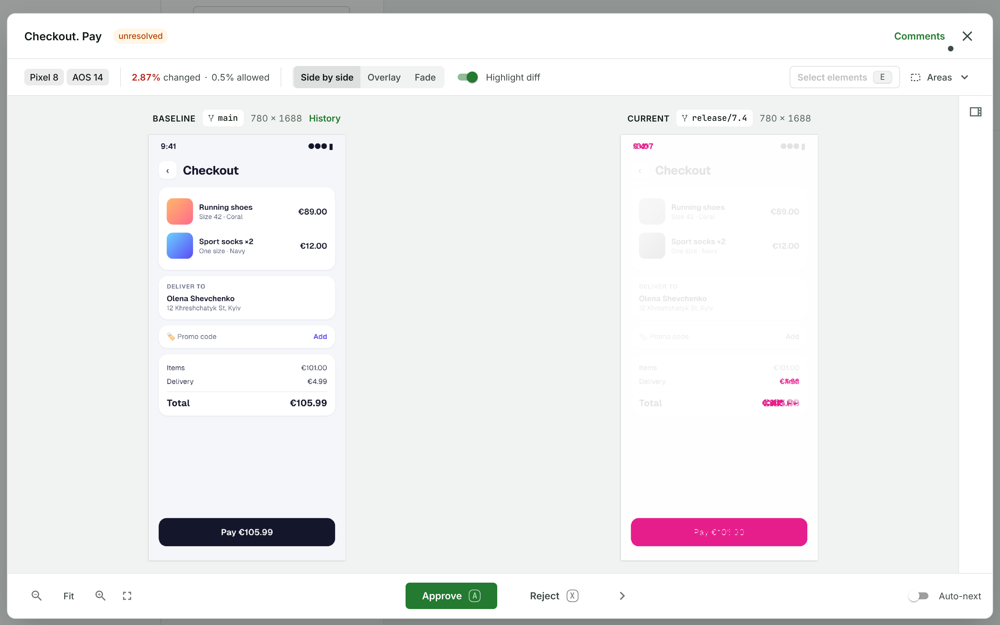
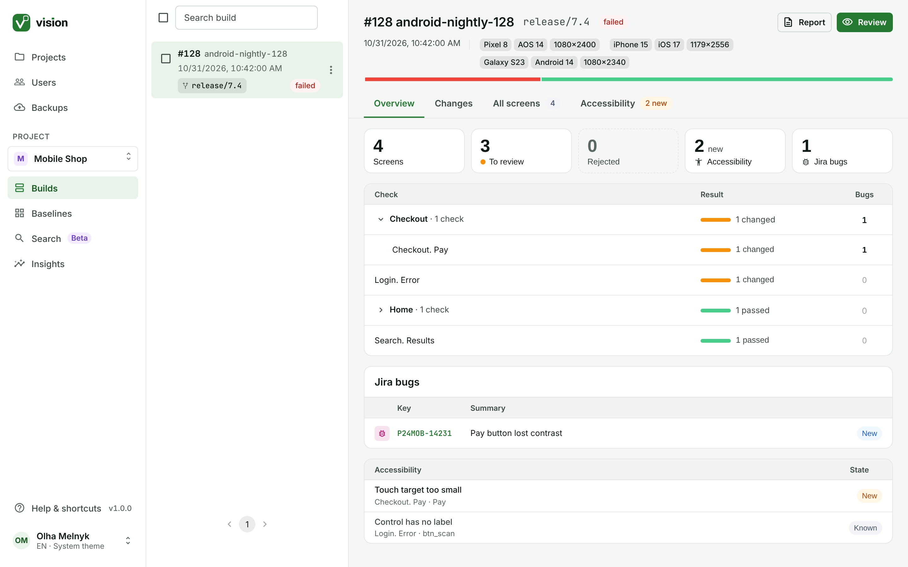

<p align="center">
  <picture>
    <source media="(prefers-color-scheme: dark)" srcset="./docs/assets/logo-dark.png">
    
  </picture>
</p>

<h3 align="center">Doesn't just see screens. Understands them.</h3>

<p align="center">
  Візуальні перевірки, доступність і UI-дерево для автотестів і ручного тестування<br>
  мобільних застосунків і вебу. Self-hosted.
</p>

<p align="center">
  <a href="#швидкий-старт">Швидкий старт</a> ·
  <a href="#можливості">Можливості</a> ·
  <a href="#sdk-та-інтеграції">SDK</a> ·
  <a href="docs/README.md">Документація</a> ·
  <a href="CHANGELOG.md">Зміни</a>
</p>

<p align="center">
  <picture>
    <source media="(prefers-color-scheme: dark)" srcset="./docs/assets/screenshots/review-dark.png">
    
  </picture>
</p>

## Як це працює

- Автотест робить знімок екрана й надсилає його у Vision через **SDK** (Java для Appium і Selenide,
  Playwright), **CLI** або **REST API** — разом з **UI-деревом** екрана: Appium page source або
  деревом вебсторінки.
- Vision порівнює знімок з еталоном тієї самої перевірки на тому самому пристрої. За деревом він
  знає, *який елемент* змінився, відкидає шум (годинник у статус-барі, зсув списку, анімації) і
  перевіряє доступність.
- Без змін — перевірка пройдена. Зміни чекають рев'ю: QA приймає або відхиляє їх групами, а знайдену
  проблему заводить у Jira в один клік, без дублів.

## Можливості

- **Порівняння з урахуванням UI-дерева.** Зміни названі за елементами, а не пікселями; правила
  «ігнорувати», «терпіти», «порівнювати лише» для елемента чи всього проєкту; нестабільний текст
  (суми, дати) — регулярним виразом; компенсація зсувів; приховані зміни, яких не видно на знімку.
- **Групи змін.** Одна зміна спільного компонента — одна картка й одне рішення на всі екрани
  збірки. Рішення можна скасувати (Undo).
- **Рев'ю.** Side by side, Overlay, Fade, підсвітка змін, зум, історія еталона, клавіатурні
  скорочення, черга рев'ю й автоперехід до наступного екрана.
- **Доступність.** Підписи, зона тапу, контраст, поля вводу, дубльовані підписи, VoiceOver і
  TalkBack; нове / наявне / виправлене відносно еталона; норми — на проєкт.
- **Jira без дублів.** Стабільний ID проблеми: той самий баг не заводиться вдруге ні з іншого
  екрана, ні іншою людиною. Підзадача з обов'язковими полями, шаблоном опису й скриншотом з обводкою.
- **Огляд збірки й звіт.** Що змінилось, що чекає, пристрої, баги, доступність — на одній
  сторінці; звіт для друку й публічне посилання.
- **Insights.** Застарілі еталони, нестабільні екрани, найчастіші проблеми доступності.
- **Пошук екранів** *(бета)* — за текстом, підписом чи селектором в UI-деревах. **Рев'ю за
  елементом** *(бета)* — зміна одного елемента на всіх екранах збірки, одне рішення.
- **Ручні перевірки.** `vision.py` знімає поточний екран пристрою (adb, Appium, симулятор) з
  терміналу або як MCP-сервер для AI-асистента.
- **AI на вимогу.** Підсумок групи змін, підписи для іконок — лише коли людина попросила; Gemini
  або локальна Ollama, денний ліміт. Під час прийому знімків LLM не викликається ніколи.
- **Доступ і безпека.** Ролі й доступ до проєктів, LDAP або SSO (OIDC) поруч із локальними
  акаунтами, знімки лише за підписаним посиланням, секрети в базі зашифровані.
- **Self-hosted.** Docker Compose, Postgres, знімки на диску, нічні бекапи. Інтерфейс англійською
  й українською, світла й темна теми.

<p align="center">
  <picture>
    <source media="(prefers-color-scheme: dark)" srcset="./docs/assets/screenshots/overview-dark.png">
    
  </picture>
</p>

## Швидкий старт

Потрібні [Docker](https://docs.docker.com/get-docker/) з Compose v2, git і bash.

```sh
git clone <адреса репозиторію Vision> vision && cd vision
cp .env.demo.example .env.demo
# JWT_SECRET і VISION_SECRET_KEY — два різні випадкові рядки: openssl rand -base64 32
./scripts/vision.sh up -d --build
```

| | |
|---|---|
| Інтерфейс | http://localhost:18080 |
| API | http://localhost:14200 (`/health`; Swagger `/api` — з `VISION_SWAGGER=true`) |
| Перший вхід | `admin@vision.local` / значення `DEFAULT_USER_PASSWORD` (типово `123456` — змініть одразу) |
| API-ключ | **Profile → API key** (показується один раз) |

Compose запускаємо **лише через `./scripts/vision.sh`**: він закріплює назву проєкту й нічого не
робить, якщо поруч є чужі контейнери. Повне розгортання, TLS, LDAP/SSO, Jira й бекапи — у
[DEPLOY.md](DEPLOY.md), усі змінні — у [довіднику налаштувань](docs/admin/configuration.md).

## SDK та інтеграції

| | Для чого | Де |
|---|---|---|
| **Java SDK** `ua.vision:vision-sdk` | Appium (Android, iOS), Selenide і Selenium | [`sdk-java/`](sdk-java/README.md) |
| **Playwright SDK** `@vision/sdk-playwright` | Playwright Test, веб | [`sdk-playwright/`](sdk-playwright/README.md) |
| **CLI і MCP** `vision.py` | ручні перевірки з пристрою; AI-асистенти | [`frontend/public/cli/vision.py`](frontend/public/cli/vision.py) |
| **REST API** | будь-яка мова й фреймворк | Swagger `<API>/api`, [опис](docs/architecture/api.md) |

Усі SDK читають однакові налаштування — з коду, змінних `VISION_*` або файла `vision.json` у
корені проєкту тестів (у такому порядку пріоритету):

| Поле | Змінна | | Що це |
|---|---|---|---|
| `apiUrl` | `VISION_APIURL` | обов'язкове | адреса API Vision, напр. `https://vision-api.example.com` |
| `apiKey` | `VISION_APIKEY` | обов'язкове | особистий API-ключ (**Profile → API key**) |
| `project` | `VISION_PROJECT` | обов'язкове | назва або ID проєкту |
| `branchName` | `VISION_BRANCHNAME` | обов'язкове | гілка, з якою порівнювати |
| `ciBuildId` | `VISION_CIBUILDID` | | ID збірки в CI |
| `enableSoftAssert` | `VISION_ENABLESOFTASSERT` | | `true`: писати в лог замість падіння тесту |
| `httpTimeoutInSeconds` | `VISION_HTTPTIMEOUTINSECONDS` | | час очікування відповіді |
| `sourceBranch` | `VISION_SOURCEBRANCH` | лише Playwright | звідки брати еталони для нової гілки |

### Java SDK

Для Java 11+. Jar збирається з цього репозиторію (JDK 11, Gradle 7):

```sh
./scripts/build-sdk-jar.sh        # → dist/sdk-java/vision-sdk-1.0.0.jar і .pom
mvn install:install-file -Dfile=dist/sdk-java/vision-sdk-1.0.0.jar -DpomFile=dist/sdk-java/vision-sdk-1.0.0.pom
```

```xml
<dependency>
    <groupId>ua.vision</groupId>
    <artifactId>vision-sdk</artifactId>
    <version>1.0.0</version>
</dependency>
```

Або в Gradle — `implementation 'ua.vision:vision-sdk:1.0.0'` з `mavenLocal()`; у корпоративний
Nexus — `gradle publish -PrepoUrl=…` ([sdk-java](sdk-java/README.md)).

**Мобільний екран (Appium)** — до звичного знімка додається page source:

```java
import ua.vision.sdk.Vision;
import ua.vision.sdk.VisionOptions;

Vision vision = new Vision();            // налаштування — з VISION_* або vision.json
vision.start();                          // нова збірка

String screenshot = driver.getScreenshotAs(OutputType.BASE64);
vision.track("Checkout. Pay", screenshot, VisionOptions.builder()
        .device("Pixel 8")
        .os("Android 14")
        .uiTree(driver.getPageSource())  // Android чи iOS — визначається з XML
        .featureName("Checkout")         // необов'язково: фіча для назви бага
        .build());

vision.stop();                           // збірку завершено
```

**Вебсторінка (Selenide, Selenium)** — дерево збирає `WebUiTree` у браузері сесії, одразу перед
знімком:

```java
import ua.vision.sdk.web.WebUiTree;

String tree = WebUiTree.collect((JavascriptExecutor) WebDriverRunner.getWebDriver());
vision.track("Cart", Selenide.screenshot(OutputType.BASE64), VisionOptions.builder()
        .browser("chrome")
        .browserVersion("131.0.6778.85")   // показується в рев'ю, в ідентичність не входить
        .viewport("1280x800")
        .uiTree(tree)
        .build());
```

`VisionOptions`:

| Опція | Що це |
|---|---|
| `device`, `os`, `browser`, `viewport`, `customTags` | ідентичність перевірки: еталон окремий для кожного поєднання |
| `uiTree` | Appium page source або результат `WebUiTree.collect`; до 10 МиБ, більше — знімок іде без дерева з попередженням у лозі |
| `featureName` | фіча, до якої належить екран; дає назву багам з рев'ю |
| `browserVersion` | версія браузера для рев'ю |
| `diffTollerancePercent` | допустимий відсоток змін |
| `ignoreAreas` | області, які не порівнюються |

`track` повертає `VisionResult`: статус перевірки (`getTestRunResponse()`) і посилання на поточний
знімок, diff і еталон (`getImageUrl()`, `getDiffUrl()`, `getBaselineUrl()`). Якщо проєкт обмежує
пристрої, знімок з іншого пристрою відхиляється з `TestRunException` і причиною.

### Playwright SDK

Для Node 18+ і Playwright 1.40+. Пакет збирається з репозиторію:

```sh
cd sdk-playwright && npm ci && npm pack    # → vision-sdk-playwright-1.0.0.tgz
npm install --save-dev ./vision-sdk-playwright-1.0.0.tgz   # у проєкті тестів
```

```ts
import { test } from '@playwright/test';
import { VisionPlaywright } from '@vision/sdk-playwright';

const vision = new VisionPlaywright('chromium');

test.beforeAll(() => vision.start());
test.afterAll(() => vision.stop());

test('cart', async ({ page }) => {
  await page.goto('https://shop.example.com/cart');
  await vision.trackPage(page, 'Cart', {
    featureName: 'Checkout',
    screenshotOptions: { fullPage: true },  // дерево збирається для того, що на знімку
  });
  await vision.trackElementHandle(page.locator('#total'), 'Cart total');
});
```

| Метод | Що робить |
|---|---|
| `start()` / `stop()` | відкриває й закриває збірку |
| `trackPage(page, name, options?, retryCount = 2)` | знімок сторінки з UI-деревом |
| `trackElementHandle(handle, name, options?, retryCount = 2)` | знімок елемента (`Locator` або `ElementHandle`), без дерева |

Опції: `agent: { os, device, viewport }`, `customTags`, `diffTollerancePercent`, `ignoreAreas`,
`comment`, `screenshotOptions`, `featureName` і `uiTree` (`true` за замовчуванням, `'viewport'`,
`'page'` або `false`). Версія браузера визначається сама. Статуси `new` і `unresolved` валять тест,
якщо не ввімкнено `enableSoftAssert`. Деталі — у [sdk-playwright](sdk-playwright/README.md).

### CLI і MCP для ручних перевірок

`vision.py` — один файл на Python 3.8+ без залежностей. Його віддає сам Vision:
`<адреса інтерфейсу>/cli/vision.py`.

```sh
python3 vision.py config --api https://vision-api.example.com --key API_KEY --project "Mobile Shop"

python3 vision.py check "Payment"                           # єдиний пристрій adb
python3 vision.py check "Payment" --serial emulator-5554    # конкретний пристрій
python3 vision.py check "Payment" --appium http://127.0.0.1:4723   # сесія Appium, Android чи iOS
python3 vision.py check "Payment" --simulator               # симулятор iOS, лише знімок
python3 vision.py check "Payment" --png screen.png --xml screen.xml

python3 vision.py start   # кілька перевірок в одну збірку…
python3 vision.py finish  # …і закрити її
```

`check` друкує статус відносно еталона, змінені елементи, приховані зміни, проблеми доступності й
посилання на рев'ю. Інші команди: `capture` (зберегти екран у файли), `devices` (пристрої adb).

**MCP:** `python3 vision.py mcp` — сервер для AI-асистентів (Claude, Cursor та інших) з
інструментами `vision_check`, `vision_devices` і `vision_session`. Приклад налаштування клієнта:

```json
{
  "mcpServers": {
    "vision": { "command": "python3", "args": ["/path/to/vision.py", "mcp"] }
  }
}
```

### REST API

`POST /test-runs` (JSON) або `POST /test-runs/multipart` приймає знімок і, необов'язково, `uiTree`
(gzip + base64), `uiTreeFormat` і `deviceDensity`. Автентифікація — заголовок `apiKey`. Повна схема
— у Swagger (`<API>/api`), що змінено відносно базового API — в [описі API](docs/architecture/api.md).

## Терміни

- **Project** — застосунок або набір тестів; у нього свої учасники, правила й норми доступності.
- **Build** — один запуск тестів: усі екрани, надіслані між `start()` і `stop()`.
- **Screen (перевірка)** — один знімок у збірці; визначається назвою й пристроєм (`device`, `os`,
  `browser`, `viewport`, `customTags`).
- **Baseline (еталон)** — прийнятий знімок перевірки, з яким порівнюються нові.
- **UI-дерево** — ієрархія елементів екрана з межами й атрибутами: Appium page source або дерево
  вебсторінки.
- **Група змін** — однакова зміна на кількох екранах, яку вирішують одним рішенням.

Більше — у [словнику](docs/product/glossary.md).

## Документація

| Кому | Що читати |
|---|---|
| QA, власнику продукту | [огляд продукту](docs/product/overview.md), [словник](docs/product/glossary.md), [CHANGELOG](CHANGELOG.md) |
| Адміністратору | [DEPLOY.md](DEPLOY.md), [вимоги](docs/admin/requirements.md), [налаштування](docs/admin/configuration.md), [експлуатація](docs/admin/operations.md) |
| Службі безпеки | [огляд безпеки](docs/security/overview.md), [звіт аудиту](audit/security-audit-2026-11.md), [ліцензії](docs/security/third-party-licenses.md), [SECURITY.md](SECURITY.md) |
| Розробнику | [документація](docs/README.md), [архітектура](docs/architecture/overview.md), [локальний запуск](docs/guides/development.md), [тести](docs/guides/testing.md) |

## Розробка

| Папка | Що там |
|---|---|
| `backend/` | API: NestJS 12, Prisma 7, PostgreSQL 16, Node 24 |
| `frontend/` | інтерфейс: React 18, MUI 5, Vite; CLI і MCP `public/cli/vision.py` |
| `sdk-java/`, `sdk-playwright/` | SDK |
| `web-tree/` | збір дерева вебсторінки, спільний для обох SDK |
| `scripts/` | запуск, бекапи, перевірки |
| `docs/` | продукт, архітектура, специфікації, рішення, гайди |

Нова фіча проходить цикл **специфікація → дизайн → реалізація з тестами → перевірка**
([як ми працюємо](docs/guides/agentic-workflow.md)). Усі перевірки — однією командою:

```sh
python3 -I scripts/verify.py
```

Правила, що діють завжди, — у [AGENTS.md](AGENTS.md).

## Ліцензія

[Apache-2.0](LICENSE). Атрибуція — у [NOTICE](NOTICE); сторонні компоненти — у
[переліку ліцензій](docs/security/third-party-licenses.md).
