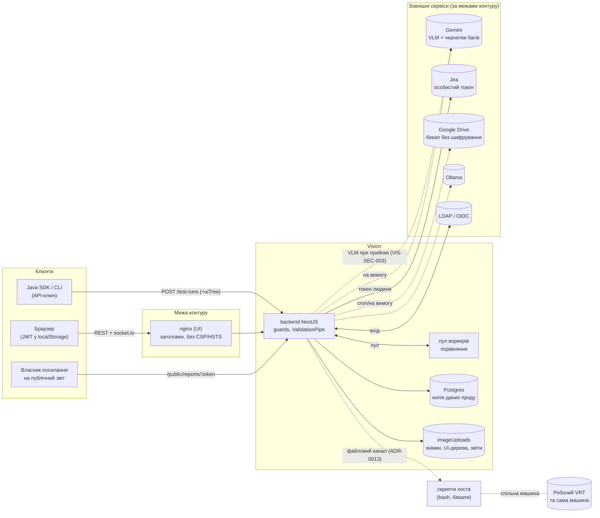

# Модель загроз Vision (STRIDE)

> Оновлено 2026-11-07 (коміт a3b6104): межі довіри без змін; нові поверхні — `GET /projects/:id/jira/types?url=` (VIS-SEC-048) і `GET /test-runs/:id/trend`; найслабша межа за доступністю — спільний процес API (VIS-SEC-043, 045, 046).

Коміт `7b13af1`. Модель розгортання: внутрішній on-prem сервіс у банківському контурі, кілька
команд банку в одному інстансі, ролі admin/editor/guest + доступ за проєктами (042), на тій самій
машині, що й робочий VRT (спільні диск, CPU, Docker).

## Діаграма потоків даних

## Активи
Знімки й UI-дерева банківських застосунків (ПІБ, номери карток/рахунків, баланси); еталони;
рішення команди (журнал ADR-0014); секрети (`JWT_SECRET`, `VISION_SECRET_KEY`, токени Jira, ключі
Gemini, облікові дані Google Drive); хеші API-ключів; токени публічних звітів (256-біт анонімний доступ).

## Ролі (суб'єкти)
anonymous, власник посилання на публічний звіт, guest, editor, admin, API-ключ (SDK/CLI, права
власника ключа), адміністратор хоста, адмін бази.

## Межі довіри
SDK/CLI → API; браузер → nginx → API; API → Postgres/Redis/диск; API → Jira/Gemini/Ollama/LDAP/
OIDC/Google Drive (вихід за межі контуру); API ↔ скрипти хоста через файли; Vision ↔ робочий VRT
на тій самій машині.

## STRIDE (ключові загрози → знахідки)

| Категорія | Загроза | Знахідки |
|---|---|---|
| **S**poofing | Підробка JWT адміна за слабким/спільним секретом; захоплення акаунта в LDAP; порожній bind; login-CSRF; фіксація сесії | VIS-SEC-002, 006, 007, 018 |
| **T**ampering | Mass assignment (ескалація ролі, перенесення збірки в чужий проєкт); системний ValidationPipe; prompt injection у вердикт VLM | VIS-SEC-001, 012, 032 |
| **R**epudiation | Немає аудит-логу адмінських дій; адмін діє чужим токеном Jira; підробка записів логу; немає відкликання сесій | VIS-SEC-017, 023, 009; розділ «чого бракує» |
| **I**nformation disclosure | Автовиклик Gemini з даними банку; SSRF/редиректи Jira; незашифрований бекап у Drive; безстрокові підписані посилання; відкриті токени звітів; секрети в логах | VIS-SEC-003, 008, 013, 022, 025, 027 |
| **D**enial of service | Обчислювальна DoS аналізу доступності; зависання воркера через області ігнорування; необмежені PNG; ReDoS; блокування чужих акаунтів лімітом входу | VIS-SEC-004, 005, 014, 015, 034 |
| **E**levation of privilege | editor→admin через PATCH /builds; повернення ролі через SSO; editor керує чужими проєктами; обхід guard.py на спільній машині | VIS-SEC-001, 020, 041, 021 |
