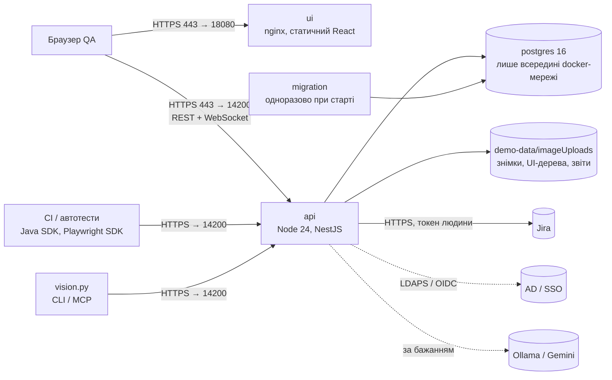

# Вимоги до середовища

Що потрібно, щоб розгорнути Vision: сервер, мережа, доступи. Читати перед замовленням
сервера й погодженням мережевих доступів. Покрокове розгортання — у [DEPLOY.md](../../DEPLOY.md),
налаштування — у [довіднику](configuration.md).

## Склад

| Контейнер | Образ | Користувач | Порт у контейнері |
|---|---|---|---|
| `ui` | збирається з `frontend/`, nginx-unprivileged 1.30 | `nginx` (не root) | 8080 |
| `api` | збирається з `backend/`, Node 24 | користувач хоста, від якого працює `vision.sh` | 3000 |
| `migration` | збирається з `backend/prisma/`, завершується після міграцій | `node` | — |
| `postgres` | `postgres:16-alpine` за digest | `postgres` | 5432, на хост не публікується |

Усі образи, крім Postgres, збираються з цього коду на вашому сервері (`./scripts/vision.sh build`);
готових образів ззовні не потрібно, базові закріплені за digest.

## Сервер

| Ресурс | Мінімум (поруч із VRT) | Рекомендовано (окремий сервер) |
|---|---|---|
| CPU | 4 vCPU (Vision обмежений до 3,5) | 8 vCPU |
| Пам'ять | 8 ГБ (Vision обмежений до ~4,3 ГБ) | 16 ГБ |
| Диск | ~6 ГБ під образи + 2 × база + знімки | SSD, від 200 ГБ; знімки — основний обсяг |
| ОС | Linux x86_64 з Docker Engine 24+ і Compose v2 | те саме |
| Ще | git, bash, rsync, python3 ≥ 3.8, cron (бекапи) | те саме |

Обсяг знімків оцінюється з робочого VRT: розмір його папки `imageUploads` і темп росту. Скрипти
перед копіюванням і збиранням самі перевіряють, що вільного місця вистачить.

На окремому сервері ліміти CPU й пам'яті можна підняти (`DEMO_API_CPUS`, `DEMO_API_MEMORY`,
`DEMO_DIFF_WORKERS` — [довідник](configuration.md#ліміти-й-ресурси)).

## Мережеві доступи

### Вхідні

| Звідки | Куди | Порт | Навіщо |
|---|---|---|---|
| Робочі місця QA | `ui` | 18080 (або 443 на проксі) | інтерфейс |
| Робочі місця QA, CI, мобільні ферми | `api` | 14200 (або 443 на проксі) | API, WebSocket `/socket.io`, знімки |
| Адміністратор | сервер | 22 | SSH для обслуговування |

Vision сам слухає HTTP. **Для робочої установки — TLS на зворотному проксі** (nginx, F5, HAProxy) перед обома
портами; проксі має передавати `X-Forwarded-Proto: https` і пропускати WebSocket (`Upgrade`). Тоді
відповіді отримують HSTS. Адреси за проксі — у `DEMO_UI_URL` і `DEMO_API_URL`.

### Вихідні з сервера

| Куди | Коли | Обов'язково |
|---|---|---|
| Дзеркало npm (Nexus) або `registry.npmjs.org` | збирання образів | так (`VISION_NPM_REGISTRY`) |
| Дзеркало `binaries.prisma.sh` | збирання образу міграцій | так (`VISION_PRISMA_ENGINES_MIRROR`) |
| Реєстр Docker (Docker Hub або дзеркало) | базові образи при першому збиранні | так |
| Maven Central і Gradle Plugin Portal (або дзеркало) | збирання jar SDK | там, де збирають SDK |
| Jira (`VISION_JIRA_HOSTS`) | заведення багів, пошук дублів | якщо потрібна Jira |
| LDAP/AD (`LDAPS 636`) або провайдер OIDC | вхід | якщо корпоративний вхід |
| Сховище бекапів (S3-сумісне) | щоночі | рекомендовано |
| Ollama у вашій мережі | лише на вимогу людини | ні |
| Gemini (`generativelanguage.googleapis.com`) | лише на вимогу людини | ні; лише з погодженням ІБ |

Телеметрію вимкнено під час збирання (`CHECKPOINT_DISABLE=1`, `SCARF_ANALYTICS=false`); у роботі
Vision нікуди, крім перелічених адрес, не звертається.

Проксі, що переписує TLS: його CA — у `VISION_EXTRA_CA_FILE` (PEM). Перевірку TLS не вимикаємо.

## Клієнти

| Що | Вимоги |
|---|---|
| Браузер | актуальні Chrome, Edge, Firefox, Safari |
| Java SDK | автотести на Java 11+, Maven або Gradle; jar збирає `./scripts/build-sdk-jar.sh`: потрібні JDK 11 (на 17 плагін Lombok падає) і Gradle 7.x |
| Playwright SDK | Node 18+, `@playwright/test` |
| CLI / MCP `vision.py` | Python 3.8+, лише стандартна бібліотека; для пристроїв — `adb` або Appium |

## Сумісність з робочим VRT

Якщо Vision ставиться поруч із робочим Visual Regression Tracker і бере з нього дані: VRT 5.x на
Postgres 12+; новіша схема VRT, ніж знає Vision, — копіювання зупиняється, нічого не змінивши.
VRT лише читається ([ADR-0002](../decisions/0002-production-is-read-only.md)).
