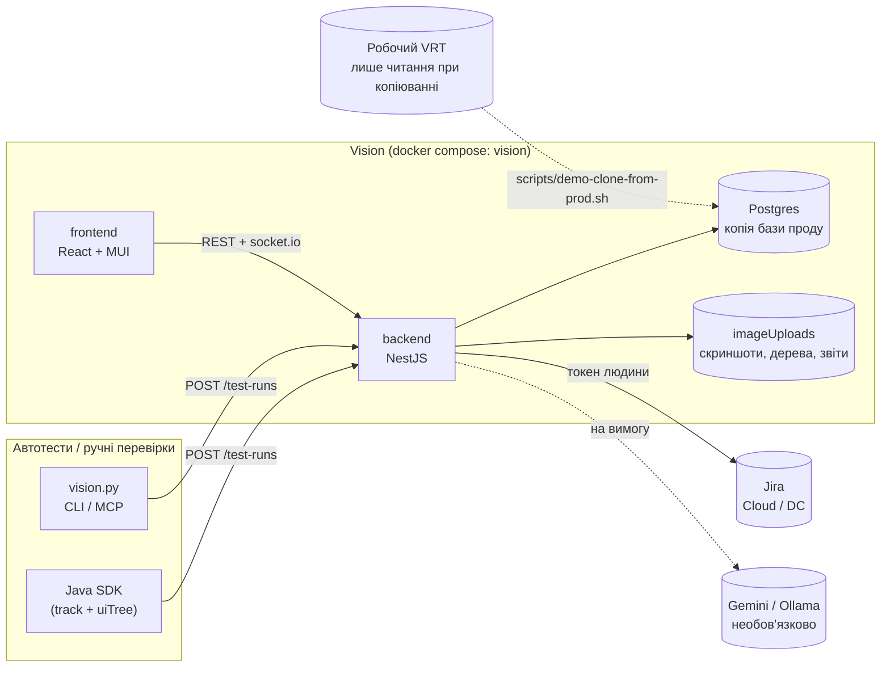

# Архітектура

## Компоненти

## Прийом знімка

1. `POST /test-runs` (JSON або multipart) приносить скриншот і, необов'язково, `uiTree`
   (gzip + base64 XML), `uiTreeFormat`, `deviceDensity`.
2. Дерево розбирається в нормалізований список вузлів (`ui-tree.parser.ts`), межі вузлів
   переводяться в пікселі скриншота. Результат зберігається файлом `.uitree.json.gz` поруч зі
   скриншотом.
3. Входи порівняння (`comparisonInputs`): ігноровані області з правил елементів, системні бари,
   компенсація зсувів.
4. Піксельне порівняння в пулі воркерів (`compare/diff-worker-pool.ts`) повертає відсоток змін
   і **області змін**.
5. `analyzeUiTree`, один прохід по декодованих картинках:
   - звіт доступності (файл) з порівнянням з еталоном: нове / наявне / виправлене;
   - приховані зміни: якщо пікселі збіглися, а вони є, статус стає `unresolved`;
   - змінені компоненти.
6. У рядок `TestRun` пишуться лише імена файлів і лічильники (`a11yNewCount`, `a11yTotalCount`,
   `semanticChangeCount`…), потім іде подія socket.io.

LLM на цьому шляху не викликається ніколи.

## Рев'ю

UI запитує окремо, коли відкривають знімок:

| Запит | Що повертає |
|---|---|
| `GET /test-runs/groups?buildId=` | групи змін збірки |
| `GET /test-runs/:id/a11y` | звіт доступності з рішеннями команди; заодно один пошук у Jira за незаведеними проблемами |
| `GET /test-runs/:id/structure` | зміни на рівні елементів, правила, підказки щодо шуму |

## Модулі бекенду

| Модуль | Роль |
|---|---|
| `test-runs` | прийом, затвердження і відхилення, групи змін, ендпоінти рев'ю |
| `ui-tree` | розбір дерева, налаштування проєкту (`uiTreeSettings`), правила, перевірки екрана, групи компонентів, порівняння пристроїв |
| `a11y` | правила, проблеми й рішення, Jira |
| `analytics` | Insights (чиста функція `computeInsights` + сервіс) |
| `ai` | провайдери Gemini/Ollama, кеш `AiResult`, денний ліміт |
| `compare` | піксельні алгоритми upstream + області змін |
| `users`, `projects`, `builds`, `test-variations`, `auth` | upstream, з невеликими доповненнями (особистий токен Jira, налаштування проєкту) |

## Принципи

- **Чисті функції + тонкі сервіси.** Логіку (правила, ідентичність проблем, текст бага, Insights)
  можна тестувати без Nest і бази.
- **Великі дані — у файлах.** У базі — імена файлів і лічильники.
- **Додавальна схема** ([ADR-0003](../decisions/0003-additive-schema-only.md)).
- **Jira — дзеркало, база Vision — джерело правди** для рішень щодо проблем
  ([ADR-0009](../decisions/0009-jira-mirrors-local-decisions.md)).

Детальніше: [модель даних](data-model.md), [API](api.md).
