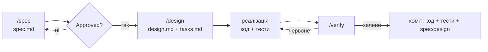

# Агентська розробка за специфікаціями

Як люди й агенти змінюють Vision, щоб будь-хто, хто відкрив репозиторій, міг продовжити роботу
без контексту з чату.

## Цикл

| Крок | Хто | Результат |
|---|---|---|
| `/spec` | агент разом з людиною | `spec.md`: історії, вимоги EARS, граничні випадки, критерії успіху, `[ПОТРЕБУЄ УТОЧНЕННЯ]` |
| Затвердження | власник продукту | статус `Approved`, маркерів уточнень немає |
| `/design` | агент | `design.md` (підхід, компоненти, дані, ризики, тест на кожну вимогу), `tasks.md`, ADR за потреби |
| Реалізація | агент | код і тести по задачах; одна задача — одна логічна зміна |
| `/verify` | агент | тести, типи, лінт, еталони, міграції, `check-docs.py`; статус `Implemented` |
| Приймання | власник продукту або QA | сценарії приймання на стенді → `Verified` |

Зміни людина бачить на кожному переході: специфікацію до дизайну, дизайн до коду, звіт `/verify`
до коміту.

## Правила для агента

- **Не вигадуй вимог.** Неясне — `[ПОТРЕБУЄ УТОЧНЕННЯ]` і питання людині. Неминуче припущення
  назви у звіті.
- **Вимога без тесту не реалізована.** Виняток — `manual:` з точним описом перевірки.
- **Поведінка змінилась — змінилась специфікація,** у тому ж коміті. Розбіжність коду й
  специфікації — баг одного з них.
- **Рішення з наслідками — ADR** (`docs/decisions/template.md`). Прийнятий ADR не переписуємо,
  а замінюємо новим.
- **Непорушні правила** ([AGENTS.md](../../AGENTS.md)) забезпечує hook `.claude/hooks/guard.py`.
  Він блокує docker compose поза `vision.sh`, пуш не в `vision`, видалення чужих контейнерів і
  томів, скидання й видалення бази. Якщо hook щось заблокував, не обходь його, а поясни людині,
  що й навіщо хотів зробити.
- **Дії назовні — з явного дозволу:** пуш, зміни в реальній Jira, повідомлення, видалення.
- **Звіт — правдивий:** що перевірено, що ні, що впало. «Не перевірено на реальній Jira» —
  нормальна фраза.

## Паралельна робота

Задачі з позначкою `[P]` у `tasks.md` можна віддати окремим агентам (окремі сесії або worktree),
якщо вони не залежать одна від одної, не чіпають тих самих файлів і не мусять потрапити в один
коміт. `/verify` всієї фічі робить один агент після злиття.

## Коли специфікація не потрібна

- Виправлення бага без зміни задуманої поведінки (тест обов'язковий).
- Рефакторинг без зміни поведінки; документація; залежності.

Якщо «просте виправлення» вимагає змінити поведінку — зупинись і онови специфікацію.

## Контекст: що читати агенту

Поступово: `AGENTS.md` (корінь, потім пакет) → специфікація фічі → її ADR → `design.md` → код за
посиланнями з `design.md`. Не читай увесь `docs/` наперед: те, чого немає в контексті, не
відволікає.
