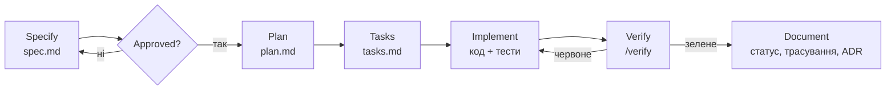

# Агентська розробка за специфікаціями

Як ми (люди й агенти) робимо зміни у Vision. Мета — щоб будь-хто, хто відкрив репозиторій,
міг продовжити роботу без контексту з чату.

## Цикл

| Крок | Хто | Результат | Команда Claude Code |
|---|---|---|---|
| Specify | агент з людиною | `docs/specs/NNN-…/spec.md`: проблема, вимоги EARS, критерії приймання, відкриті питання | `/spec` |
| Approve | власник продукту | статус `Approved`, відкриті питання закрито | — |
| Plan | агент | `plan.md`: підхід, зміни по шарах, міграція, ризики; за потреби ADR | `/plan` |
| Tasks | агент | `tasks.md`: малі кроки з перевіркою, позначка `[parallel]` для незалежних | `/plan` |
| Implement | агент | код + тести; один крок — одна логічна зміна | — |
| Verify | агент | тести, типи, лінт, еталони, сценарій з критеріїв приймання | `/verify` |
| Document | агент | статус `Implemented`, заповнене «Трасування», DEPLOY.md/DEMO.md | `/verify` |

## Правила для агента

- **Не вигадуй вимог.** Неясне — у «Відкриті питання» і питання людині, а не припущення в коді.
  Якщо припущення неминуче, назви його у звіті.
- **Одна специфікація — одна фіча.** Зміна, що зачіпає кілька фіч, оновлює кожну з їхніх
  специфікацій.
- **Вимога без тесту не реалізована.** Виняток — `manual:` з точним описом перевірки.
- **Зміна поведінки → зміна специфікації в тому ж коміті.** Розбіжність коду й специфікації —
  баг одного з них.
- **Рішення з наслідками → ADR.** Прийнятий ADR не редагуємо, а замінюємо новим.
- **Безпека понад усе** ([AGENTS.md](../../AGENTS.md), «Непорушні правила»): прод, міграції, SDK,
  пуш. Руйнівні або зовнішні дії (видалення, пуш, повідомлення, зміни в реальній Jira) — лише з
  явного дозволу людини.
- **Звіт — правдивий.** Що перевірено, що ні, що впало. «Не перевірено на реальній Jira» —
  нормальна фраза.

## Паралельна робота

Задачі з `tasks.md`, позначені `[parallel]`, можна віддати окремим агентам (окремі сесії або
worktree), якщо вони:
- не залежать від результату одна одної;
- не чіпають тих самих файлів;
- не мусять потрапити в один коміт.

Перевірку всієї фічі (`/verify`) робить один агент після злиття всіх гілок.

## Коли специфікація не потрібна

- Виправлення бага без зміни задуманої поведінки (тест обов'язковий).
- Рефакторинг без зміни поведінки.
- Документація, коментарі, залежності.

Якщо під час «простого виправлення» з'ясувалось, що треба змінити поведінку, зупинись і
напиши або онови специфікацію.

## Контекст для агента: що читати

Розкриття поступове ([documentation.md](documentation.md)): спершу `AGENTS.md` (корінь і
пакет), потім специфікація фічі та її ADR, і лише потім код за посиланнями «Код:» зі
специфікації. Не читай увесь `docs/` наперед.
