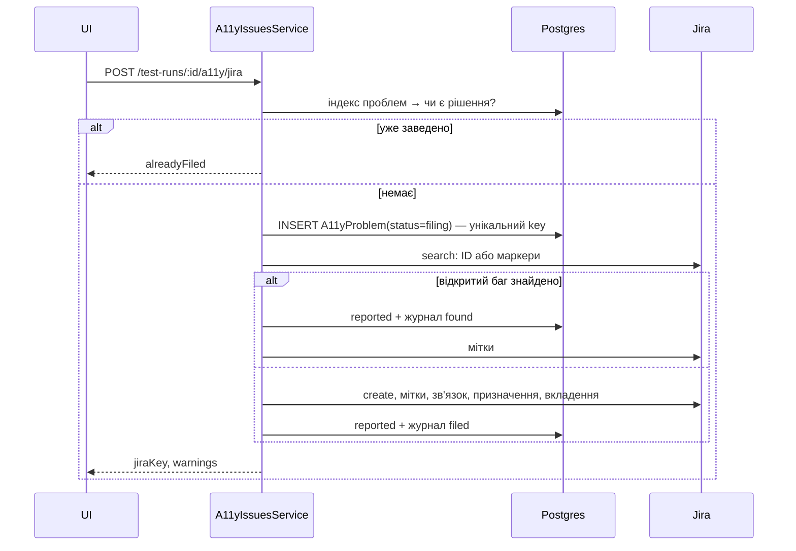

# 004 — Дизайн

## Підхід

- **Факти, а не ключ.** Знахідка перетворюється на факти (`facetsOf`). Ключ проблеми —
  `problemKeyOf(факти, налаштування)`, і його перераховують щоразу: і для знахідок, і для фактів
  збережених проблем. Збережені проблеми індексуються за ключами їхніх фактів під поточними
  налаштуваннями (`indexProblems`). Тому зміна налаштувань перегруповує, але ID (`code`) і баг
  лишаються при проблемі ([ADR-0008](../../decisions/0008-stable-problem-ids-from-facts.md)).
- **База — джерело правди, Jira — дзеркало** ([ADR-0009](../../decisions/0009-jira-mirrors-local-decisions.md)).
  «Замок» — унікальний `(projectId, key)` у `A11yProblem` зі статусом `filing`. Jira отримує мітки
  (маркери) і шукається за ID або маркерами.
- **Чисті функції окремо від сервісу:** ідентичність, класи, маркери — `a11y-problems.ts`; рев'ю —
  `a11y-issues.ts`; сервіс лише завантажує, кешує й пише.

## Компоненти

| Компонент | Шлях | Роль |
|---|---|---|
| Ідентичність | `backend/src/a11y/a11y-problems.ts` | `facetsOf`, `componentOf`, `measurementOf`, `classOf`, `problemKeyOf`, `problemCode`, `problemMarkers`, `markerQuery`, `screenTitle`, `facetsFromKey` |
| Рев'ю | `backend/src/a11y/a11y-issues.ts` | `indexProblems`, `decidingProblem`, `reviewReport`: рішення, `related`, `resolved`, лічильники |
| Сервіс | `backend/src/a11y/a11y-issues.service.ts` | кеш індексу (версія = кількість + останній `updatedAt` + налаштування; скидається після кожного запису), `claim`, `fileBug`, `link`, `reset`, `lookUpInJira`, журнал, перенесення старих рішень при старті |
| Jira | `backend/src/a11y/jira.client.ts` | `search` (Cloud `search/jql`, інакше класичний `search`), `editLabels` |
| Налаштування | `backend/src/ui-tree/comparison-inputs.ts` | `screenTitle`, `a11yDuplicates`, `a11yClasses` у `uiTreeSettings` проєкту; парсер відкидає биті записи |
| Картки | `frontend/src/components/TestDetailsDialog/InsightsPanel.tsx` | групування за `group` + станом, `a11yElsewhere`, `a11yRelated`, ID проблеми |
| Налаштування UI | `frontend/src/components/ProjectForm/A11yProblemSettings.tsx` | селектори заголовка, режими за правилом, класи (умови по полях, групування, дія, порядок) |

## Дані

- `A11yProblem`: `code` (видається з хешу проєкту й ключа на момент створення, потім не
  змінюється), `key` (ключ на момент створення; унікальний з `projectId`, він же «замок»), `rule`,
  `facets` (JSON, `ProblemFacets[]`), `status` (`filing` / `reported` / `ignored`), `jiraKey`,
  `jiraUrl`, `screenName`, `screenTitle`, `userId`.
- `A11yDecision`: `action` (`filed` / `linked` / `found` / `unlinked` / `ignored` / `restored`),
  `code`, `problemId`, `jiraKey`, `screenName`, `userId`, `comment`, `createdAt`.
- Старі `A11yIssueState` переносяться при старті (`moveIssueStates`), проблемам без фактів
  відновлюються факти з ключа (`fillFacets`).
- Ключі: `rule|c:<компонент>|<значення або порожньо>`, `rule|k:<id класу>|`,
  `rule|s:<екран>|c:<компонент>|<значення>`, `rule|s:<екран>|e:<ключ елемента>`.
- Мітки: `a11y-<8 hex>`, `a11y-<правило>`, `a11y-component-…`, `a11y-value-…`, `a11y-class-…`;
  після відв'язування — `a11y-unlinked-<8 hex>`.

## Потік заведення

## Ризики

| Ризик | Що робимо |
|---|---|
| Індекс усіх проблем проєкту дорогий на великих проєктах | кеш за версією; перебудова лише після змін; вимірювати, коли проблем стане понад 10 тис. |
| Дві різні проблеми випадково отримують однаковий рядок ключа після зміни налаштувань | вважаються однією, з показом обох багів (REQ-004-07) |
| Пошук у Jira повертає шум | бага вважаємо своїм лише за ID або **всіма** маркерами (`isBugOf`) |

## Перевірка вимог

| Вимога | Перевірка |
|---|---|
| REQ-004-01 | `backend/src/a11y/a11y-problems.spec.ts › is one problem for the same component and tap area on any screen` |
| REQ-004-02 | `backend/src/a11y/a11y-problems.spec.ts › is one problem for the same component on any screen when the rule measures nothing`; `backend/src/a11y/a11y-problems.spec.ts › keeps the same label a problem of its own screen` (з [021](../021-fixed-a11y-grouping/spec.md) типове групування — єдине) |
| REQ-004-03 | `backend/src/a11y/a11y-problems.spec.ts › keeps ids apart and makes an element without an id a problem of its screen only` |
| REQ-004-04 | `backend/src/a11y/a11y-problems.spec.ts › reads the title by the project selectors, first match wins` |
| REQ-004-05 | `backend/src/a11y/a11y-issues.spec.ts › keeps ids and bugs of problems decided under another grouping` |
| REQ-004-06 | `backend/src/a11y/a11y-issues.spec.ts › keeps ids and bugs of problems decided under another grouping` |
| REQ-004-07 | `backend/src/a11y/a11y-issues.spec.ts › keeps ids and bugs of problems decided under another grouping` (поле `related`) |
| REQ-004-10 | manual: знято [021](../021-fixed-a11y-grouping/spec.md), класів проблем більше немає |
| REQ-004-11 | manual: знято [021](../021-fixed-a11y-grouping/spec.md), класів проблем більше немає |
| REQ-004-16 | manual: знято [021](../021-fixed-a11y-grouping/spec.md), класів проблем більше немає |
| REQ-004-12 | manual: знято [021](../021-fixed-a11y-grouping/spec.md), класів проблем більше немає |
| REQ-004-13 | manual: знято [021](../021-fixed-a11y-grouping/spec.md), класів проблем більше немає |
| REQ-004-14 | manual: знято [021](../021-fixed-a11y-grouping/spec.md), класів проблем більше немає |
| REQ-004-17 | manual: знято [021](../021-fixed-a11y-grouping/spec.md), класів проблем більше немає |
| REQ-004-15 | manual: знято [021](../021-fixed-a11y-grouping/spec.md), класів проблем більше немає |
| REQ-004-20 | `backend/src/a11y/a11y-problems.service.spec.ts › links instead of filing when someone filed the problem already` |
| REQ-004-21 | `backend/src/a11y/a11y-problems.service.spec.ts › links instead of filing when someone filed the problem already` |
| REQ-004-22 | `backend/src/a11y/a11y-problems.service.spec.ts › refuses while a colleague is filing the same problem` |
| REQ-004-27 | manual: рядок `filing` з `updatedAt` старшим за 3 хв → заведення проходить |
| REQ-004-23 | `backend/src/a11y/a11y-problems.service.spec.ts › links an open bug Jira already has with the problem id, and frees the claim when Jira fails` |
| REQ-004-24 | `backend/src/a11y/a11y-problems.service.spec.ts › links an open bug Jira already has with the problem id…` (за маркерами, шумний збіг відкинуто) |
| REQ-004-25 | manual: закритий баг з тим самим ID → попередження «filed before … (done)» |
| REQ-004-26 | `backend/src/a11y/a11y-problems.service.spec.ts › marks a problem filed in Jira under its id as filed, once per while` |
| REQ-004-28 | `backend/src/a11y/a11y-problems.service.spec.ts › marks a problem filed in Jira under its id as filed, once per while` (другий запит не йде) |
| REQ-004-29 | manual: Jira URL на хост, що не відповідає → рев'ю відкривається; у лозі `Jira lookup … failed` |
| REQ-004-30 | `backend/src/a11y/a11y-issues.spec.ts › covers the same component problem with the bug filed on another screen` |
| REQ-004-31 | `backend/src/a11y/a11y-problems.spec.ts › labels a bug with its id, rule, component and values` (мітки класу немає з [021](../021-fixed-a11y-grouping/spec.md)); `backend/src/a11y/a11y-problems.service.spec.ts › files one bug per problem, with its id, and records it for the project` |
| REQ-004-32 | manual: Link existing → у Jira з'явились маркери, зникла `a11y-unlinked-…` |
| REQ-004-33 | `backend/src/a11y/a11y-problems.service.spec.ts › takes Vision` |
| REQ-004-38 | `backend/src/a11y/a11y-problems.service.spec.ts › takes Vision` (рев'ю після Unlink не прив'язує) |
| REQ-004-34 | `backend/src/a11y/a11y-problems.service.spec.ts › forgets only the part that is unlinked; the rest keeps the bug` |
| REQ-004-35 | `backend/src/a11y/a11y-problems.service.spec.ts › takes Vision` (журнал `filed`, `unlinked`) |
| REQ-004-36 | manual: токен без права редагувати мітки → дія вдається, у UI попередження |
| REQ-004-37 | `backend/src/a11y/a11y-problems.spec.ts › reads the facts back from keys of problems stored before facts were kept`; manual: лог `Moved N accessibility decisions to problems` |
| REQ-004-40 | `frontend/integration_tests/test/a11yProblems.spec.ts › shows one problem for the same issue on elements of one component` |
| REQ-004-41 | `frontend/integration_tests/test/a11yProblems.spec.ts › shows a problem filed on another screen as covered` |
| REQ-004-42 | manual: «Create Jira bugs for all N open problems» → N багів |
| REQ-004-43 | manual: Projects → олівець → Accessibility problems (з [021](../021-fixed-a11y-grouping/spec.md) — лише заголовок екрана) |
