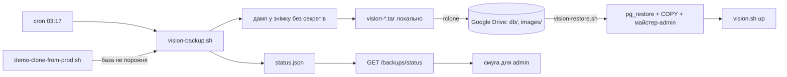

# 013 — Дизайн

## Підхід

Два bash-скрипти на хості за правилами `scripts/AGENTS.md` і невелика частина в API.

- **Бекап** (`scripts/vision-backup.sh`): дамп бази Vision без секретів і нові картинки →
  папка Google Drive через `rclone`. Шифрування немає ([ADR-0012](../../decisions/0012-backups-without-secrets.md)):
  секрети просто не потрапляють у бекап.
- **Відновлення** (`scripts/vision-restore.sh`): бекап із Drive або локальний → база Vision і
  картинки, майстер-адміністратор, решті користувачів — вхід за паролем вимкнено до нового
  пароля від адміністратора.
- **API:** стан бекапу з файлу, який пише скрипт (`backend/src/backups/`), попередження
  адміністраторам; адміністратор задає пароль користувачу (`backend/src/users/`).
- **UI:** смуга попередження для адміністраторів; кнопка «Set password» у списку користувачів.

### Дамп без секретів

`pg_dump` не вміє пропускати колонки, тож дамп складається з двох частин, знятих в одному
знімку бази (`pg_export_snapshot`), щоб зв'язки між таблицями збігалися:

1. `pg_dump -Fc --snapshot=… --exclude-table-data='"User"' --exclude-table-data='"Project"'` —
   схема й усі дані, крім цих двох таблиць;
2. `COPY (SELECT …) TO STDOUT WITH CSV HEADER` для `User` і `Project` у тій самій транзакції
   знімка, де секретні колонки замінено: `User.password` → `'!restored'` (не bcrypt-хеш, тож
   `bcryptjs.compare` завжди повертає `false`), `User.jiraToken`, `Project.jiraToken` → `NULL`.
   `User.apiKey` лишається (REQ-013-19). Перелік колонок береться з `information_schema`, тож
   нові колонки потрапляють у бекап самі, а секретні перелічено в одному місці.

Сесія, що тримає знімок, — фоновий `psql` у контейнері бази Vision, керований через FIFO
(без `coproc`: bash 3.2).

Бекап — один `vision-<UTC-час>.tar`: `db.dump`, `user.csv`, `project.csv`, `manifest.txt`
(остання міграція, кількість проєктів, збірок, знімків, еталонів, користувачів).

### Відновлення

`pg_restore --section=pre-data` → `--section=data` → `COPY "User"/"Project" FROM STDIN CSV
HEADER` → `--section=post-data`: зовнішні ключі й індекси створюються вже після даних обох
частин. Потім майстер-адміністратор (REQ-013-15): пароль хешується `bcryptjs` в одноразовому
контейнері образу API (пароль іде через stdin, не в аргументах і не в оточенні); користувач з
цим email отримує хеш і роль `admin`, а якщо його немає — створюється з новим випадковим
API-ключем. Далі `vision.sh up -d`: міграції Vision доганяють схему, якщо бекап старіший за код,
і звірка з `manifest.txt`.

## Компоненти

| Компонент | Шлях | Роль |
|---|---|---|
| Бекап | `scripts/vision-backup.sh` | без аргументів — бекап зараз, `--local-only`, `--install-cron`; дамп, tar, передача, зберігання, статус |
| Відновлення | `scripts/vision-restore.sh` | `latest` або ім'я/шлях бекапу; майстер-логін, план, `yes`, відновлення, звірка |
| Спільне | `scripts/lib/vision-backup.sh` | секретні колонки, дамп у знімку, manifest, виклик `rclone`: з хоста, якщо встановлений, інакше з образу `rclone/rclone` |
| Копія проду | `scripts/demo-clone-from-prod.sh` | перед заміною непорожньої бази викликає бекап (REQ-013-12) |
| Стан бекапу | `backend/src/backups/backup-status.ts` | чиста `backupWarning(status, now)` |
| API стану | `backend/src/backups/backups.controller.ts` | `GET /backups/status`, лише `admin` |
| Пароль від адміністратора | `backend/src/users/users.controller.ts`, `users.service.ts` | `PUT /users/:id/password`, лише `admin` |
| UI | `frontend/src/components/BackupWarning.tsx`, `frontend/src/components/UserList/ActionButtons.tsx` | смуга для адміністраторів; «Set password» |
| Compose | `docker-compose.demo.yml` | том `./demo-data/backup-status:/backup-status:ro`, `BACKUP_STATUS_FILE` |

## Дані

- Схема бази не змінюється.
- Файли на хості: `demo-data/backups/vision-*.tar` (локальні; лишаються 2 останні й усі
  ще не передані — у них немає позначки `.uploaded`), `demo-data/backup-status/status.json`
  (`lastSuccessAt`, `lastAttemptAt`, `lastError`, `pendingUploads`).
- На Drive: `<BACKUP_REMOTE>/db/vision-*.tar` (7 останніх, `BACKUP_KEEP`) і
  `<BACKUP_REMOTE>/images/` (лише докопіювання, `rclone copy --ignore-existing`, без видалень).
- Налаштування в `.env.demo`: `BACKUP_REMOTE` (наприклад, `gdrive:vision-backups`; порожньо —
  лише локальні бекапи), `BACKUP_KEEP`, `RCLONE_CONFIG_DIR` (типово `~/.config/rclone`),
  `VISION_MASTER_EMAIL`, `VISION_MASTER_PASSWORD`.
- API читає стан, лише коли задано `BACKUP_STATUS_FILE`; compose задає його, тільки якщо задано
  `BACKUP_REMOTE`, тож демо без бекапів попереджень не показує.

## Потік

## Ризики

| Ризик | Що робимо |
|---|---|
| Нова секретна колонка потрапить у бекап | секретні колонки — один перелік у `lib/vision-backup.sh`; тест перевіряє, що в CSV немає значень секретів |
| API-ключі в бекапі | папка Drive лише власника (рішення власника, ADR-0012) |
| Дамп і передача забирають CPU, диск і канал | `nice`/`ionice`, запас диска з `vision-safety.sh` перед дампом, нічний запуск |
| Відновлення поверх живих даних | план, `yes`, лише контейнер, перевірений `vision_container` |
| Google Drive недоступний | бекап лишається локально, передається наступним запуском, попередження після 26 год |
| rclone.org недоступний із сервера | rclone з Docker-образу, нічого не ставимо на хост |
| Вхід у Google без браузера | сервісний акаунт Workspace + спільний диск (у сервісного акаунта немає місця на «Моєму диску»); ключ у `RCLONE_CONFIG_DIR` |

## Перевірка вимог

| Вимога | Перевірка |
|---|---|
| REQ-013-01 | `scripts/tests/test_vision_backup.py › test_installs_a_daily_cron_line_once`; `scripts/tests/test_vision_backup.py › test_uploads_the_dump_and_new_images_to_the_remote` |
| REQ-013-03 | `scripts/tests/test_vision_backup.py › test_keeps_the_last_7_dumps_on_the_remote`; `scripts/tests/test_vision_backup.py › test_uploads_the_dump_and_new_images_to_the_remote` |
| REQ-013-05 | `scripts/tests/test_vision_backup.py › test_refuses_when_the_database_container_is_not_visions` |
| REQ-013-09 | `backend/src/backups/backup-status.spec.ts › warns when the last successful backup is older than 26 hours`; `backend/src/backups/backup-status.spec.ts › stays quiet when backups are not configured`; manual: адміністратор бачить жовту смугу під шапкою, коли бекапу понад 26 год; інші ролі — ні |
| REQ-013-10 | `scripts/tests/test_vision_backup.py › test_restores_a_backup_into_an_empty_database` |
| REQ-013-11 | `scripts/tests/test_vision_backup.py › test_keeps_the_backup_locally_and_uploads_it_on_the_next_run` |
| REQ-013-12 | `scripts/tests/test_vision_backup.py › test_backs_up_before_a_production_copy_replaces_visions_data`; `scripts/tests/test_vision_backup.py › test_replaces_nothing_when_the_backup_before_a_production_copy_fails` |
| REQ-013-13 | `scripts/tests/test_vision_backup.py › test_uploads_the_dump_and_new_images_to_the_remote`; `scripts/tests/test_vision_backup.py › test_runs_rclone_from_its_docker_image_when_it_is_not_installed` |
| REQ-013-14 | `scripts/tests/test_vision_backup.py › test_leaves_passwords_and_jira_tokens_out_of_the_backup` |
| REQ-013-15 | `scripts/tests/test_vision_backup.py › test_makes_the_master_user_an_admin_existing_or_new` |
| REQ-013-17 | `scripts/tests/test_vision_backup.py › test_other_users_cannot_log_in_with_a_password_after_a_restore`; `backend/src/auth/auth.service.spec.ts › never accepts a password against a restored placeholder` |
| REQ-013-18 | `backend/src/users/users.service.spec.ts › lets an admin set a user's password`; `frontend/integration_tests/test/userList.spec.ts › lets an admin set a user's password` |
| REQ-013-19 | `scripts/tests/test_vision_backup.py › test_restores_api_keys_unchanged` |
| REQ-013-20 | `scripts/tests/test_vision_backup.py › test_refuses_a_master_password_shorter_than_12_characters` |

Тести скриптів ганяють справжній дамп і відновлення на локальному Postgres 16 через замінник
`docker` (виконує `docker exec … pg_dump/psql/pg_restore` локально) і замінник `rclone`
(локальна папка замість Drive). Без локального Postgres ці тести пропускаються з поясненням.
Сценарій приймання на стенді зі справжнім Google Drive — T9 у tasks.md.
