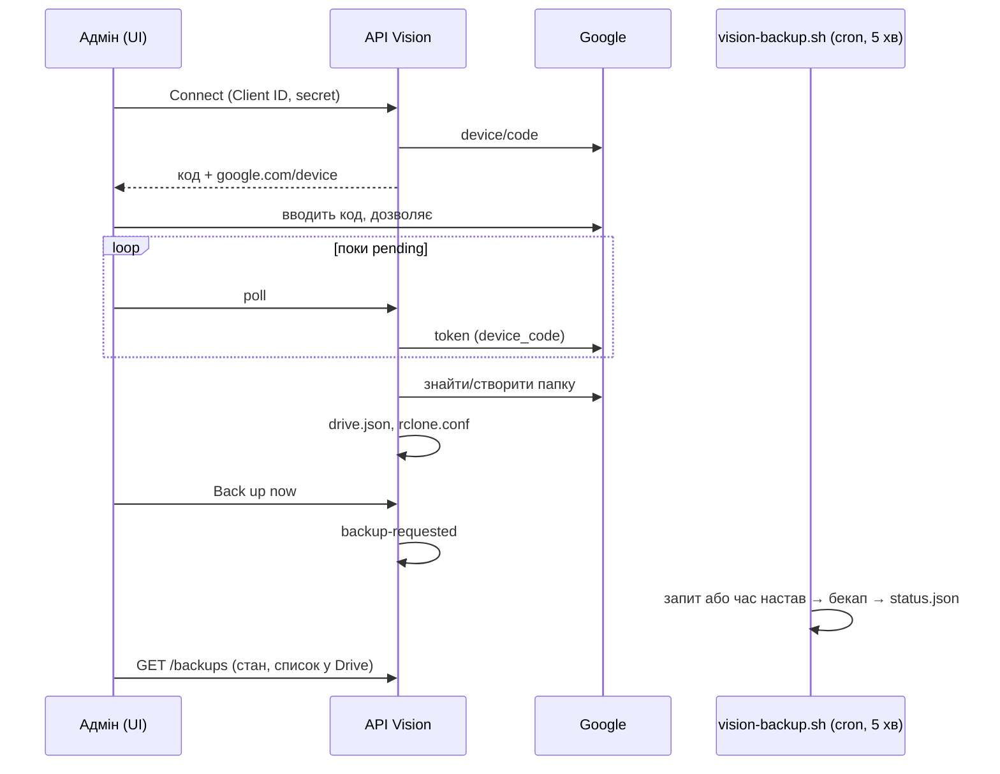

# 017 — Дизайн

## Підхід

Бекап і далі робить `scripts/vision-backup.sh` на хості ([013](../013-backups-and-secrets/design.md)):
лише він може безпечно дампити базу й зупиняти API при відновленні. API не отримує Docker socket.
Інтерфейс і скрипт обмінюються файлами в `demo-data/backup-config/`
([ADR-0013](../../decisions/0013-ui-drives-host-scripts-through-files.md)):

- API пише підключення Google Drive (`rclone.conf`, `drive.json`), налаштування (`settings.json`) і
  запит на бекап (`backup-requested`);
- скрипт читає їх і пише стан (`backup-status/status.json`), який API показує.

**Вхід у Google — device flow.** Перенаправлення OAuth потребує https або localhost, а Vision
працює за http у внутрішній мережі. API запитує код у `oauth2.googleapis.com/device/code`
(scope `openid email https://www.googleapis.com/auth/drive.file`), інтерфейс показує його й
опитує API, а API обмінює код на токен. Email береться з `id_token`, отриманого напряму від
Google по TLS, тож підпис не перевіряємо. Після входу API створює папку бекапів (або знаходить
наявну, створену цим застосунком) і записує її id як `root_folder_id` у `rclone.conf`: rclone і API
працюють з однією папкою, без дублікатів однакових назв.

**Список бекапів і перевірка** — запити API до Drive REST (`files.list`, `files.create`) з
access token, оновленим через refresh token. rclone оновлює свій access token у `rclone.conf` сам;
API цей файл переписує лише при підключенні.

**Розклад.** `--install-cron` ставить один рядок кожні 5 хвилин: `vision-backup.sh --scheduled`.
Скрипт виходить мовчки, якщо немає ні запиту, ні настання часу з `settings.json` (у часовому поясі
сервера, раз на добу), і тримає замок, щоб два бекапи не йшли одночасно.

**Власник файлів.** API в контейнері працює від root, а cron — від користувача хоста. `vision.sh`
передає compose свої `uid:gid`, і API віддає їм файли (`chown`), лишаючи права `600` на секретах.

## Компоненти

| Компонент | Шлях | Роль |
|---|---|---|
| Чиста логіка | `backend/src/backups/drive-auth.ts` | відповіді device flow → стан, email з `id_token`, текст `rclone.conf`, перевірка налаштувань, публічний вигляд підключення без секретів |
| Сервіс | `backend/src/backups/backups.service.ts` | файли конфігурації, виклики Google, запит на бекап |
| API | `backend/src/backups/backups.controller.ts` | `GET /backups`, `POST /backups/drive/connect`, `POST /backups/drive/poll`, `POST /backups/drive/test`, `DELETE /backups/drive`, `PUT /backups/settings`, `POST /backups/run`; усе лише `admin` |
| Скрипт | `scripts/vision-backup.sh`, `scripts/lib/vision-backup.sh` | `--scheduled`, замок, стан «running», віддалене сховище й кількість копій з інтерфейсу |
| Compose | `docker-compose.demo.yml`, `scripts/vision.sh` | том `backup-config` (rw), `BACKUP_CONFIG_DIR`, `BACKUP_FILES_OWNER` |
| UI | `frontend/src/pages/BackupsPage.tsx`, `frontend/src/components/Backups/` | сторінка Backups; пункт «Backups» у меню акаунта; посилання зі смуги попередження |

## Дані

Схема бази не змінюється. Файли на хості, `demo-data/backup-config/`:

| Файл | Хто пише | Що |
|---|---|---|
| `drive.json` (600) | API | Client ID і secret, refresh token, email, id і назва папки |
| `rclone.conf` (600) | API, далі rclone | remote `vision-drive` (`scope = drive.file`, `root_folder_id`, токен) |
| `settings.json` | API | `{ "time": "03:17", "keep": 7 }` |
| `backup-requested` | API, видаляє скрипт | час запиту Back up now |

`demo-data/backup-status/status.json` доповнюється полем `runningSince`. Секрети не потрапляють
у бекап: `backup-config` лежить поза базою й поза `imageUploads`.

## Потік

## Ризики

| Ризик | Що робимо |
|---|---|
| Секрет у відповіді API | відповіді будує одна функція з білого списку полів; тест перевіряє відсутність секретів |
| Root-файли, які cron не прочитає | `chown` на `BACKUP_FILES_OWNER`; без нього — попередження в журналі API |
| Два бекапи одночасно | замок-папка з pid у скрипті |
| Політика Workspace блокує OAuth-клієнт | клієнт створюється в проєкті банку з екраном згоди Internal; помилку Google показуємо дослівно |
| Токен відкликали | бекап локальний, у стані помилка rclone; сторінка пропонує перепідключити |

## Перевірка вимог

| Вимога | Перевірка |
|---|---|
| REQ-017-01 | `backend/src/backups/backups.service.spec.ts › connects Google Drive with a device code`; `frontend/integration_tests/test/backups.spec.ts › connects Google Drive with a device code` |
| REQ-017-02 | `backend/src/backups/drive-auth.spec.ts › asks Google only for the files Vision creates` |
| REQ-017-03 | `backend/src/backups/backups.service.spec.ts › never returns the client secret or tokens`; `backend/src/backups/drive-auth.spec.ts › writes the rclone remote for the backup folder` |
| REQ-017-04 | `backend/src/backups/backups.service.spec.ts › forgets the connection on disconnect` |
| REQ-017-05 | `backend/src/backups/drive-auth.spec.ts › reads the device flow answers`; `frontend/integration_tests/test/backups.spec.ts › offers to start again when Google refuses` |
| REQ-017-06 | `backend/src/backups/backups.service.spec.ts › tests the connection by finding the backup folder` |
| REQ-017-10 | `backend/src/backups/backups.service.spec.ts › lists the backups in Drive with the status` |
| REQ-017-11 | `backend/src/backups/backups.service.spec.ts › requests a backup for the host script`; `scripts/tests/test_vision_backup.py › test_runs_a_requested_backup_once`; `scripts/tests/test_vision_backup.py › test_does_not_run_two_backups_at_once` |
| REQ-017-12 | `backend/src/backups/backups.controller.spec.ts › lets only admins manage backups` |
| REQ-017-20 | `backend/src/backups/drive-auth.spec.ts › accepts a daily time and a number of copies`; `scripts/tests/test_vision_backup.py › test_runs_the_daily_backup_once_after_its_time`; `scripts/tests/test_vision_backup.py › test_installs_a_cron_line_every_5_minutes_once` |
| REQ-017-21 | `scripts/tests/test_vision_backup.py › test_uses_the_drive_connected_in_the_ui` |
