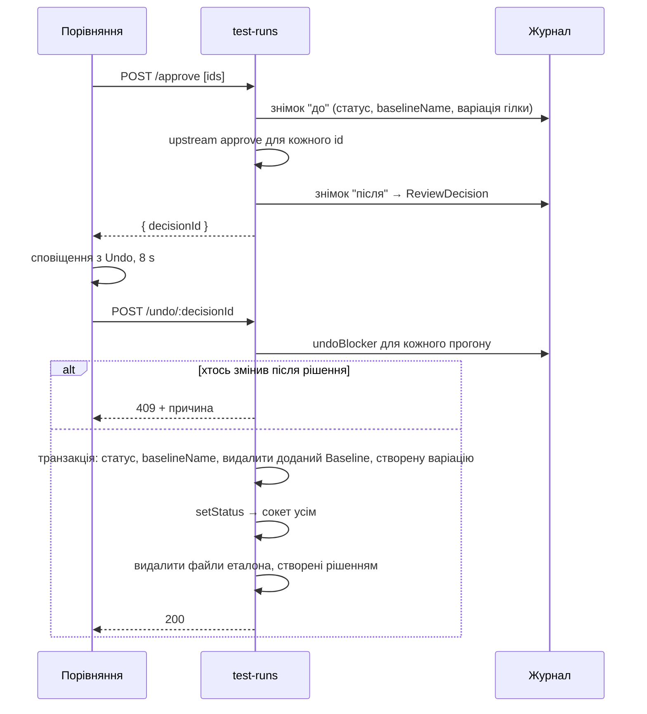

# 018 — Дизайн

## Підхід

Редизайн іде трьома шарами. Кожен шар можна злити окремо, і кожен лишає застосунок робочим.

1. **Основа:** теми, рух, бренд. Кольори стають CSS-змінними, світлі й темні значення лежать в
   одній таблиці в `theme.ts` ([ADR-0015](../../decisions/0015-theme-tokens-as-css-variables.md)).
   Наявні `tokens.*` у компонентах працюють в обох темах без змін. Тривалості й крива руху —
   об'єкт `motion` поруч; глобальне правило `prefers-reduced-motion` зводить анімації до нуля.
   Вибір теми — контекст: System, Light або Dark, у `localStorage`, перемикання колом через View
   Transitions з `flushSync`. Знак і словесний знак — SVG-компоненти з анімацією на CSS
   keyframes.
2. **Екрани:** кожен екран переходить на основу: мініатюри, групи, фільтри-чипи, хронологія,
   плитки, меню, порожні стани. Логіка відбору даних не змінюється. Нові обчислення (смужка
   діфу, крапки кроків, пошук у налаштуваннях, змінені розділи, смужки Insights, ряд бекапів,
   пошук людей) — чисті функції в `src/_helpers`, протестовані напряму.
3. **Нова поведінка:**
   - **Сторінка налаштувань проєкту** з маршрутом `/projects/:projectId/settings`. Щоб питати
     перед виходом із незбереженими змінами, `BrowserRouter` замінюємо на data router
     (`createBrowserRouter` з одним маршрутом `*`, усередині — наявні `<Routes>`): лише він дає
     `useBlocker`.
   - **Undo** через журнал рішень на сервері
     ([ADR-0014](../../decisions/0014-undo-through-decision-journal.md)).
   - **Last sign-in:** колонка в `User`.
   - **Конфлікт налаштувань:** сервер порівнює налаштування, з якими сторінку відкрили, з
     нинішніми.

Розкладку порівняння не перебудовуємо: у наявні компоненти діалогу додаємо п'ять дрібних частин.

## Компоненти

### Основа

| Компонент | Шлях | Роль |
|---|---|---|
| Токени, теми, рух | `frontend/src/theme.ts` | `palettes.light/dark` (значення), `tokens` (посилання `var(--v-*)`), `createAppTheme(mode)`, `cssVariables(mode)`, `palettes[mode]` і хук `useTokens()` для canvas, `motion` (тривалості 180/220/240/320/600 ms, крок 34 ms, крива `cubic-bezier(.16,1,.3,1)`) |
| Вибір теми | `frontend/src/_helpers/themeMode.helper.ts` | чисті функції: `resolveMode(pref, systemDark)`, `nextPreference(pref, resolved)`, `readPreference/writePreference` з try/catch |
| Контекст теми | `frontend/src/contexts/themeMode.context.tsx` | слухає `matchMedia`, тримає вибір, `toggle(fromEl)` з колом через `document.startViewTransition` (або миттєво), гаряча клавіша ⇧D поза полями вводу |
| Корінь застосунку | `frontend/src/App.tsx` | `ThemeProvider` з темою режиму, `GlobalStyles` зі змінними й правилом reduced motion, вигляд сповіщень |
| Data router | `frontend/src/index.tsx` | `RouterProvider` + `createBrowserRouter([{ path: "*", element: <App/> }])` |
| Знак і словесний знак | `frontend/src/components/BrandMark.tsx` | «Гніздо» (маска з вирізом, піксель), `Wordmark` з квадратними крапками; анімація раз при монтуванні й при наведенні |
| Favicon | `frontend/public/favicon.svg`, `frontend/public/favicon.png` | новий знак; PNG рендерить скрипт через Playwright |
| Скрипт favicon | `frontend/scripts/render-favicon.mjs` | SVG → PNG 32/180 px |
| Шрифти | `frontend/src/index.tsx` | `@fontsource/jetbrains-mono`, `@fontsource/geist-sans` (600–700, для словесного знака) — локально, без CDN |
| Рух | `frontend/src/_helpers/motion.helper.ts` | `staggerDelay(i)`, `countUp(value, t)`, `prefersReducedMotion()` |
| Хук лічильника | `frontend/src/components/motion/useCountUp.tsx` | доводить число до значення за 600 ms, одразу при reduced motion |
| Каскад | `frontend/src/components/motion/Stagger.tsx` | `staggered(i)`: клас входу й затримка рядка каскаду |
| Сегменти | `frontend/src/components/motion/SlidingToggleGroup.tsx` | `ToggleButtonGroup`, підсвітка якого переїжджає; `rememberAs` — для перемикача, що монтується наново (Table/Grid) |
| Заготовки | `frontend/src/components/SkeletonList.tsx` | відблиск замість спінера |

### Шапка, навігація, меню

| Компонент | Шлях | Роль |
|---|---|---|
| Шапка | `frontend/src/components/Header.tsx` | знак, кнопка теми, меню «?» (Guided tour, Manual checks, Report a problem, версія), меню акаунта (ім'я, пошта, роль, Profile, Users, Backups, тема з ⇧D, Log out) |
| Ліва навігація | `frontend/src/components/NavRail.tsx` | підсвітка, що переїжджає |
| Тур | `frontend/src/components/GuidedTour.tsx`, `frontend/src/components/GuidedTour.locators.ts` | кроки під нові елементи |

### Порівняння (розкладка без змін)

| Компонент | Шлях | Роль |
|---|---|---|
| Смужка діфу | `frontend/src/components/TestDetailsDialog/DiffMeter.tsx` | відсоток, заповнення, риска допуску |
| Крапки кроків | `frontend/src/components/TestDetailsDialog/StepDots.tsx` | стан кожного кроку |
| Чисті функції ревю | `frontend/src/_helpers/review.helper.ts` | `diffMeter(diff, tolerance)`, `stepStates(ids, current, decided)`, `hotkeyLabel` |
| Кнопки | `frontend/src/components/TestDetailsDialog/ApproveRejectButtons.tsx` | підписи A і X, галочка 420 ms, сповіщення з Undo |
| Діалог | `frontend/src/components/TestDetailsDialog/TestDetailsModal.tsx` | крапки, напрямок переходу кроків, знімки без анімацій після появи |
| Підсвітка рамок | `frontend/src/components/TestDetailsDialog/InsightsPanel.tsx`, `frontend/src/components/TestDetailsDialog/DrawArea.tsx` | наведення на пункт → обвідка рамки на Konva; кольори з `useTokens()` (`frontend/src/contexts/themeMode.context.tsx`) |

### Налаштування проєкту

| Компонент | Шлях | Роль |
|---|---|---|
| Сторінка | `frontend/src/pages/ProjectSettingsPage.tsx` | маршрут, зміст, пошук, панель збереження, `useBlocker`, конфлікт |
| Розділи | `frontend/src/components/ProjectForm/ProjectForm.tsx`, `frontend/src/components/ProjectForm/A11yProblemSettings.tsx` | старий діалог розкладено на `GeneralFields`, `ReviewFields`, `ComparisonFields` (картки движків і параметри лише обраного), `MobileSettings` (`show="mobile"` / `"rules"`, `bare`), `A11yProblemSettings` (нумерація класів, «How matching works»), `JiraSettings`; поля й їхня логіка ті самі |
| Секрети | `frontend/src/components/ProjectForm/SecretField.tsx`, `frontend/src/components/ProjectForm/GeminiConfigForm.tsx` | «Saved» з Replace і Remove для спільного токена Jira і ключа Gemini |
| Чисті функції | `frontend/src/_helpers/projectSettings.helper.ts` | `matchSettings(rows, query)`, `changedSections(saved, edited)`, `ruleSelectorError(text)`, `deleteConfirmed(name, typed)` |
| Новий проєкт | `frontend/src/components/ProjectForm/ProjectForm.tsx` (`NewProjectFields`), `frontend/src/components/BaseModal.tsx` | три поля → створити → перейти на налаштування; `submitDisabled` для підтвердження назвою |
| Список проєктів | `frontend/src/pages/ProjectListPage.tsx` | олівець → сторінка; кошик → те саме підтвердження назвою |
| Маршрути | `frontend/src/constants/routes.ts`, `frontend/src/Router.jsx` | `PROJECT_SETTINGS_PAGE` |
| Конфлікт на сервері | `backend/src/projects/settings-conflict.ts` | чиста `settingsConflict(loaded, current)` → назви змінених полів |
| Збереження | `backend/src/projects/projects.service.ts`, `backend/src/projects/dto/update-project.dto.ts`, `frontend/src/services/projects.service.ts` | необов'язкові `loadedSettings` і `force`; без них поводиться як зараз; `updateSettings` на фронтенді розпізнає 409 |
| Ключ Gemini | `backend/src/projects/project-secrets.ts` | API не повертає `apiKey` з налаштувань порівняння, лише `geminiApiKeySet`; при збереженні відсутній ключ лишає збережений, порожній видаляє |

### Інші екрани

| Компонент | Шлях | Роль |
|---|---|---|
| Збірка | `frontend/src/pages/ProjectPage.tsx`, `frontend/src/components/BuildList/index.tsx`, `frontend/src/components/BuildDetails.tsx` | смуга статусів, лічильники, вкладки |
| Групи змін | `frontend/src/components/ChangeGroups.tsx` | згортувані картки, дії в заголовку, портретні мініатюри |
| Сітка тестів | `frontend/src/components/TestRunList/TestRunGrid.tsx`, `frontend/src/components/TestRunList/TestRunListControls.tsx` | портретні картки за пропорцією знімка; фільтри в рядок |
| Доступність збірки | `frontend/src/components/A11ySummary.tsx` | плитки, мініатюри з рамками |
| Еталони | `frontend/src/pages/TestVariationListPage.tsx`, `frontend/src/components/TestVariationList.tsx`, `frontend/src/components/Filters.tsx`, `frontend/src/components/TestVariationMergeForm.tsx` | чипи-фільтри, Merge branches |
| Історія еталона | `frontend/src/pages/TestVariationDetailsPage.tsx`, `frontend/src/components/TestVariationDetails.tsx` | хронологія і пара «цей / попередній» |
| Insights | `frontend/src/pages/InsightsPage.tsx`, `frontend/src/_helpers/insights.helper.ts` | плитки, `barShare(value, max)` |
| Профіль | `frontend/src/pages/ProfilePage.tsx`, `frontend/src/components/JiraTokenCard.tsx` | Appearance, API key із Show і Copy, вкладки прикладів |
| Користувачі | `frontend/src/pages/UserListPage.tsx`, `frontend/src/components/UserList/index.tsx`, `frontend/src/_helpers/users.helper.ts` | пошук `filterUsers`, колонка Last sign-in |
| Бекапи | `frontend/src/pages/BackupsPage.tsx`, `frontend/src/components/Backups/DriveCard.tsx`, `frontend/src/_helpers/backups.helper.ts` | три картки, `dayStrip(backups, today, 14)` |
| Вхід | `frontend/src/components/AuthLayout.tsx`, `frontend/src/components/LoginForm.tsx`, `frontend/src/components/RegisterForm.tsx` | великий знак, піксельна сітка, перехід вхід ↔ реєстрація |
| Ручні перевірки | `frontend/src/components/ManualChecksDialog.tsx` | кроки з копіюванням |
| Стани | `frontend/src/components/EmptyState.tsx`, `frontend/src/components/RouteError.tsx` | `EmptyState` і `ErrorState` (причина й Try again); `RouteError` замість екрана розробника react-router |
| Діалоги | `frontend/src/components/motion/GrowFromPointer.tsx` | кожен діалог виростає з точки, де клацнули (тема MUI, `MuiDialog`) |
| Профіль: картки | `frontend/src/components/ApiKeyCard.tsx`, `frontend/src/components/AppearanceCard.tsx` | ключ схований до Show, Copy; System / Light / Dark |

### Undo і останній вхід

| Компонент | Шлях | Роль |
|---|---|---|
| Журнал рішень | `backend/src/test-runs/decision-undo.ts` | чисті `snapshotOf(testRun, variation)`, `undoPlan(before, after)`, `undoBlocker(item, current)` |
| Сервіс Undo | `backend/src/test-runs/decision-undo.service.ts` | записує журнал навколо approve і reject; `undo(decisionId, userId)` у транзакції; потім видаляє створені рішенням файли |
| Ендпоінти | `backend/src/test-runs/test-runs.controller.ts` | `approve` і `reject` повертають `{ decisionId }` (раніше порожньо); `POST /test-runs/undo/:decisionId` |
| Сповіщення з Undo | `frontend/src/components/useDecisionSnackbar.tsx`, `frontend/src/_helpers/undo.helper.ts` | 8 s, Undo, повідомлення про відмову |
| Сервіс фронтенду | `frontend/src/services/testRun.service.ts` | `approveBulk`, `rejectBulk` повертають `decisionId`; `undoDecision` |
| Останній вхід | `backend/src/users/users.service.ts`, `backend/src/users/dto/user.dto.ts` | після успішного `login` і `oidcHandleCallback` записує час; `UserDto.lastSignInAt` |

## Дані

Лише додавальні зміни ([ADR-0003](../../decisions/0003-additive-schema-only.md)).

```sql
-- новий nullable-стовпець: старі рядки отримують NULL ("—" у списку), нічого не переписується
ALTER TABLE "User" ADD COLUMN "lastSignInAt" TIMESTAMP(3);

-- нова таблиця: журнал рішень для Undo; ні на що не посилається зовнішнім ключем,
-- тож видалення прогонів і варіацій upstream-кодом її не зачіпає
CREATE TABLE "ReviewDecision" (
  "id" TEXT PRIMARY KEY,
  "userId" TEXT,
  "kind" TEXT NOT NULL,          -- approve | reject
  "items" JSONB NOT NULL,        -- [{ testRunId, before, after }] на кожен прогін
  "createdAt" TIMESTAMP(3) NOT NULL DEFAULT CURRENT_TIMESTAMP,
  "undoneAt" TIMESTAMP(3)
);
CREATE INDEX "ReviewDecision_createdAt_idx" ON "ReviewDecision"("createdAt");
```

- `items` — кілька сотень байтів на прогін; рядок не розсилається сокетом. Записи, старші за
  7 днів, сервіс видаляє при наступному записі.
- Вибір теми — `localStorage["vision.theme"]` = `light` | `dark`; відсутність означає System.
- Налаштування проєкту не змінюються. `loadedSettings` у запиті збереження — копія полів
  налаштувань на момент відкриття сторінки; у базу не пишеться.

## Потік



Undo на сервері дозволене до 30 s після рішення: це запас на мережу. Кнопку інтерфейс показує
8 s.

## Ризики

| Ризик | Що робимо |
|---|---|
| Злиття з upstream VRT стануть важчими: редизайн зачіпає майже всі файли фронтенду | Ділимо на три шари з окремими комітами; логіку upstream (approve, фільтри, сервіси) не переписуємо, лише вигляд і обгортки |
| Approve upstream почне змінювати ще щось, і Undo відновлюватиме не все | Тест відновлення порівнює повний стан до approve і після undo; новий ефект approve його зламає |
| Недостатній контраст у темній темі (пігулки, підписи DataGrid) | `theme.test.ts` перевіряє кожну текстову пару; DataGrid і react-joyride отримують стилі з тих самих змінних |
| Konva-полотно не розуміє CSS-змінних | `useTokens()` дає справжні кольори; полотно перемальовується при зміні теми |
| Скриншот-еталони Playwright зміняться всі | Генеруємо в Docker ([ADR-0011](../../decisions/0011-screenshot-baselines-in-docker.md)), кожен переглядаємо |
| View Transitions є не в усіх браузерах | Перевірка `document.startViewTransition`; без неї тема змінюється миттєво |
| Перехід на data router зачепить навігацію | `PrivateRoute.test.tsx` і всі Playwright-тести маршрутів мають лишитись зеленими до інших змін |
| Шрифти з npm збільшують збірку | Лише потрібні накреслення (Geist 600–700, JetBrains Mono 400–600, латиниця й кирилиця); ≤ 250 KB woff2 разом |

## Перевірка вимог

| Вимога | Перевірка |
|---|---|
| REQ-018-01 | `frontend/src/theme.test.ts › every token has a light and a dark value` |
| REQ-018-02 | `frontend/src/_helpers/themeMode.helper.test.ts › follows the system until the user picks a theme` |
| REQ-018-03 | `frontend/integration_tests/test/theme.spec.ts › switches theme with the header button and with Shift+D, and remembers it` |
| REQ-018-04 | `frontend/integration_tests/test/theme.spec.ts › Appearance System forgets the choice and follows the system again` |
| REQ-018-05 | `frontend/src/_helpers/themeMode.helper.test.ts › ends with the soft edge past the farthest corner`; manual: Chrome, клацнути кнопку теми — нова тема розходиться колом з м'яким краєм ~0.7 s, без ривків уздовж країв і без спалаху в кінці; Firefox без View Transitions — тема змінюється миттєво. Перевірено 2026-10-29 у Chromium (1440×900 і 800×374): запис кожного кадру, середня яскравість спадає плавно, без стрибків угору; справжній Firefox не запускали |
| REQ-018-06 | `frontend/integration_tests/test/theme.spec.ts › screenshots keep their pixels in the dark theme` |
| REQ-018-07 | `frontend/src/theme.test.ts › text on every surface has at least 4.5:1 in both themes` |
| REQ-018-08 | `frontend/src/theme.test.ts › keeps magenta for differences and orange for accessibility in both themes` |
| REQ-018-10 | `frontend/src/components/BrandMark.test.tsx › draws the nest mark and the two square dots` |
| REQ-018-11 | `frontend/src/components/BrandMark.test.tsx › has no magenta at rest` |
| REQ-018-12 | `frontend/src/components/BrandMark.test.tsx › plays once on mount and again on hover` |
| REQ-018-20 | `frontend/src/theme.test.ts › motion durations stay between 180 and 320 ms with one easing` |
| REQ-018-21 | `frontend/src/_helpers/motion.helper.test.ts › staggers rows by 34 ms and ends the cascade by 700 ms` |
| REQ-018-22 | `frontend/integration_tests/test/motion.spec.ts › highlights travel to the new item instead of jumping` (рейка, вкладка збірки, сегмент Table/Grid); Appearance — той самий `SlidingToggleGroup` |
| REQ-018-23 | `frontend/src/_helpers/motion.helper.test.ts › counts up to the value in 600 ms` |
| REQ-018-24 | manual: Add project, видалення проєкту, «?» → Manual checks, Report bug in Jira — кожен діалог виростає з того, на що клацнули. Перевірено 2026-10-29 у Chromium для перших трьох: `transform-origin` контейнера = точка кліку; Jira-діалог бере той самий `GrowFromPointer` з теми |
| REQ-018-25 | `frontend/integration_tests/test/motion.spec.ts › screenshots do not move after the step appears` |
| REQ-018-26 | `frontend/integration_tests/test/motion.spec.ts › reduced motion turns every animation off` |
| REQ-018-27 | manual: сповільнити мережу в DevTools до Slow 3G, відкрити збірку — заготовки з відблиском у списку й таблиці, спінера на весь екран немає. Перевірено 2026-10-29: відповідь API затримана на 2.5 s — три заготовки з відблиском, видимого спінера немає |
| REQ-018-30 | `frontend/integration_tests/test/testDetailsDialog.spec.ts › keeps the review layout and its keys` |
| REQ-018-31 | `frontend/src/_helpers/review.helper.test.ts › puts the tolerance mark and the diff on one scale` |
| REQ-018-32 | `frontend/src/_helpers/review.helper.test.ts › marks each step as current, approved, rejected or waiting` |
| REQ-018-33 | `frontend/integration_tests/test/testDetailsDialog.spec.ts › shows the A and X keys on Approve and Reject` |
| REQ-018-34 | manual: у порівнянні → — пара знімків іде вліво, наступна заходить справа; ← — навпаки. Перевірено 2026-10-29 у Chromium: на → панелі посередині руху зсунуті вправо (+3 px), на ← — вліво (−6 px) |
| REQ-018-35 | `frontend/integration_tests/test/testDetailsDialog.spec.ts › shows a check on Approve instead of a toast` |
| REQ-018-36 | manual: навести на пункт Changed areas або на проблему доступності — на знімку обводиться її рамка. Перевірено 2026-10-29 для Changed areas: рамка з'являється на знімку й зникає, коли курсор іде; для проблем доступності не перевіряли |
| REQ-018-40 | `frontend/integration_tests/test/projectSettings.spec.ts › opens the settings page from the pencil and by its address` |
| REQ-018-41 | `frontend/integration_tests/test/projectSettings.spec.ts › lists the sections and highlights the one in view` |
| REQ-018-42 | `frontend/integration_tests/test/projectSettings.spec.ts › saves every field the old dialog had` |
| REQ-018-43 | `frontend/src/_helpers/projectSettings.helper.test.ts › finds settings by section or field name` |
| REQ-018-44 | `frontend/integration_tests/test/projectSettings.spec.ts › shows only the chosen engine's settings` |
| REQ-018-45 | `frontend/integration_tests/test/projectSettings.spec.ts › shows a dependent field only when its switch is on` |
| REQ-018-46 | `frontend/integration_tests/test/projectSettings.spec.ts › numbers problem classes and moves one up` |
| REQ-018-47 | `frontend/src/_helpers/projectSettings.helper.test.ts › names the sections with unsaved changes` |
| REQ-018-48 | `frontend/integration_tests/test/projectSettings.spec.ts › asks before leaving with unsaved changes` |
| REQ-018-49 | `frontend/src/_helpers/projectSettings.helper.test.ts › deletes only after the exact project name` |
| REQ-018-50 | `frontend/integration_tests/test/projectSettings.spec.ts › shows saved secrets as Saved and never their value` |
| REQ-018-51 | `frontend/src/_helpers/projectSettings.helper.test.ts › refuses an element rule without id:, class: or text:` |
| REQ-018-52 | `frontend/integration_tests/test/projectList.spec.ts › creates a project from three fields and opens its settings` |
| REQ-018-53 | `backend/src/projects/settings-conflict.spec.ts › reports settings someone changed after the page was opened` |
| REQ-018-60 | `frontend/integration_tests/test/testRunGrid.spec.ts › shows phone screenshots as portrait cards` |
| REQ-018-61 | `frontend/integration_tests/test/projec.spec.ts › collapses a change group from its header` |
| REQ-018-62 | `frontend/integration_tests/test/testVariationList.spec.ts › filters with chips and hides merge behind a button` |
| REQ-018-63 | `frontend/integration_tests/test/testVariationDetails.spec.ts › shows the picked baseline next to the one before` |
| REQ-018-64 | `frontend/src/_helpers/insights.helper.test.ts › sizes each bar against the largest value of its table` |
| REQ-018-65 | `frontend/integration_tests/test/roles.spec.ts › account menu shows Users and Backups only to admins` |
| REQ-018-66 | `frontend/integration_tests/test/errors.spec.ts › shows the reason and Try again when a page fails to load` |
| REQ-018-67 | `frontend/integration_tests/test/guidedTour.spec.ts › should display all tour steps` |
| REQ-018-68 | `frontend/integration_tests/test/profile.spec.ts › hides the API key until Show and copies it` |
| REQ-018-69 | `frontend/src/_helpers/backups.helper.test.ts › marks each of the last 14 days with or without a backup` |
| REQ-018-70 | `frontend/src/_helpers/undo.helper.test.ts › offers Undo for 8 seconds` |
| REQ-018-71 | `backend/src/test-runs/decision-undo.spec.ts › restores status and baseline as they were before approve` |
| REQ-018-72 | `backend/src/test-runs/decision-undo.spec.ts › undoes a bulk decision all or nothing` |
| REQ-018-73 | `backend/src/test-runs/decision-undo.spec.ts › refuses undo when someone changed the run after the decision` |
| REQ-018-80 | `backend/src/users/users.service.spec.ts › records the sign-in time on password and SSO sign-in only` |
| REQ-018-81 | `frontend/integration_tests/test/userList.spec.ts › shows last sign-in or a dash` |
| REQ-018-82 | `frontend/src/_helpers/users.helper.test.ts › finds people by first name, last name or email, any case` |
