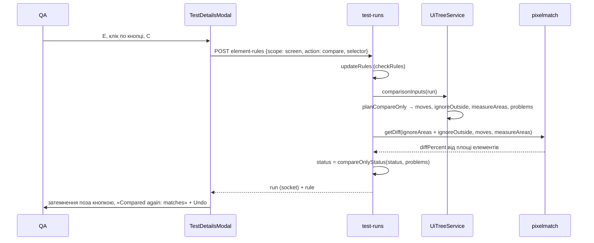

# 024 — Дизайн (разом із 015)

Цей дизайн реалізує дві специфікації; посилання «015/NN» — на вимоги REQ‑015‑NN. [015](../015-compare-selected-elements/spec.md) описує, як
рахується «порівнювати лише», а [024](spec.md) — екран порівняння. Макет:
[Elements instead of areas](https://claude.ai/artifact/J6iTa3meUu4nCQgkibs871).

## Підхід

**Бекенд: «порівнювати лише» — ще одна дія правила елемента.** Правила вже лежать у
`Project.uiTreeSettings` (JSON): `elementRules` для всього проєкту, `checkRules` для перевірки.
До `ignore` і `tolerate` додаємо дію `compare`. Колонок і міграцій не треба. Правило `compare`
можна покласти лише в `checkRules` (015/23).

Що робити з пікселями, вирішує чиста функція `planCompareOnly` у новому
`backend/src/ui-tree/compare-only.ts`. Вона бере правила `compare`, дерево еталона й дерево знімка
та повертає три речі.

1. **Пари елементів.** Збіги кожного селектора в обох деревах сортуються за `(y, x)` і
   зіставляються по черзі (015/14). Пара однакового розміру (±1 px) стає зсувом (`move`):
   наявний `shiftBaseline` копіює елемент еталона туди, де він у знімку. Тож зсунута кнопка
   порівнюється сама з собою (015/11).
2. **Що порівнюється.** Прямокутники елементів знімка (`keep`) і доповнення до них до меж знімка
   (`ignoreOutside`). Доповнення лягає в звичайні ігноровані області (015/10). Правила
   `ignore`, області з тестів і намальовані області діють як і раніше. Ті, що лежать усередині
   `keep`, і далі нічого не рахують (015/13, REQ-024-17).
3. **Проблеми,** без яких піксельне порівняння збрехало б:
   - елемент є лише з одного боку;
   - різна кількість збігів;
   - змінився розмір;
   - правило нічого не знайшло;
   - немає дерева.

   Будь-яка з них відправляє знімок на рев'ю, хай що каже порівняння пікселів (015/12,
   015/20, 015/21, 015/22). Проблеми не зберігаються: `structure()` рахує їх щоразу
   для показу. Статус змінює та сама функція в `calculateDiff`, яку викликають і прийом знімка,
   і повторне порівняння.

**Відсоток різниці для «порівнювати лише» рахуємо від площі обраних елементів, а не від усього
знімка.** Інакше зміна, яка вкрила всю кнопку, дає 0,7 % екрана і ховається під допуском
перевірки. У `computePixelmatchDiff` з'являється необов'язкове `measureAreas`. Без нього все
працює як раніше. Рішення має наслідки для Insights і порогів, тому його винесено в
[ADR-0018](../../decisions/0018-compare-only-measures-compared-elements.md).

**Фронтенд: усе, що зараз у вкладці Changes і в рядку областей, переїжджає на знімок.**
- `TestDetailsModal` тримає режим вибору (він уже має `pickMode`). Замість `ignoreAreasToolbar`
  у рядку інструментів стоять три кнопки: «Select elements», `AreasMenu` і перемикач позначок.
- `ElementPopover` показується поруч з обраним елементом. Нічого не зберігає сам: викликає
  наявний `insightsService.addElementRule` / `removeElementRule`.
- Що під курсором, що є батьком, скільки збігів у селектора, вирішують чисті хелпери. Вони
  тестуються jest без Konva.
- Позначки правил малює `DrawArea`. У нього вже є `overlayRects`, до них додаються стилі
  штриховки й затемнення поза областями.

## Компоненти

| Компонент | Шлях | Роль |
|---|---|---|
| Дія правила `compare`, межі збігів по деревах | `backend/src/ui-tree/comparison-inputs.ts` | `ElementRuleAction` += `'compare'`. `resolveRules` пропускає `compare` (його бере `planCompareOnly`) і повертає для кожного правила його прямокутники окремо в еталоні й у знімку (`boundsByRule`) та кількість збігів у кожному дереві (015/31, REQ-024-20, REQ-024-24). |
| План «порівнювати лише» | `backend/src/ui-tree/compare-only.ts` (новий) | `planCompareOnly(rules, baselineTree, tree, size)` → `{ moves, keep, ignoreOutside, problems }`; `compareOnlyStatus(status, problems)` → `unresolved`, якщо є проблеми. Чисті функції. |
| Елемент під областю | `backend/src/ui-tree/area-elements.ts` (новий) | `elementForArea(area, tree)`: елемент, з яким область перекривається щонайменше на 90 % площі кожного (REQ-024-50). Його беруть і підказки про шум (REQ-024-40), і пропозиція замінити область. |
| Входи порівняння | `backend/src/ui-tree/ui-tree.service.ts` | `comparisonInputs` додає `compareOnly` (план, `measureAreas`) і зливає зсуви плану з компенсацією зсувів. Якщо в перевірки є `compare`-правило, а дерева немає, повертає проблему `no-tree` (015/22). `structure()` повертає `compareOnly` (`keep` і `problems`), межі правил по деревах, `baselineElements`, `parent` для кожного елемента, `element` у підказках і `areaSuggestions`. |
| Пікселі | `backend/src/compare/libs/pixelmatch/pixelmatch.core.ts`, `pixelmatch.service.ts`, `backend/src/compare/libs/ImageCompareInput.ts` | Необов'язкове `measureAreas`: `diffPercent` рахується від їхньої площі ([ADR-0018](../../decisions/0018-compare-only-measures-compared-elements.md)). |
| Статус і правила | `backend/src/test-runs/test-runs.service.ts` | `calculateDiff` передає `measureAreas` і застосовує `compareOnlyStatus`. `addElementRule` відмовляє `compare` для `project` (400). Новий `replaceAreaWithElement` прибирає область і додає правило `ignore` для екрана, а потім порівнює один раз (REQ-024-51). |
| API | `backend/src/test-runs/dto/element-rule.dto.ts`, `backend/src/test-runs/test-runs.controller.ts` | `action` ∈ `ignore`, `tolerate`, `compare`; `POST /test-runs/:id/ignore-areas/replace-with-element` `{ areaId, selector }` → `{ rule }`. |
| Типи й виклики | `frontend/src/types/insights.ts`, `frontend/src/services/insights.service.ts` | Дзеркало нових полів `StructureInfo`; `compare` у `addElementRule`; `replaceAreaWithElement`. |
| Вибір елементів | `frontend/src/_helpers/elementPicking.helper.ts` (новий) | `elementAt(point, elements)` — найменший, `parentOf` / `childOf`, `countBySelector`, `toggleSelection` (Shift) (REQ-024-02…05). |
| Що порівнюється | `frontend/src/_helpers/whatsCompared.helper.ts` (новий) | `summarize(structure, areas)` → `whole` / `except N` / `only N` + кількість областей; `groupRules` → Compared only / Ignored / Allowed changes / Pixel areas (REQ-024-22, REQ-024-23). |
| Підказка біля елемента | `frontend/src/components/TestDetailsDialog/ElementPopover.tsx` (новий) | Назва, ↑ / ↓, «⋯» (повна форма правила, REQ-024-10); Ignore / Compare only / Allow N % з клавішами I, C, T; This screen / All screens (All screens вимкнене для Compare only, REQ-024-16); наявне правило → «Remove rule» (REQ-024-09). |
| Меню областей | `frontend/src/components/TestDetailsDialog/AreasMenu.tsx` (новий) | Вміст колишнього `ignoreAreasToolbar` з підписами; лічильник `ignoreAreas` + `tempIgnoreAreas`; «Use element» біля області з пропозицією; питання про незбережене (REQ-024-30…34, REQ-024-50). |
| Блок «What's compared» | `frontend/src/components/TestDetailsDialog/WhatsCompared.tsx` (новий) | Підсумок, правила за групами, проблеми «порівнювати лише». Селектор і «found» — у підказці рядка. Наведення підсвічує елементи (REQ-024-22…24, 015/20…22, 015/31). |
| Екран порівняння | `frontend/src/components/TestDetailsDialog/TestDetailsModal.tsx` | Рядок інструментів; режим вибору: E, Esc, Shift, ↑ / ↓; Undo для правила (REQ-024-07). |
| Панель | `frontend/src/components/TestDetailsDialog/InsightsPanel.tsx` | Без «Pick element» і без «Rules for this screen» (їх замінює `WhatsCompared`). Підказка про шум з елементом → «Ignore» (REQ-024-40). У рядку зміненої області — Ignore і «⋯» з Compare only та Allow changes (REQ-024-41). |
| Полотно | `frontend/src/components/TestDetailsDialog/DrawArea.tsx` | `OverlayRect.style`: `hatch` / `dashed` / `solid`; `dimOutside?: Rect[]` — затемнення поза областями (REQ-024-20, 015/30). |
| Undo правила | `frontend/src/components/useRuleSnackbar.tsx` (новий) | Як `useDecisionSnackbar`: 8 s, Undo → `removeElementRule` (або повернути область після заміни). |
| Тексти | `frontend/src/i18n/en.ts`, `frontend/src/i18n/uk.ts` | Нові ключі `select.*`, `areas.*`, `compared.*`. Невживані ключі `review.ignoreAreas` / `review.compareArea` прибираємо. |

## Дані

Міграцій немає.

- **Правила.** Правило `{ action: 'compare' }` лягає в `checkRules` у тому самому JSON
  `Project.uiTreeSettings`. Старий `parseUiTreeSettings` пропускає правила як є. Старий
  `resolveRules` правило з невідомою дією вважав би «допуском», тому нова дія з'являється разом
  із кодом, що її розуміє.
- **Області.** `TestRun.ignoreAreas`, `tempIgnoreAreas` і `TestVariation.ignoreAreas` не
  змінюються. «Compare Area» і далі зберігається як ігноровані прямокутники навколо, як в
  upstream VRT.
- **Вибір перемикача позначок** живе в `localStorage` браузера. Профілю користувача він не
  потребує, бо стосується лише вигляду.

## Потік

## Ризики

| Ризик | Що робимо |
|---|---|
| Інші рушії (odiff, looks-same, VLM) не знають `moves` і `measureAreas` | Для них «порівнювати лише» = ігнорувати все поза елементами без вирівнювання. Рушій за замовчуванням — pixelmatch, і проєкти Vision працюють на ньому. Інші рушії дістають той самий план, а проблеми (зник, розмір, кількість) працюють для всіх, бо їх рахує дерево, а не пікселі. |
| Знімок і еталон різного розміру | `scaleImageToSize` не розтягує, а доповнює менший знімок до більшого від лівого верхнього кута, тож межі з дерева лишаються в тих самих пікселях. `planCompareOnly` бере полотно за більшими розмірами двох дерев. |
| Доповнення до `keep` — багато прямокутників (кілька елементів) | `complement` ріже полотно смугами за `y`: ≤ 2·n + 1 смуга на n елементів. Зміни елементів поза обраними відсіює `insideCompared`, бо зміна на межі двох смуг не лежить у жодній. |
| `diffPercent` для таких знімків не порівнюваний з іншими в Insights | ADR-0018; Insights рахують знімки, а не відсотки. Підказка над відсотком у рядку інструментів каже, від чого він рахується. |
| Клавіші I, C, T, E, ↑, ↓ конфліктують з A, X, ←/→, D | Не конфліктують: I, C, T, ↑, ↓ слухає лише відкрита підказка біля елемента, E — кнопка «Select elements». Esc у режимі вибору спершу закриває підказку, потім режим, і лише тоді — порівняння (тест «stays in selection until Esc»). |
| Специфікація 020 з паралельної гілки прибирає вкладку Devices і попередження про знімок у тих самих файлах (`InsightsPanel`, `TestDetailsModal`) | Проблеми «порівнювати лише» не залежать від `captureWarnings`. Перед злиттям — rebase на свіжий `vision/main`; хто зливається другим, той розв'язує конфлікти. |
| вимога 02 специфікації 019 вимагає показувати селектор і кількість, а макет їх сховав | Вони в підказці рядка правила (наведення). Тест Playwright читає їх звідти. |
| Без змін у шляху SDK тести, що надсилають `ignoreAreas`, мають працювати як раніше | REQ-024-31: наявні тести `ignoreAreas.spec.ts` і `test-runs.service.spec.ts` про області не змінюються, лише UI-шлях до інструментів. |

## Перевірка вимог

| Вимога | Перевірка |
|---|---|
| REQ-024-01 | `frontend/integration_tests/test/elementSelection.spec.ts › offers Select elements to editors of a screenshot with a UI tree` |
| REQ-024-02 | `frontend/src/_helpers/elementPicking.helper.test.ts › picks the smallest element under the pointer on either screenshot` |
| REQ-024-03 | `frontend/integration_tests/test/elementSelection.spec.ts › shows actions next to a clicked element` |
| REQ-024-04 | `frontend/src/_helpers/elementPicking.helper.test.ts › steps to the parent and back` |
| REQ-024-05 | `frontend/src/_helpers/elementPicking.helper.test.ts › adds elements to the selection with Shift`; `frontend/integration_tests/test/elementSelection.spec.ts › adds one rule per selected element` |
| REQ-024-06 | `frontend/integration_tests/test/elementSelection.spec.ts › ignores a clicked element and compares again` |
| REQ-024-07 | `frontend/integration_tests/test/elementSelection.spec.ts › undoes a rule from the notice` |
| REQ-024-08 | `frontend/integration_tests/test/elementSelection.spec.ts › stays in selection until Esc` |
| REQ-024-09 | `frontend/integration_tests/test/elementSelection.spec.ts › offers to remove the rule an element is under` |
| REQ-024-10 | `frontend/integration_tests/test/elementSelection.spec.ts › opens the full rule form from the element` |
| REQ-024-11 | `frontend/integration_tests/test/elementSelection.spec.ts › shows actions next to a clicked element` |
| REQ-024-12 | `frontend/integration_tests/test/elementSelection.spec.ts › keeps the Select elements label while selecting` |
| REQ-024-15 | `frontend/integration_tests/test/elementSelection.spec.ts › compares only a picked element` |
| REQ-024-16 | `frontend/integration_tests/test/elementSelection.spec.ts › keeps compare only to this screen`; `backend/src/test-runs/test-runs.service.spec.ts › refuses a compare-only rule for every screen` |
| REQ-024-17 | `backend/src/ui-tree/compare-only.spec.ts › keeps ignored elements and areas ignored inside a compared one` |
| REQ-024-20 | `frontend/integration_tests/test/elementSelection.spec.ts › marks rules on both screenshots` |
| REQ-024-21 | Знято 2026-10-30 |
| REQ-024-22 | замінено 030 (підсумок): `frontend/src/_helpers/whatsCompared.helper.test.ts › sums up what is compared in places`; `frontend/src/_helpers/whatsCompared.helper.test.ts › says the whole screen is compared when neither side has a tree` |
| REQ-024-23 | замінено 030 (групи): `frontend/src/_helpers/whatsCompared.helper.test.ts › groups rows by what they do` |
| REQ-024-24 | `frontend/integration_tests/test/elementSelection.spec.ts › highlights a rule's elements on hover` |
| REQ-024-25 | `frontend/integration_tests/test/elementRules.spec.ts › opens an area of the summary in the Areas menu`; `frontend/integration_tests/test/elementRules.spec.ts › lights an area the test sent on the screenshot until clicked again`; `frontend/integration_tests/test/ignoreAreas.spec.ts › shows saved and test areas as before` |
| REQ-024-30 | `frontend/integration_tests/test/ignoreAreas.spec.ts › keeps area tools behind the Areas button` |
| REQ-024-31 | `frontend/integration_tests/test/ignoreAreas.spec.ts › shows saved and test areas as before` |
| REQ-024-32 | `frontend/integration_tests/test/ignoreAreas.spec.ts › counts areas on the Areas button` |
| REQ-024-33 | `frontend/integration_tests/test/elementSelection.spec.ts › offers an area when the screenshot has no UI tree` |
| REQ-024-34 | `frontend/integration_tests/test/ignoreAreas.spec.ts › asks about unsaved areas when leaving them` |
| REQ-024-35 | `frontend/integration_tests/test/ignoreAreas.spec.ts › puts the Areas menu away on a press beside it, not while drawing` |
| REQ-024-40 | `backend/src/ui-tree/area-elements.spec.ts › finds the element a noisy area covers`; `backend/src/ui-tree/ui-tree.service.spec.ts › offers to ignore the element under a noise hint` |
| REQ-024-41 | `frontend/integration_tests/test/elementSelection.spec.ts › offers element actions on a changed area` |
| REQ-024-50 | `backend/src/ui-tree/area-elements.spec.ts › suggests an element only when it and the area overlap by 90 %` |
| REQ-024-51 | `backend/src/test-runs/test-runs.service.spec.ts › replaces an area with an ignore rule and compares once` |
