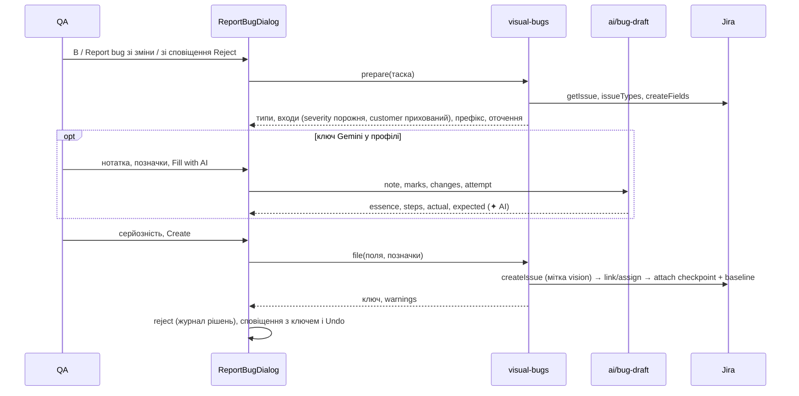

# 025 — Дизайн

## Підхід

Баг із порівняння повторює шлях багів доступності ([005](../005-jira-bugs/design.md)): діалог
двічі ходить на сервер — `prepare` (таска, типи, поля екрана створення) і `file` (створення), усі
виклики Jira йдуть через `JiraClient` від імені того, хто діє. Нове — інший текст бага, позначки
на знімку, два вкладення, необов'язкова чернетка від Gemini на особистому ключі людини і запис
бага в базі Vision, щоб показувати його на кожному знімку перевірки.

- **Чиста логіка окремо.** Назва, оточення, опис із розділами й малювання позначок — чисті
  функції модуля `visual-bugs`. Сервіс лише завантажує прогін, знімки й таску і викликає їх. Те
  саме для чернетки AI: промпт, схема й злиття з правками людини — чисті функції.
- **`buildBugFields` перевикористовуємо.** Серйозність у ньому необов'язкова: без неї поле
  серйозності стає порожнім обов'язковим входом (REQ-025-23). Кожен вхід має `role`
  (`severity` | `customer`), щоб діалог ховав заповненого «Замовника» (REQ-025-24). Для багів
  доступності нічого не змінюється: вони передають S4.
- **Доступ до Jira спільний.** `jiraFor` з `A11yIssuesService` став функцією `jiraAccess`, нею
  користуються обидва сервіси. Звичайна функція, а не провайдер Nest: конструктор і тести
  сервісу доступності лишились як були.
- **Мітка `vision`** ставиться кожному багу: у полі міток, а якщо його немає на екрані створення —
  окремим кроком після створення (REQ-025-35).
- **Відхилення робить фронтенд** тим самим викликом, що й кнопка Reject, після створення бага.
  Так працюють журнал рішень і Undo ([ADR-0014](../../decisions/0014-undo-through-decision-journal.md)), а
  збій відхилення не скасовує бага (REQ-025-30, REQ-025-32).
- **Назва фічі** — nullable-колонка прогону поза ключем варіації
  ([ADR-0019](../../decisions/0019-sdk-upstream-plus-ui-tree-and-feature.md)); без неї —
  `functionalBlock(name)` з [005](../005-jira-bugs/design.md).
- **AI — Gemini на особистому ключі** ([ADR-0020](../../decisions/0020-personal-gemini-keys.md)).
  Ключ лежить у `User.geminiApiKey`, API повертає лише `geminiKeySet`. `AiService.generateJson`
  приймає `personalGeminiKey`: тоді запит іде в Gemini незалежно від провайдера інстансу, а денний
  ліміт інстансу не перевіряється. Ask again додає номер спроби в ключ кешу, інакше той самий
  запит повернув би відповідь з кешу. Решта AI (групи змін, підписи) і ключ проєкту для VLM не
  змінюються.
- **Інтерфейс:** діалог `ReportBugDialog` за макетами
  [Bug from comparison](https://claude.ai/artifact/GNZ2RJrnGWGgeKFxjsskf7). У нижній панелі
  порівняння Report bug стоїть праворуч, за роздільником, окремо від Approve і Reject. Тексти —
  через `useT()` з ключами в `en.ts` і `uk.ts`
  ([ADR-0017](../../decisions/0017-interface-in-two-languages.md)). Відхилення в макетах підписане
  `R`, у коді клавіша — `X`; лишили `X`.

## Компоненти

### Бекенд

| Компонент | Шлях | Роль |
|---|---|---|
| Текст бага | `backend/src/visual-bugs/visual-bug.ts` | `featureOf`, `bugSummary` (`[Automation] [фіча] суть`, ≤ 250, префікс цілий), `environmentText`, `bugDescription` (вікі-розмітка Jira: `h3.` Оточення, Кроки, Фактичний результат із `!checkpoint.png!`, Очікуваний результат із `!baseline.png!`, потім перевірка, збірка й посилання), `normalizeMarks`, `VISUAL_BUG_LABELS` |
| Позначки на знімку | `backend/src/visual-bugs/mark-image.ts` | `markImage(png, marks)`: рамка й синій кружок із номером (піксельний шрифт цифр 3×5, без нових залежностей) |
| Чернетка AI | `backend/src/visual-bugs/bug-draft.ts` | `draftSchema` (`essence`, `steps[]`, `actual`, `expected`), `draftPrompt` (українською, лише ці поля), `cropAreas` (до 3 областей, найбільші), `draftFields` |
| Сервіс | `backend/src/visual-bugs/visual-bugs.service.ts` | `prepare`, `file` (створити з міткою `vision` → зв'язати/призначити → прикласти обидва знімки → записати `VisualBug`; збої після створення — `warnings`), `forCheck` (`sameDevice`: позначки лише в пікселях того самого профілю пристрою) |
| Контролер і DTO | `backend/src/visual-bugs/visual-bugs.controller.ts`, `backend/src/visual-bugs/visual-bug.dto.ts`, `backend/src/visual-bugs/visual-bugs.module.ts` | `POST /test-runs/:id/bug/prepare`, `POST /test-runs/:id/bug` (admin, editor), `GET /test-runs/:id/bugs` |
| Доступ до Jira | `backend/src/a11y/jira-access.ts` | `jiraAccess(prisma, projectId, userId)`: особистий токен, інакше спільний |
| Поля бага | `backend/src/a11y/jira-bug.ts` | `buildBugFields`: `severity` необов'язкова; `BugInput.role` |
| AI | `backend/src/ai/ai.service.ts`, `backend/src/ai/ai-features.service.ts`, `backend/src/ai/ai.controller.ts` | `generateJson({ personalGeminiKey })`; `draftBug(request, userId)` → `POST /ai/bug-draft`: ключ людини, вирізки `cropPng`, тайм-аут 30 с → 504 |
| Ключ у профілі | `backend/src/users/users.controller.ts`, `backend/src/users/dto/user-jira.dto.ts`, `backend/src/users/dto/user.dto.ts` | `PUT /users/gemini` (`geminiApiKey`, порожній рядок видаляє); `UserDto.geminiKeySet` |
| Прийом знімка | `backend/src/test-runs/dto/create-test-request.dto.ts`, `backend/src/test-runs/test-runs.service.ts`, `backend/src/test-runs/dto/testRun.dto.ts` | `featureName` (≤ 200) на прогоні й у `TestRunDto`; multipart успадковує поле; пошук варіації його не бачить |
| Схема | `backend/prisma/schema.prisma` | `TestRun.featureName`, `User.geminiApiKey`, модель `VisualBug` |

### SDK

| Компонент | Шлях | Роль |
|---|---|---|
| Опції й запит | `sdk-java/src/main/java/io/visual_regression_tracker/sdk_java/TestRunOptions.java`, `sdk-java/src/main/java/io/visual_regression_tracker/sdk_java/request/TestRunRequest.java`, `sdk-java/src/main/java/io/visual_regression_tracker/sdk_java/VisualRegressionTracker.java` | `featureName`; у JSON лише коли задано (Gson пропускає `null`, REQ-025-73) |
| Збірка | `scripts/build-sdk-jar.sh`, `sdk-java/build.gradle`, `dist/sdk-java/` | версія `4.3.1-vision.2` |

### Фронтенд

| Компонент | Шлях | Роль |
|---|---|---|
| Діалог | `frontend/src/components/TestDetailsDialog/ReportBugDialog.tsx` | дві колонки: докази ліворуч, форма праворуч; блок AI або підказка про ключ; лічильник незаповнених полів; «Also reject the checkpoint» |
| Докази | `frontend/src/components/TestDetailsDialog/BugEvidence.tsx` | Konva: чекпоінт або еталон на тому самому місці, «Mark area», «Pick element» (з `structure.elements`), номери, видалення |
| Чисті функції | `frontend/src/_helpers/bugReport.helper.ts` | `addMark`, `removeMark`, `visibleInputs`, `missingFields`, `aiAvailable(user)`, `canAskAi`, `applyDraft`, `editField` |
| Вибір елемента | `frontend/src/_helpers/elementPicking.helper.ts` | `elementAt(point, elements)` зі специфікації 024: той самий вибір, що й для правил елементів |
| Пам'ять Jira | `frontend/src/_helpers/jiraMemory.ts` | таска для екрана, частота типів і зв'язків, значення полів — винесено з `frontend/src/components/TestDetailsDialog/JiraBugDialog.tsx`; серйозність не запам'ятовується (REQ-025-23) |
| Порівняння | `frontend/src/components/TestDetailsDialog/TestDetailsModal.tsx` | Report bug у нижній панелі, клавіша `B`, чипи багів у шапці, позначки багів на чекпоінті, створення → відхилення → сповіщення |
| Кнопки | `frontend/src/components/TestDetailsDialog/ApproveRejectButtons.tsx` | Report bug у сповіщенні після Reject |
| Панель змін | `frontend/src/components/TestDetailsDialog/InsightsPanel.tsx` | Report bug у діях зміненої області; «Bugs for this screen» з перемикачем «Bug marks» |
| Сповіщення | `frontend/src/components/useDecisionSnackbar.tsx` | необов'язкова дія й власний текст поруч з Undo |
| Ключ у профілі | `frontend/src/components/GeminiKeyCard.tsx`, `frontend/src/pages/ProfilePage.tsx`, `frontend/src/services/users.service.ts`, `frontend/src/contexts/user.context.tsx`, `frontend/src/types/user.ts` | зберегти, замінити, видалити; видно лише «ключ збережено» |
| Типи й сервіс | `frontend/src/types/insights.ts`, `frontend/src/services/insights.service.ts` | `VisualBug`, `VisualBugPreparation`, `BugDraft`; `prepareVisualBug`, `fileVisualBug`, `visualBugs`, `draftBug` |
| Тексти | `frontend/src/i18n/en.ts`, `frontend/src/i18n/uk.ts` | ключі `reportBug.*`, `profile.gemini*` |

## Дані

Лише додавальні зміни ([ADR-0003](../../decisions/0003-additive-schema-only.md)), дві міграції:
`20261029200000_add_visual_bugs` і `20261029210000_add_user_gemini_key`.

```sql
-- nullable: старі прогони й клієнти без featureName нічого не змінюють; не входить у ключ варіації
ALTER TABLE "TestRun" ADD COLUMN "featureName" TEXT;

-- особистий ключ Gemini; лише записується (ADR-0020)
ALTER TABLE "User" ADD COLUMN "geminiApiKey" TEXT;

-- нова таблиця без зовнішніх ключів: видалення прогонів і варіацій upstream-кодом її не чіпає
CREATE TABLE "VisualBug" (
  "id" TEXT PRIMARY KEY,
  "projectId" TEXT NOT NULL,
  "checkName" TEXT NOT NULL,          -- перевірка: назва + customTags (ADR-0005)
  "customTags" TEXT NOT NULL DEFAULT '',
  "testRunId" TEXT NOT NULL,          -- знімок, з якого заведено
  "device" TEXT NOT NULL DEFAULT '',  -- профіль пристрою на момент створення
  "jiraKey" TEXT NOT NULL,
  "jiraUrl" TEXT,
  "summary" TEXT NOT NULL,
  "marks" TEXT NOT NULL DEFAULT '[]', -- [{n, x, y, width, height, element?}] у пікселях знімка
  "userId" TEXT,
  "createdAt" TIMESTAMP(3) NOT NULL DEFAULT CURRENT_TIMESTAMP
);
CREATE INDEX "VisualBug_projectId_checkName_customTags_idx" ON "VisualBug"("projectId", "checkName", "customTags");
```

- `VisualBug` сокет не розсилає; список багів перевірки фронтенд бере запитом при відкритті знімка.
- Знімки для Jira не зберігаються: позначений чекпоінт малюється з файлу прогону в момент
  створення.
- У браузері: таска для екрана й частота типів (`vision.jira.*`, як у 005); нотатка й позначки
  живуть лише поки відкритий діалог.

## Потік



## Ризики

| Ризик | Що робимо |
|---|---|
| Jira не показує зображення за посиланням `!file.png!`, поки його не приклали | вкладення додаються одразу після створення; Jira рендерить посилання при перегляді. Перевірка на тестовій Jira — `manual:` для REQ-025-13 |
| Gemini пише неточно або вигадує | ✦ AI на кожному полі, Create лише вручну; серйозність і оточення AI не чіпає |
| Модель повертає поля, яких не просили | схема має лише чотири поля; зайве відкидає zod (REQ-025-44) |
| Хибний ключ або вичерпана квота | помилка Gemini показується в діалозі, нотатка й поля лишаються (REQ-025-48) |
| Клавіша B під час набору тексту | `react-hotkeys-hook` ігнорує поля вводу за замовчуванням |
| Широкий діалог на малому екрані | менше 900 px колонки стають одна під одною |
| Відхилення не вдалося після створення бага | баг лишається, сповіщення-попередження (REQ-025-32) |
| Позначки з іншого пристрою | показуються лише на тому самому профілі пристрою (`sameDevice`), на інших — лише ключ |
| Дублі з двох пристроїв | свідомо не шукаємо (поза межами специфікації); список багів екрана підказує |

## Перевірка вимог

| Вимога | Перевірка |
|---|---|
| REQ-025-01 | `frontend/integration_tests/test/reportBug.spec.ts › shows Report bug next to the decisions when Jira is set up` |
| REQ-025-02 | `frontend/integration_tests/test/reportBug.spec.ts › opens the bug dialog with B` |
| REQ-025-03 | `frontend/integration_tests/test/reportBug.spec.ts › opens with the changed area already marked` |
| REQ-025-04 | `frontend/integration_tests/test/reportBug.spec.ts › offers Report bug after a reject` |
| REQ-025-05 | `frontend/integration_tests/test/reportBug.spec.ts › disables Report bug without a Jira token` |
| REQ-025-10 | `frontend/src/_helpers/bugReport.helper.test.ts › numbers marks and renumbers after removing one`; `frontend/src/_helpers/elementPicking.helper.test.ts › picks the smallest element under the pointer on either screenshot` |
| REQ-025-11 | manual: у діалозі перемкнути Checkpoint / Baseline — знімок на тому самому місці, позначки лише на чекпоінті |
| REQ-025-12 | `backend/src/visual-bugs/visual-bugs.service.spec.ts › attaches the marked checkpoint and the plain baseline`; `backend/src/visual-bugs/mark-image.spec.ts › draws a numbered frame and leaves the rest alone` |
| REQ-025-13 | `backend/src/visual-bugs/visual-bug.spec.ts › puts the checkpoint into the actual result and the baseline into the expected one`; manual: на тестовій Jira зображення видно в розділах опису |
| REQ-025-20 | `backend/src/visual-bugs/visual-bug.spec.ts › keeps the Automation prefix whole in a long summary` |
| REQ-025-21 | `backend/src/visual-bugs/visual-bug.spec.ts › names the device the problem was seen on, its OS beside it, and no build` |
| REQ-025-22 | `frontend/src/_helpers/bugReport.helper.test.ts › lists empty steps, actual and expected as missing` |
| REQ-025-28 | `backend/src/visual-bugs/visual-bug.spec.ts › orders the sections: environment, steps, actual, expected, then the service lines` |
| REQ-025-23 | `backend/src/a11y/jira-bug.spec.ts › leaves severity empty and required when none is given`; `backend/src/visual-bugs/visual-bugs.service.spec.ts › refuses to file while severity is not chosen` |
| REQ-025-24 | `backend/src/a11y/jira-bug.spec.ts › marks the customer input so the dialog can hide it`; `frontend/src/_helpers/bugReport.helper.test.ts › hides the customer once the task gives one` |
| REQ-025-25 | `backend/src/visual-bugs/visual-bugs.service.spec.ts › files under the task as the person with their own token` |
| REQ-025-26 | `frontend/src/_helpers/bugReport.helper.test.ts › keeps Create off while a required field is empty` |
| REQ-025-27 | `backend/src/visual-bugs/visual-bug.spec.ts › ends with the check, the build and a link back to the review` |
| REQ-025-30 | `frontend/integration_tests/test/reportBug.spec.ts › rejects the checkpoint after filing when the box is ticked` |
| REQ-025-32 | `backend/src/visual-bugs/visual-bugs.service.spec.ts › keeps the bug and warns when linking or attaching fails` |
| REQ-025-33 | `frontend/integration_tests/test/reportBug.spec.ts › shows the new key with Open in Jira and Undo reject` |
| REQ-025-34 | manual: заповнити форму й закрити діалог без Create — у Jira нічого не з'явилось |
| REQ-025-35 | `backend/src/visual-bugs/visual-bugs.service.spec.ts › labels the bug vision, on the create screen or right after` |
| REQ-025-40 | `frontend/src/_helpers/bugReport.helper.test.ts › offers AI only with the person’s own Gemini key`; `frontend/integration_tests/test/reportBug.spec.ts › asks for a personal Gemini key instead of offering AI without one` |
| REQ-025-49 | `backend/src/users/users.controller.spec.ts › stores a personal Gemini key and answers only whether one is set`; manual: у профілі зберегти, замінити й видалити ключ — поле порожнє, видно лише «A key is saved» |
| REQ-025-41 | `frontend/src/_helpers/bugReport.helper.test.ts › keeps Fill with AI off while the note is empty` |
| REQ-025-42 | `backend/src/visual-bugs/bug-draft.spec.ts › sends crops around the marks, else around the changed areas, never whole screenshots`; `backend/src/ai/ai.service.spec.ts › drafts on the person’s own key whatever the instance runs, outside its daily limit` |
| REQ-025-43 | manual: у діалозі з ключем видно рядок «Gemini gets…» з кількістю областей і змін до натискання Fill with AI |
| REQ-025-44 | `backend/src/visual-bugs/bug-draft.spec.ts › asks for Ukrainian and takes only essence, steps, actual and expected` |
| REQ-025-45 | `frontend/src/_helpers/bugReport.helper.test.ts › marks drafted fields until the person edits them`; `frontend/integration_tests/test/reportBug.spec.ts › fills the texts with AI on the person’s own Gemini key and marks them` |
| REQ-025-46 | `frontend/src/_helpers/bugReport.helper.test.ts › asking again keeps the fields the person edited` |
| REQ-025-47 | `backend/src/ai/ai.service.spec.ts › asks again instead of answering from the cache on a new attempt`; `backend/src/ai/ai.service.spec.ts › drafts on the person’s own key whatever the instance runs, outside its daily limit`; `backend/src/ai/ai.service.spec.ts › counts only the instance’s own calls toward its daily limit…` |
| REQ-025-48 | `backend/src/ai/ai.service.spec.ts › gives up on a bug draft after 30 seconds`; `backend/src/ai/ai.service.spec.ts › refuses a bug draft without the person’s own Gemini key`; `frontend/src/_helpers/bugReport.helper.test.ts › keeps the note and the person’s fields when the draft fails` |
| REQ-025-60 | `backend/src/visual-bugs/visual-bugs.service.spec.ts › lists the check’s bugs on every device and build` |
| REQ-025-61 | manual: відкрити знімок перевірки з багом на тому самому пристрої — пунктирна рамка з ключем на чекпоінті, «Bug marks» її ховає |
| REQ-025-70 | `sdk-java/src/test/java/io/visual_regression_tracker/sdk_java/VisualRegressionTrackerTest.java › trackSendsFeature` |
| REQ-025-71 | `backend/src/visual-bugs/visual-bug.spec.ts › takes the feature from the check name before the first dot when none is sent` |
| REQ-025-72 | `backend/src/test-variations/test-variations.service.spec.ts › compares with the same baseline whether a feature is sent or not` |
| REQ-025-73 | `sdk-java/src/test/java/io/visual_regression_tracker/sdk_java/VisualRegressionTrackerTest.java › trackWithoutFeatureSendsTheSameRequest` |
