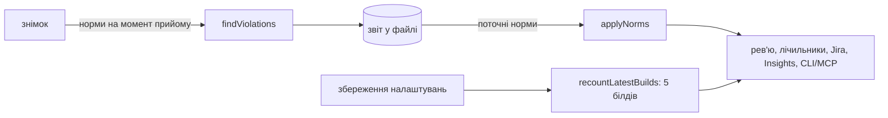

# 026 — Дизайн

## Підхід

Норми — частина налаштувань UI-дерева проєкту (`uiTreeSettings`, JSON), ключ `a11yNorms`. Таблиць
і міграцій немає.

Норми діють у двох місцях:

1. **При прийомі знімка** `findViolations` перевіряє дерево за нормами проєкту: мінімум зони тапу
   за платформою, мінімум контрасту, вимкнені правила не запускаються (REQ-026-03, REQ-026-07).
   Знахідка пише в `details` норму й одиницю (`min`, `unit`, `required`, `large`), тож звіт
   самодостатній.
2. **При читанні звіту** чиста функція `applyNorms(report, norms)` ховає знахідки, які за
   поточною нормою проходять або належать вимкненому правилу, переписує в решті норму в
   повідомленні й перераховує `summary`. Так послаблена норма діє на вже отримані знімки без
   повторного аналізу дерев (REQ-026-05). Суворішої норми старий звіт не знає: нові знахідки
   з'являються лише з новими знімками, як і погоджено.

Ідентичність знахідки (`rule|nodeKey`) і факти проблеми (компонент, виміряні `widthDp` ×
`heightDp`, `ratio`) від норми не залежать, тож ID проблем і баги не рухаються (REQ-026-11).

Лічильники на рядку `TestRun` (`a11yNewCount`, `a11yTotalCount`) рахуються з уже відфільтрованого
звіту. Після збереження налаштувань проєкту Vision у фоні перераховує їх для 5 останніх білдів
наявним `refreshCounts` (REQ-026-08). Старіші білди зберігають свої числа.

Поле заголовка екрана зникає з інтерфейсу; бекенд і далі читає `screenTitle` з налаштувань і
має типовий `id:Appbar#Title` (REQ-026-13, REQ-026-14). Форма налаштувань зберігає JSON
цілком, тож збережені селектори не губляться.

## Компоненти

| Компонент | Шлях | Роль |
|---|---|---|
| Норми | `backend/src/a11y/a11y-norms.ts` | `A11yNorms`, типові значення й межі, `parseA11yNorms` (поза межами → типове), `applyNorms` |
| Правила | `backend/src/a11y/a11y.rules.ts` | `findViolations(tree, image, norms)`; `summarize` винесено з `buildReport` для `applyNorms` |
| Налаштування | `backend/src/ui-tree/comparison-inputs.ts` | `UiTreeSettings.a11yNorms`, розбір у `parseUiTreeSettings` |
| Прийом | `backend/src/ui-tree/ui-tree.service.ts` | `analyze` передає норми в `findViolations` для знімка й еталона |
| Рев'ю | `backend/src/a11y/a11y-issues.service.ts` | кожен звіт перед рев'ю, лічильниками й заведенням бага проходить `applyNorms`; `recountLatestBuilds` |
| Перерахунок | `backend/src/projects/projects.controller.ts` | після збереження `uiTreeSettings` запускає `recountLatestBuilds` у фоні |
| Insights | `backend/src/analytics/analytics.service.ts` | розбивка за правилами з відфільтрованих звітів |
| Текст бага | `backend/src/a11y/jira-bug.ts` | очікуваний результат із норми знахідки (REQ-026-04) |
| Розділ налаштувань | `frontend/src/components/ProjectForm/A11yRulesSettings.tsx` | 7 правил: перемикач, норми для тапу й контрасту, типове значення, «Типове», перевірка меж; замінює `A11yProblemSettings` |
| Типи | `frontend/src/types/insights.ts` | `A11yNorms`, межі, `normsOf(settings)` |
| Пошук | `frontend/src/_helpers/projectSettings.helper.ts` | мітки розділу для «Find a setting» |

## Дані

`Project.uiTreeSettings` (JSON) отримує необов'язковий ключ:

```json
"a11yNorms": {
  "touchTargetAndroid": 40, "touchTargetIos": 44,
  "contrast": 4.5, "contrastLarge": 3,
  "disabledRules": ["redundant-role"]
}
```

Немає ключа чи поля → типова норма. Значення поза межами REQ-026-01 і REQ-026-06 бекенд читає як
типове, тож зіпсований JSON не вимкне перевірку. Звіти старих знімків не мають `unit` і
`large`: `applyNorms` бере одиницю з `report.format`, а «великий текст» — з `required < 4.5`.

## Потік



## Ризики

| Ризик | Що робимо |
|---|---|
| Суворішу норму не видно на старих знімках | Так погоджено (REQ-026-05); підказка в розділі каже, що нові знахідки з'являться з новими знімками |
| Лічильники старіших за 5 білдів показують старі числа | Саме рев'ю завжди за поточними нормами; лічильники білда перераховує перше рішення в ньому (`refreshCounts`) |
| Повідомлення старого звіту з «minimum is 48» | `applyNorms` переписує норму в повідомленні за шаблоном правила |
| Хтось вимкне всі правила | Дозволено: це рішення проєкту; розділ показує, що правило вимкнене |

## Перевірка вимог

| Вимога | Перевірка |
|---|---|
| REQ-026-01 | `backend/src/a11y/a11y-norms.spec.ts › reads the project's touch target per platform` |
| REQ-026-02 | `backend/src/a11y/a11y.rules.spec.ts › keeps 48 dp and 44 pt when the project has no norm of its own` |
| REQ-026-03 | `backend/src/a11y/a11y.rules.spec.ts › checks the touch target against the project's norm` |
| REQ-026-04 | `backend/src/a11y/jira-bug.spec.ts › expects the norm the issue was found by` |
| REQ-026-05 | `backend/src/a11y/a11y-norms.spec.ts › hides issues a looser norm lets pass in a received report` |
| REQ-026-06 | `backend/src/a11y/a11y.rules.spec.ts › checks contrast against the project's norm` |
| REQ-026-07 | `backend/src/a11y/a11y.rules.spec.ts › skips the rules the project turned off` |
| REQ-026-08 | `backend/src/a11y/a11y-problems.service.spec.ts › reviews a received report by the project's current norms` |
| REQ-026-09 | `frontend/integration_tests/test/projectSettings.spec.ts › does not save a norm out of range` |
| REQ-026-10 | `frontend/integration_tests/test/projectSettings.spec.ts › sets the project's touch target and turns a rule off` |
| REQ-026-11 | `backend/src/a11y/a11y-norms.spec.ts › keeps the issue's id and measured size whatever the norm` |
| REQ-026-12 | `frontend/integration_tests/test/projectSettings.spec.ts › shows only the rules under Accessibility` |
| REQ-026-13 | `backend/src/ui-tree/comparison-inputs.spec.ts › looks for the screen title in Appbar#Title when the project saved none` |
| REQ-026-14 | `frontend/integration_tests/test/projectSettings.spec.ts › keeps the screen title selectors the project saved` |
| REQ-026-15 | `frontend/src/_helpers/projectSettings.helper.test.ts › finds the accessibility norms by tap, touch, contrast…` |
