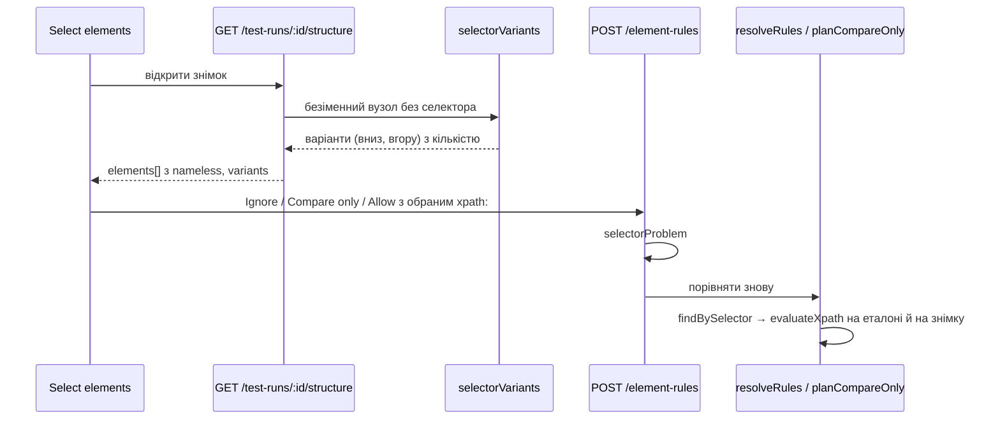

# 027 — Дизайн

Фіча — експеримент без вимикача ([spec](spec.md), «Контекст»). Тому все нове лежить в окремих
файлах, а в наявних файлах лише точкові виклики. Міграцій і нових полів у налаштуваннях немає.
Відкат — `git revert` комітів фічі. Як вузький XPath влаштовано і чому, пояснює
[ADR-0021](../../decisions/0021-xpath-selectors-from-stable-elements.md).

## Підхід

**Селектор `xpath:` обчислюється на розібраному дереві, а не на XML.** Сирий page source не
зберігається: `UiTreeService.store` кладе у файл уже розібраний `UiTree` (JSON). Тому вираз
обчислюється на вузлах `UiTree.nodes`: `parent`, `className`, `resourceId`, `text`, `label`.
Порядковий номер кроку `[n]` рахується так само, як в Appium: номер серед дітей того самого
батьківського з тим самим класом, з 1, у порядку вузлів. Обхід у парсері прямий (pre-order),
тому порядок сусідів у `nodes` такий самий, як у XML. Так працюють і дерева, збережені до
зміни: перезаписувати нічого не треба.

**Мова виразу — лише REQ-027-30.** Чиста функція `parseXpath` у новому
`backend/src/ui-tree/xpath-selector.ts` перетворює рядок на опору (клас або `*`, атрибут,
значення) і список кроків в одному напрямку:

- вниз: `/` або `//`, клас або `*`, необов'язковий `[n]`;
- вгору: `/..` або `/ancestor::Клас[n]`.

Решту функція відхиляє з кодом причини (REQ-027-31): `syntax`, `anchor` (немає опори або їх
кілька), `attribute` (атрибут не з переліку), `axis` (сусіди та інші осі), `function`, `or`,
`mixed` (кроки вниз і вгору разом). Повідомлення сервера в інтерфейсі не перекладаються, тому
бекенд віддає код, а текст до нього бере фронтенд зі словника. `evaluateXpath(tree, parsed)`
повертає вузли в порядку дерева. Атрибути мапляться на поля вузла так:

| Атрибут | Android | iOS |
|---|---|---|
| `resource-id` | `resourceId` (повний, `com.app:id/x`) | — |
| `text` | `text` | — |
| `content-desc` | `label` | — |
| `name` | — | `resourceId`, а якщо його немає — `label` (парсер прибирає `name`, коли він дорівнює `label`) |
| `label` | — | `label` |

**Одна точка пошуку для правил.** У `comparison-inputs.ts` з'являється
`findBySelector(tree, selector): UiNode[]`. Вираз з `xpath:` віддається в `evaluateXpath`, решта
йде через наявні `parseSelector`/`matchesSelector`. `resolveRules` і `matchesOf` (у
`compare-only.ts`) переходять на неї, тому ігнор, допуск і «порівнювати лише» працюють з
`xpath:` без інших змін (REQ-027-14, REQ-027-21). `parseSelector` про `xpath:` не знає. Тому ID
екрана в `a11y-problems.ts` і далі не приймає XPath, як записано в «Поза межами». Перевіряє
селектор перед збереженням `selectorProblem(selector)`: він повертає `null` або код причини.
Його викликають `addElementRule`, `replaceAreaWithElement` і новий запит лічильника.

**Варіанти селектора — чиста функція.** `selectorVariants(tree, node)` у новому
`backend/src/ui-tree/selector-variants.ts`:

1. **Вниз (REQ-027-11).** Шукає найближчого предка з ідентифікатором застосунку (не
   `android:id/`). Якщо такого немає, бере найближчого з `text` чи `label` (без `hint`: це
   підказка поля, а не ім'я). Вираз: опора `//*[@атрибут='значення']`, потім від дитини опори до
   вузла кроки `/Клас[n]` з повним класом, як у page source.
2. **Вгору (REQ-027-15).** Шукає найближчого стабільного нащадка: менша глибина, потім порядок у
   дереві; нащадок з id переважає нащадка з текстом. Вираз: опора нащадка, далі `/..` стільки
   разів, скільки рівнів між ними.
3. Значення з `'` береться в `"`. Якщо значення містить обидві лапки, ця опора не годиться: без
   `concat()` такий рядок у XPath 1.0 не записати.
4. Для кожного варіанта рахується `count` на цьому самому дереві. Сортування (REQ-027-16):
   спершу ті, що знаходять рівно 1 елемент і мають опору-id, потім решта з опорою-id, потім
   опора-текст; за рівності — вниз раніше за вгору. Варіантів щонайбільше два, по одному в
   кожному напрямку.

**Безіменні елементи для вибору.** `pickableElements` у `ui-tree.service.ts` викликає новий
`namelessPickable(tree, index)` для вузлів без селектора. Вузол пропонується, якщо він видимий,
не порожній і займає ≤ 90 % екрана (REQ-027-01). Його межі не повинні збігатися (±1 px з
кожного боку) з межами батьківського чи будь-якого дочірнього вузла (REQ-027-02). І він повинен
мати хоча б один варіант селектора (REQ-027-17). Селектор елемента — перший варіант. Решта
полів `PickableElement` додається як необов'язкові: `nameless: true`, `variants`. `parent` і
↑/↓ працюють без змін, бо безіменний елемент тепер має селектор (REQ-027-04). Позначки бага
беруть ті самі `elements`, тому REQ-027-05 виконується без змін у `BugEvidence`.

**Лічильник у формі (REQ-027-32).** `GET /test-runs/:id/selector-matches?selector=…` повертає
`{ current, baseline, problem }`. `TestRunsService.selectorMatches` завантажує обидва дерева через
`UiTreeService.load` (там є кеш) і рахує `findBySelector` на кожному. Запит лише читає дані.

**Фронтенд.**

- `ElementPopover` для безіменного елемента складає підпис за REQ-027-03 з ключів `select.noName`,
  `select.inside` і `select.around`. Під назвою — попередження `select.textAnchor` для опори-тексту
  (REQ-027-12). Якщо варіантів два, видно перемикач між ними з опорою й кількістю (REQ-027-15,
  REQ-027-16).
- Обраний варіант іде в дію: `onAct(action, scope, selector)`. Кількість на знімку для
  `xpath:` береться з `variant.count`, а не з `countBySelector` (REQ-027-22).
- `ruleFor` вважає правило правилом елемента, якщо його селектор збігається з будь-яким варіантом
  (як у специфікації 024, вимога 09).
- Повна форма в `InsightsPanel` пропускає `xpath:` у перевірці кнопки Add rule. Через 300 ms
  після введення вона питає лічильник і показує «N on baseline · M on screenshot» або причину з
  `panel.xpathProblem.<код>` (REQ-027-31, REQ-027-32).

## Компоненти

| Компонент | Шлях | Роль |
|---|---|---|
| `parseXpath`, `evaluateXpath` | `backend/src/ui-tree/xpath-selector.ts` (новий) | мова REQ-027-30, коди причин, обчислення на `UiTree` |
| `selectorVariants`, `namelessPickable` | `backend/src/ui-tree/selector-variants.ts` (новий) | опори, варіанти й порядок, які безіменні елементи пропонувати |
| `findBySelector`, `selectorProblem` | `backend/src/ui-tree/comparison-inputs.ts` | одна точка пошуку й перевірки для всіх видів селектора |
| `resolveRules`, `matchesOf` | `comparison-inputs.ts`, `compare-only.ts` | беруть вузли через `findBySelector` |
| `pickableElements` | `backend/src/ui-tree/ui-tree.service.ts` | додає безіменні елементи з варіантами |
| `addElementRule`, `replaceAreaWithElement`, `selectorMatches` | `backend/src/test-runs/test-runs.service.ts`, `test-runs.controller.ts` | перевірка `selectorProblem`, лічильник для форми |
| `PickableElement`, `SelectorVariant` | `frontend/src/types/insights.ts` | нові необов'язкові поля |
| `selectorMatches` | `frontend/src/services/insights.service.ts` | виклик лічильника |
| `ruleFor`, `elementLabel` | `frontend/src/_helpers/elementPicking.helper.ts` | правило за будь-яким варіантом, підпис безіменного |
| підказка біля елемента | `frontend/src/components/TestDetailsDialog/ElementPopover.tsx`, `TestDetailsModal.tsx` | підпис, попередження, варіанти, селектор у дію |
| повна форма правила | `frontend/src/components/TestDetailsDialog/InsightsPanel.tsx` | `xpath:` дозволено, лічильник і причина |
| словники | `frontend/src/i18n/en.ts`, `uk.ts` | нові ключі |

## Дані

Нових таблиць, колонок і полів налаштувань немає. Правила з `xpath:` лежать там само, де інші
правила: `checkRules` і `elementRules` у `Project.uiTreeSettings`, а селектор — звичайний рядок.
Дерева, збережені до зміни, не перезаписуються.

**Після відкату** `parseSelector` знову не знає `xpath:`. Правило ігнору чи допуску з ним тоді
нічого не знаходить (`resolveRules` пропускає його), а «порівнювати лише» з ним іде на рев'ю
(як у специфікації 015, вимога 21). Перед відкатом такі правила треба прибрати. Знайти їх можна в `uiTreeSettings`
проєктів за підрядком `"xpath:`.

## Потік

## Ризики

| Ризик | Що робимо |
|---|---|
| У дереві застосунку немає вузлів усередині картки (злиті семантики) | Бета нічого не дасть для таких карток; перевіряємо на page source екрана «Привіт» до злиття (manual у SC-027-01) |
| Номер `[n]` зсувається, коли перед елементом з'являється сусід того самого класу | Опора — найближчий предок, тож шлях короткий; лічильник у блоці «що порівнюється» видно; SC-027-03 вирішує про відкат |
| Номер не збігається з Appium, коли в XML були вузли без меж (парсер їх пропускає й переносить їхніх дітей до діда) | В UiAutomator2 і XCUITest межі мають усі вузли; SC-027-05 перевіряється на фікстурах: очікування записані з еталонного XPath (`xpath@0.0.34`) над сирим XML |
| iOS `@name`, коли `name` порожній, а `label` є: збіг за `label` замість відсутності збігу | Згенеровані селектори для iOS беруть `@name` лише для вузлів з `resourceId`, а текст — через `@label`; ручний вираз — відомий край, записаний у тесті |
| Безіменних вузлів багато, і вибір стає «липким» до дрібних обгорток | REQ-027-02 відкидає обгортки того самого розміру; ↑ веде до батьківського |
| Обчислення варіантів на великому дереві (2 000 вузлів) | Мапа дітей і знайдені опори кешуються на дерево, тож спільна опора (`offers_list`) шукається раз; на дереві з 2 219 вузлів `pickableElements` займає ~100 ms; тест тримає межу 500 ms, бо в паралельному прогоні час подвоюється |
| Після відкату правила з `xpath:` тихо перестають діяти | Записано в «Дані»; нагадати перед відкатом |

## Перевірка вимог

| Вимога | Перевірка |
|---|---|
| REQ-027-01 | `backend/src/ui-tree/pickable-elements.spec.ts › offers a nameless element inside a named one` |
| REQ-027-02 | `backend/src/ui-tree/pickable-elements.spec.ts › leaves out a nameless wrapper the size of its parent or child` |
| REQ-027-03 | `frontend/src/_helpers/elementPicking.helper.test.ts › names a nameless element by class and anchor` |
| REQ-027-04 | `frontend/src/_helpers/elementPicking.helper.test.ts › steps up from a nameless element to its named parent and back` |
| REQ-027-05 | `frontend/src/_helpers/elementPicking.helper.test.ts › takes the nameless element under the pointer, not the card around it` |
| REQ-027-10 | `backend/src/ui-tree/selector-variants.spec.ts › treats an app id or a text as stable, not a hint or a system id` |
| REQ-027-11 | `backend/src/ui-tree/selector-variants.spec.ts › goes down from the nearest ancestor with an id, past a nearer text` |
| REQ-027-12 | `frontend/integration_tests/test/elementSelection.spec.ts › warns when a nameless element hangs on a text` |
| REQ-027-13 | `backend/src/ui-tree/xpath-selector.spec.ts › finds what XPath over the page source finds` |
| REQ-027-14 | `backend/src/ui-tree/comparison-inputs.spec.ts › applies an xpath rule where the element was and where it is` |
| REQ-027-15 | `backend/src/ui-tree/selector-variants.spec.ts › offers a path up from the nearest stable descendant` |
| REQ-027-16 | `backend/src/ui-tree/selector-variants.spec.ts › puts first the id variant that finds only this element` |
| REQ-027-17 | `backend/src/ui-tree/pickable-elements.spec.ts › leaves out a nameless element with nothing stable above or below` |
| REQ-027-20 | `frontend/integration_tests/test/elementSelection.spec.ts › ignores a nameless element with the chosen selector` |
| REQ-027-21 | `backend/src/ui-tree/compare-only.spec.ts › compares only the element an xpath rule finds` |
| REQ-027-22 | `frontend/integration_tests/test/elementSelection.spec.ts › counts what a nameless element's selector finds` |
| REQ-027-30 | `backend/src/ui-tree/xpath-selector.spec.ts › accepts an anchor with steps down or steps up` |
| REQ-027-31 | `backend/src/ui-tree/xpath-selector.spec.ts › rejects siblings, functions, or, several anchors and mixed directions` |
| REQ-027-32 | `backend/src/test-runs/test-runs.service.spec.ts › counts what a selector finds on the baseline and the screenshot` |
