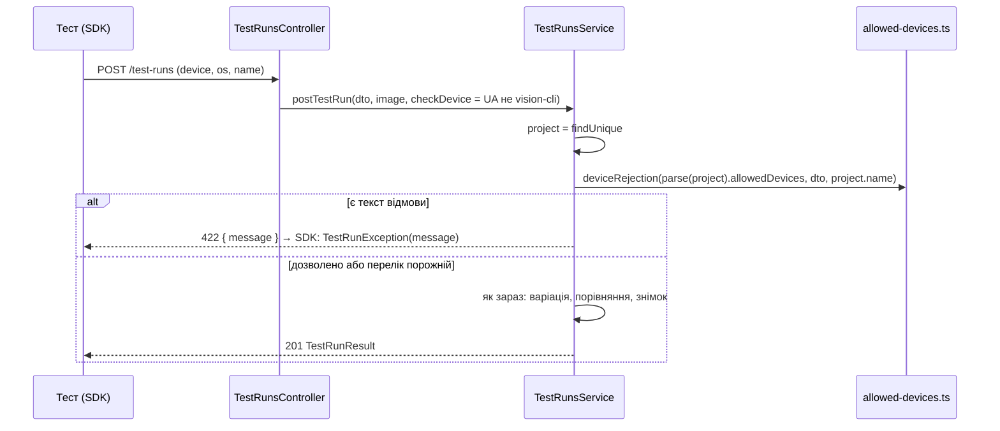

# 028 — Дизайн

## Підхід

Уся фіча — на сервері; SDK не змінюється ([ADR-0019](../../decisions/0019-sdk-upstream-plus-ui-tree-and-feature.md)):
на будь-яку відповідь не 2xx `handleResponse` кидає `TestRunException` з тілом відповіді, і
робить це до перевірки soft assert (REQ-028-08).

- **Чиста логіка** — новий `backend/src/projects/allowed-devices.ts`: розбір переліку, перевірка
  запису (шаблон лише `.*` у кінці OS), збіг пристрою й OS, текст відмови. Ті самі правила
  перевірки запису дзеркалить фронтенд-хелпер, щоб помилку було видно ще до збереження; джерело
  правди — бекенд (400 на збереженні).
- **Зберігання** — поле `allowedDevices` у JSON налаштувань проєкту (`Project.uiTreeSettings`), як
  `a11yNorms` у [026](../026-a11y-rules-settings/design.md): без міграції, той самий шлях
  збереження з перевіркою конфлікту (409). Назва колонки історична; окремої колонки для одного
  списку не варто.
- **Перевірка знімка** — на початку `TestRunsService.postTestRun`, до пошуку чи створення
  варіації: відмова нічого не пише, тож збірка лишається як була (REQ-028-05, REQ-028-10).
  Обидва ендпоінти прийому (`POST /test-runs` і `/test-runs/multipart`) проходять через неї.
- **Хто перевіряється** — контролер передає в сервіс `checkDevice`. CLI і MCP (`vision.py`)
  надсилають `User-Agent: vision-cli/<версія>`; для них перевірки немає (REQ-028-12), для всіх
  інших клієнтів (Java SDK, upstream SDK) — є. Це захист від помилки, а не від зловмисника:
  підробити заголовок можна, але для цього треба хотіти обійти правило.
- **Відповідь** — `422 Unprocessable Entity`, `message` англійською (REQ-028-07):

  ```
  Device not allowed in project "AOS": check "Payment" was sent from device "Pixel 6", OS "Android 13".
  Allowed: "Pixel 7" / "Android 15", "iPhone 17" / "26.*". Run on an allowed device or add it in Project settings → Devices.
  ```

  Без пристрою чи OS: `... was sent without a device` (`without an OS`, `without a device and OS`).
- **UI** — новий розділ налаштувань «Пристрої» (`devices`) після «Мобільних»: таблиця записів
  (пристрій, OS, видалити), рядок додавання, під ним «Пристрої зі знімків» з позначкою «не в
  переліку» і кнопкою «Додати» (REQ-028-11). Дані для підказки — новий `GET /projects/:id/devices`:
  різні пари `device` + `os` з варіацій проєкту.

Окремого ADR не пропоную: зберігання повторює 026, а розрізнення CLI за `User-Agent` — локальна
деталь прийому, описана тут.

## Компоненти

| Компонент | Шлях | Роль |
|---|---|---|
| Правила переліку | `backend/src/projects/allowed-devices.ts` | `parseAllowedDevices`, `invalidAllowedDevice`, `deviceAllowed`, `deviceRejection` — чисті функції |
| Розбір налаштувань | `backend/src/ui-tree/comparison-inputs.ts` | `UiTreeSettings.allowedDevices`, `parseUiTreeSettings` читає поле через `parseAllowedDevices` |
| Збереження | `backend/src/projects/projects.service.ts` | `normalizeUiTreeSettings`: недійсний запис → 400 з поясненням шаблону (REQ-028-15) |
| Пристрої зі знімків | `backend/src/projects/projects.controller.ts`, `projects.service.ts` | `GET /projects/:id/devices` → `[{ device, os }]`, різні пари з `TestVariation` |
| Прийом знімка | `backend/src/test-runs/test-runs.controller.ts` | читає `User-Agent`, передає `checkDevice` |
| Перевірка знімка | `backend/src/test-runs/test-runs.service.ts` | `postTestRun`: відмова 422 до будь-якого запису |
| Тип і сервіс | `frontend/src/types/project.ts`, `frontend/src/services/projects.service.ts` | `AllowedDevice`, `getDevices(projectId)` |
| Хелпер | `frontend/src/_helpers/allowedDevices.helper.ts` | та сама перевірка запису й збіг, для позначки «не в переліку» |
| Розділ | `frontend/src/components/ProjectForm/AllowedDevicesSettings.tsx` | таблиця, додавання, пристрої зі знімків |
| Сторінка | `frontend/src/pages/ProjectSettingsPage.tsx`, `frontend/src/_helpers/projectSettings.helper.ts` | розділ `devices` у переліку розділів, пошуку й «змінених розділів» |
| Тексти | `frontend/src/i18n/en.ts`, `uk.ts` | ключі `devices.*` |

## Дані

Без міграцій. У JSON `Project.uiTreeSettings` з'являється необов'язкове поле:

```json
{ "allowedDevices": [{ "device": "Pixel 7", "os": "Android 15" }, { "device": "iPhone 17", "os": "26.*" }] }
```

Немає поля чи порожній масив → без обмежень (REQ-028-03); усі наявні проєкти поводяться як
раніше. Значення зберігаються так, як їх ввели (обрізані з країв); регістр враховується лише в
показі. `parseAllowedDevices` відкидає записи без рядкових `device`/`os`, тож зіпсоване значення
не ламає прийом; але недійсний шаблон на збереженні — 400, а не тихе відкидання (REQ-028-15).
Дублікати (після нормалізації) зберігаються один раз.

## Потік



Збіг (`deviceAllowed`): пристрій — `trim().toLowerCase()` обох сторін, рівність. OS — так само,
а для запису, що закінчується на `.*`, з префіксом `p`: `os === p || os.startsWith(p + '.')`.

## Ризики

| Ризик | Що робимо |
|---|---|
| CI на дозволених пристроях передає `device`/`os` інакше, ніж записано (`Pixel 7 emulator` проти `Pixel 7`), і падає весь прогін одразу | підказка «Пристрої зі знімків» показує саме ті значення, що вже приходять, і додає їх одним кліком; у DEPLOY.md — порядок увімкнення: спершу додати з підказки пристрої CI |
| Текст відмови губиться в JSON тіла помилки (фільтр додає `stack`) | SDK кладе тіло відповіді в текст винятку цілком, тож `message` видно одразу після `path` і `name`; ручна перевірка, що його видно в лозі тесту |
| Хтось шле знімки з SDK, підробивши `User-Agent` | прийнятно: це запобіжник від помилки, не контроль доступу |
| Правила запису розійдуться між фронтендом і бекендом | однакові назви тестів в обох; бекенд — джерело правди, а його 400 показується в розділі |
| Новий розділ змінить скриншот-еталон сторінки налаштувань | еталон оновлюємо в Docker, переглянувши знімок (frontend/AGENTS.md) |

## Перевірка вимог

| Вимога | Перевірка |
|---|---|
| REQ-028-01 | `backend/src/projects/allowed-devices.spec.ts › reads the allowed devices from the project settings` |
| REQ-028-02 | `frontend/integration_tests/test/projectSettings.spec.ts › adds, edits and removes an allowed device` |
| REQ-028-03 | `backend/src/projects/allowed-devices.spec.ts › allows any device when the list is empty` |
| REQ-028-04 | `backend/src/projects/allowed-devices.spec.ts › allows a device and OS that match an entry` |
| REQ-028-05 | `backend/src/projects/allowed-devices.spec.ts › rejects a device or OS that matches no entry`; `backend/src/test-runs/test-runs.service.spec.ts › rejects a device not allowed without creating a variation or run` |
| REQ-028-06 | `backend/src/projects/allowed-devices.spec.ts › rejects a snapshot without a device or OS` |
| REQ-028-07 | `backend/src/projects/allowed-devices.spec.ts › names the check, what was sent, the allowed list and the project` |
| REQ-028-08 | `sdk-java/src/test/java/io/visual_regression_tracker/sdk_java/VisualRegressionTrackerTest.java › handleRequestShouldThrowIfNotSuccess` (upstream; `handleResponse` не читає soft assert); manual: проєкт з переліком, тест з `enableSoftAssert(true)` на недозволеному пристрої → тест падає з `TestRunException`, у тексті — повідомлення сервера |
| REQ-028-09 | `backend/src/projects/allowed-devices.spec.ts › ignores case and surrounding spaces` |
| REQ-028-10 | `backend/src/test-runs/test-runs.service.spec.ts › accepts an allowed device in the same build after a rejection` |
| REQ-028-11 | `backend/src/projects/projects.controller.spec.ts › lists the devices the project received snapshots from`; `frontend/integration_tests/test/projectSettings.spec.ts › marks received devices outside the list and adds one in a click` |
| REQ-028-12 | `backend/src/test-runs/test-runs.controller.spec.ts › does not check devices for snapshots from the Vision CLI` |
| REQ-028-13 | `backend/src/projects/allowed-devices.spec.ts › matches the OS exactly unless the entry ends in .*` |
| REQ-028-14 | `backend/src/projects/allowed-devices.spec.ts › takes 26.* for 26, 26.1 and 26.2.1 but not 260 or 27.0` |
| REQ-028-15 | `backend/src/projects/allowed-devices.spec.ts › refuses a * anywhere but a trailing .* of the OS`; `backend/src/projects/projects.service.spec.ts › refuses to save allowed devices with an unsupported wildcard`; `frontend/src/_helpers/allowedDevices.helper.test.ts › refuses a * anywhere but a trailing .* of the OS` |
