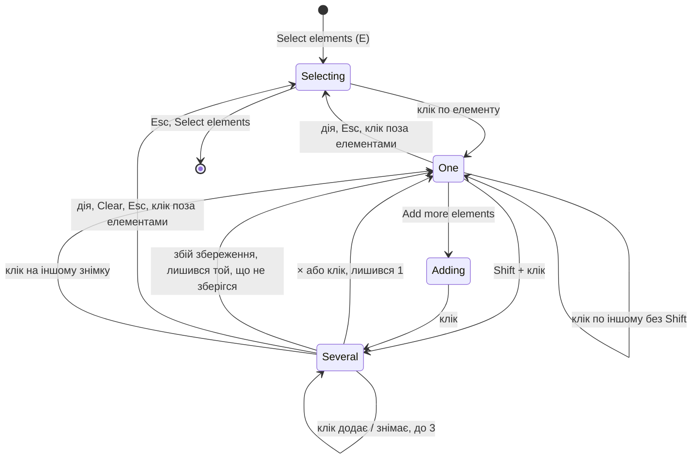

# 028 — Дизайн

Специфікація: [spec.md](spec.md). Макет: [вибір кількох елементів](https://claude.ai/artifact/YBRAiZXPBb7WWeXrufc9tv).

## Підхід

Зміна лише у фронтенді. Бекенд уже вміє все потрібне: правило додається й прибирається по одному
(`addElementRule`, `removeElementRule`), а екран і так додає по правилу на кожен обраний селектор
([024](../024-elements-instead-of-areas/spec.md), Shift + клік). Нової моделі даних немає.

- **Правила вибору — чисті функції** в `elementPicking.helper.ts`, поруч із `toggleSelection`, яку
  вони замінюють:
  - `addToSelection(selected, element, limit)` повертає новий вибір і `refused`, коли елемент не
    додано через ліміт 3 (REQ-028-03, REQ-028-05). Клік по вже обраному елементу знімає його.
  - `sortSelected(selected, rules, side)` ділить обрані на ті, що без правила, і ті, що вже з
    правилом. Для цього береться наявна `ruleFor`. Функція також каже, що
    показати замість дій: «Remove N rules», коли всі обрані мають правила однієї дії, або пояснення,
    коли дії різні (REQ-028-30, REQ-028-31, REQ-028-33).
  - `panelSide(selectedRects, panelHeight, areaHeight)` каже, де стати панелі: внизу, а якщо
    під нею опинився б обраний елемент, угорі (див. «Ризики», SC-028-03).
- **Нова панель вибору `SelectionPanel`** показується замість `ElementPopover`, коли обрано 2–3
  елементи (REQ-028-10). Вона не прив'язана до місця кліку: стоїть у полі зі знімками, внизу або
  вгорі за `panelSide`. Поки панель відкрита, смуга-підказка «Click an element» прихована, бо
  Clear і Esc є в самій панелі.
- **Спільне з підказкою біля елемента** виносимо в `ElementActions.tsx`: позначка дії (`swatch`),
  кнопки Ignore / Compare only / Allow, перемикач This screen / All screens з вимкненим Compare
  only для All screens (REQ-028-24) і клавіші I, C, T, Esc. `ElementPopover` і `SelectionPanel`
  беруть їх звідти, тому дії однакові в обох місцях. Клавіші ↑ / ↓ лишаються лише в
  `ElementPopover` (REQ-028-15).
- **Номери на знімках.** `OverlayRect` отримує необов'язкове поле `badge`, а `DrawArea` малює його
  кружечком у куті рамки. Рамки обраних (`picked:N`) отримують номер, коли обрано більше одного
  (REQ-028-11). Наведення на елемент у панелі передає `picked:N` у `highlightedOverlayId`, і ця
  рамка підсвічується на обох знімках (REQ-028-12). Цей механізм уже є.
- **Дія для кількох** у `TestDetailsModal.act`:
  - пропускає обрані з правилом (REQ-028-30);
  - зберігає правила по одному, як зараз, бо кожне порівнює знімок знову;
  - показує одне сповіщення з одним Undo на всі збережені правила (REQ-028-21);
  - якщо збереження зупинилось на помилці: збережені правила лишаються разом із сповіщенням і
    Undo, помилка називає елемент, а обраним лишається лише він, з підказкою біля нього
    (REQ-028-22).
- **«Remove N rules»** прибирає правила по одному. Якщо серед них є правило для всіх екранів,
  кнопка спершу перетворюється на «Remove on every screen», як `elementRemoveRule` в
  `ElementPopover` (REQ-028-32).

## Компоненти

| Компонент | Шлях | Роль |
|---|---|---|
| Правила вибору | `frontend/src/_helpers/elementPicking.helper.ts` | `addToSelection`, `MAX_SELECTED = 3`, `sortSelected`, `panelSide`; `toggleSelection` прибираємо (її робить `addToSelection`) |
| Спільні дії | frontend/src/components/TestDetailsDialog/ElementActions.tsx (новий) | `swatch`, `ActionButtons`, `ScopeToggle`, `useActionKeys` (I, C, T, Esc); винесено з `ElementPopover` без зміни поведінки |
| Підказка біля елемента | `frontend/src/components/TestDetailsDialog/ElementPopover.tsx` | бере дії з `ElementActions`; нова кнопка `elementAddMore` «Add more elements» з «or Shift + click» (REQ-028-01); рядок «N selected» прибираємо, бо для кількох тепер панель |
| Панель вибору | frontend/src/components/TestDetailsDialog/SelectionPanel.tsx (новий) | `selectionPanel`: заголовок із кількістю, «one rule each», Clear (`selectionClear`); елементи `selectionItem-N` з номером, назвою, «×K», якщо K > 1, позначкою правила й × (`selectionRemove-N`); рядок про пропущені (`selectionSkipped`) і про ліміт (`selectionLimit`); дії або «Remove N rules» (`selectionRemoveRules`), або пояснення (`selectionMixed`) |
| Екран порівняння | `frontend/src/components/TestDetailsDialog/TestDetailsModal.tsx` | у `Selection` нове поле `adding` (після «Add more elements»); `pick` додає, коли є Shift, `adding` або обрано ≥ 2, і лише на тому самому знімку (REQ-028-03, 04, 06); `act` для кількох; `removeRules`; положення панелі; підказка з Shift у `selectingBar` (REQ-028-02) |
| Рамки на знімку | `frontend/src/components/TestDetailsDialog/DrawArea.tsx` | `OverlayRect.badge`: номер у кружечку кольору рамки |
| Тексти | `frontend/src/i18n/en.ts`, `frontend/src/i18n/uk.ts` | `select.hint` з Shift; `select.addMore`, `select.addMoreShift`; `selection.title`, `selection.eachRule`, `selection.clear`, `selection.limit`, `selection.skipped`, `selection.removeRules`, `selection.mixed`, `selection.failed`; `select.selected` прибираємо |

## Дані

Без змін у базі й API. Вибір живе лише в стані екрана й скидається при переході до іншого знімка,
як і зараз.

## Потік

Коли обраних лишається один (× у панелі або збій), підказку біля нього треба до чогось
прив'язати. Точку прив'язки рахуємо з меж елемента, переводячи їх через масштаб і зсув знімка,
як це вже робиться для позначок доступності, бо місця кліку для нього може й не бути.

## Ризики

| Ризик | Що робимо |
|---|---|
| SC-028-03 («панель не перекриває знімки на 1440×900») не виконати, не зменшуючи знімки. Мобільний знімок вписується у всю висоту поля, а змінювати масштаб знімка після появи забороняє [018](../018-ui-redesign/spec.md). | Панель стоїть унизу поля, а якщо під нею опинився б обраний елемент, угорі (`panelSide`). **Пропоную власнику переписати SC-028-03 так: «панель вибору не перекриває жоден обраний елемент».** Доки він не вирішить, SC-028-03 перевіряємо вручну. |
| Три правила одне за одним — це три перепорівняння, тож дія займає кілька секунд. | Поки дія триває, кнопки дій недоступні (`ruleBusy`), як і зараз. Ліміт 3 обмежує час. |
| Shift + клік на трекпаді macOS виділяє текст сторінки. | Панель і поле знімків мають `user-select: none`, поки ввімкнено вибір. |
| Тест «adds one rule per selected element» (Shift + клік, 024) шукає «2 selected» у підказці біля елемента, а цього тексту більше не буде. | Тест переписуємо під панель; його назва лишається, тож трасування 024 не ламається. |

## Перевірка вимог

Тести ще не написані. Поки специфікація не `Implemented`, назви нижче — план без лапок
коду. Задача T7 у [tasks.md](tasks.md) переводить їх у формат трасування.

| Вимога | Перевірка |
|---|---|
| REQ-028-01 | план: frontend/integration_tests/test/elementSelection.spec.ts › offers to add more elements next to one |
| REQ-028-02 | план: frontend/integration_tests/test/elementSelection.spec.ts › tells about Shift while selecting |
| REQ-028-03 | план: frontend/src/_helpers/elementPicking.helper.test.ts › adds an element and takes a selected one back out; frontend/integration_tests/test/elementSelection.spec.ts › adds a second element with Add more elements |
| REQ-028-04 | план: frontend/integration_tests/test/elementSelection.spec.ts › adds with a plain click while the panel is open |
| REQ-028-05 | план: frontend/src/_helpers/elementPicking.helper.test.ts › refuses a fourth element; frontend/integration_tests/test/elementSelection.spec.ts › says no more than three can be selected |
| REQ-028-06 | план: frontend/integration_tests/test/elementSelection.spec.ts › starts over on the other screenshot |
| REQ-028-10 | план: frontend/integration_tests/test/elementSelection.spec.ts › shows the selection panel for two elements |
| REQ-028-11 | manual: обрати три елементи → на еталоні й знімку біля кожного рамка з номером 1, 2, 3, такими самими, як у панелі (рамки малює canvas, тест їх не бачить) |
| REQ-028-12 | manual: навести курсор на елемент 2 у панелі → його рамка підсвічена на обох знімках, а рамки 1 і 3 ні |
| REQ-028-13 | план: frontend/integration_tests/test/elementSelection.spec.ts › takes an element out of the selection |
| REQ-028-14 | план: frontend/integration_tests/test/elementSelection.spec.ts › clears the selection and keeps selecting |
| REQ-028-15 | план: frontend/integration_tests/test/elementSelection.spec.ts › offers no parent or full form for several |
| REQ-028-20 | план: frontend/integration_tests/test/elementSelection.spec.ts › adds one rule per selected element |
| REQ-028-21 | план: frontend/integration_tests/test/elementSelection.spec.ts › undoes all rules of one action at once |
| REQ-028-22 | план: frontend/integration_tests/test/elementSelection.spec.ts › keeps the saved rules when one fails |
| REQ-028-23 | план: frontend/integration_tests/test/elementSelection.spec.ts › clears the selection after an action |
| REQ-028-24 | план: frontend/integration_tests/test/elementSelection.spec.ts › keeps compare only to this screen for several |
| REQ-028-30 | план: frontend/src/_helpers/elementPicking.helper.test.ts › sorts out the selected elements that have a rule; frontend/integration_tests/test/elementSelection.spec.ts › skips a selected element that has a rule |
| REQ-028-31 | план: frontend/integration_tests/test/elementSelection.spec.ts › removes the rules of all selected elements |
| REQ-028-32 | план: frontend/integration_tests/test/elementSelection.spec.ts › asks before removing a rule for every screen with others |
| REQ-028-33 | план: frontend/src/_helpers/elementPicking.helper.test.ts › offers nothing to do when the rules differ |
