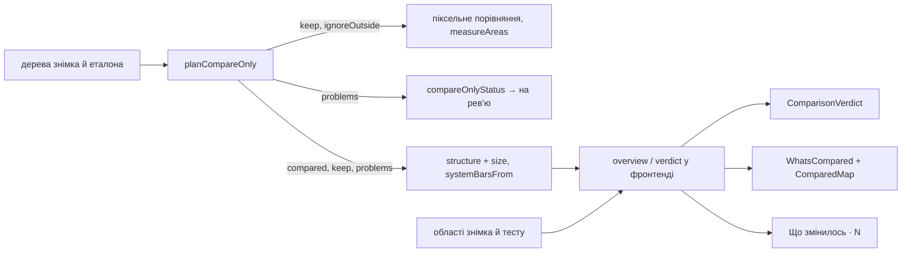

# 030 — Дизайн

Специфікація: [spec.md](spec.md). Макет: [чотири стани вкладки](https://claude.ai/artifact/RmLEJ3ttdt79GQTUFB1hwD).

## Підхід

Зміна майже вся у фронтенді: усе, що треба показати, бекенд уже рахує, бракує лише трьох
речей.

1. **Порівняння за одним деревом (REQ-030-30…33).** `planCompareOnly` зараз повертає `no-tree`,
   щойно немає хоча б одного дерева. Тепер, коли дерево є лише з одного боку, план бере рамки
   обраних елементів із нього як `keep`, решту екрана віддає в `ignoreOutside`, переміщень не
   рахує і додає проблему `one-tree` із тим, чийого дерева немає. Далі все працює як зараз:
   `measureAreas` ([ADR-0018](../../decisions/0018-compare-only-measures-compared-elements.md))
   міряє різницю лише в цих ділянках, а `compareOnlyStatus` не пропускає прогін із проблемою, тож
   знімок іде на рев'ю (REQ-030-31) без нового коду в `TestRunsService`. `no-tree` лишається
   лише тоді, коли дерев немає з обох боків (REQ-030-33).
2. **Обрані елементи поіменно (REQ-030-20, 24, 40).** План уже знає, який вузол якого правила
   збігся і куди він зсунувся, але віддає лише плаский `keep`. Додаємо `compared`: правило,
   назва елемента, рамка, зсув. Зсув у dp рахує `structure()`, як для `moves`.
3. **Розмір знімка й джерело системних панелей (REQ-030-11, 13).** `structure()` уже читає
   розмір PNG для підказок про шум. Віддаємо його як `size` для схеми, а `systemBarsFrom`
   (`test` чи `project`) каже, звідки рядок системних панелей.

Решта — чиста функція у фронтенді, що з `structure`, областей знімка й областей тесту складає
все, що показує вкладка: результат, підсумок, групи, ознаку «впливає / не впливає», місце
рядка під обраним елементом. Компоненти лише малюють її результат. Перетин рахуємо
прямокутниками в пікселях знімка: ті самі прямокутники бекенд віддає в `ignoreOutside`, тож
«не впливає» в панелі збігається з тим, що відкинуло порівняння.

Окремого ADR не потрібно: правило, що прогін без певності йде на рев'ю, і заміри лише в
обраних ділянках уже записані в 015 і ADR-0018; 030 лише дає їм дерево з одного боку.

## Компоненти

| Компонент | Шлях | Роль |
|---|---|---|
| План «порівнювати лише» | `backend/src/ui-tree/compare-only.ts` | `planCompareOnly(rules, baseline, current)` приймає одне дерево: `keep` і `compared` з наявного, без `moves`, проблема `{ kind: 'one-tree', missing: 'baseline' \| 'current' }`; правило без збігів у ньому — `nothing-found`. Новий `compared: Array<{ ruleId, element, bounds, shift? }>` і для двох дерев (REQ-030-20, 24, 30, 33). |
| Вхідні дані порівняння | `backend/src/ui-tree/ui-tree.service.ts` | `comparisonInputs`: без поточного дерева, але з деревом еталона — план за еталоном замість раннього `no-tree`; `systemBarsFrom` поряд із `systemBars`. `structure()`: `size`, `systemBarsFrom`, `compareOnly.compared` зі зсувом у dp (REQ-030-11, 13, 24, 30). |
| Типи | `frontend/src/types/insights.ts` | `CompareOnlyProblem` += `one-tree`; `StructureInfo` += `size`, `systemBarsFrom`, `compareOnly.compared`. |
| Огляд вкладки | `frontend/src/_helpers/whatsCompared.helper.ts` | Замість `summarize` і `groupRules`: `verdict(...)` → вид заголовка й причина (REQ-030-01…05); `overview(structure, areas, testAreas)` → підсумок і N (REQ-030-10), рядки з дією, джерелом, ознакою `effect: 'applies' \| 'outside' \| 'nothing-found'` і `insideOf` (REQ-030-12…14, 20…23); `elementState(...)` → «без змін», «змінено», «зник», «з'явився», «нічого не знайдено» (REQ-030-40). |
| Заголовок результату | frontend/src/components/TestDetailsDialog/ComparisonVerdict.tsx (новий) | Іконка, заголовок, причина; кольори з `tokens.status` (REQ-030-01…04, 32, 33). |
| Схема екрана | frontend/src/components/TestDetailsDialog/ComparedMap.tsx (новий) | Прямокутники з `overview` і змінені ділянки в масштабі `size`; поза `keep` — приглушено; `role="img"` з описом (REQ-030-11). |
| Блок «Що порівнюється» | `frontend/src/components/TestDetailsDialog/WhatsCompared.tsx` | Переписується за макетом: підсумок і схема, групи, джерело, рядки під обраним елементом, згорнута «Не впливають · N», стан обраного елемента й «Прибрати з порівнюваного». Наведення, клік по області, видалення правила й підказка з селектором лишаються (REQ-030-10…24, 40, 41). |
| Вкладка «Зміни» | `frontend/src/components/TestDetailsDialog/InsightsPanel.tsx` | Порядок: результат → «Що порівнюється» → підказки й невидимі зміни → «Що змінилось · N» (змінені ділянки й зміни з дерева під одним заголовком, «Порівняно на новому місці» лишається під ними). Прибираються речення «нічого не змінилося» і про системні панелі. Знизу «Обрати елементи» (E) і, для тих, хто може змінювати, повна форма правила. «Прибрати з порівнюваного» видаляє правило і в сповіщенні дає Undo, що додає його знову (REQ-030-05, 41, 50, 51). |
| Вибір елементів | `frontend/src/components/TestDetailsDialog/TestDetailsModal.tsx` | Передає `toggleSelecting` у панель для посилання «Обрати елементи» (REQ-030-51). |
| Тексти | `frontend/src/i18n/en.ts`, `frontend/src/i18n/uk.ts` | Нові ключі `compared.*`, `verdict.*`; старі `compared.except`, `compared.areas`, `panel.nothingChanged`, `panel.systemBars` прибираються, якщо ніде не лишились. |
| Моки й тести UI | `frontend/integration_tests/test/elementRules.spec.ts`, `frontend/integration_tests/test/elementSelection.spec.ts` | Сценарії вкладки на моках `structure`. |

## Дані

Без змін у базі. `structure` — відповідь API, не колонка: нові поля `size`, `systemBarsFrom`,
`compareOnly.compared` лише додаються, старий фронтенд їх не читає. Збережені області й
правила не змінюються.

## Потік

## Ризики

| Ризик | Що робимо |
|---|---|
| Еталон і знімок різного розміру, а ділянку взято з одного дерева | `complement` уже обрізає по більшій стороні; ділянку, що виходить за меншу картинку, піксельне порівняння й так покаже зміною. Знімок однаково на рев'ю (REQ-030-31). |
| Перетин «впливає / не впливає» у панелі розійдеться з тим, що відкинуло порівняння | Рахуємо по тих самих `keep`, що бекенд віддає в `measureAreas`; тест на область, що наполовину заходить на елемент. |
| Старі тести 024 і 015 (`sums up what is compared`, `groups rules by what they do`, `says the whole screen is compared when there is no UI tree`) зникнуть разом із `summarize` і `groupRules` | У тому ж коміті в design.md 024 рядки підсумку й груп позначаємо «замінено REQ-030-10, REQ-030-12» з новими тестами, а в spec.md 015 і 024 — що вимоги змінено 030. |
| Прибрати правило «порівнювати лише» тепер можна з видного місця | Дія лише біля проблеми, лише з правом змінювати проєкт, з Undo (REQ-030-41). |
| Еталон із VRT без дерева тепер порівнюється за ділянкою, і зсув поля дасть зміну | Це свідомо (REQ-030-32): пояснення каже, що пошуку після зсуву немає і як це виправити. |

## Перевірка вимог

Тести ще не написані. Поки специфікація не `Implemented`, назви нижче — план без лапок коду.
Задача T8 у [tasks.md](tasks.md) переводить їх у формат трасування.

| Вимога | Перевірка |
|---|---|
| REQ-030-01 | whatsCompared.helper.test.ts › says what came out and why |
| REQ-030-02 | whatsCompared.helper.test.ts › says nothing changed when the compared part matches |
| REQ-030-03 | whatsCompared.helper.test.ts › counts the changes the list shows |
| REQ-030-04 | whatsCompared.helper.test.ts › puts a compare-only problem in the heading |
| REQ-030-05 | elementRules.spec.ts › shows the result once, at the top of the Changes tab |
| REQ-030-10 | whatsCompared.helper.test.ts › sums up what is compared in places |
| REQ-030-11 | ComparedMap.test.tsx › draws the compared, ignored, tolerated and changed parts to scale |
| REQ-030-12 | whatsCompared.helper.test.ts › groups rows by what they do |
| REQ-030-13 | whatsCompared.helper.test.ts › names where each row comes from |
| REQ-030-14 | whatsCompared.helper.test.ts › lists the system bars as an ignored row |
| REQ-030-15 | elementRules.spec.ts › highlights, opens and removes rows of what is compared |
| REQ-030-20 | whatsCompared.helper.test.ts › puts what applies inside a compared element under it |
| REQ-030-21 | whatsCompared.helper.test.ts › folds away what lies outside the compared elements; elementRules.spec.ts › keeps rows outside the compared elements folded |
| REQ-030-22 | elementRules.spec.ts › explains why the folded rows do not count |
| REQ-030-23 | whatsCompared.helper.test.ts › folds away rules that found nothing |
| REQ-030-24 | ui-tree.service.spec.ts › says how far a compared element moved, in dp |
| REQ-030-30 | compare-only.spec.ts › compares the element at its place when only one side has a tree |
| REQ-030-31 | test-runs.service.spec.ts › keeps a run compared by one tree in review |
| REQ-030-32 | whatsCompared.helper.test.ts › explains which side has no tree and what accepting does |
| REQ-030-33 | compare-only.spec.ts › compares the whole screen when neither side has a tree |
| REQ-030-40 | whatsCompared.helper.test.ts › tells which compared elements are gone, new or unchanged |
| REQ-030-41 | elementRules.spec.ts › removes a gone element from what is compared, with Undo |
| REQ-030-50 | elementRules.spec.ts › lists every change under one heading with its count |
| REQ-030-51 | elementSelection.spec.ts › turns on element selection from the Changes tab |
