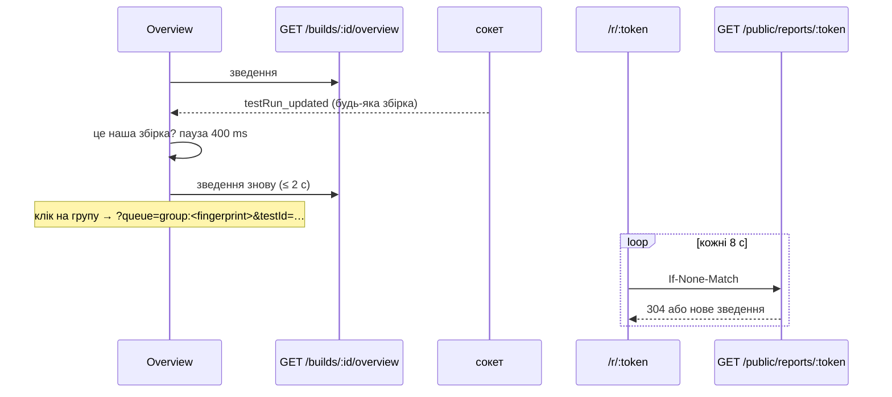

# 031 — Дизайн

## Підхід

- **Одне зведення збірки на бекенді.** Чиста функція `buildOverview` рахує вердикт, числа,
  прогрес, пристрої, фічі, баги й порівняння з попередньою збіркою. Сервіс лише вантажить рядки.
  Те саме зведення читають Overview, діалог звіту й публічна сторінка, тож числа однакові всюди.
- **Групи — з наявного `GET /test-runs/groups`.** Їх уже рахує вкладка Changes ([006](../006-change-groups/spec.md)).
  В огляд вони не дублюються. Підсумки AI («Possible regression») в огляд не потрапляють (REQ-031-48).
- **Черги рахуються на фронтенді.** Чистий хелпер `reviewQueue` з ключа черги (`all`,
  `group:<fingerprint>`, `device:<профіль>`, `feature:<назва>`, `run:<id>`) і даних, що вже є на сторінці
  (прогони збірки, групи), будує впорядкований список id. Ключ живе в адресі. Список фіксується, коли
  порівняння відкрили, щоб крапки й «N / M» не стрибали після рішень.
- **Публічний звіт — окрема таблиця посилань і один endpoint без входу**
  ([ADR-0022](../../decisions/0022-public-report-links.md)).
- **Живе оновлення.** Overview не слухає сокет сам: контекст прогонів збірки вже оновлюється його
  подіями, і зміна статусу чи лічильника a11y будь-якого прогону збірки перезапитує зведення з паузою
  400 ms. Групи для «To decide» і черг тримає один хук на сторінці, `useBuildGroups`.
- **Вкладка в адресі.** `tab` (без нього — Overview), `status` (All tests на одному статусі),
  `queue`, а `testId` завжди останній. Вкладка, з якої відкрили порівняння, лишається в адресі,
  тож Esc повертає туди. Ціль останнього кроку туру — область вкладки, а не список, що прихований
  на інших вкладках. Публічна сторінка не слухає сокет, бо він розсилає рядки всіх
  збірок. Вона перепитує своє зведення кожні 8 с з `ETag`, тож незмінене зведення коштує 304.
- **PDF — друк сторінки звіту браузером** у «Save as PDF», зі стилем `@page A4`. Нової залежності
  немає, і PDF збігається з тим, що видно на екрані (ADR-0022).

## Компоненти

| Компонент | Шлях | Роль |
|---|---|---|
| зведення (чисте) | `backend/src/builds/build-overview.ts` | вердикт, числа, прогрес, пристрої, фічі, баги, порівняння з попередньою |
| сервіс зведення | `backend/src/builds/build-overview.service.ts` | вантажить прогони збірки й попередньої, рішення, баги перевірки, баги доступності |
| маршрут | `backend/src/builds/builds.controller.ts` | `GET /builds/:id/overview` (JwtAuthGuard) |
| назва фічі | `backend/src/visual-bugs/visual-bug.ts` | наявний `featureOf` — та сама фіча, що в назві бага |
| баги доступності збірки | `backend/src/a11y/a11y-issues.service.ts` | новий метод: ключі Jira проблем, що трапились у прогонах збірки; читає лише прогони з `a11yTotalCount > 0`, кеш за збіркою й найпізнішим `updatedAt` |
| журнал рішень | `backend/src/test-runs/decision-undo.service.ts` | пише автора рішення в прогон (`decidedById`), Undo його стирає |
| посилання (чисте) | `backend/src/reports/report-links.ts` | чинність (лише відкликання), обрізання до розділів, до 20 змін, люди лише на ім'я |
| посилання (сервіс, маршрути) | `backend/src/reports/` | `GET /builds/:id/report` (повний звіт для діалогу й друку), `POST /builds/:id/report-links` (editor, admin), `GET /builds/:id/report-links`, `DELETE /report-links/:id` (автор або admin), `GET /public/reports/:token` без входу, з `ETag` |
| типи | `frontend/src/types/` | `BuildOverview`, `ReportLink`, `PublicReport` |
| сервіси | `frontend/src/services/` | `frontend/src/services/buildOverview.service.ts`, `frontend/src/services/reports.service.ts` |
| вкладка Overview | `frontend/src/components/BuildOverview/`, `frontend/src/_helpers/previousBuild.helper.ts` | вердикт, плитки, To decide, Devices, Features, Jira bugs |
| вкладка Accessibility | `frontend/src/components/A11ySummary.tsx`; спільні з Overview плитки й таблиці — `frontend/src/components/SummaryParts.tsx` | REQ-031-71 |
| вкладка в адресі | `frontend/src/pages/ProjectPage.tsx`, `frontend/src/_helpers/route.helpers.ts` | `tab` і `queue` у query; без `tab` — Overview |
| черги (чисте) | `frontend/src/_helpers/reviewQueue.helper.ts` | ключ черги → впорядковані id; меню черг; наступна непорожня |
| порівняння | `frontend/src/components/TestDetailsDialog/index.tsx` | крокує чергою, якщо вона є, інакше як зараз (список All tests) |
| заголовок черги, підсумок | `frontend/src/components/TestDetailsDialog/QueueHeader.tsx`, `frontend/src/components/TestDetailsDialog/QueueDone.tsx` | назва черги, «N / M», меню; підсумок, Enter і Esc |
| крапки кроків | `frontend/src/components/TestDetailsDialog/StepDots.tsx` | без змін; поруч «N / M» замість «Step N/M» |
| звіт | `frontend/src/components/BuildReport/` | `ReportDialog` (налаштування, поділитися, посилання), `ReportDocument` (спільний для діалогу, сторінки й друку) |
| сторінки звіту | `frontend/src/pages/ReportPage.tsx`, `frontend/src/Router.jsx`, `frontend/src/App.tsx` | `/r/:token` поза `PrivateRoute`, перепит кожні 8 с; `/report/:buildId` для друку (входу треба), друкує, щойно знімки завантажились; обидві — без шапки й навігації |
| тексти | `frontend/src/i18n/en.ts`, `frontend/src/i18n/uk.ts` | ключі `overview.*`, `queue.*`, `report.*` |

## Дані

Міграція лише додавальна ([ADR-0003](../../decisions/0003-additive-schema-only.md)):

- **Нова таблиця `ReportLink`:** `id`, `token` (унікальний, 32 випадкові байти base64url), `buildId`,
  `projectId`, `sections` (JSON-рядок), `language`, `createdById`, `createdAt`,
  `revokedAt?`. Індекси — `token` і `buildId`. **Без зовнішніх ключів на `Build` і `User`:** upstream
  видаляє збірки (ліміт збірок, гілки), і обмеження зламало б це видалення. Посилання на видалену
  збірку показує «збірки більше немає» (REQ-031-65).
- **`TestRun.decidedById String?`.** Журнал рішень пише в нього того, хто прийняв чи відхилив прогон,
  а Undo його стирає. Сам журнал (`ReviewDecision`) живе лише 7 днів, тож для прогресу (REQ-031-04)
  він не підходить. Для рішень, ухвалених до міграції, автора approve беремо з `Baseline.userId`
  за `testRunId`, а reject без автора рахується як «хтось».
- Старі дані не змінюються.

## Потік

Попередня збірка — та сама `projectId` і `branchName`, найбільший `number`, менший за поточний.
Ідентичність знімка — перевірка (назва + `customTags`) і профіль пристрою ([ADR-0005](../../decisions/0005-check-by-name-baseline-per-device.md)).
Знімок «відрізняється», якщо його статус `unresolved`, `failed` або `approved`: при прийомі він не
збігся з еталоном.

## Ризики

| Ризик | Що робимо |
|---|---|
| Перший ендпоінт з даними без входу | лише `GET /public/reports/:token`; токен на 256 біт; відповідь зібрана з білого списку полів (імена знімків, числа, імена людей без пошт); тест, що в ній немає `email`, `apiKey`, `token`, `jira*` |
| Сокет без авторизації вже розсилає рядки всім | публічна сторінка до сокета не під'єднується; сам сокет — окрема задача, поза 031 |
| Баги доступності збірки дорогі (файли звітів) | читаємо лише прогони з відкритими проблемами; кеш за збіркою й найпізнішим `updatedAt`; Overview показує баги перевірки одразу, а доступності — коли догрузились |
| Огляд перераховується на кожну подію під час прийому знімків | пауза 400 ms і не більше одного запиту одночасно; зведення — агрегація в базі, як `build-stats.ts` |
| Група змінює `id` після рішень | черга тримається за `fingerprint` групи, а список id фіксується при відкритті |
| PDF залежить від браузера | `@page A4`, контрольний PDF у Chrome і Safari вручну; власний генератор не беремо (ADR-0022) |
| Час «стану» в PDF | час останнього оновлення зведення, а не натискання, — щоб не обіцяти свіжіший стан, ніж є |

## Перевірка вимог

| Вимога | Перевірка |
|---|---|
| REQ-031-01 | `frontend/integration_tests/test/buildOverview.spec.ts › opens a build on the Overview tab` |
| REQ-031-02 | `frontend/src/_helpers/route.helpers.test.ts › keeps the build tab in the address` |
| REQ-031-03 | `backend/src/builds/build-overview.spec.ts › says Running, Waiting for review, Reviewed or Passed`; `frontend/src/components/BuildReport/ReportDocument.test.tsx › renders in the report language, not the interface one` |
| REQ-031-04 | `backend/src/builds/build-overview.spec.ts › counts decisions per person and leaves undone ones out`; `frontend/integration_tests/test/buildOverview.spec.ts › opens a build on the Overview tab`; `frontend/integration_tests/test/buildOverview.spec.ts › leaves the decided caption out when nothing needed a decision` |
| REQ-031-05 | `backend/src/builds/build-overview.spec.ts › counts screenshots, waiting, rejected, new a11y issues and bugs` |
| REQ-031-06 | `frontend/integration_tests/test/buildOverview.spec.ts › each number opens its tab or queue` |
| REQ-031-07 | знято 2026-11-01 — `frontend/integration_tests/test/buildOverview.spec.ts › leaves change groups to the Changes tab` |
| REQ-031-08 | `backend/src/builds/build-overview.spec.ts › splits the result by device profile`; `backend/src/builds/build-overview.spec.ts › takes the screen size of a device from the screenshots measured`; `backend/src/builds/build-overview.service.spec.ts › reads the screen size of each device from one of its screenshots`; `backend/src/builds/build-overview.service.spec.ts › leaves the screen size out when the screenshot cannot be read`; `frontend/integration_tests/test/buildOverview.spec.ts › shows a device's screen size when the run sent no viewport` |
| REQ-031-09 | `backend/src/builds/build-overview.spec.ts › groups checks by featureName only and keeps the others one per check`; `backend/src/builds/build-overview.spec.ts › keeps a feature and a check of the same name apart`; `backend/src/builds/build-overview.spec.ts › folds quiet features into one row`; `frontend/integration_tests/test/buildOverview.spec.ts › opens the passed features in place of their folded row`; `frontend/src/components/BuildReport/ReportDocument.test.tsx › Short has Summary, Changes and Jira bugs; Full adds the rest` |
| REQ-031-10 | `backend/src/builds/build-overview.spec.ts › marks bugs filed from this build New and older ones Known` |
| REQ-031-11 | `backend/src/builds/build-overview.spec.ts › compares with the previous build of the branch`; `frontend/src/_helpers/previousBuild.helper.test.ts › says what changed since the previous build, leaving out zeros` |
| REQ-031-12 | `backend/src/builds/build-overview.spec.ts › says first build when the branch has no earlier one`; `frontend/src/components/BuildReport/ReportDocument.test.tsx › says first build on the branch when there is no earlier one` |
| REQ-031-13 | `frontend/src/components/BuildOverview/useBuildOverview.test.tsx › updates the numbers when a run of the build changes` |
| REQ-031-14 | знято 2026-11-01 — перевірки немає |
| REQ-031-15 | `frontend/integration_tests/test/buildOverview.spec.ts › keeps the counts out of the build header on every tab` |
| REQ-031-16 | `frontend/src/_helpers/buildPeriod.helper.test.ts › shows the start and the end, the end without the date on the same day`; `frontend/src/_helpers/buildPeriod.helper.test.ts › shows the start alone until the build runs on` |
| REQ-031-17 | `frontend/integration_tests/test/buildOverview.spec.ts › shows a device's screen size when the run sent no viewport`; `frontend/src/components/BuildReport/ReportDocument.test.tsx › summary names the project, build, branch, time, devices and numbers` |
| REQ-031-18 | `frontend/integration_tests/test/buildOverview.spec.ts › puts the count of All tests in a pill like the tabs beside it` |
| REQ-031-19 | `frontend/integration_tests/test/buildOverview.spec.ts › explains a result bar and leaves zeros out of the counts`; `frontend/integration_tests/test/buildOverview.spec.ts › says there are no Jira bugs in one line`; `frontend/src/components/BuildReport/ReportDocument.test.tsx › explains the bars and leaves zeros out of the tables` |
| REQ-031-70 | `frontend/integration_tests/test/buildOverview.spec.ts › counts the checks of a feature and opens a check on its own`; `frontend/src/components/BuildReport/ReportDocument.test.tsx › says how many checks a feature holds and not for a check on its own` |
| REQ-031-71 | `frontend/integration_tests/test/buildOverview.spec.ts › lays out the Accessibility tab like the Overview` |
| REQ-031-20 | `frontend/src/_helpers/reviewQueue.helper.test.ts › puts all waiting in the order of the groups, new last`; `frontend/integration_tests/test/buildOverview.spec.ts › names the review button without a count` |
| REQ-031-21 | `frontend/src/_helpers/reviewQueue.helper.test.ts › keeps only the waiting runs of a group, device, feature or check`; `frontend/integration_tests/test/buildOverview.spec.ts › counts the checks of a feature and opens a check on its own` |
| REQ-031-22 | знято 2026-11-01 — перевірки немає |
| REQ-031-23 | `frontend/src/_helpers/reviewQueue.helper.test.ts › opens the run a bug was filed from, decided or not` |
| REQ-031-24 | `frontend/integration_tests/test/buildOverview.spec.ts › shows the queue name and position instead of Step` |
| REQ-031-25 | `frontend/integration_tests/test/buildOverview.spec.ts › switches the queue from its menu` |
| REQ-031-26 | `frontend/integration_tests/test/buildOverview.spec.ts › sums up a finished queue and offers the next one` |
| REQ-031-27 | `frontend/src/_helpers/reviewQueue.helper.test.ts › skips runs someone else decided` |
| REQ-031-28 | `frontend/integration_tests/test/buildOverview.spec.ts › Esc returns to where the review was opened, focus on the same row` |
| REQ-031-29 | `frontend/src/_helpers/route.helpers.test.ts › keeps build, run and queue in the address` |
| REQ-031-40 | `frontend/integration_tests/test/buildReport.spec.ts › previews the whole report and shares it` |
| REQ-031-41 | знято 2026-11-01 — `frontend/integration_tests/test/buildReport.spec.ts › previews the whole report and shares it` |
| REQ-031-42 | `frontend/src/components/BuildReport/ReportDocument.test.tsx › renders in the report language, not the interface one` |
| REQ-031-43 | `frontend/src/components/BuildReport/ReportDocument.test.tsx › summary names the project, build, branch, time, devices and numbers`; `frontend/src/components/BuildReport/ReportDocument.test.tsx › gives when the build ran as its period and the state's time once` |
| REQ-031-44 | `backend/src/reports/report-links.spec.ts › lists up to 20 changes and counts the rest`; `backend/src/reports/report-links.spec.ts › shows new screenshots after the changed ones and before the rejected`; `frontend/src/components/BuildReport/ReportDocument.test.tsx › shows new screenshots without a baseline and names statuses as the app does` |
| REQ-031-45 | знято 2026-11-01 — `frontend/integration_tests/test/buildReport.spec.ts › previews the whole report and shares it` |
| REQ-031-46 | `frontend/integration_tests/test/buildReport.spec.ts › prints the report on A4 pages with the chosen sections and language`; manual: Report → PDF у Chrome і Safari → «Save as PDF» дає A4 з обраними розділами й мовою |
| REQ-031-47 | `frontend/src/components/BuildReport/ReportDocument.test.tsx › summary names the project, build, branch, time, devices and numbers` |
| REQ-031-48 | `backend/src/builds/build-overview.service.spec.ts › builds the overview without calling AI` |
| REQ-031-49 | manual: у коді звіту (`frontend/src/components/BuildReport/`, `frontend/src/pages/ReportPage.tsx`, `frontend/src/services/reports.service.ts`, `backend/src/reports/`) немає звернень ні до чого, крім API Vision; перевірено пошуком і рев'ю диффу 2026-10-31 |
| REQ-031-60 | `backend/src/reports/reports.controller.spec.ts › creates a link with the chosen sections and language` |
| REQ-031-61 | `backend/src/reports/report-links.spec.ts › opens for as long as the build is kept and closes when revoked` |
| REQ-031-62 | `backend/src/reports/reports.controller.spec.ts › serves a report without signing in and nothing else` |
| REQ-031-63 | `frontend/integration_tests/test/publicReport.spec.ts › updates the open page within 10 s` |
| REQ-031-64 | `backend/src/reports/report-links.spec.ts › opens for as long as the build is kept and closes when revoked`; `backend/src/reports/reports.controller.spec.ts › says a revoked link is closed and shows nothing of the build` |
| REQ-031-65 | `backend/src/reports/reports.controller.spec.ts › says the build is gone when it was deleted` |
| REQ-031-66 | `backend/src/reports/reports.controller.spec.ts › lets the author or an admin revoke a link`; `frontend/integration_tests/test/buildReport.spec.ts › asks before revoking a public link` |
| REQ-031-67 | `backend/src/reports/report-links.spec.ts › makes a 256-bit token unrelated to the build` |
| REQ-031-68 | `backend/src/reports/report-links.spec.ts › keeps emails, keys and tokens out of a public report` |
| REQ-031-69 | `backend/src/reports/reports.controller.spec.ts › lets editors and admins create links, not guests` |
