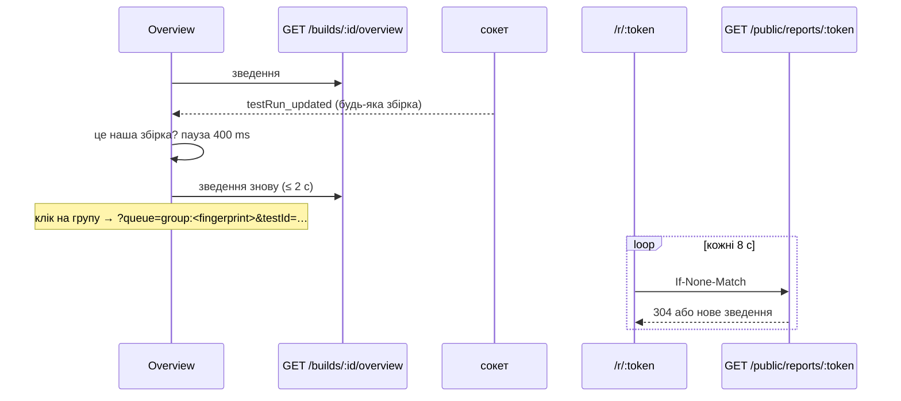

# 031 — Дизайн

## Підхід

- **Одне зведення збірки на бекенді.** Чиста функція `buildOverview` рахує вердикт, числа,
  прогрес, пристрої, фічі, баги й порівняння з попередньою збіркою. Сервіс лише вантажить рядки.
  Те саме зведення читають Overview, діалог звіту й публічна сторінка, тож числа однакові всюди.
- **Групи — з наявного `GET /test-runs/groups`.** Їх уже рахує вкладка Changes ([006](../006-change-groups/spec.md)).
  В огляд вони не дублюються. Підсумки AI («Possible regression») в огляд не потрапляють (REQ-031-48).
- **Черги рахуються на фронтенді.** Чистий хелпер `reviewQueue` з ключа черги (`all`,
  `group:<fingerprint>`, `device:<профіль>`, `feature:<назва>`, `run:<id>`) і даних, що вже є на сторінці
  (прогони збірки, групи), будує впорядкований список id. Ключ живе в адресі. Список фіксується, коли
  порівняння відкрили, щоб крапки й «N / M» не стрибали після рішень.
- **Публічний звіт — окрема таблиця посилань і один endpoint без входу**
  ([ADR-0022](../../decisions/0022-public-report-links.md)).
- **Живе оновлення.** Overview оновлюється з нинішнього сокета: подія `testRun_*` чи `build_updated`
  перезапитує зведення з паузою 400 ms. Публічна сторінка не слухає сокет, бо він розсилає рядки всіх
  збірок. Вона перепитує своє зведення кожні 8 с з `ETag`, тож незмінене зведення коштує 304.
- **PDF — друк сторінки звіту браузером** у «Save as PDF», зі стилем `@page A4`. Нової залежності
  немає, і PDF збігається з тим, що видно на екрані (ADR-0022).
- **Текст для Slack і Jira** складає чиста функція `reportText(overview, format, text)`. Slack
  отримує mrkdwn, Jira — простий список з URL: його однаково показують Jira Cloud і Server, а ключі
  Jira самі стають посиланнями.

Нові файли, яких ще немає, названо без лапок: `check-docs.py` вимагає, щоб шляхи в лапках існували.
Коли їх буде створено, вони отримають лапки.

## Компоненти

| Компонент | Шлях | Роль |
|---|---|---|
| зведення (чисте) | backend/src/builds/build-overview.ts (новий) | вердикт, числа, прогрес, пристрої, фічі, баги, порівняння з попередньою |
| сервіс зведення | backend/src/builds/build-overview.service.ts (новий) | вантажить прогони збірки й попередньої, рішення, баги перевірки, баги доступності |
| маршрут | `backend/src/builds/builds.controller.ts` | `GET /builds/:id/overview` (JwtAuthGuard) |
| назва фічі | `backend/src/visual-bugs/visual-bug.ts` | наявний `featureOf` — та сама фіча, що в назві бага |
| баги доступності збірки | `backend/src/a11y/a11y-issues.service.ts` | новий метод: ключі Jira проблем, що трапились у прогонах збірки; читає лише прогони з `a11yTotalCount > 0`, кеш за збіркою й найпізнішим `updatedAt` |
| журнал рішень | `backend/src/test-runs/decision-undo.service.ts` | пише автора рішення в прогон (`decidedById`), Undo його стирає |
| посилання (чисте) | backend/src/reports/report-links.ts (новий) | термін (7/30/90), чинність, обрізання до розділів, до 20 змін, люди лише на ім'я |
| посилання (сервіс, маршрути) | backend/src/reports/ (новий модуль) | `POST /builds/:id/report-links` (editor, admin), `GET /builds/:id/report-links`, `DELETE /report-links/:id` (автор або admin), `GET /public/reports/:token` без входу, з `ETag` |
| типи | `frontend/src/types/` | `BuildOverview`, `ReportLink`, `PublicReport` |
| сервіси | `frontend/src/services/` | buildOverview.service.ts, reports.service.ts (нові) |
| вкладка Overview | frontend/src/components/BuildOverview/ (новий) | вердикт, плитки, To decide, Devices, Features, Jira bugs |
| вкладка в адресі | `frontend/src/pages/ProjectPage.tsx`, `frontend/src/_helpers/route.helpers.ts` | `tab` і `queue` у query; без `tab` — Overview |
| черги (чисте) | frontend/src/_helpers/reviewQueue.helper.ts (новий) | ключ черги → впорядковані id; меню черг; наступна непорожня |
| порівняння | `frontend/src/components/TestDetailsDialog/index.tsx` | крокує чергою, якщо вона є, інакше як зараз (список All tests) |
| заголовок черги, підсумок | frontend/src/components/TestDetailsDialog/QueueHeader.tsx, QueueDone.tsx (нові) | назва черги, «N / M», меню; підсумок, Enter і Esc |
| крапки кроків | `frontend/src/components/TestDetailsDialog/StepDots.tsx` | без змін; поруч «N / M» замість «Step N/M» |
| звіт | frontend/src/components/BuildReport/ (новий) | `ReportDialog` (налаштування, поділитися, посилання), `ReportDocument` (спільний для діалогу, сторінки й друку) |
| текст звіту (чисте) | frontend/src/_helpers/reportText.helper.ts (новий) | Slack і Jira, мовою звіту |
| публічна сторінка | frontend/src/pages/PublicReportPage.tsx (новий), `frontend/src/Router.jsx` | `/r/:token` поза `PrivateRoute`; перепит кожні 8 с; друк |
| тексти | `frontend/src/i18n/en.ts`, `frontend/src/i18n/uk.ts` | ключі `overview.*`, `queue.*`, `report.*` |

## Дані

Міграція лише додавальна ([ADR-0003](../../decisions/0003-additive-schema-only.md)):

- **Нова таблиця `ReportLink`:** `id`, `token` (унікальний, 32 випадкові байти base64url), `buildId`,
  `projectId`, `sections` (JSON-рядок), `language`, `createdById`, `createdAt`, `expiresAt`,
  `revokedAt?`. Індекси — `token` і `buildId`. **Без зовнішніх ключів на `Build` і `User`:** upstream
  видаляє збірки (ліміт збірок, гілки), і обмеження зламало б це видалення. Посилання на видалену
  збірку показує «збірки більше немає» (REQ-031-65).
- **`TestRun.decidedById String?`.** Журнал рішень пише в нього того, хто прийняв чи відхилив прогон,
  а Undo його стирає. Сам журнал (`ReviewDecision`) живе лише 7 днів, тож для прогресу (REQ-031-04)
  він не підходить. Для рішень, ухвалених до міграції, автора approve беремо з `Baseline.userId`
  за `testRunId`, а reject без автора рахується як «хтось».
- Старі дані не змінюються.

## Потік

Попередня збірка — та сама `projectId` і `branchName`, найбільший `number`, менший за поточний.
Ідентичність знімка — перевірка (назва + `customTags`) і профіль пристрою ([ADR-0005](../../decisions/0005-check-by-name-baseline-per-device.md)).
Знімок «відрізняється», якщо його статус `unresolved`, `failed` або `approved`: при прийомі він не
збігся з еталоном.

## Ризики

| Ризик | Що робимо |
|---|---|
| Перший ендпоінт з даними без входу | лише `GET /public/reports/:token`; токен на 256 біт; відповідь зібрана з білого списку полів (імена знімків, числа, імена людей без пошт); тест, що в ній немає `email`, `apiKey`, `token`, `jira*` |
| Сокет без авторизації вже розсилає рядки всім | публічна сторінка до сокета не під'єднується; сам сокет — окрема задача, поза 031 |
| Баги доступності збірки дорогі (файли звітів) | читаємо лише прогони з відкритими проблемами; кеш за збіркою й найпізнішим `updatedAt`; Overview показує баги перевірки одразу, а доступності — коли догрузились |
| Огляд перераховується на кожну подію під час прийому знімків | пауза 400 ms і не більше одного запиту одночасно; зведення — агрегація в базі, як `build-stats.ts` |
| Група змінює `id` після рішень | черга тримається за `fingerprint` групи, а список id фіксується при відкритті |
| PDF залежить від браузера | `@page A4`, контрольний PDF у Chrome і Safari вручну; власний генератор не беремо (ADR-0022) |
| Час «стану» в PDF і тексті | час останнього оновлення зведення, а не натискання, — щоб не обіцяти свіжіший стан, ніж є |

## Перевірка вимог

Тести ще не написано. Назви нижче — план; під час реалізації кожну буде записано у форматі
`шлях › назва`, і `check-docs.py` перевірятиме, що тест існує.

| Вимога | Перевірка |
|---|---|
| REQ-031-01 | план: frontend/integration_tests/test/buildOverview.spec.ts — «opens a build on the Overview tab» |
| REQ-031-02 | план: frontend/src/_helpers/route.helpers.test.ts — «keeps the build tab in the address» |
| REQ-031-03 | план: backend/src/builds/build-overview.spec.ts — «says Running, Waiting for review, Reviewed or Passed» |
| REQ-031-04 | план: build-overview.spec.ts — «counts decisions per person and leaves undone ones out» |
| REQ-031-05 | план: build-overview.spec.ts — «counts screenshots, waiting, rejected, new a11y issues and bugs» |
| REQ-031-06 | план: buildOverview.spec.ts — «each number opens its tab or queue» |
| REQ-031-07 | план: buildOverview.spec.ts — «lists the change groups in the order of the Changes tab, new last» |
| REQ-031-08 | план: build-overview.spec.ts — «splits the result by device profile» |
| REQ-031-09 | план: build-overview.spec.ts — «names a feature by featureName or the check up to the first dot»; «folds quiet features into one row» |
| REQ-031-10 | план: build-overview.spec.ts — «marks bugs filed from this build New and older ones Known» |
| REQ-031-11 | план: build-overview.spec.ts — «compares with the previous build of the branch» |
| REQ-031-12 | план: build-overview.spec.ts — «says first build when the branch has no earlier one» |
| REQ-031-13 | план: buildOverview.spec.ts — «updates the numbers when a run of the build changes» |
| REQ-031-20 | план: frontend/src/_helpers/reviewQueue.helper.test.ts — «puts all waiting in the order of the groups, new last» |
| REQ-031-21 | план: reviewQueue.helper.test.ts — «keeps only the waiting runs of a group, device or feature» |
| REQ-031-22 | план: reviewQueue.helper.test.ts — «starts at the clicked run inside its group» |
| REQ-031-23 | план: reviewQueue.helper.test.ts — «opens the run a bug was filed from, decided or not» |
| REQ-031-24 | план: buildOverview.spec.ts — «shows the queue name and position instead of Step» |
| REQ-031-25 | план: buildOverview.spec.ts — «switches the queue from its menu» |
| REQ-031-26 | план: buildOverview.spec.ts — «sums up a finished queue and offers the next one» |
| REQ-031-27 | план: reviewQueue.helper.test.ts — «skips runs someone else decided» |
| REQ-031-28 | план: buildOverview.spec.ts — «Esc returns to where the review was opened, focus on the same row» |
| REQ-031-29 | план: route.helpers.test.ts — «keeps build, run and queue in the address» |
| REQ-031-40 | план: frontend/integration_tests/test/buildReport.spec.ts — «previews the report as settings change» |
| REQ-031-41 | план: frontend/src/components/BuildReport/ReportDocument.test.tsx — «Short has Summary, Changes and Jira bugs; Full adds the rest» |
| REQ-031-42 | план: ReportDocument.test.tsx — «renders in the report language, not the interface one» |
| REQ-031-43 | план: ReportDocument.test.tsx — «summary names the project, build, branch, time, devices and numbers» |
| REQ-031-44 | план: backend/src/reports/report-links.spec.ts — «lists up to 20 changes and counts the rest» |
| REQ-031-45 | план: frontend/src/_helpers/reportText.helper.test.ts — «writes Slack mrkdwn»; «writes a Jira list with links» |
| REQ-031-46 | manual: Report → PDF у Chrome і Safari → «Save as PDF» дає A4 з обраними розділами й мовою |
| REQ-031-47 | план: reportText.helper.test.ts — «states the time of the state it shows» |
| REQ-031-48 | план: build-overview.service.spec.ts — «builds the overview without calling AI» |
| REQ-031-49 | manual: у коді звіту немає викликів Slack, Jira чи пошти; рев'ю диффу |
| REQ-031-60 | план: backend/src/reports/reports.controller.spec.ts — «creates a link with the chosen sections and language» |
| REQ-031-61 | план: report-links.spec.ts — «expires after 7, 30 or 90 days, 30 by default» |
| REQ-031-62 | план: reports.controller.spec.ts — «serves a report without signing in and nothing else» |
| REQ-031-63 | план: frontend/integration_tests/test/publicReport.spec.ts — «updates the open page within 10 s» |
| REQ-031-64 | план: report-links.spec.ts — «refuses an expired or revoked link without build data» |
| REQ-031-65 | план: reports.controller.spec.ts — «says the build is gone when it was deleted» |
| REQ-031-66 | план: reports.controller.spec.ts — «lets the author or an admin revoke a link» |
| REQ-031-67 | план: report-links.spec.ts — «makes a 256-bit token unrelated to the build» |
| REQ-031-68 | план: report-links.spec.ts — «keeps emails, keys and tokens out of a public report» |
| REQ-031-69 | план: reports.controller.spec.ts — «lets editors and admins create links, not guests» |
