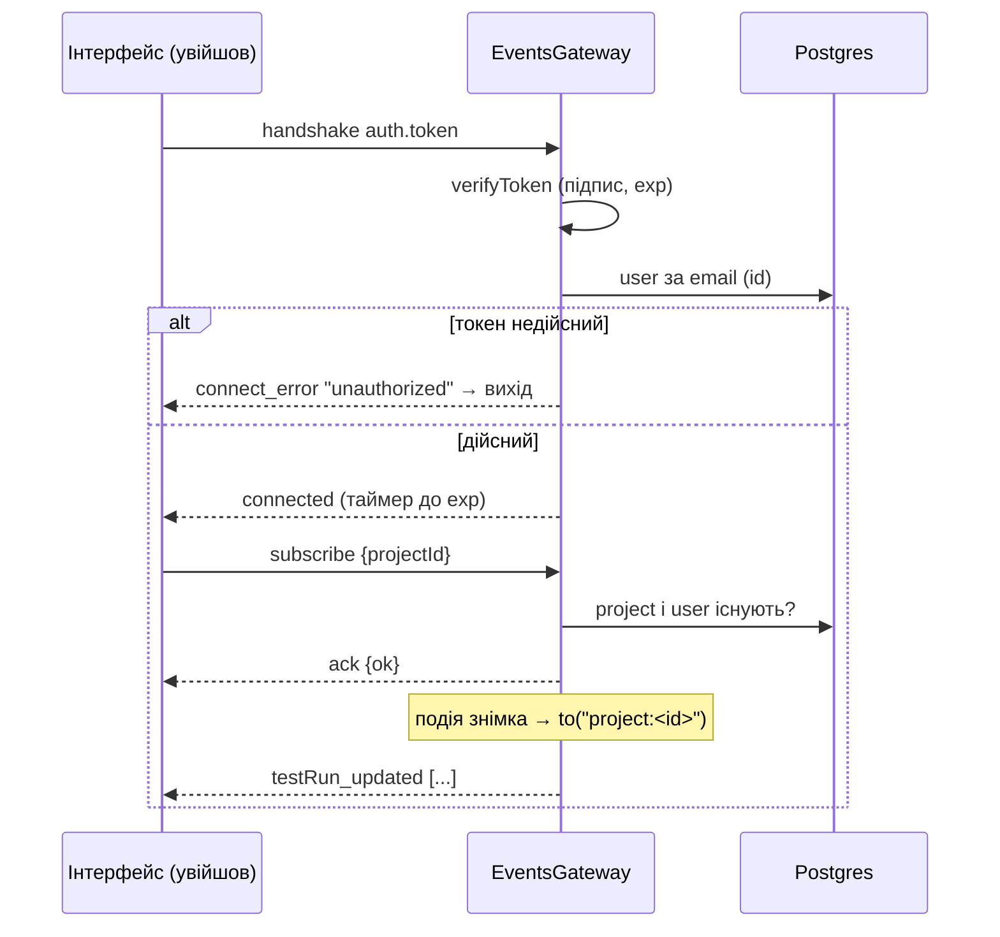

# 032 — Дизайн

Специфікація: [spec.md](spec.md). Рішення: [ADR-0023](../../decisions/0023-events-socket-behind-login.md).

## Підхід

Шлюз socket.io (`EventsGateway`, з вихідного проєкту) отримує дві речі, а розсилка лишається тією самою
чергою з дебаунсом.

1. **Вхід на рукостисканні (REQ-032-01…04).** У `afterInit` шлюз ставить middleware socket.io:
   воно бере `socket.handshake.auth.token`, перевіряє підпис і термін дії тим самим `JWT_SECRET`,
   що й `JwtStrategy` для API (`AuthService.verifyToken` поверх `JwtService`), і шукає
   користувача за `email` з токена (`select: { id: true }`, рядок `User` цілком не беремо). Немає
   токена, підпис не той, термін сплив, користувача немає — `next(new Error('unauthorized'))`:
   socket.io відповідає клієнтові `connect_error` до того, як з'єднання потрапить у будь-яку
   кімнату. Заголовок `apiKey` middleware не читає зовсім (REQ-032-03). Роль не перевіряємо: API
   з цим токеном теж пускає будь-яку роль на читання (REQ-032-02). Якщо в токені є `exp`, шлюз
   ставить таймер на `exp − now` (не довше 2³¹−1 мс, межі `setTimeout`) і розриває з'єднання
   (`socket.disconnect(true)`); таймер знімається при відключенні (REQ-032-04).
2. **Кімнати проєктів (REQ-032-09…11).** Повідомлення `subscribe` з `{ projectId }` спершу запам'ятовує проєкт (щоб пізніша підписка
   перемогла, навіть якщо її перевірка закінчиться раніше), потім перевіряє,
   що проєкт є і користувач з'єднання ще існує, виводить з'єднання з попередньої кімнати й
   заводить у `project:<id>`; відповідь-ack — `{ ok: true }` або `{ ok: false }`. `projectId: null`
   лише виводить. Кожна розсилка (`build_created/updated/deleted`, `testRun_created/updated/
   deleted`) групує накопичені записи за проєктом і шле кожну групу лише в її кімнату. Знімок без
   власного `projectId` (старі записи) бере проєкт своєї збірки одним запитом на всю пачку.
   З'єднання без підписки, як і раніше, у кімнаті лише свого `socket.id`, тож подій не отримує.
   Кімнати працюють і з `RedisIoAdapter`: адаптер розсилає `to(room)` на всі екземпляри.

Чиста логіка — окремо від шлюзу (`events-auth.ts`, `events-rooms.ts`): звідки брати токен, скільки
до розриву, як групувати записи за проєктом. Шлюз лише викликає їх, ходить у базу й у socket.io.

**Інтерфейс (REQ-032-05…08, 10, 12).** `SocketProvider` відкриває з'єднання лише тоді, коли в
`useUserState()` є користувач із токеном, і закриває його при виході чи зміні токена (ефект на
`user?.token`). Токен іде в `auth` рукостискання; новий вхід дає новий токен, а отже нове
з'єднання. Правила з'єднання винесені в `socket.events.ts`, щоб перевіряти їх юніт-тестами з
фейковим сокетом:

- `followProject(socket, projectId)` — шле `subscribe` одразу, якщо з'єднання відкрите, і знову
  на кожен `connect` (після обриву сервер нічого не пам'ятає); повертає відписку від `connect`;
- `onRejected(socket, onUnauthorized)` — `connect_error` з повідомленням `unauthorized` викликає
  `onUnauthorized`, а розрив сервером (`io server disconnect`, термін токена сплив) — нову спробу
  з'єднатися: вона або пройде з новим токеном, або отримає `unauthorized`. Інші помилки
  (сервер недоступний) лишають звичайні повтори socket.io;
- `onUnauthorized` — той самий вихід, що на 401 від API: `logoutAndReload()` винесено з
  `handleResponse` у `service.helpers.ts` і викликається з обох місць (REQ-032-08).

Обробники подій тепер знімаються поіменно (`socket.off(name)`), а не `removeAllListeners()`,
бо інакше перереєстрація на зміну збірки знімала б і `connect`, і `connect_error`. Фільтри за
проєктом і збіркою в обробниках лишаються: вони дешеві й страхують від події, що прийшла до
відписки.

## Компоненти

| Компонент | Шлях | Роль |
|---|---|---|
| Перевірка токена | `backend/src/auth/auth.service.ts` | `verifyToken(token)` — підпис і термін через `JwtService.verifyAsync`; той самий секрет, що в `JwtStrategy` |
| Чисті правила входу | `backend/src/shared/events/events-auth.ts` | `tokenFromHandshake(auth)`, `msUntilExpiry(exp, now)` |
| Чисті правила кімнат | `backend/src/shared/events/events-rooms.ts` | `projectRoom(id)`, `groupByProject(items, projectOf)` |
| Шлюз | `backend/src/shared/events/events.gateway.ts` | middleware входу, таймер терміну, `subscribe`, розсилка по кімнатах (REQ-032-01…04, 09…11) |
| Модуль | `backend/src/shared/shared.module.ts` | імпортує `AuthModule` заради `AuthService` |
| Правила з'єднання | `frontend/src/contexts/socket.events.ts` | `followProject`, `onRejected` |
| Провайдер | `frontend/src/contexts/socket.context.tsx` | з'єднання лише з входом, підписка на обраний проєкт (REQ-032-05…07, 10, 12) |
| Вихід на 401 | `frontend/src/_helpers/service.helpers.ts` | `logoutAndReload()` для API й сокета (REQ-032-08) |

## Дані

Без змін схеми й налаштувань. Секрет і термін дії — наявні `JWT_SECRET` і `JWT_LIFE_TIME`.

## Потік

## Ризики

| Ризик | Що робимо |
|---|---|
| Клієнт вихідного проєкту без токена перестане отримувати події | Vision постачає власний інтерфейс; рішення й конфлікти з вихідним проєктом у двох файлах записані в ADR-0023 |
| Розрив на терміні токена посеред роботи викидає людину | Так само зараз поводиться API на першому ж запиті після терміну; `JWT_LIFE_TIME` = 1 доба |
| Подія знімка без `projectId` загубиться | `groupByProject` бере проєкт збірки; тест `routes a test run without its own project…` |
| Перереєстрація обробників знімає службові | обробники подій знімаються поіменно; юніт-тести `followProject` і `onRejected` |
| Mock сокета в Playwright не знає про `subscribe` | POST із пакетом `42[...]` він приймає як і будь-який інший; рукостискання й далі починається з `40` |

## Перевірка вимог

| Вимога | Перевірка |
|---|---|
| REQ-032-01 | `backend/src/shared/events/events.gateway.spec.ts › rejects a connection without a token`; `… › rejects a token signed with another secret`; `… › rejects an expired token`; `… › rejects a token of a user who no longer exists` |
| REQ-032-02 | `backend/src/shared/events/events.gateway.spec.ts › accepts a valid token of a guest` |
| REQ-032-03 | `backend/src/shared/events/events.gateway.spec.ts › rejects an API key without a login token` |
| REQ-032-04 | `backend/src/shared/events/events.gateway.spec.ts › disconnects when the token expires`; `backend/src/shared/events/events-auth.spec.ts › counts the time left until the token expires` |
| REQ-032-05 | `frontend/integration_tests/test/liveEvents.spec.ts › connects with the token of the signed-in user`; `frontend/integration_tests/test/testDetailsDialog.spec.ts › moves on by itself after approving with the key` |
| REQ-032-06 | `frontend/integration_tests/test/liveEvents.spec.ts › opens no events connection before signing in` |
| REQ-032-07 | `frontend/integration_tests/test/liveEvents.spec.ts › signing out closes the connection and signing in opens one with the new token` |
| REQ-032-08 | `frontend/src/contexts/socket.events.test.ts › signs out when the server rejects the token`; `… › tries again when the server drops the connection`; `… › keeps the user signed in when the server cannot be reached`; `frontend/integration_tests/test/liveEvents.spec.ts › signs out when the server rejects the token` |
| REQ-032-09 | `backend/src/shared/events/events.gateway.spec.ts › sends events only to connections subscribed to their project`; `… › sends nothing about builds to a connection without a subscription`; `… › routes a test run without its own project to the project of its build`; `backend/src/shared/events/events-rooms.spec.ts › groups records by project` |
| REQ-032-10 | `backend/src/shared/events/events.gateway.spec.ts › moving the subscription stops events of the previous project`; `frontend/integration_tests/test/liveEvents.spec.ts › subscribes to the project that is open`; `frontend/src/contexts/socket.events.test.ts › stops following a project it was switched away from` |
| REQ-032-11 | `backend/src/shared/events/events.gateway.spec.ts › refuses a subscription to a project that does not exist` |
| REQ-032-12 | `frontend/src/contexts/socket.events.test.ts › subscribes again after reconnecting`; `… › waits for the connection before subscribing` |
