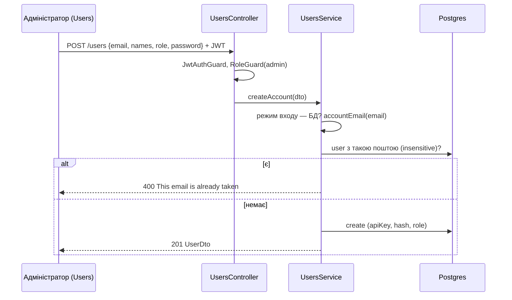

# 035 — Дизайн

Специфікація: [spec.md](spec.md). Рішення: [ADR-0025](../../decisions/0025-admin-made-accounts-personal-tokens.md).

## Підхід

Чотири незалежні частини; кожна — маленька зміна наявного коду, без нових таблиць.

1. **Без самореєстрації (REQ-035-01…03).** `POST /users/register` прибрано з `UsersController`:
   без маршруту запит отримує 404 і нічого не створює, хто б його не надсилав. У фронтенді
   зникають `RegisterPage`, `RegisterForm`, `usersService.register`, посилання «No account? Create
   one» на вході й крок туру про реєстрацію. Маршрут `/register` лишається, щоб старі закладки не
   вели в нікуди: `RegisterRoute` веде на `/` для того, хто увійшов, і на `/login` для решти.
2. **Акаунт від адміністратора (REQ-035-10…16).** Новий `POST /users` під `JwtAuthGuard` +
   `RoleGuard` з `@Roles(Role.admin)` (REQ-035-14) приймає `CreateAccountDto`: `email` (`IsEmail`),
   `password` (непорожній), `role` (`IsEnum(Role)`), `firstName`, `lastName` (необов'язкові,
   порожній рядок за замовчуванням, бо колонки `NOT NULL`). `UsersService.createAccount`:
   - відмовляє 400 «Accounts come from LDAP or SSO…», якщо активний сервіс користувачів не
     `DbUsersService` (REQ-035-16);
   - нормалізує пошту чистою `accountEmail(email)` (обрізати, малими літерами) і шукає наявний
     акаунт без урахування регістру (`mode: 'insensitive'`, `select: { id: true }`): є — 400
     «This email is already taken» (REQ-035-13); унікальний індекс страхує від гонки, фільтр
     помилок уже перекладає її в 400 «This user already exists.»;
   - створює рядок з новим API-ключем, хешем пароля й обраною роллю; повертає `UserDto`, без
     токена входу: адміністратор лишається собою (REQ-035-11, 15).

   Інтерфейс `Users.create` і його реалізації в `db`/`ldap`/`oidc` (upstream) не чіпаємо:
   `DbUsersService.create` отримує необов'язкову `role`, і `createAccount` іде через нього.
   `GET /users/accounts/enabled` (без входу, як `oidc/enabled`) каже, чи можна створювати акаунти
   в цьому режимі входу.

   У Users поруч із пошуком — кнопка New user (`data-testid="newUser"`). Вона відкриває
   `NewUserDialog` на `BaseModal` з полями пошта, ім'я, прізвище, роль (`Guest` за
   замовчуванням) і `PasswordField`; Save неактивна, поки пошта не валідна чи пароль порожній
   (REQ-035-12, правило `canCreateAccount` у `users.helper.ts`). Успіх — рядок додається в
   `userList` через `userDispatch` і снекбар; відмова сервера — снекбар з її текстом. Поки
   `GET /users/accounts/enabled` повертає `false`, кнопка неактивна з підказкою (REQ-035-16).
3. **Users (REQ-035-20, 21).** З `UserListPage` прибрано лічильник `users.people`, з тулбара
   `UserList` — `GridToolbarDensitySelector`; фільтр і дії лишаються.
4. **Лише особисті токени (REQ-035-30…35).**
   - `jiraAccess` бере лише токен людини; без нього — та сама 400 «Add your Jira token in your
     profile…» (REQ-035-31, 32). Без `userId` (виклик не від людини) — теж 400.
   - `ProjectDto`/`CreateProjectDto` втрачають `jiraToken` і `jiraEmail`; `jiraFields` їх не
     пише; `toPublicProject` не віддає ні `jiraToken`, ні `jiraEmail`, ні `jiraTokenSet`;
     `SETTINGS_FIELDS` — без `jiraEmail` (REQ-035-30). Старий клієнт, що надішле ці поля,
     отримає їх проігнорованими: глобальний `ValidationPipe` без `whitelist`, тож поле просто не
     потрапляє в `jiraFields`.
   - `wipeSharedJiraCredentials(prisma)` (`projects/shared-jira-credentials.ts`) — один
     `updateMany` проєктів, де `jiraToken` чи `jiraEmail` не `null`, на `null`; повертає кількість.
     `ProjectsService.onModuleInit` викликає його й пише в лог, скільки проєктів почищено; збій
     лише логується, щоб не заважати старту (REQ-035-35). Повторний запуск знаходить 0 рядків.
     Це перенесення даних застосунком при старті, як `moveIssueStates` (ADR-0003); міграції немає.
   - Фронтенд: `JiraSettings` — лише `jiraUrl`, `jiraIssueType`, `jiraLinkType`, новий текст
     `jira.intro` / `section.jiraIntro`; `InsightsPanel` і `TestDetailsModal` перевіряють лише
     `user.jiraTokenSet`; `ProjectListPage` не показує стан Jira (REQ-035-34);
     `profile.tokenNotSet` більше не згадує спільний токен; `Project` у `types/project.ts` — без
     `jiraToken`, `jiraEmail`, `jiraTokenSet`.
   - REQ-035-33 уже виконується: `PUT /users/jira` і `PUT /users/gemini` пишуть лише в рядок
     `@CurrentUser()`, маршрутів для чужого акаунта немає, `UserDto` віддає лише `jiraTokenSet` і
     `geminiKeySet`. Закріплюємо тестом.

## Компоненти

| Компонент | Шлях | Роль |
|---|---|---|
| Маршрути користувачів | `backend/src/users/users.controller.ts` | без `register`; `POST /users` (адмін), `GET /users/accounts/enabled` |
| Створення акаунта | `backend/src/users/users.service.ts` | `createAccount`, `canCreateAccounts` |
| Правила акаунта | `backend/src/users/account.ts` | `accountEmail` — нормалізація пошти |
| DTO | `backend/src/users/dto/account-create.dto.ts` | `CreateAccountDto` з `role` |
| Локальні акаунти | `backend/src/users/db/dbusers.service.ts` | `create` з необов'язковою роллю |
| Доступ до Jira | `backend/src/a11y/jira-access.ts` | лише особистий токен |
| Налаштування проєкту | `backend/src/projects/projects.service.ts`, `dto/project.dto.ts`, `settings-conflict.ts` | без спільних токена й пошти |
| Чищення | `backend/src/projects/shared-jira-credentials.ts` | `wipeSharedJiraCredentials` при старті |
| Вхід і маршрут | `frontend/src/components/LoginForm.tsx`, `frontend/src/Router.jsx` | без посилання; `/register` → `/` чи `/login` |
| Users | `frontend/src/pages/UserListPage.tsx`, `frontend/src/components/UserList/index.tsx`, `frontend/src/components/UserList/NewUserDialog.tsx` | New user, без лічильника й density |
| Правило форми | `frontend/src/_helpers/users.helper.ts` | `canCreateAccount(values)` |
| Сервіс | `frontend/src/services/users.service.ts` | `create`, `accountsEnabled`; без `register` |
| Jira в проєкті | `frontend/src/components/ProjectForm/ProjectForm.tsx` (`JiraSettings`), `TestDetailsDialog/InsightsPanel.tsx`, `TestDetailsDialog/TestDetailsModal.tsx`, `pages/ProjectListPage.tsx` | лише особистий токен |
| Тексти | `frontend/src/i18n/en.ts`, `uk.ts` | нові ключі `users.new*`, оновлені `jira.*`, `profile.tokenNotSet`; прибрані `auth.*` реєстрації, `users.people`, `tour.loginRegister` |

## Дані

Без змін схеми. `Project.jiraToken` і `Project.jiraEmail` лишаються колонками (ADR-0003), але
не читаються й не пишуться; значення стирає `wipeSharedJiraCredentials` під час старту
(рішення власника, REQ-035-35). Рядок `User` для нового акаунта — ті самі поля, що давала
реєстрація, плюс роль від адміністратора.

Бекап ([013](../013-backups-and-secrets/spec.md)) уже не бере токени проєктів; граничний
випадок 013 про «спільний токен проєкту після відновлення» оновлюємо.

## Потік

## Ризики

| Ризик | Що робимо |
|---|---|
| Хтось працював лише через спільний токен і після оновлення не заведе баг | Підказка «Add your Jira token in your profile» уже стоїть у кожному місці; пишемо в DEPLOY.md, що перед оновленням треба попросити команду додати токени |
| Відкат Vision після чищення не поверне спільні токени | Рішення власника (ADR-0025); у бекапах їх і так немає |
| `wipeSharedJiraCredentials` падає на старті (база недоступна) | Лише лог; повториться на наступному старті |
| e2e та acceptance upstream створюють користувача через `/users/register` | Переписуємо їх на `POST /users` від адміністратора за замовчуванням або прямий запис через Prisma |
| Сід створює адміністратора з поштою як є (може бути з великими літерами) | Пошук дубля — без урахування регістру, тож дубль не з'явиться |

## Перевірка вимог

| Вимога | Перевірка |
|---|---|
| REQ-035-01 | `frontend/integration_tests/test/login.spec.ts › offers no way to sign up` |
| REQ-035-02 | `frontend/integration_tests/test/login.spec.ts › an old sign-up link opens the sign-in page` |
| REQ-035-03 | `backend/src/users/users.controller.spec.ts › has no route for signing oneself up` |
| REQ-035-10 | `frontend/integration_tests/test/userList.spec.ts › lets an admin create an account` |
| REQ-035-11 | `frontend/integration_tests/test/userList.spec.ts › lets an admin create an account`; `backend/src/users/users.service.spec.ts › creates an account with the role the admin chose and no sign-in token` |
| REQ-035-12 | `frontend/src/_helpers/users.helper.test.ts › needs a valid email, a role and a password to create an account` |
| REQ-035-13 | `backend/src/users/users.service.spec.ts › refuses an email that is taken in any letter case` |
| REQ-035-14 | `backend/src/users/users.controller.spec.ts › lets only admins create accounts` |
| REQ-035-15 | `backend/src/users/users.service.spec.ts › creates an account with the role the admin chose and no sign-in token`; manual: створити акаунт у Users, вийти, увійти ним — роль та, що обрав адміністратор |
| REQ-035-16 | `backend/src/users/users.service.spec.ts › refuses to create accounts when sign-in goes through LDAP or SSO`; `frontend/integration_tests/test/userList.spec.ts › explains that accounts come from SSO` |
| REQ-035-20 | `frontend/integration_tests/test/userList.spec.ts › shows no head count and no row height picker` |
| REQ-035-21 | `frontend/integration_tests/test/userList.spec.ts › shows no head count and no row height picker` |
| REQ-035-30 | `frontend/integration_tests/test/projectSettings.spec.ts › Jira settings have no shared token or email` |
| REQ-035-31 | `backend/src/a11y/jira-access.spec.ts › never falls back to the project's shared token` |
| REQ-035-32 | `backend/src/a11y/jira-access.spec.ts › asks for a personal token when the person has none`; `frontend/integration_tests/test/reportBug.spec.ts › disables Report bug without a personal Jira token, even with a shared one saved` |
| REQ-035-33 | `backend/src/users/users.controller.spec.ts › writes Jira and Gemini secrets only to the signed-in person` |
| REQ-035-34 | `frontend/integration_tests/test/projectList.spec.ts › does not show a Jira status in the project list` |
| REQ-035-35 | `backend/src/projects/shared-jira-credentials.spec.ts › wipes stored shared Jira tokens and emails, and only them` |
