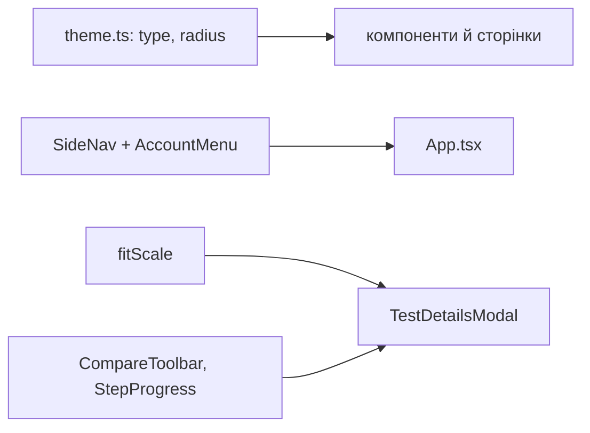

# 046 — Дизайн

Макет: [Vision redesign](https://claude.ai/artifact/UJ7fb5xgJBmpW5tQkvwAWQ). Усе — фронтенд;
бекенд, SDK, CLI і дані не змінюються.

## Підхід

Одна зміна в чотири шари, кожен спирається на попередній.

1. **Основи в `theme.ts`.** Шкала шрифту й радіусів стає токенами (`type`, `radius`), а
   типографіка й `styleOverrides` MUI беруть значення лише з них: h4 = 28, h5 = 20, h6 = 16,
   body1 = 14, body2 = 13, caption/шапки таблиць = 12; вага 650 → 600. `MuiLink` — колір бренду,
   підкреслення при наведенні; `MuiChip` — 6 px; таблиці й DataGrid — одна шапка. Літерал
   `fontSize`/`borderRadius` поза шкалою в `components/` і `pages/` забороняє ESLint
   (`no-restricted-syntax`), як уже заборонено шістнадцяткові кольори. Розміри, яких немає в
   шкалі (10.5, 11.5, 12.5, 13.5, 14.5, 15, 18, 19), зводимо до найближчого кроку.
2. **Оболонка.** `Header` і `NavRail` після входу замінює `SideNav`: логотип, Projects, для адміна
   Users і Backups, вибір проєкту, пункти проєкту, Help з версією, `AccountMenu` (Profile, мова,
   тема, Log out). Нижче 1100 px `SideNav` згортається до іконок з підказками. Сторінка входу й
   публічний звіт меню не мають; вхід отримує перемикачі мови й теми в куті `AuthLayout`.
   Помічники стану меню — чисті функції в `_helpers/sideNav.helper.ts` (які пункти, які активні,
   що каже вибір проєкту).
3. **Порівняння й баг-діалог.** `TestDetailsModal` отримує новий тулбар (`CompareToolbar`) з
   групами з REQ-046-02, `DiffMeter` без повзунка, `StepProgress` замість крапок, `SizeDiffers` і
   «Auto-next». Масштаб «вписати» рахує чиста `fitScale(image, box)` за висотою й шириною
   області, яку міряє `ResizeObserver`; масштаб змінюється лише за розміром вікна й діями
   людини (вимога [018](../018-ui-redesign/spec.md) про нерухомі знімки лишається). `ReportBugDialog` і `JiraFieldInput` переходять на підписи над
   полями (`FieldLabel`), «Create bug» завжди активна й на незаповнене поле прокручує до нього;
   «Ask again» стає другорядною «Draft again».
4. **Сторінки.** Сітка All screens без шапки таблиці, з `GridSortButton` і статусом на
   мініатюрі; теги рядка з «+N» (`TagOverflow`, вимірює вміщене); Overview — нейтральні числа,
   «1 changed» біля смужки, пристрій в один рядок, «No feature»; Login, Profile, Projects,
   Baselines (`FiltersButton` + чипи), історія еталона — за макетом.

Тексти — нові ключі в `en.ts`/`uk.ts`; «All tests» → «All screens» / «Усі екрани» за глосарієм.

Рішення прибрати верхню смугу на користь бічного меню змінює оболонку для всіх майбутніх
сторінок — пропоную [ADR-0028](../../decisions/0028-sidebar-instead-of-top-bar.md).

## Компоненти

| Компонент | Шлях | Роль |
|---|---|---|
| Токени шкали | `frontend/src/theme.ts` | `type`, `radius`, типографіка й overrides лише з них; `MuiLink`, `MuiChip`, шапки таблиць |
| Заборона літералів | `frontend/eslint.config.mjs` | `fontSize`/`borderRadius` поза шкалою в `components/`, `pages/` — помилка |
| Оболонка | `frontend/src/App.tsx` | `SideNav` замість `Header` + `NavRail` після входу |
| Бічне меню | `frontend/src/components/SideNav.tsx` (новий) | пункти, вибір проєкту, Help, версія, згортання |
| Меню акаунта | `frontend/src/components/AccountMenu.tsx` (новий) | Profile, мова, тема, Log out — з `Header.tsx` |
| Стан меню | `frontend/src/_helpers/sideNav.helper.ts` (новий) | чисті функції: пункти за роллю, активний, підпис вибору проєкту |
| Старі шапка й рейка | `Header.tsx`, `NavRail.tsx` | видалено; Help-меню й тур переїжджають у `SideNav` |
| Вхід | `frontend/src/components/AuthLayout.tsx`, `LoginForm.tsx` | дві половини, мова й тема в куті, SSO першим |
| Тулбар порівняння | `frontend/src/components/TestDetailsDialog/CompareToolbar.tsx` (новий) | групи, `DiffMeter`, вигляд, Highlight diff, Select elements, Areas |
| Прогрес черги | `StepProgress.tsx` (прибрано в [047](../047-overview-and-review-header/spec.md)) | «N з M» |
| Тренд перевірки | `frontend/src/components/TestDetailsDialog/CheckTrend.tsx` (новий), `backend/src/test-runs/check-trend.ts` (новий) | останні 20 прогонів перевірки: `GET /test-runs/:id/trend`, чиста `checkTrend` |
| Вписування | `frontend/src/_helpers/fit.helper.ts` (новий) | `fitScale` |
| Порівняння | `frontend/src/components/TestDetailsDialog/TestDetailsModal.tsx`, `DrawArea.tsx` | нова розкладка, масштаб «вписати», згорнута порожня панель |
| Баг-діалог | `frontend/src/components/TestDetailsDialog/ReportBugDialog.tsx`, `JiraFieldInput.tsx` | підписи над полями, Create bug, Draft again, поле Jira |
| Таблиця й сітка | `frontend/src/components/TestRunList/index.tsx`, `TestRunGrid.tsx`, `TestRunGridHeader.tsx` | без шапки в сітці, сортування кнопкою, статус на мініатюрі |
| Теги з +N | `frontend/src/components/DeviceTags.tsx` | `TagOverflow`: вміщені теги й «+N» |
| Огляд | `frontend/src/components/BuildOverview/index.tsx`, `ResultBar.tsx`, `frontend/src/components/SummaryParts.tsx` | нейтральні числа, підпис смужки, пристрій в рядок, No feature |
| Профіль | `frontend/src/pages/ProfilePage.tsx`, `ApiKeyCard.tsx`, `AppearanceCard.tsx` | одна колонка, Save праворуч, мова й тема разом |
| Проєкти | `frontend/src/pages/ProjectListPage.tsx` | пошук без підпису, New project |
| Еталони | `frontend/src/pages/TestVariationListPage.tsx`, `frontend/src/components/Filters.tsx` | Filters + чипи |
| Історія еталона | `frontend/src/pages/TestVariationDetailsPage.tsx` | дата в рядок, Selected / Previous |
| Тексти | `frontend/src/i18n/en.ts`, `frontend/src/i18n/uk.ts` | нові ключі, All screens |

## Дані

Немає. Вибір мови й теми лишається в браузері, як зараз.

## Потік

## Ризики

| Ризик | Що робимо |
|---|---|
| Playwright-сторінки й тести шукають шапку (`Header.ts`, `theme.spec`, `language.spec`) | переносимо локатори на `SideNav`/`AccountMenu`, `data-testid` тем і мови зберігаємо |
| Усі скриншот-еталони змінюються | оновлюємо в Docker, кожен переглядаємо перед заміною |
| Тур (GuidedTour) посилається на кнопки шапки | кроки туру ([018](../018-ui-redesign/spec.md)) переводимо на пункти бічного меню |
| Вписування змінює масштаб посеред огляду | `fitScale` рахується при відкритті кроку й зміні розміру вікна, не при перемальовуванні |
| Зведення розмірів шрифту ламає щільні місця (чипи 11.5) | щільне → 12, перевіряємо SC-046-03 на 1280 px обома мовами |

## Перевірка вимог

| Вимога | Перевірка |
|---|---|
| REQ-046-01 | `frontend/src/_helpers/fit.helper.test.ts › fits a portrait screen to the height of the area` |
| REQ-046-02 | `frontend/integration_tests/test/compareLayout.spec.ts › groups the comparison toolbar in one row` |
| REQ-046-03 | `frontend/integration_tests/test/compareLayout.spec.ts › shows the changed share against the allowed one without a handle` |
| REQ-046-04 | `frontend/integration_tests/test/compareLayout.spec.ts › says the size differs next to Current` |
| REQ-046-05 | замінено REQ-046-08, REQ-046-09, REQ-046-19 |
| REQ-046-08 | `frontend/integration_tests/test/compareLayout.spec.ts › shows the trend of the check in the header` |
| REQ-046-09 | `frontend/src/components/TestDetailsDialog/CheckTrend.test.tsx › names the build, the share, the status and the date of a run on hover` |
| REQ-046-19 | `frontend/integration_tests/test/compareLayout.spec.ts › shows neither the position nor the queue in the header` |
| REQ-046-06 | `frontend/integration_tests/test/compareLayout.spec.ts › keeps the footer in one line with Auto-next` |
| REQ-046-07 | `frontend/integration_tests/test/compareLayout.spec.ts › opens with the side panel folded when there is nothing in it` |
| REQ-046-10 | `frontend/src/theme.test.ts › uses only the six type sizes and four weights` |
| REQ-046-11 | `frontend/src/theme.test.ts › rounds corners with three values only` |
| REQ-046-12 | `frontend/src/theme.test.ts › gives every table head the same full-width band` |
| REQ-046-13 | `manual: Projects, налаштування, Insights, Overview — «pixelmatch», числа й дні звичайним шрифтом; гілка, ключ Jira, селектор — моноширинним` |
| REQ-046-14 | `frontend/src/theme.test.ts › colours every link with the brand` |
| REQ-046-15 | `frontend/src/components/DeviceTags.test.tsx › shows tags and the branch as one grey chip shape` |
| REQ-046-16 | `frontend/integration_tests/test/projectList.spec.ts › names the create button New project` |
| REQ-046-17 | `frontend/integration_tests/test/language.spec.ts › names the build tab All screens in both languages` |
| REQ-046-18 | `frontend/integration_tests/test/testVariationDetails.spec.ts › labels the pair Selected and Previous` |
| REQ-046-20 | `frontend/src/_helpers/sideNav.helper.test.ts › lists the labelled items for the role` |
| REQ-046-21 | `frontend/integration_tests/test/sideNav.spec.ts › shows no top bar after sign-in` |
| REQ-046-22 | `frontend/src/_helpers/sideNav.helper.test.ts › says Choose project and disables project items until one is picked` |
| REQ-046-23 | `frontend/integration_tests/test/sideNav.spec.ts › holds Profile, language, theme and Log out in the account menu` |
| REQ-046-24 | `frontend/integration_tests/test/sideNav.spec.ts › shows the version next to Help` |
| REQ-046-25 | `frontend/integration_tests/test/sideNav.spec.ts › folds to icons with tooltips below 1100 px` |
| REQ-046-26 | `frontend/integration_tests/test/login.spec.ts › keeps language and theme in the corner of the sign-in page` |
| REQ-046-27 | `frontend/src/_helpers/sideNav.helper.test.ts › says No projects yet without any project` |
| REQ-046-30 | `frontend/integration_tests/test/testRunGrid.spec.ts › shows cards without the table head, sorted by a button` |
| REQ-046-31 | `frontend/src/components/DeviceTags.test.tsx › hides the tags that do not fit behind +N` |
| REQ-046-32 | `frontend/integration_tests/test/buildOverview.spec.ts › keeps tile numbers neutral and colours only the marker` |
| REQ-046-33 | `frontend/integration_tests/test/buildOverview.spec.ts › shows the devices of the build in its header on every tab` |
| REQ-046-34 | `frontend/integration_tests/test/buildOverview.spec.ts › names the result next to its bar` |
| REQ-046-35 | `frontend/integration_tests/test/buildOverview.spec.ts › shows a check without a feature as a plain row with its whole name` |
| REQ-046-40 | `frontend/integration_tests/test/reportBug.spec.ts › makes Create bug the only primary action` |
| REQ-046-41 | `frontend/integration_tests/test/reportBug.spec.ts › scrolls to the empty required field instead of filing` |
| REQ-046-42 | `frontend/integration_tests/test/reportBug.spec.ts › labels the fields above them` |
| REQ-046-43 | `frontend/integration_tests/test/reportBug.spec.ts › shows a Jira field by its Jira name` |
| REQ-046-50 | `frontend/integration_tests/test/login.spec.ts › shows the brand and the form side by side with one logo` |
| REQ-046-51 | `frontend/integration_tests/test/login.spec.ts › offers SSO and the local sign-in together` |
| REQ-046-57 | `frontend/integration_tests/test/login.spec.ts › brings back the grid and the stray pixel without leaving a square` |
| REQ-046-52 | `frontend/integration_tests/test/profile.spec.ts › shows the profile in one column with the role as text` |
| REQ-046-53 | `frontend/integration_tests/test/projectList.spec.ts › searches with a placeholder and no floating label` |
| REQ-046-54 | `frontend/integration_tests/test/testVariationList.spec.ts › filters with one Filters button and removable chips` |
| REQ-046-55 | `frontend/integration_tests/test/testVariationDetails.spec.ts › shows the date of a record in one line` |
| REQ-046-56 | `manual: усі сторінки в Light/Dark і EN/UK на 1280 px; контраст тексту ≥ 4.5:1 (axe у DevTools), нічого не переноситься (SC-046-03)` |
