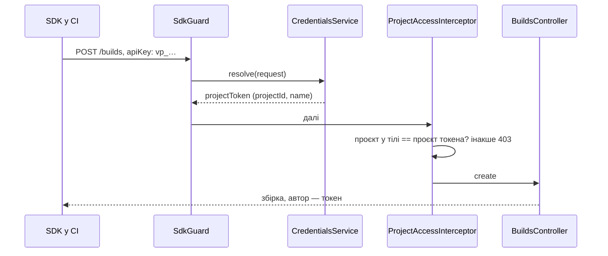

# 046 — Дизайн

Рішення з наслідками — [ADR-0028](../../decisions/0028-project-tokens-and-personal-keys.md).

## Підхід

**Хто діє.** Запит несе одне з трьох: JWT входу, персональний ключ або проєктний токен (у тому
самому заголовку `apiKey`, що й зараз; SDK не змінюється, REQ-046-01). Чиста функція
`credentialOf(header)` розрізняє ключі за префіксом: `vp_…` — проєктний токен, усе інше —
персональний ключ (REQ-046-07). Нові ключі `vp_` + 32 випадкові байти base64url; наявні
персональні ключі (UUID) з `vp_` не починаються, тож двозначності немає.

**Три guard-и замість трьох наявних.** Замість `JwtAuthGuard`, `ApiGuard` і `MixedGuard` у
контролерах:

| Guard | Приймає | Де стоїть |
|---|---|---|
| `PersonGuard` | JWT або персональний ключ активної людини | усі маршрути, що зараз мають `JwtAuthGuard` або `MixedGuard`, крім SDK |
| `SdkGuard` | JWT, персональний ключ або проєктний токен | лише чотири маршрути SDK: `POST /builds`, `PATCH /builds/:id`, `POST /test-runs`, `POST /test-runs/multipart` (REQ-046-02) |
| — | лише JWT | маршрути з позначкою `@SignedInOnly()` (див. нижче) |

Обидва guard-и спираються на один сервіс `CredentialsService.resolve(request)`, який повертає
`{ kind: 'session' | 'personalKey', user }` або `{ kind: 'projectToken', token }` і кладе це в
запит (`request.user` для людини, `request.projectToken` для токена). `PersonGuard` на проєктний
токен відповідає `403` «Project tokens work only for the SDK; use your personal API key»
(REQ-046-03). Ключ деактивованої людини (`isActive = false`) не розпізнається (REQ-046-22) —
зараз `ApiGuard` цього не перевіряє.

**`@SignedInOnly()`** — метадані на маршрутах облікового запису (`GET /users/newApiKey`,
`PUT /users/password`, `PUT /users`, `PUT /users/jira`, `PUT /users/gemini`, REQ-046-24) і на
кожному маршруті, доступному лише адміну (`@Roles(Role.admin)`: користувачі, ролі, доступ до
проєктів, бекапи, REQ-046-25). `PersonGuard` на такому маршруті з персональним ключем відповідає
`403` «This works only in the Vision interface after signing in». Щоб нового адмін-маршруту не
забули позначити, тест маршрутів вимагає `@SignedInOnly()` на кожному маршруті, де ролі — лише
`admin`.

**Ролі.** `RoleGuard` більше не шукає користувача за ключем сам, а бере того, кого визначив guard;
для проєктного токена ролі не застосовуються: його права — це сам маршрут SDK (REQ-046-02).

**Доступ до проєкту.** `ProjectAccessInterceptor` для проєктного токена пропускає запит, лише якщо
всі проєкти, які він називає, — проєкт токена; інакше `403` (REQ-046-04). Для людини — як у 042
(REQ-046-20). Чиста `mayReach` отримує третій випадок, `mayTokenReach(token, projectIds)`.

**Автор збірки.** `BuildsController.create` передає в `findOrCreate` `userId` людини або
`projectTokenId` токена (REQ-046-05). Зараз автор збірки не записується взагалі, тож рядки до
цієї зміни лишаються без автора, і інтерфейс показує «—».

**Автор дій персональним ключем** (REQ-046-21) уже правильний: сервіси беруть `request.user`, а
для ключа це власник ключа; Jira — особистий токен цієї людини (ADR-0025). Нового коду тут не
треба, лише тести, що з ключем записується той самий автор, що й після входу.

**Керування токенами.** Маршрути проєкту `GET /projects/:id/tokens`, `POST /projects/:id/tokens`
(`{ name }` → токен повністю один раз, REQ-046-11), `DELETE /projects/:id/tokens/:tokenId`
(REQ-046-14) — `PersonGuard`, `@Roles(admin, editor)`, `@ProjectFrom(inParam('id', 'project'))`
(REQ-046-10). Токен зберігається хешем `hashApiKey` (REQ-046-12), як персональний ключ. Чисті
функції — у новому backend/src/projects/project-tokens.ts: генерація, кінець для показу, перевірка
назви (1–60 символів, унікальна серед невідкликаних у проєкті), `shouldTouch(lastUsedAt, now)`.

**Останнє використання** (REQ-046-13) пишемо не частіше разу на 60 с на токен, щоб CI з сотнями
знімків не робив запис у базу на кожен.

**Інтерфейс.** У налаштуваннях проєкту — новий розділ «Токени для SDK» поруч із
`frontend/src/components/ProjectForm/ProjectAccessSettings.tsx`: перелік (назва, `vp_…кінець`, хто
й коли створив, останнє використання), створення з назвою й показом токена один раз з копіюванням,
відкликання з підтвердженням. Видно лише admin і editor. В огляді збірки
(`frontend/src/components/BuildOverview/index.tsx`) — рядок «Надіслано: <людина або назва
токена>». У картці API-ключа профілю (`frontend/src/components/ApiKeyCard.tsx`) — підказка, що для
CI краще токен проєкту. Усі тексти — ключі словника англійською й українською
([ADR-0017](../../decisions/0017-interface-in-two-languages.md)).

**CLI** (`frontend/public/cli/vision.py`) нічого не змінює: на `403` вона вже показує повідомлення
сервера, тож з токеном проєкту людина побачить, що потрібен персональний ключ.

## Компоненти

| Компонент | Шлях | Роль |
|---|---|---|
| Розрізнення ключів | новий backend/src/auth/credentials.ts | чисті `credentialOf`, `mayUseCredential(kind, route)` |
| Сервіс ключів | новий backend/src/auth/credentials.service.ts | шукає людину чи токен за хешем, активність, `lastUsedAt` |
| Guard-и | нові backend/src/auth/guards/person.guard.ts, sdk.guard.ts; `@SignedInOnly()` | замість `backend/src/auth/guards/auth.guard.ts`, `backend/src/auth/guards/api.guard.ts`, `backend/src/auth/guards/mixed.guard.ts` у контролерах (старі файли видаляємо після заміни) |
| Ролі | `backend/src/auth/guards/role.guard.ts` | бере визначеного guard-ом; токен — без ролей |
| Доступ до проєкту | `backend/src/projects/project-access.ts`, `backend/src/projects/project-access.interceptor.ts` | токен — лише свій проєкт |
| Токени проєкту | новий backend/src/projects/project-tokens.ts, `project-tokens.service.ts`, маршрути в `backend/src/projects/projects.controller.ts` | створення, перелік, відкликання |
| Автор збірки | `backend/src/builds/builds.controller.ts`, `backend/src/builds/builds.service.ts` | `userId` або `projectTokenId` |
| Контролери | усі `backend/src/**/*.controller.ts` з guard-ами | заміна guard-ів, `@SignedInOnly()` |
| Тест маршрутів | `backend/src/projects/project-access.routes.spec.ts` | кожен маршрут: токен — відмова, крім SDK; адмін- і облікові маршрути — без ключа |
| Інтерфейс | `frontend/src/components/ProjectForm/ProjectForm.tsx`, новий `ProjectTokensSettings.tsx`, `frontend/src/services/projects.service.ts`, `frontend/src/components/BuildOverview/index.tsx`, `frontend/src/components/ApiKeyCard.tsx`, `frontend/src/i18n/en.ts`, `frontend/src/i18n/uk.ts` | розділ токенів, автор збірки, підказка |

## Дані

Лише додавальні зміни ([ADR-0003](../../decisions/0003-additive-schema-only.md)), одна міграція:

- нова таблиця `ProjectToken`: `id`, `projectId` (→ `Project`, `onDelete: Cascade` — REQ-046-16),
  `name`, `tokenHash` (унікальний), `ending`, `createdById` (→ `User`, nullable, `onDelete:
  SetNull`, щоб видалення людини не забрало токен — REQ-046-06), `createdAt`, `lastUsedAt?`,
  `revokedAt?`; індекс за `projectId`;
- nullable `Build.projectTokenId` (→ `ProjectToken`, `onDelete: SetNull`).

Відкликання ставить `revokedAt`, а не видаляє рядок, щоб збірки й далі показували назву токена.
Унікальність назви серед невідкликаних перевіряє сервіс (частковий унікальний індекс Prisma не
описує). Старі дані не змінюються. Бекап ([013](../013-backups-and-secrets/spec.md)) отримує таблицю
як є: у ній лише хеші, тож після відновлення CI працює.

## Потік

## Ризики

| Ризик | Що робимо |
|---|---|
| Заміна guard-ів у ~70 маршрутах щось відкриє або закриє | тест маршрутів перебирає кожен маршрут з кожним видом ключа; e2e і контрольний сценарій |
| Новий адмін-маршрут без `@SignedInOnly()` | тест маршрутів падає, якщо ролі лише `admin`, а позначки немає |
| Витік персонального ключа дає більше, ніж раніше | ключ деактивованої людини не діє; новий ключ і пароль — лише після входу; підказка в профілі використовувати токен проєкту в CI |
| `lastUsedAt` пише в базу на кожен знімок | `shouldTouch`: не частіше разу на 60 с |
| Паралельний редизайн інтерфейсу чіпає ті самі файли | бекенд — окремими комітами; інтерфейс — останнім, після злиття редизайну в цю гілку |
| `FileLinksInterceptor` підписує знімки лише на маршрутах з guard-ом | нові guard-и стоять на тих самих маршрутах; тест підписів лишається |

## Перевірка вимог

Тести ще не написані: назви нижче — заплановані. Під час реалізації кожен рядок стане трасуванням
у форматі `шлях › назва тесту`.

| Вимога | Перевірка |
|---|---|
| REQ-046-01 | заплановано: e2e builds — «accepts a project token in the apiKey header the SDK already sends»; manual: наявний jar SDK з токеном проєкту в `VISION_API_KEY` проходить контрольний сценарій |
| REQ-046-02 | заплановано: routes spec — «lets a project token through only the four SDK routes» |
| REQ-046-03 | заплановано: person.guard spec — «refuses a project token and says it works only for the SDK» |
| REQ-046-04 | заплановано: interceptor spec — «refuses a project token for another project and creates nothing» |
| REQ-046-05 | заплановано: builds.controller spec — «names the project token as the author of its build»; manual: огляд збірки показує назву токена |
| REQ-046-06 | заплановано: credentials.service spec — «keeps a project token working after its creator is deactivated» |
| REQ-046-07 | заплановано: credentials spec — «tells a project token from a personal key by its vp_ prefix» |
| REQ-046-08 | заплановано: test-runs e2e — «checks allowed devices for a snapshot sent with a project token» |
| REQ-046-10 | заплановано: routes spec — «lets only admins and editors with access manage the project's tokens» |
| REQ-046-11 | заплановано: project-tokens spec — «refuses a name already used by a live token of the project»; service spec — «returns the token once and stores only its hash» |
| REQ-046-12 | заплановано: project-tokens.service spec — «stores only the hash of a project token» |
| REQ-046-13 | заплановано: project-tokens spec — «touches last use at most once a minute»; manual: перелік показує назву, кінець, автора, дати |
| REQ-046-14 | заплановано: credentials.service spec — «refuses a revoked project token» |
| REQ-046-15 | заплановано: project-tokens.service spec — «keeps several live tokens in one project» |
| REQ-046-16 | заплановано: credentials.service spec — «refuses the token of a deleted project» (каскад у міграції) |
| REQ-046-20 | заплановано: routes spec — «lets a personal key do what a signed-in person of that role may»; e2e — «approves a change with an editor's personal key» |
| REQ-046-21 | заплановано: test-runs e2e — «records the key's owner as the author of an approval» |
| REQ-046-22 | заплановано: credentials.service spec — «refuses the personal key of a deactivated person» |
| REQ-046-23 | заплановано: e2e builds — «still accepts a personal key from the SDK» |
| REQ-046-24 | заплановано: routes spec — «refuses a personal key on password, new key, Jira token and Gemini key» |
| REQ-046-25 | заплановано: routes spec — «refuses a personal key on every admin-only route, even an admin's» |
