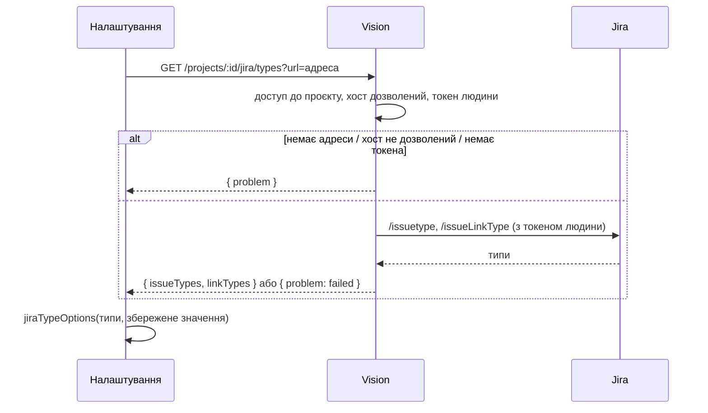

# 049 — Дизайн

## Підхід

Три незалежні частини, усі на сторінці налаштувань проєкту.

1. **Типи Jira зі списку.** Бекенд отримує новий запит `GET /projects/:id/jira/types?url=…`,
   який іде в Jira з особистим токеном того, хто відкрив сторінку (ADR-0025, правило особистого токена зі специфікації 035), і лише
   на дозволений хост (правило дозволених хостів зі специфікації 044). Адреса береться з параметра, а не з бази, бо списки
   перезавантажуються до збереження (REQ-049-09). Відповідь — завжди 200: або списки, або
   причина, чому їх немає (`notSet`, `hostNotAllowed`, `noToken`, `failed`): сторінка показує
   причину біля полів і не валить решту (SC-049-03). Типи задач — усі, які бачить людина
   (`/rest/api/2/issuetype`), бо проєкту Jira в налаштуваннях немає; зв'язки — як зараз
   (`/rest/api/2/issueLinkType`). Як показати список (пункт «Автоматично», групи, збережене
   значення, якого немає в Jira) вирішує чиста функція у фронтенді.
2. **Назва розділу.** Лише тексти словника й пошук: старі назви додаються до міток розділу,
   тож `matchSettings` знаходить його за ними (REQ-049-11). Ідентифікатор розділу (`mobile`,
   `nav-mobile`, `section-mobile`) не змінюємо: на нього спираються тести й адреса.
3. **«?» з анімацією.** Компонент `OptionExplainer`: кнопка «?» і `Popover` MUI з
   SVG-схемою екрана. Кожна з чотирьох опцій має свою сцену — чисту функцію, що за станом опції
   (`on`/`off`) і кадром (`before`/`after`) повертає опис фігур. Анімація — CSS keyframes на
   SVG між двома кадрами циклом 2,4 с; при `prefers-reduced-motion` — два нерухомі кадри поруч
   (REQ-049-25). Кольори — `tokens` (REQ-049-27), тож темна тема працює сама.

## Компоненти

| Компонент | Шлях | Роль |
|---|---|---|
| `JiraClient.allIssueTypes` | `backend/src/a11y/jira.client.ts` | усі типи задач, які бачить людина |
| `jiraTypesFor` | `backend/src/a11y/jira-types.ts` | чиста: сирі типи Jira → `{ issueTypes, linkTypes }` без дублів, за абеткою |
| `settingsJira` | `backend/src/a11y/jira-access.ts` | Jira за адресою з параметра, токеном людини, з перевіркою хоста; причина замість винятку |
| `GET :id/jira/types` | `backend/src/projects/projects.controller.ts` | адмін і редактор з доступом до проєкту (`ProjectFrom`) |
| `JiraTypes` | `frontend/src/types/jira.ts` | тип відповіді |
| `projectsService.getJiraTypes` | `frontend/src/services/projects.service.ts` | виклик API |
| `jiraTypeOptions` | `frontend/src/_helpers/jiraTypes.helper.ts` | чиста: пункти списку — «Автоматично», групи, збережене значення з позначкою |
| `JiraTypeSelect` | `frontend/src/components/ProjectForm/JiraTypeSelect.tsx` | список типів з групами; без списків — збережене значення, неактивне |
| `JiraSettings`, `useJiraTypes` | `frontend/src/components/ProjectForm/ProjectForm.tsx` | підказка без токена, «Спробувати ще», перезавантаження після виходу з поля адреси |
| `OptionExplainer`, `Explained` | `frontend/src/components/ProjectForm/OptionExplainer.tsx` | «?», підказка, анімація, кадри для зменшеного руху, опис для читача екрана; `Explained` ставить «?» поруч з опцією |
| `explainerScene` | `frontend/src/components/ProjectForm/explainerScenes.ts` | чисті сцени для чотирьох опцій |
| словники, пошук | `frontend/src/i18n/en.ts`, `uk.ts`, `frontend/src/_helpers/projectSettings.helper.ts` | назва «Screen structure», старі назви в пошуку, тексти пояснень |

## Дані

Без змін у базі. `jiraIssueType` і `jiraLinkType` лишаються рядками; «Автоматично» — порожнє
значення, як зараз (REQ-049-02). Значення, введені раніше вручну, не чіпаємо (REQ-049-06).

## Потік

Запит іде при відкритті сторінки, після виходу з поля адреси, якщо адреса змінилась
(REQ-049-09), і за «Спробувати ще» (REQ-049-05).

## Ризики

| Ризик | Що робимо |
|---|---|
| Повільна Jira тримає сторінку | списки вантажаться окремо від налаштувань; поки йде запит — поле зі збереженим значенням і індикатором |
| Адреса з параметра — шлях до чужого хоста з токеном людини | той самий `jiraHostProblem`, що й при збереженні; без дозволеного хоста запиту в Jira немає |
| Анімація відволікає | лише в підказці, відкритій кліком; цикл 2,4 с; зменшений рух — кадри |
| Тести на старі назви (`Mobile screens`) | ідентифікатори розділу не змінюються; тексти в тестах оновлюємо |

## Перевірка вимог

| Вимога | Перевірка |
|---|---|
| REQ-049-01 | `frontend/integration_tests/test/projectSettings.spec.ts › picks the Jira issue and link type from the person's Jira` |
| REQ-049-02 | `frontend/src/_helpers/jiraTypes.helper.test.ts › starts with Automatic, which saves an empty value` |
| REQ-049-03 | `backend/src/a11y/jira-access.spec.ts › reads the setting lists with the person's own token only` |
| REQ-049-04 | `frontend/integration_tests/test/projectSettings.spec.ts › asks for a Jira token in the profile when the person has none` |
| REQ-049-05 | `frontend/integration_tests/test/projectSettings.spec.ts › keeps the saved Jira types and offers a retry when Jira fails` |
| REQ-049-06 | `frontend/src/_helpers/jiraTypes.helper.test.ts › keeps a saved type Jira does not return, marked` |
| REQ-049-07 | `frontend/integration_tests/test/projectSettings.spec.ts › picks the Jira issue and link type from the person's Jira` |
| REQ-049-08 | `frontend/src/_helpers/jiraTypes.helper.test.ts › groups sub-tasks apart from other issue types` |
| REQ-049-09 | `frontend/integration_tests/test/projectSettings.spec.ts › reloads the Jira types for a new address before saving` |
| REQ-049-13 | `backend/src/a11y/jira-access.spec.ts › reads no Jira for an address the server does not allow` |
| REQ-049-10 | `frontend/integration_tests/test/projectSettings.spec.ts › names the UI tree section Screen structure` |
| REQ-049-11 | `frontend/src/_helpers/projectSettings.helper.test.ts › finds the screen structure section by its former name` |
| REQ-049-12 | `frontend/integration_tests/test/projectSettings.spec.ts › names the UI tree section Screen structure` |
| REQ-049-20 | `frontend/integration_tests/test/projectSettings.spec.ts › explains the compare and ignore options with an animation` |
| REQ-049-21 | `frontend/integration_tests/test/projectSettings.spec.ts › explains the compare and ignore options with an animation` |
| REQ-049-28 | `frontend/integration_tests/test/projectSettings.spec.ts › explains the compare and ignore options with an animation` |
| REQ-049-22 | `frontend/src/components/ProjectForm/explainerScenes.test.ts › marks the change only when the option lets it through` |
| REQ-049-23 | `frontend/src/components/ProjectForm/explainerScenes.test.ts › draws every scene from shapes alone` |
| REQ-049-24 | `frontend/src/components/ProjectForm/OptionExplainer.test.tsx › plays the animation only while the hint is open` |
| REQ-049-25 | `frontend/src/components/ProjectForm/OptionExplainer.test.tsx › shows two still frames when motion is reduced` |
| REQ-049-26 | `frontend/src/components/ProjectForm/OptionExplainer.test.tsx › describes the animation for screen readers` |
| REQ-049-27 | `manual: перемкнути тему (⇧D) з відкритою підказкою → схема в кольорах теми, без білих плям у темній` |
