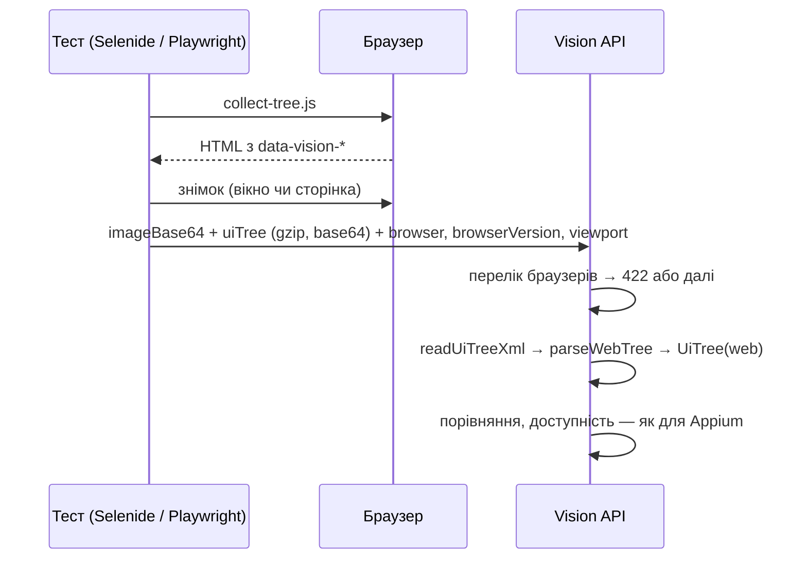

# 050 — Дизайн

## Підхід

Веб стає третім форматом UI-дерева (`web`) поряд з `appium-android` і `appium-ios`. Усе, що
вже вміє дерево Appium (зсуви, невидимі зміни, правила елементів, вибір елемента, доступність),
працює з деревом вебу без окремої гілки коду: розбір HTML дає ті самі `UiNode` з `bounds` у
пікселях знімка. Відмінності вебу зосереджені у трьох місцях: розбір (`web-tree.parser.ts`),
правила доступності, яким потрібні «що таке поле вводу» й «яка норма», і системні смуги.

1. **Що надсилає SDK.** Один скрипт збору `web-tree/collect-tree.js` для Selenide і Playwright
   (REQ-050-24). Він виконується в браузері сесії перед знімком (REQ-050-21) і повертає HTML:
   ті самі теги й атрибути, що в `page source`, без `script`/`style`, плюс
   - на `<html>`: `data-vision-tree="1"`, `data-vision-viewport="w,h"` (CSS px вікна),
     `data-vision-page="w,h"`, `data-vision-scroll="x,y"`, `data-vision-dpr`,
     `data-vision-capture="viewport|page"` (REQ-050-08);
   - на кожному показаному елементі `data-vision-rect="x,y,w,h"` — `getBoundingClientRect()` у
     CSS px відносно вікна верхнього документа (для `iframe` вже з його зсувом);
   - на прихованому (`display:none`, `visibility:hidden`, нульовий розмір) —
     `data-vision-hidden="1"` і без вмісту;
   - вміст відкритого shadow DOM — у `<template shadowrootmode="open">` усередині хоста
     (стандартний декларативний shadow DOM), вміст `iframe` того самого походження — його
     `<html>` дочірнім елементом `<iframe>` (REQ-050-14). Закритий shadow DOM і чужий `iframe`
     скрипт не бачить — вони лишаються одним елементом;
   - доступна назва, яку рахує браузер (`aria-labelledby`, `<label for>`, обгортка `<label>`), —
     у `data-vision-name`, бо сервер не бачить зв'язків поза деревом (REQ-050-13).
2. **Розбір.** `htmlparser2` (без DTD і власних сутностей, лише іменовані HTML) → `UiNode`:
   `className` — тег (`button`, `input:text`), `role` — `role` або неявна роль тегу,
   `resourceId` — `id`, `text` — власний текст елемента (як `text` в Android), `label` —
   `data-vision-name` | `aria-label` | `alt` | `title`, `hint` — `placeholder`, `clickable` —
   інтерактивні теги й ролі, `onclick`, `tabindex ≥ 0`; `enabled` — без `disabled` /
   `aria-disabled`; `accessible` — без `aria-hidden="true"`. Шлях для ключа — як в Appium,
   тож `xpath:` і безіменні елементи працюють так само (REQ-050-06).
   Масштаб: `ширина знімка / ширина знятого` (вікна або сторінки), а без неї — `dpr`; до
   `bounds` сторінкового знімка додається прокрутка (REQ-050-03). Одиниця норм — CSS px:
   `pixelsPerDp = scale`.
3. **Без координат.** Звичайний `page source` (немає `data-vision-tree`) дає дерево з
   `positioned: false` і нульовими `bounds`. Тоді зсуви й вибір елемента пропускаються самі
   (нульова площа), правила доступності, яким потрібні координати (контраст, область дотику),
   не запускаються, а `structure` віддає `tree.positioned = false` — на порівнянні з'являється
   пояснення (REQ-050-09).
4. **Прийом.** `readUiTreeXml` пропускає лише `<!DOCTYPE html>` без внутрішньої частини — HTML
   не має власних сутностей, тож це не відкриває вибуху сутностей (040); `<!ENTITY` і будь-який
   інший DOCTYPE — як і раніше, відмова. Межа 10 МиБ та сама (REQ-050-04). `uiTreeFormat`
   приймає `web`, а без нього формат визначається з тексту (REQ-050-01, REQ-050-47).
5. **Доступність.** Правила лишаються ті самі; для `web` — поля вводу (`input` текстових типів,
   `textarea`, `[contenteditable]`, роль `textbox`/`searchbox`), текстові елементи для контрасту
   (елемент з власним текстом), норма `touchTargetWeb` (24 CSS px, WCAG 2.2 2.5.8), одиниця `px`,
   читач екрана в тексті — «screen reader». `not-accessible` — і далі лише iOS (REQ-050-11).
6. **Налаштування й платформа.** Усе в JSON `uiTreeSettings`, без нових колонок для проєкту:
   `platform: 'mobile' | 'web' | 'both'` (без поля — `mobile`, REQ-050-41), `allowedBrowsers:
   [{ browser, version, viewport }]`, `a11yNorms.touchTargetWeb`. Платформа впливає лише на те,
   що видно на сторінці налаштувань і в пошуку (`SETTINGS_SECTIONS` отримує `platform` для
   міток), а не на розбір (REQ-050-47). Приховані поля не стираються: форма міняє лише
   `platform` (REQ-050-46).
7. **Браузери.** Знімок з `browser` перевіряється за `allowedBrowsers`, без нього — за
   `allowedDevices` (REQ-050-52). Версія браузера приходить новим необов'язковим полем запиту
   `browserVersion` (не входить в ідентичність перевірки, як `featureName`), зберігається в
   новій nullable-колонці `TestRun.browserVersion`. Розмір вікна — наявне `viewport`
   (`1280x720`; `×` і `x` рівнозначні). Отримані браузери — `GET /projects/:id/browsers`
   (REQ-050-53).
8. **SDK.** Java: `ua.vision.sdk.web.WebUiTree.collect(JavascriptExecutor)` (selenium-api —
   `compileOnly`, Selenide дає `WebDriverRunner.getWebDriver()`), `VisionOptions.browserVersion`;
   при помилці скрипта — `null` і `warn` у лог (REQ-050-22). Playwright: новий пакет
   `sdk-playwright/` (`@vision/sdk-playwright`): `VisionPlaywright` з `trackPage` і
   `trackElementHandle`, як `PlaywrightVisualRegressionTracker`, налаштування `VISION_*`, той
   самий JSON запиту, що в `sdk-js` VRT, плюс `uiTree`, `uiTreeFormat`, `featureName`,
   `browserVersion`. Скрипт збору — копія `web-tree/collect-tree.js`, тест звіряє копії
   побайтно.

Рішення «HTML із доповненнями замість власного JSON» — [ADR-0029](../../decisions/0029-web-tree-as-augmented-html.md).

## Компоненти

| Компонент | Шлях | Роль |
|---|---|---|
| скрипт збору | `web-tree/collect-tree.js` | дерево сторінки з координатами, `iframe`, shadow DOM |
| `parseWebTree`, `detectFormat` | `backend/src/ui-tree/web-tree.parser.ts`, `ui-tree.parser.ts` | HTML → `UiTree` формату `web` |
| `readUiTreeXml` | `backend/src/ui-tree/ui-tree.intake.ts` | `<!DOCTYPE html>` дозволено |
| `UiTreeFormat`, `UiTree.positioned`, `UiNode.role` | `backend/src/ui-tree/ui-tree.types.ts` | новий формат |
| `findSystemBars` | `backend/src/ui-tree/comparison-inputs.ts` | для `web` — нічого |
| правила, норми | `backend/src/a11y/a11y.rules.ts`, `a11y-norms.ts` | поля вводу вебу, `touchTargetWeb`, `px` |
| `allowedBrowsers`, `browserRejection` | `backend/src/projects/allowed-browsers.ts` | перелік, збіг, текст відмови |
| `findBrowsers` | `backend/src/projects/projects.service.ts`, `projects.controller.ts` | отримані браузери |
| запит знімка | `backend/src/test-runs/dto/create-test-request.dto.ts`, `test-runs.service.ts` | `uiTreeFormat: web`, `browserVersion` |
| платформа і поля | `frontend/src/_helpers/projectSettings.helper.ts`, `components/ProjectForm/*` | вибір платформи, приховані поля, норма вебу, браузери |
| пояснення без координат | `frontend/src/components/TestDetailsDialog/` | REQ-050-09 |
| `WebUiTree` | `sdk-java/src/main/java/ua/vision/sdk/web/WebUiTree.java` | збір у Selenide |
| `VisionPlaywright` | `sdk-playwright/src/` | SDK для Playwright |

## Дані

- `TestRun.browserVersion String?` — нова nullable-колонка (ADR-0003), старі рядки — `NULL`.
- `uiTreeSettings` (JSON) — нові ключі `platform`, `allowedBrowsers`, `a11yNorms.touchTargetWeb`;
  старі налаштування без них читаються як «Мобільний», порожній перелік, 24 px.
- Дерево вебу зберігається тим самим файлом `uitree/*.json.gz`, з `format: 'web'`.

## Потік

## Ризики

| Ризик | Що робимо |
|---|---|
| Велика сторінка — довгий збір | скрипт не серіалізує `script`, `style`, `svg` усередині і вміст прихованих; тест на 3000 елементах (SC-050-02) |
| HTML без координат дає «невидимі» зміни там, де їх видно | лише невидимі зміни і правила без координат; на порівнянні — пояснення |
| Різні браузери рахують доступну назву по-різному | назву рахує наш скрипт однаково, а не браузер |
| Колонка `browserVersion` у великій таблиці `TestRun` | nullable без значення за замовчуванням — у Postgres це миттєво |

## Перевірка вимог

| Вимога | Перевірка |
|---|---|
| REQ-050-01 | `backend/src/ui-tree/web-tree.parser.spec.ts › reads a Selenium page source as a web tree` |
| REQ-050-02 | `backend/src/ui-tree/web-tree.parser.spec.ts › reads tag, role, id, text, name, placeholder and state of each element` |
| REQ-050-03 | `backend/src/ui-tree/web-tree.parser.spec.ts › turns CSS pixels into screenshot pixels by the page scale` |
| REQ-050-04 | `backend/src/ui-tree/ui-tree.intake.spec.ts › holds a web page to the same limit as an Appium tree` |
| REQ-050-05 | `backend/src/ui-tree/web-tree.compare.spec.ts › does not mark the list as changed when a banner pushes it down` |
| REQ-050-06 | `backend/src/ui-tree/web-tree.compare.spec.ts › finds web elements by id, text and xpath rules` |
| REQ-050-07 | `backend/src/ui-tree/web-tree.compare.spec.ts › leaves no system bars out of a web page` |
| REQ-050-08 | `backend/src/ui-tree/web-tree.parser.spec.ts › places elements of a full-page screenshot below the scroll` |
| REQ-050-09 | `backend/src/a11y/a11y.web.spec.ts › skips contrast and tap area when the page source has no positions` |
| REQ-050-10 | `backend/src/a11y/a11y.web.spec.ts › finds an icon button without a label on a web page` |
| REQ-050-11 | `backend/src/a11y/a11y.web.spec.ts › never reports a web element as hidden from VoiceOver` |
| REQ-050-12 | `backend/src/a11y/a11y-norms.spec.ts › reads the web tap area in CSS pixels, 24 by default` |
| REQ-050-13 | `backend/src/ui-tree/web-tree.parser.spec.ts › names an element as the browser does` |
| REQ-050-14 | `backend/src/ui-tree/web-tree.parser.spec.ts › reads iframe and shadow DOM content in place` |
| REQ-050-20 | `sdk-java/src/test/java/ua/vision/sdk/web/WebUiTreeTest.java › collectsTheTreeWithTheSharedScript` |
| REQ-050-21 | `sdk-playwright/test/collect.spec.ts › collects the tree in the page right before the screenshot` |
| REQ-050-22 | `sdk-playwright/test/track.spec.ts › sends the screenshot without a tree when collecting fails` |
| REQ-050-23 | `sdk-playwright/test/track.spec.ts › sends the same request as the VRT agent, with Vision names` |
| REQ-050-24 | `sdk-playwright/test/collect.spec.ts › uses the very script the Java SDK uses` |
| REQ-050-25 | `sdk-playwright/test/track.spec.ts › sends the tree, the format and the feature name with the screenshot` |
| REQ-050-30 | `frontend/src/_helpers/projectSettings.helper.test.ts › names Appium and the web as tree sources for a mobile and web project` |
| REQ-050-40 | `backend/src/ui-tree/comparison-inputs.spec.ts › keeps the project platform` |
| REQ-050-41 | `backend/src/ui-tree/comparison-inputs.spec.ts › reads a project saved before platforms as mobile` |
| REQ-050-42 | `frontend/integration_tests/projectSettings.spec.ts › picks the platform in General and when creating a project` |
| REQ-050-43 | `frontend/src/_helpers/projectSettings.helper.test.ts › hides system bars, Android and iOS norms and VoiceOver in a web project` |
| REQ-050-44 | `frontend/src/_helpers/projectSettings.helper.test.ts › hides the web norm in a mobile project` |
| REQ-050-45 | `frontend/src/_helpers/allowedBrowsers.helper.test.ts › reads browser, version and window size entries` |
| REQ-050-46 | `frontend/src/_helpers/projectSettings.helper.test.ts › keeps hidden values when the platform changes` |
| REQ-050-47 | `backend/src/ui-tree/web-tree.parser.spec.ts › reads a tree by its format whatever the project platform` |
| REQ-050-48 | `frontend/src/_helpers/projectSettings.helper.test.ts › does not find fields the platform hides` |
| REQ-050-49 | `frontend/src/_helpers/projectSettings.helper.test.ts › names Selenide and Playwright as tree sources for a web project` |
| REQ-050-50 | `frontend/src/_helpers/projectSettings.helper.test.ts › shows fields of both platforms for a mobile and web project` |
| REQ-050-51 | `backend/src/projects/allowed-browsers.spec.ts › treats an empty version or window size as any` |
| REQ-050-52 | `backend/src/projects/allowed-browsers.spec.ts › holds a snapshot with a browser to the browsers and one without to the devices` |
| REQ-050-53 | `backend/src/projects/projects.service.spec.ts › lists the browsers snapshots came from` |
