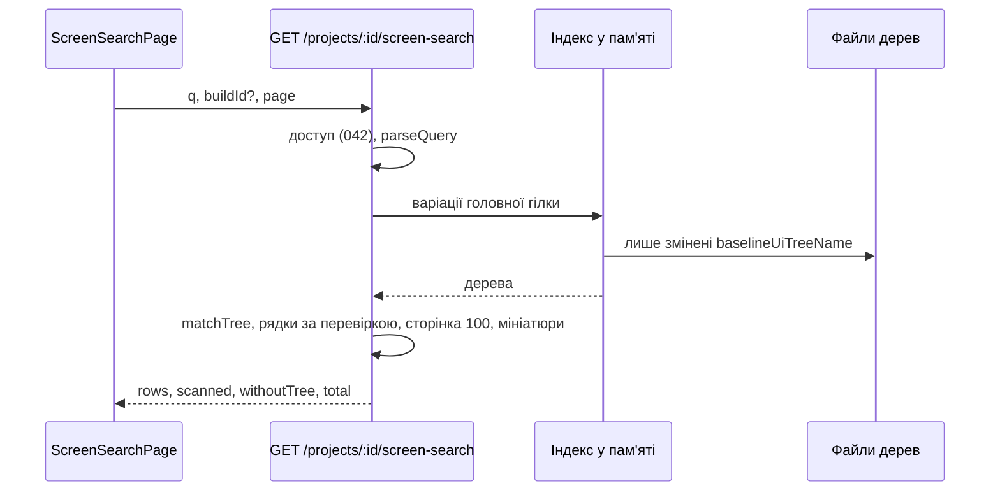

# 053 — Дизайн

## Підхід

Пошук — чисті функції над UI-деревами плюс індекс у пам'яті API, що тримає дерева останніх
еталонів проєкту ([ADR-0029](../../decisions/0029-screen-search-index-in-memory.md)).

- **Що шукаємо.** Еталони варіацій головної гілки проєкту (`Project.mainBranchName`) з
  `TestVariation.baselineName` (REQ-053-02). Варіації інших гілок — ті самі перевірки в роботі,
  вони дублювали б рядки. Без `baselineUiTreeName` еталон рахується серед непереглянутих (REQ-053-09).
- **Як шукаємо** (`backend/src/ui-tree/screen-search.ts`). Запит без префікса — нормалізований
  текст (нижній регістр, NBSP → пробіл, пробіли згорнуто) проти `text` і `label` видимих вузлів із
  ненульовою рамкою (REQ-053-03); із вкладених збігів лишається найменший. Запит з `id:`/`class:`/
  `text:`/`xpath:` — наявний `findBySelector` з `backend/src/ui-tree/comparison-inputs.ts`, той
  самий код, що в правилах (REQ-053-20, SC-053-03), без відсіву вкладених: селектор рахує те, що
  рахувало б правило. `component:` — `componentOf` з `backend/src/a11y/a11y-problems.ts`
  (REQ-053-21). Помилку селектора дає наявний `selectorProblem` (REQ-053-22).
- **Індекс** (`backend/src/ui-tree/screen-search.index.ts`). Для кожного проєкту —
  `Map<variationId, {treeName, tree}>`. Кожен запит робить один `SELECT` варіацій і довантажує
  лише дерева, чия назва змінилась (новий approve), через `UiTreeService.load`, по 4 одночасно. Межа —
  8 проєктів, найдавніше використаний викидається. Через 10 s після старту API
  `ScreenSearchService` прогріває 4 найсвіжіші проєкти.
- **Пошук у збірці (REQ-053-40)** індексу не потребує: дерева екранів збірки (`TestRun.uiTreeName`)
  читає той самий `load` з його кешем. Збірка іншого проєкту — «не знайдено», як і чужий проєкт (042).
- **Мініатюра.** `Baseline.testRunId` → `TestRun.imageThumbnailName`, інакше повний
  `TestVariation.baselineName`. Поля називаються `imageName` / `imageThumbnailName`, тож
  `FileLinksInterceptor` підписує їх без змін (043). Рамки інтерфейс малює у відсотках від розміру
  дерева (`width`, `height` у пікселях знімка).
- **Бета (2026-11-15): підказки, вирізки, прев'ю.** `/` відкриває `SearchPalette` поверх сторінки;
  підказки дає `suggest` з `backend/src/ui-tree/screen-search.ts` по тих самих деревах (маршрут
  `GET /projects/:id/screen-search/suggest`). На сторінці кожен збіг — картка з вирізкою
  (`frontend/src/components/ElementCrop.tsx`, розкладка — `cropLayout`), справа великий екран
  обраної картки; пігулки пристроїв фільтрують картки на клієнті (`searchHits`). Позначка «Бета» —
  `frontend/src/components/BetaChip.tsx`.
- **Інтерфейс** — мінімум тексту: поле з плейсхолдером замість підказок, підсумок «N перевірок ·
  N збігів · N без UI-дерева», у рядку — назва, ID екрана, кількість і слово «підпис» лише для збігу
  в підписі (REQ-053-07). Адреса `/search/:projectId?q=…&build=…&in=build` (REQ-053-30); поле
  оновлює адресу після паузи 300 ms, а пошук іде за адресою, тож один запит на паузу.
- **Клавіша `/`** — у `frontend/src/components/SideNav.tsx` (є на кожній сторінці після входу):
  поза полем вводу й без модифікаторів відкриває пошук обраного проєкту, а зі збірки передає
  `build`, і тоді з'являється перемикач «Еталони / Збірка #N» (REQ-053-01, 40).
- **Підсвітка в еталоні (REQ-053-08).** Мініатюра веде на `/variations/details/:id?highlight=x,y,w,h;…&on=<файл еталона>`.
  Сторінка обводить рамки лише тоді, коли `on` — найновіший еталон, інакше рамки вказували б не туди.

## Компоненти

| Компонент | Шлях | Роль |
|---|---|---|
| Пошук (чисті функції) | `backend/src/ui-tree/screen-search.ts` | `parseQuery`, `normalizeText`, `matchTree`, `innermost` |
| Індекс | `backend/src/ui-tree/screen-search.index.ts` | дерева в пам'яті, оновлення за назвою файла, межа проєктів |
| Сервіс | `backend/src/ui-tree/screen-search.service.ts` | варіації або екрани збірки, рядки за перевіркою, сторінки по 100, мініатюри, прогрів |
| Маршрут | `backend/src/projects/projects.controller.ts` | `GET /projects/:id/screen-search?q=&buildId=&page=`, `@ProjectFrom(inParam('id', 'project'))` |
| Модулі | `backend/src/ui-tree/ui-tree.module.ts`, `backend/src/projects/projects.module.ts` | сервіс у `UiTreeModule`, `ProjectsModule` його імпортує |
| Сторінка | `frontend/src/pages/ScreenSearchPage.tsx` | поле, межі, підсумок, рядки, «Показати ще» |
| Хелпер | `frontend/src/_helpers/screenSearch.helper.ts` | `isSearchable`, `isSearchHotkey`, `boxPercent`, `encodeBoxes`/`decodeBoxes` |
| Меню | `frontend/src/_helpers/sideNav.helper.ts`, `frontend/src/components/SideNav.tsx` | пункт «Пошук» між «Еталони» і «Аналітика», клавіша `/` |
| Маршрут UI | `frontend/src/Router.jsx`, `frontend/src/constants/routes.ts` | `SEARCH_PAGE` |
| Вікно `/` | `frontend/src/components/SearchPalette.tsx` | підказки, стрілки, Enter |
| Вирізка, «Бета» | `frontend/src/components/ElementCrop.tsx`, `frontend/src/components/BetaChip.tsx` | спільні з 055 |
| Підсвітка | `frontend/src/pages/TestVariationDetailsPage.tsx` | рамки на найновішому еталоні |
| Типи й API | `frontend/src/types/screenSearch.ts`, `frontend/src/services/projects.service.ts` | `ScreenSearchResult`, `searchScreens` |
| Тексти | `frontend/src/i18n/en.ts`, `frontend/src/i18n/uk.ts` | `nav.search`, `search.*` |

## Дані

Нових таблиць і колонок немає. Індекс живе лише в пам'яті процесу API і збирається з наявних
файлів дерев. Відповідь: `{ problem?, scanned, withoutTree, total, page, rows: [{ name, customTags,
screen, matches, where, items: [{ id, testVariationId, device, os, browser, viewport, imageName,
imageThumbnailName, width, height, boxes, keys }] }] }`.

## Потік

## Ризики

| Ризик | Що робимо |
|---|---|
| Пам'ять API на великих проєктах | межа 8 проєктів; заміряти на копії проду (T8) |
| Перший пошук після старту повільний | прогрів 4 найсвіжіших проєктів через 10 s після старту |
| `xpath:` по 6000 деревах повільніший за текст | SC-053-01 рахує 95 % запитів; дерево вже в пам'яті |
| Розбіжність із правилами | лише наявні `findBySelector`/`selectorProblem`; тест на тих самих фікстурах |
| Витік чужих проєктів | `@ProjectFrom` на маршруті; збірка перевіряється на належність проєкту |
| Рамки на еталоні, затвердженому після пошуку | `on=<файл>`: рамки лише на тому самому еталоні |

## Перевірка вимог

| Вимога | Перевірка |
|---|---|
| REQ-053-01 | `frontend/integration_tests/test/screenSearch.spec.ts › opens the search from the side menu and with the slash key`; `frontend/src/_helpers/screenSearch.helper.test.ts › opens the search with the slash key outside a field only` |
| REQ-053-02 | `backend/src/ui-tree/screen-search.service.spec.ts › searches the latest baseline of every device on the main branch`; `backend/src/ui-tree/screen-search.index.spec.ts › sees the new tree on the next search after a new baseline` |
| REQ-053-03 | `backend/src/ui-tree/screen-search.spec.ts › finds visible text and labels ignoring case, repeated spaces and NBSP` |
| REQ-053-04 | `backend/src/ui-tree/screen-search.spec.ts › asks for two characters before searching`; `frontend/src/_helpers/screenSearch.helper.test.ts › asks for two characters before searching` |
| REQ-053-05 | `backend/src/ui-tree/screen-search.service.spec.ts › returns one row per check by name with a picture per device`; `frontend/src/_helpers/screenSearch.helper.test.ts › shows each found element once with every device it was found on`; `frontend/integration_tests/test/screenSearch.spec.ts › shows every found element cut out, the picked one on its screen` |
| REQ-053-06 | `backend/src/ui-tree/screen-search.spec.ts › keeps the innermost of nested matches`; `frontend/src/_helpers/screenSearch.helper.test.ts › cuts the element out with a margin, keeping its proportions` |
| REQ-053-07 | `backend/src/ui-tree/screen-search.spec.ts › tells whether the text, the label or both matched`; `frontend/integration_tests/test/screenSearch.spec.ts › shows every found element cut out, the picked one on its screen` |
| REQ-053-08 | `frontend/integration_tests/test/screenSearch.spec.ts › opens the baseline with the found element outlined`; `frontend/integration_tests/test/screenSearch.spec.ts › outlines nothing on a baseline approved after the search` |
| REQ-053-09 | `backend/src/ui-tree/screen-search.service.spec.ts › counts screens without a UI tree as not scanned`; `frontend/integration_tests/test/screenSearch.spec.ts › shows every found element cut out, the picked one on its screen` |
| REQ-053-10 | `backend/src/ui-tree/screen-search.service.spec.ts › pages a hundred checks at a time with the total` |
| REQ-053-20 | `backend/src/ui-tree/screen-search.spec.ts › finds what an element rule with the same selector finds` |
| REQ-053-21 | `backend/src/ui-tree/screen-search.spec.ts › finds elements of a component ignoring case` |
| REQ-053-22 | `backend/src/ui-tree/screen-search.service.spec.ts › explains a selector it cannot read and returns no rows`; `frontend/integration_tests/test/screenSearch.spec.ts › explains a selector it cannot read` |
| REQ-053-30 | `frontend/integration_tests/test/screenSearch.spec.ts › keeps the query in the address` |
| REQ-053-31 | `backend/src/projects/project-access.routes.spec.ts › answers not found on every route of a project without access`; `backend/src/ui-tree/screen-search.service.spec.ts › never returns screens of a build of another project` |
| REQ-053-40 | `backend/src/ui-tree/screen-search.service.spec.ts › searches the screens of a build instead of baselines` |
| REQ-053-50 | `backend/src/ui-tree/screen-search.service.spec.ts › searches without calling the AI service` |
| REQ-053-51 | `frontend/src/i18n/translate.test.ts › has every text in both languages…` |
| REQ-053-52 | `backend/src/ui-tree/screen-search.service.spec.ts › never returns checks of another project` |
| REQ-053-60 | `backend/src/ui-tree/screen-search.spec.ts › suggests texts, labels, ids and components that hold the query, most screens first`; `backend/src/ui-tree/screen-search.service.spec.ts › suggests from the latest baselines, counting each check once` |
| REQ-053-61 | `frontend/integration_tests/test/screenSearch.spec.ts › suggests texts and elements while typing and opens the picked one`; `frontend/src/_helpers/screenSearch.helper.test.ts › moves through the suggestions and back to the field` |
| REQ-053-62 | `frontend/integration_tests/test/screenSearch.spec.ts › shows every found element cut out, the picked one on its screen`; `frontend/integration_tests/test/screenSearch.spec.ts › opens the baseline with the found element outlined` |
| REQ-053-63 | `frontend/integration_tests/test/screenSearch.spec.ts › filters the found elements by device`; `frontend/src/_helpers/screenSearch.helper.test.ts › leaves out the devices switched off` |
| REQ-053-64 | `frontend/integration_tests/test/screenSearch.spec.ts › shows every found element cut out, the picked one on its screen` |
