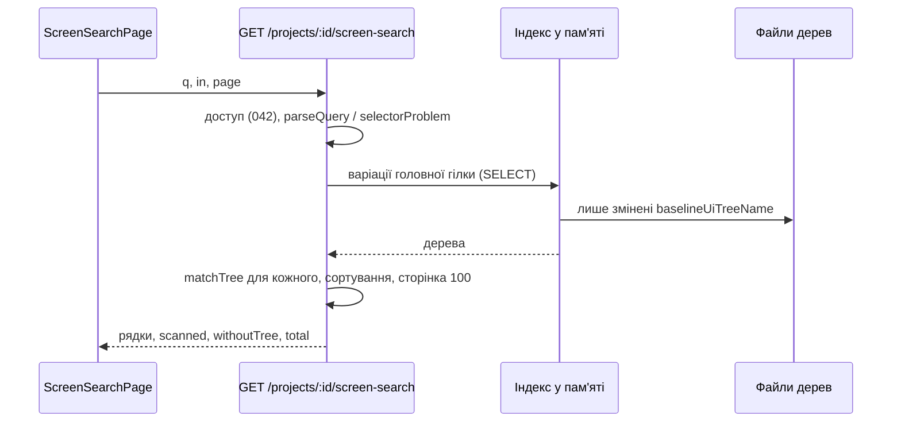

# 053 — Дизайн

<!-- Нові файли й заплановані тести записані без код-лапок: check-docs.py перевіряє, що
     названі шляхи й тести існують, а їх ще немає. При реалізації трасування переходить
     у формат `шлях › назва тесту`. -->

## Підхід

Пошук — чиста функція над деревами плюс індекс у пам'яті API, що тримає видимі вузли останніх
еталонів проєкту ([ADR-0029](../../decisions/0029-screen-search-index-in-memory.md), Proposed).

- **Що шукаємо.** Еталони варіацій головної гілки проєкту (`Project.mainBranchName`), що мають
  `TestVariation.baselineUiTreeName` (REQ-053-02). Варіації інших гілок — це ті самі перевірки
  в роботі, вони дублювали б результат.
- **Як шукаємо.** Запит без префікса — нормалізований текст (нижній регістр, NBSP → пробіл,
  пробіли згорнуто) проти `text` і `label` видимих вузлів (`visible`, ненульова рамка,
  REQ-053-03). Запит з `id:`/`class:`/`text:`/`xpath:` — наявний `findBySelector` з
  `backend/src/ui-tree/comparison-inputs.ts`, тобто точно той самий код, що в правилах
  (REQ-053-20, SC-053-03). `component:` — `componentOf` з `backend/src/a11y/a11y-problems.ts`
  (REQ-053-21). Помилку селектора дає наявний `selectorProblem` (REQ-053-22).
- **Вкладені збіги.** Із вкладених один в одного збігів лишаємо найменший (граничний випадок).
- **Індекс.** Для кожного проєкту — `Map<variationId, {treeName, tree}>`. Кожен запит робить
  один легкий `SELECT id, name, customTags, device, os, browser, viewport, baselineUiTreeName`
  по варіаціях проєкту й довантажує лише дерева, чия назва змінилась (новий approve). Дерева
  читає наявний `UiTreeService.load`. Після старту API індекси збираються у фоні з паралельністю
  4, найсвіжіші проєкти першими. Межа — 8 проєктів у пам'яті, найдавніше використаний викидається.
- **Пошук у збірці (REQ-053-40)** індексу не потребує: дерева екранів збірки (`TestRun.uiTreeName`)
  читаються тим самим `load` з його кешем.
- **Мініатюра.** `Baseline.testRunId` → `TestRun.imageThumbnailName`, інакше повний
  `TestVariation.baselineName`. Обведення малює інтерфейс за рамками збігів у пікселях знімка.
- **Інтерфейс.** Нова сторінка пошуку з адресою `/search/:projectId?q=…&in=build:<id>`
  (REQ-053-30), пункт у бічному меню і клавіша `/` (REQ-053-01). Клік мініатюри відкриває
  сторінку варіації з параметром `highlight=<ключі>` (REQ-053-08), а для збірки — порівняння
  екрана.

## Компоненти

| Компонент | Шлях | Роль |
|---|---|---|
| Пошук (чисті функції), новий | **backend/src/ui-tree/screen-search.ts** | `parseQuery`, `normalizeText`, `matchTree(tree, query)` → збіги з рамками й «де знайдено», `innermost` |
| Індекс, новий | **backend/src/ui-tree/screen-search.index.ts** | індекс проєктів у пам'яті, оновлення за назвою дерева, фонове збирання, межа 8 |
| Сервіс і маршрут, нові | **backend/src/ui-tree/screen-search.service.ts**, маршрут `GET /projects/:id/screen-search` у `backend/src/projects/projects.controller.ts` | завантаження варіацій, порядок і сторінки по 100 (REQ-053-05, 10), лічильники (REQ-053-09); `@ProjectFrom(inParam('id', 'project'))` для доступу (REQ-053-31) |
| Модуль | `backend/src/ui-tree/ui-tree.module.ts` | реєстрація індексу й сервісу |
| Селектори | `backend/src/ui-tree/comparison-inputs.ts` | наявні `findBySelector`, `selectorProblem` — без змін |
| Сторінка, нова | **frontend/src/pages/ScreenSearchPage.tsx** | поле, межі, результат, «Показати ще», адреса |
| Рядок результату, новий | **frontend/src/components/ScreenSearch/SearchResultRow.tsx** | назва, ID екрана, «текст / підпис», мініатюри з обведенням, `DeviceTags` |
| Сервіс API | `frontend/src/services/projects.service.ts` | `searchScreens(projectId, q, scope, page)` |
| Маршрут і меню | `frontend/src/Router.jsx`, `frontend/src/constants/routes.ts`, `frontend/src/components/SideNav.tsx` | `SEARCH_PAGE`, пункт меню, клавіша `/` поза полем вводу |
| Підсвітка в еталоні | `frontend/src/components/TestVariationDetails.tsx` | прочитати `highlight`, обвести елементи, «на цьому еталоні вже не знайдено» |
| Тексти | `frontend/src/i18n/en.ts`, `frontend/src/i18n/uk.ts` | ключі `search.*` (REQ-053-51) |

## Дані

Нових таблиць і колонок немає. Індекс живе лише в пам'яті процесу API і збирається з наявних
файлів дерев. Відповідь маршруту: `{ scanned, withoutTree, total, rows: [{ check, customTags,
screenId, matches, where: ('text'|'label'|'selector')[], devices: [{ variationId, device tags,
thumbnail, imageWidth, imageHeight, boxes: Rect[], keys: string[] }] }] }`.

## Потік

## Ризики

| Ризик | Що робимо |
|---|---|
| Пам'ять API на великих проєктах | у індексі лише видимі вузли без зайвих полів; межа 8 проєктів; заміряти на копії проду (T8) |
| Перший пошук після старту повільний | фонове збирання; поки індекс не готовий, відповідь має `partial: true`, інтерфейс каже «ще переглядаю N екранів» |
| `xpath:` по 6000 деревах повільніший за текст | SC-053-01 рахує 95 % запитів; для `xpath:` — те саме дерево з індексу, без читання файлів |
| Розбіжність із правилами | лише наявні `findBySelector`/`selectorProblem`, тест SC-053-03 на одних фікстурах |
| Витік чужих проєктів | маршрут лише з `@ProjectFrom`; `project-access.routes.spec.ts` ловить маршрут без позначки |

## Перевірка вимог

| Вимога | Перевірка |
|---|---|
| REQ-053-01 | план: frontend/integration_tests/test/screenSearch.spec.ts › opens the search from the side menu and with the slash key |
| REQ-053-02 | план: backend/src/ui-tree/screen-search.service.spec.ts › searches the latest baseline of every device on the main branch |
| REQ-053-03 | план: backend/src/ui-tree/screen-search.spec.ts › finds visible text and labels ignoring case, repeated spaces and NBSP |
| REQ-053-04 | план: frontend/src/pages/ScreenSearchPage.test.tsx › asks for two characters before searching |
| REQ-053-05 | план: backend/src/ui-tree/screen-search.service.spec.ts › returns one row per check by name with a picture per device |
| REQ-053-06 | план: backend/src/ui-tree/screen-search.spec.ts › keeps the innermost of nested matches |
| REQ-053-07 | план: backend/src/ui-tree/screen-search.spec.ts › tells whether the text, the label or both matched |
| REQ-053-08 | план: frontend/integration_tests/test/screenSearch.spec.ts › opens the baseline with the found elements outlined |
| REQ-053-09 | план: backend/src/ui-tree/screen-search.service.spec.ts › counts screens without a UI tree as not scanned |
| REQ-053-10 | план: backend/src/ui-tree/screen-search.service.spec.ts › pages a hundred checks at a time with the total |
| REQ-053-20 | план: backend/src/ui-tree/screen-search.spec.ts › finds what an element rule with the same selector finds |
| REQ-053-21 | план: backend/src/ui-tree/screen-search.spec.ts › finds elements of a component ignoring case |
| REQ-053-22 | план: backend/src/ui-tree/screen-search.service.spec.ts › explains a selector it cannot read and returns no rows |
| REQ-053-30 | план: frontend/integration_tests/test/screenSearch.spec.ts › keeps the query in the address |
| REQ-053-31 | план: backend/src/ui-tree/screen-search.service.spec.ts › answers not found for a project without access; і наявний обхід маршрутів `backend/src/projects/project-access.routes.spec.ts` |
| REQ-053-40 | план: backend/src/ui-tree/screen-search.service.spec.ts › searches the screens of a build instead of baselines |
| REQ-053-50 | план: backend/src/ui-tree/screen-search.service.spec.ts › searches without calling the AI service |
| REQ-053-51 | `frontend/src/i18n/translate.test.ts › has every text in both languages…` після додавання ключів `search.*` |
| REQ-053-52 | план: backend/src/ui-tree/screen-search.service.spec.ts › never returns checks of another project |
