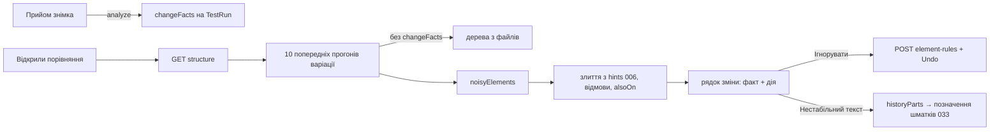

# 054 — Дизайн

<!-- Нові файли й заплановані тести записані без код-лапок: check-docs.py перевіряє, що
     названі шляхи й тести існують. При реалізації трасування переходить у `шлях › тест`. -->

## Підхід

Історія вже є в рядках `TestRun` однієї варіації (той самий профіль пристрою): статус каже,
що вирішила людина (`approved` — прийнято, `failed` — відхилено, `ok`/`autoApproved` — збіг,
`unresolved` — без рішення). Бракує лише того, **які елементи** змінювались у кожному прогоні.
Їх уже рахує `UiTreeService.structure` (`diffTrees` + `elementsUnderRegions`), але ніде не
зберігає. Тож:

1. **Факти змін на рядку.** Під час прийому знімка, у тому самому проході, що пише
   `componentChanges`, пишемо в нову nullable-колонку `TestRun.changeFacts` компактний JSON:
   ключі змінених елементів і типи їхніх змін. Для старих прогонів без колонки — обчислення з
   файлів дерев на вимогу (не більше 10 прогонів, з кешем дерев `UiTreeService.load`).
2. **Чиста функція шуму** `noisyElements(history, current)` за REQ-054-01…04, 10: на вході
   до 10 попередніх прогонів (статус, факти, чи є баг перевірки), на виході — шумні ключі з N, M.
3. **Пропозиції у відповіді `GET /test-runs/:id/structure`** (вона й так відкривається з
   порівнянням): нове поле `noise: [{ key, changed, of, rule: 'ignore' | 'variable-text',
   texts?, alsoOn?, dismissed? }]`. Злиття з підказками 006 — тут же: якщо `hints` має підказку
   для того самого елемента, вона отримує факт з історії, а окремої пропозиції немає (REQ-054-08).
4. **Нестабільний текст вирішує інтерфейс.** Бекенд повертає значення тексту з історії
   (`texts`, до 11 рядків). Поділ на шматки й вираз уже живуть у
   `frontend/src/_helpers/variableText.helper.ts` (`splitPieces`, `patternFor`, `fitsParts`),
   тож нова чиста функція `historyParts(texts)` там само знаходить шматки, що відрізнялись,
   перевіряє вираз на всіх значеннях (REQ-054-22) і каже, чи пропонувати «Нестабільний текст»
   (REQ-054-20). Так поділ на шматки не дублюється в бекенді.
5. **Дії — наявні маршрути.** «Ігнорувати тут» і «на всіх екранах» — `POST /test-runs/:id/element-rules`
   з `scope` (як зараз робить дія «Ігнорувати» в рядку, з Undo через `useRuleSnackbar`);
   «Нестабільний текст» відкриває наявне позначення шматків з `parts` наперед (REQ-054-21).
   Лише «Не пропонувати» — новий маршрут.
6. **Усі екрани (REQ-054-30).** Для ключа з id: прогони проєкту за 30 днів, у чиїх
   `changeFacts` є цей ключ (`contains` по рядку, потім точна перевірка), групуються за
   варіацією, і кожна група проходить ту саму `noisyElements`. Рахуються різні перевірки.
7. **Insights (REQ-054-50)** — та сама функція по прогонах проєкту за період, у
   `backend/src/analytics/insights.ts`.

## Компоненти

| Компонент | Шлях | Роль |
|---|---|---|
| Факти змін (чисті), новий | **backend/src/ui-tree/change-facts.ts** | `changeFacts(changes, regionElements, regionsOutside)` → `{ v: 1, elements: [{ k, kinds }], outside }`, ≤ 50 елементів |
| Запис фактів | `backend/src/ui-tree/ui-tree.service.ts` (`analyze`, `recheck`) | писати `changeFacts` поряд із `componentChanges` |
| Шум (чисті), новий | **backend/src/test-runs/noise-history.ts** | `noisyElements`, `mergeWithHints`, `projectWide` |
| Сервіс шуму, новий | **backend/src/test-runs/noise-history.service.ts** | історія варіації, баги перевірки (`VisualBug.testRunId`), відмови, тексти з дерев для текстових кандидатів |
| Структура | `backend/src/ui-tree/ui-tree.service.ts` (`structure`) | поле `noise` у відповіді |
| Відмова, маршрут | `backend/src/test-runs/test-runs.controller.ts` | `POST /test-runs/:id/noise/dismiss { key }`, `@ProjectFrom`, ролі admin/editor |
| Insights | `backend/src/analytics/insights.ts`, `backend/src/analytics/analytics.service.ts` | блок «Шумні елементи», до 20 |
| Нестабільний текст з історії, новий хелпер | `frontend/src/_helpers/variableText.helper.ts` | `historyParts(texts)` |
| Рядок зміни | `frontend/src/components/TestDetailsDialog/InsightsPanel.tsx` | факт з історії, дії, «Не пропонувати», підказка «хто й коли» |
| Insights UI | `frontend/src/pages/InsightsPage.tsx` | блок «Шумні елементи» |
| Тексти | `frontend/src/i18n/en.ts`, `frontend/src/i18n/uk.ts` | ключі `noise.*` |

## Дані

Міграція (додавальна, ADR-0003):

```sql
-- facts about what changed, for the noise history (054) and the change lines on screen tiles (055);
-- nullable: old runs fall back to the UI tree files
ALTER TABLE "TestRun" ADD COLUMN "changeFacts" TEXT;

-- "do not suggest" for an element of a check (REQ-054-40); no foreign keys, like ReviewDecision
CREATE TABLE "NoiseDismissal" (
  "id" TEXT PRIMARY KEY,
  "projectId" TEXT NOT NULL,
  "checkKey" TEXT NOT NULL,
  "elementKey" TEXT NOT NULL,
  "userId" TEXT,
  "createdAt" TIMESTAMP(3) NOT NULL DEFAULT CURRENT_TIMESTAMP
);
CREATE UNIQUE INDEX "NoiseDismissal_projectId_checkKey_elementKey_key"
  ON "NoiseDismissal"("projectId", "checkKey", "elementKey");
```

`changeFacts` — до ~3 КБ (50 × ключ + типи), бо сокет розсилає рядок цілком (backend/AGENTS.md).
Ключі за шляхом (`path:`) у факти не потрапляють (REQ-054-04). `checkKey` — наявний `checkKey`
з `backend/src/ui-tree/comparison-inputs.ts`. Ім'я того, хто відмовився, — лише `select` імені,
а не рядок `User` (правило 7).

## Потік



## Ризики

| Ризик | Що робимо |
|---|---|
| `structure` стає повільнішою (SC-054-03) | один запит історії з `select` лише потрібних полів; дерева старих прогонів — лише поки немає `changeFacts`; заміряти в тесті сервісу кількість запитів |
| Пошук «на всіх екранах» по рядку `changeFacts` | обмеження 30 днями й проєктом; `contains` — лише префільтр, точна перевірка після розбору |
| Пропозиція приховає справжню зміну | лише коли всі зміни історії прийняті, без відхилених і багів (REQ-054-02); для тексту — нестабільний текст замість ігнорування |
| Розмір рядка в сокеті | межа 50 елементів у фактах, без текстів |

## Перевірка вимог

| Вимога | Перевірка |
|---|---|
| REQ-054-01 | план: backend/src/test-runs/noise-history.spec.ts › looks at the ten runs before this one on the same device |
| REQ-054-02 | план: backend/src/test-runs/noise-history.spec.ts › calls an element noisy after five approved changes and none rejected or with a bug |
| REQ-054-03 | план: backend/src/ui-tree/change-facts.spec.ts › records elements under changed areas and invisible changes |
| REQ-054-04 | план: backend/src/ui-tree/change-facts.spec.ts › leaves out elements keyed by path |
| REQ-054-05 | план: backend/src/test-runs/noise-history.service.spec.ts › suggests a rule only for a changed noisy element without a rule |
| REQ-054-06 | план: frontend/integration_tests/test/noiseHistory.spec.ts › ignores a noisy element here and offers undo |
| REQ-054-07 | план: frontend/integration_tests/test/noiseHistory.spec.ts › shows the history without the action to a viewer |
| REQ-054-08 | план: backend/src/test-runs/noise-history.spec.ts › merges with a noise hint for the same element |
| REQ-054-09 | план: backend/src/test-runs/noise-history.service.spec.ts › finds noise without calling the AI service |
| REQ-054-10 | план: backend/src/test-runs/noise-history.spec.ts › suggests a rule for a banner that came and went but not for a first disappearance |
| REQ-054-20 | план: frontend/src/_helpers/variableText.helper.test.ts › suggests variable text when only the same pieces changed |
| REQ-054-21 | план: frontend/integration_tests/test/noiseHistory.spec.ts › opens piece marking with the changed pieces marked |
| REQ-054-22 | план: frontend/src/_helpers/variableText.helper.test.ts › does not mark a piece whose pattern misses a value from the history |
| REQ-054-30 | план: backend/src/test-runs/noise-history.service.spec.ts › counts other checks where the same element is noisy |
| REQ-054-31 | план: frontend/integration_tests/test/noiseHistory.spec.ts › asks before ignoring on all screens, naming the selector and the count |
| REQ-054-40 | план: backend/src/test-runs/noise-history.service.spec.ts › stops suggesting after do not suggest but keeps the history |
| REQ-054-41 | план: backend/src/test-runs/noise-history.service.spec.ts › tells who declined and when without the user row |
| REQ-054-50 | план: backend/src/analytics/insights.spec.ts › lists up to twenty noisy elements of the period |
| REQ-054-60 | `frontend/src/i18n/translate.test.ts › has every text in both languages…` після додавання ключів `noise.*` |
