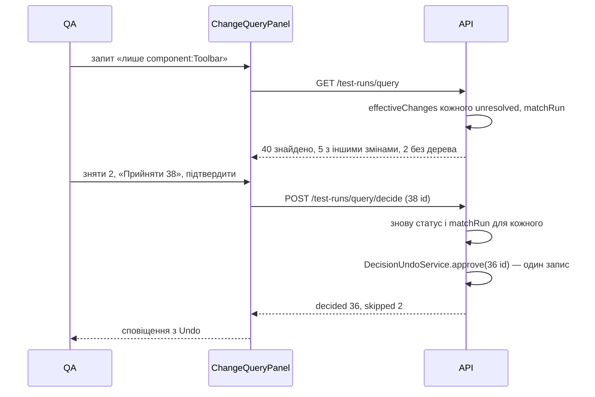

# 055 — Дизайн

<!-- Нові файли й заплановані тести записані без код-лапок: check-docs.py перевіряє, що
     названі шляхи й тести існують. При реалізації трасування переходить у `шлях › тест`. -->

## Підхід

- **Що таке «змінилось лише це».** Для кожного екрана збірки зі статусом `unresolved`, що має
  `uiTreeName` і `baselineUiTreeName` (REQ-055-02, 05), беремо ті самі зміни, що показує вкладка
  «Зміни»: області `diffRegions` і зміни дерева `diffTrees`, відфільтровані правилами
  (`outsideAreas`, `insideCompared`). Цю частину `UiTreeService.structure` виносимо в окремий
  метод `effectiveChanges(run)`, щоб запит і вкладка «Зміни» не розійшлися.
- **Чиста функція** `matchRun(query, { tree, baselineTree, regions, changes })`:
  - елементи запиту — `findBySelector` (як у правилах) або `componentOf` для `component:`, в
    обох деревах (елемент, що зник, береться з еталона);
  - режим «лише» (REQ-055-03): кожна область лежить у рамці знайденого елемента поточного дерева
    чи еталона, і кожна зміна дерева (текст, підпис, стан, з'явився, зник, розмір) — на знайденому
    елементі чи його нащадку; рух без інших змін не рахується, як і в групах 006;
  - режим «зокрема» (REQ-055-04): хоча б одна область чи зміна дерева на знайденому елементі;
  - типи зміни (REQ-055-40…41): кожна зміна знайденого елемента — з обраних; «лише пікселі» —
    область без зміни дерева в ньому.
- **Два маршрути.** `GET /test-runs/query` повертає перелік, а `POST /test-runs/query/decide`
  приймає ідентифікатори, **ще раз** перевіряє кожен екран (статус і запит, REQ-055-24) і
  викликає наявні `DecisionUndoService.approve` / `reject` одним викликом. Тобто це один запис
  `ReviewDecision`, і наявне Undo повертає всю пачку або нічого (REQ-055-25, ADR-0014). Approve у
  режимі «зокрема» сервер відхиляє з 400 (REQ-055-22), а не лише інтерфейс.
- **Межі на N немає** (рішення власника 2026-11-15): захищають перелік, підтвердження й Undo.
  Сервер обробляє будь-яку кількість ідентифікаторів одним журналом, як і масовий approve у списку тестів.
- **Інтерфейс.** Панель «Рішення за запитом» на сторінці збірки, параметри в адресі
  (`?query=…&mode=only|including&kinds=…`, REQ-055-50). Перелік — плитки зі знятими позначками;
  клік відкриває наявне порівняння, повернення відновлює панель з адреси й позначки з
  `sessionStorage` (REQ-055-12). Вхід з рядка зміни — пункт у меню рядка у `InsightsPanel`
  (REQ-055-30).
- **US-6, зміни словами.**
  - `diffTrees` тепер пише для `moved` зсув зі знаком (dx, dy у dp), а не модуль. Рядок зміни
    прикріплює `moved` до рядка області цього елемента, якщо інших змін у нього немає, і пише
    напрям за осями понад поріг `MOVE_THRESHOLD_DP` (REQ-055-60). `changeFingerprint` рух не
    враховує, тож групи 006 не змінюються.
  - Плитка екрана в збірці (`TestRunGrid`) бере перші 2 рядки з `TestRun.changeFacts` (колонка з
    [054](../054-rules-from-noise-history/design.md), T1) і «ще N» (REQ-055-61). Для цього факти
    змін доповнюються коротким текстом «було → стало» (до 40 символів) лише для перших 2 елементів.
    Без фактів плитка така сама, як зараз (REQ-055-62).

## Компоненти

| Компонент | Шлях | Роль |
|---|---|---|
| Запит до змін (чисті), новий | **backend/src/test-runs/change-query.ts** | `parseChangeQuery` (той самий синтаксис, що `parseQuery` з 053), `matchRun` |
| Сервіс, новий | **backend/src/test-runs/change-query.service.ts** | екрани збірки, `effectiveChanges` з паралельністю 8, лічильники «з іншими змінами» і «без дерева», повторна перевірка при рішенні |
| Ефективні зміни | `backend/src/ui-tree/ui-tree.service.ts` | `effectiveChanges(run)`, винесений зі `structure` |
| Маршрути | `backend/src/test-runs/test-runs.controller.ts` | `GET /test-runs/query`, `POST /test-runs/query/decide` з `@ProjectFrom(inQuery('buildId'…))`/тілом, ролі admin/editor, DTO з class-validator |
| Журнал рішень | `backend/src/test-runs/decision-undo.service.ts` | без змін: один виклик — один запис |
| Рух зі знаком | `backend/src/ui-tree/structure-diff.ts` | `moved`: dx, dy зі знаком |
| Факти для плитки | backend/src/ui-tree/change-facts.ts (з 054) | коротке «було → стало» для перших 2 |
| Панель запиту, нова | **frontend/src/components/BuildQuery/ChangeQueryPanel.tsx** | поле, режим, типи, лічильники, плитки з позначками, «Прийняти N» / «Відхилити N», підтвердження, Undo через `useDecisionSnackbar` |
| Сторінка збірки | `frontend/src/pages/ProjectPage.tsx` | кнопка «Рішення за запитом», стан з адреси |
| Рядок зміни | `frontend/src/components/TestDetailsDialog/changedAreas.ts`, `frontend/src/components/TestDetailsDialog/InsightsPanel.tsx` | `moved` у рядку області; меню «Усі екрани збірки, де змінився лише він» |
| Плитка | `frontend/src/components/TestRunList/TestRunGrid.tsx` | 2 рядки змін і «ще N» |
| Сервіс API | `frontend/src/services/testRun.service.ts` | `queryChanges`, `decideByQuery` |
| Тексти | `frontend/src/i18n/en.ts`, `frontend/src/i18n/uk.ts` | `query.*`, `changes.moved*` |

## Дані

Власних таблиць і колонок немає. Використовується `TestRun.changeFacts` з 054. Якщо 055
реалізується раніше, задача T1 з [054](../054-rules-from-noise-history/tasks.md) іде першою.
Масове рішення — наявний `ReviewDecision` з кількома `items`.

Відповідь `GET /test-runs/query`: `{ problem?: string, matched: [{ testRun, places: Rect[],
line }], partial: number, withoutTree: number }`. Тіло `POST …/decide`: `{ buildId, query, mode,
kinds?, action: 'approve' | 'reject', ids: string[] }` → `{ decisionId, decided, skipped }`.

## Потік

## Ризики

| Ризик | Що робимо |
|---|---|
| Повільно на 500 екранах (SC-055-03) | паралельність 8, кеш дерев `UiTreeService.load` (300); заміряти на копії проду; за потреби — спершу відсіяти за `changeFacts` |
| Прийняти зайве | «лише» перевіряє і області, і зміни дерева; сервер перевіряє все ще раз при рішенні; approve у «зокрема» — 400 |
| Розбіжність із вкладкою «Зміни» | одна функція `effectiveChanges` для обох |
| Знак у `moved` ламає інших споживачів | `moved` не входить у `changeFingerprint`; `groups.moved` чисел не показує; тести `structure-diff.spec.ts` оновлюються |

## Перевірка вимог

| Вимога | Перевірка |
|---|---|
| REQ-055-01 | план: backend/src/test-runs/change-query.spec.ts › reads the same selectors as the screen search and component |
| REQ-055-02 | план: backend/src/test-runs/change-query.service.spec.ts › looks only at screens waiting for a decision with a baseline |
| REQ-055-03 | план: backend/src/test-runs/change-query.spec.ts › matches only when every change lies in the found elements |
| REQ-055-04 | план: backend/src/test-runs/change-query.spec.ts › matches including when any change touches the found element |
| REQ-055-05 | план: backend/src/test-runs/change-query.service.spec.ts › counts screens without a UI tree as not checked |
| REQ-055-06 | план: backend/src/test-runs/change-query.service.spec.ts › counts screens where the element changed among other changes |
| REQ-055-10 | план: frontend/integration_tests/test/changeQuery.spec.ts › shows found screens with the change in words |
| REQ-055-11 | план: frontend/integration_tests/test/changeQuery.spec.ts › decides only the screens left marked |
| REQ-055-12 | план: frontend/integration_tests/test/changeQuery.spec.ts › keeps the query and marks after opening a comparison |
| REQ-055-20 | план: frontend/integration_tests/test/changeQuery.spec.ts › approves the marked screens in the only mode |
| REQ-055-21 | план: frontend/integration_tests/test/changeQuery.spec.ts › rejects in both modes |
| REQ-055-22 | план: backend/src/test-runs/change-query.service.spec.ts › refuses to approve in the including mode |
| REQ-055-23 | план: frontend/integration_tests/test/changeQuery.spec.ts › asks before deciding, naming the action, the query and the count |
| REQ-055-24 | план: backend/src/test-runs/change-query.service.spec.ts › skips screens decided by someone else or changed since |
| REQ-055-25 | план: backend/src/test-runs/change-query.service.spec.ts › records one decision that undo puts back all or nothing |
| REQ-055-30 | план: frontend/integration_tests/test/changeQuery.spec.ts › opens the query from a change line with its selector |
| REQ-055-40 | план: backend/src/test-runs/change-query.spec.ts › limits the match to the chosen kinds of change |
| REQ-055-41 | план: backend/src/test-runs/change-query.spec.ts › leaves out a screen with a change of another kind in the element |
| REQ-055-50 | план: frontend/integration_tests/test/changeQuery.spec.ts › keeps the query in the address |
| REQ-055-51 | `frontend/src/i18n/translate.test.ts › has every text in both languages…` після додавання ключів `query.*` |
| REQ-055-60 | план: backend/src/ui-tree/structure-diff.spec.ts › keeps the direction of a move; frontend/src/components/TestDetailsDialog/changedAreas.test.ts › writes a move with its direction and distance |
| REQ-055-61 | план: frontend/integration_tests/test/testRunGrid.spec.ts › shows the first two changes in words and how many more |
| REQ-055-62 | план: frontend/integration_tests/test/testRunGrid.spec.ts › shows a tile without change lines when the tree says nothing |
