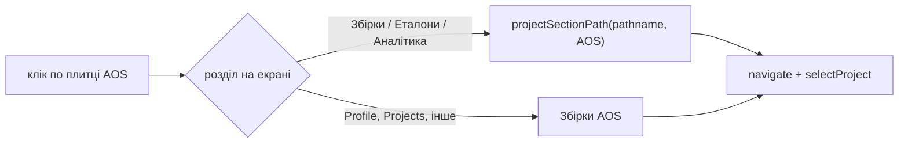

# 057 — Дизайн

## Підхід

Зміна лише у фронтенді. Схема бази не змінюється.

- **Що показує меню, вирішують чисті функції** в `sideNav.helper.ts`, як і в 046: склад пунктів за
  роллю, неактивні розділи без проєкту, активний пункт, перехід у той самий розділ іншого
  проєкту. Нові функції там же: `projectTileLabel(name)` (скорочення на плитці) і
  `railProjects(projects, selectedId)` (порядок і обраний). `SideNav` лише бере стан і малює.
- **`SideNav` стає двома смугами:** `ProjectRail` (рейка 64 px) і `SectionPanel` (панель 200 px).
  Поки вікно вужче за 1100 px (`SIDE_NAV_FOLD_QUERY`, як у 046), панелі немає, а її пункти
  малюються іконками в рейці. Загальна ширина: 264 px замість 232, вузька — 64 px, як і була.
- **Вибір проєкту в меню більше не випадний список.** `ProjectSelect` у варіанті `sidebar` з
  меню зникає; компактний `ProjectSelect` у заголовках сторінок лишається без змін.
- **Довідка переїжджає в `AccountMenu`:** тур (`GuidedTour`), ручні перевірки
  (`ManualChecksDialog`), «Повідомити про проблему», «Усі проєкти» і рядок версії. Кнопки
  Help і `HELP_MENU_*` локаторів більше немає.
- **Пошук екранів прибираємо з інтерфейсу, сервер лишаємо** (рішення власника 2026-11-16).
  Ендпоінт `screen-search` і індекс у пам'яті (ADR-0030) не змінюються: індекс наповнюється лише
  на запит, тож без викликів не тримає пам'яті. Повернути пошук в інтерфейс можна без змін сервера.
- Старі посилання `/search/:projectId…` маршрутизатор перенаправляє на Збірки проєкту
  (REQ-057-51); доступ перевіряє вже наявний шлях Збірок ([042](../042-project-access/spec.md)).
- `BetaChip` і `ElementCrop` лишаються: ними користується «Рев'ю за елементом» (055).

Скорочення назви (REQ-057-02): назва до 3 символів — як є («iOS», «AOS», «Web»); кілька слів —
перші літери до трьох слів великими («Mobile Shop Android» → «MSA»); одне довше слово — перші дві
літери, перша велика («Android» → «An»). Повна назва — у `aria-label` і підказці.

## Компоненти

| Компонент | Шлях | Роль |
|---|---|---|
| Хелпер меню | `frontend/src/_helpers/sideNav.helper.ts` | без `projects` і `search` у `SideNavKey`; група `admin` замість `main`; `projectTileLabel`, `railProjects` |
| Бічне меню | `frontend/src/components/SideNav.tsx` | збирає рейку й панель, вузький режим, переїзд позначки (як у [018](../018-ui-redesign/spec.md)), без клавіші `/` і `SearchPalette` |
| Рейка | frontend/src/components/ProjectRail.tsx (новий) | логотип → Projects, плитки з прокруткою, «+» для admin/editor (`/projects?create=1`), аватар |
| Панель розділів | frontend/src/components/SectionPanel.tsx (новий) | заголовок проєкту / «Choose project» / «No projects yet», розділи, «Адміністрування» |
| Меню акаунта | `frontend/src/components/AccountMenu.tsx` | «Усі проєкти», тур, ручні перевірки, «Повідомити про проблему», версія |
| Локатори | `frontend/src/components/SideNav.locators.ts` | `PROJECT_RAIL_TEST_ID`, `projectTile(id)`, без `HELP_MENU_*` |
| Вибір проєкту | `frontend/src/components/ProjectSelect.tsx` | прибрати варіант `sidebar`/`folded` |
| Маршрути | `frontend/src/Router.jsx`, `src/constants/routes.ts` | `/search/:projectId` → `Navigate` на Збірки |
| Словники | `frontend/src/i18n/en.ts`, `uk.ts` | `nav.admin`, `nav.project`, `account.allProjects`, `account.help*`; без ключів пошуку |
| Видалення (фронтенд) | `pages/ScreenSearchPage.tsx`, `components/SearchPalette.tsx`, `_helpers/screenSearch.helper*.ts`, `types/screenSearch.ts`, `searchScreens`/`suggest` у `services/projects.service.ts`, рамки `?highlight` у `pages/TestVariationDetailsPage.tsx`, `integration_tests/test/screenSearch.spec.ts` | пошук і все, чим користувався лише він |
| Документація | `docs/product/overview.md`, `frontend/AGENTS.md` | рядки про пошук в інтерфейсі |

## Дані

Нічого. Таблиць і колонок пошук не мав: індекс жив у пам'яті процесу.

## Потік

## Ризики

| Ризик | Що робимо |
|---|---|
| Скриншот-еталони Playwright усіх сторінок з меню зміняться | оновлюємо в Docker одним кроком наприкінці; кожен отриманий знімок переглядаємо |
| Однакові скорочення двох проєктів | різняться підказкою й `aria-label`; у тесті хелпера — пара «Mobile iOS» / «Mobile Android» |
| Хтось має закладку на пошук | REQ-057-51: перенаправлення на Збірки, а не 404 |
| Тур (`GuidedTour`) вказує на старі елементи меню (`LOCATOR_SIDE_NAV_PROJECT`) | кроки туру переводимо на рейку; тест туру в задачах |
| Серверний пошук лишається без користувача в інтерфейсі | позначено в `docs/architecture/api.md`, що його викликає лише API; рішення переглядаємо, якщо пошук не повернеться |

## Перевірка вимог

| Вимога | Перевірка |
|---|---|
| REQ-057-01 | план: frontend/integration_tests/test/sideNav.spec.ts › shows the logo, a tile per project, the plus tile and the account in the rail |
| REQ-057-02 | план: frontend/src/_helpers/sideNav.helper.test.ts › shortens a project name to at most three characters |
| REQ-057-03 | план: frontend/integration_tests/test/sideNav.spec.ts › marks the chosen project tile as current |
| REQ-057-04 | план: frontend/src/_helpers/sideNav.helper.test.ts › keeps the section when switching the project |
| REQ-057-05 | план: frontend/integration_tests/test/sideNav.spec.ts › opens New project from the plus tile for an editor only |
| REQ-057-06 | план: frontend/integration_tests/test/sideNav.spec.ts › scrolls only the tiles and keeps the chosen one in view |
| REQ-057-07 | план: frontend/integration_tests/test/sideNav.spec.ts › opens Projects from the logo |
| REQ-057-10 | план: frontend/src/_helpers/sideNav.helper.test.ts › lists the project sections under the project's name |
| REQ-057-11 | план: frontend/src/_helpers/sideNav.helper.test.ts › says Choose project and disables project items until one is picked |
| REQ-057-12 | план: frontend/src/_helpers/sideNav.helper.test.ts › says No projects yet without any project |
| REQ-057-13 | план: frontend/src/_helpers/sideNav.helper.test.ts › puts Users and Backups under Administration for an admin only |
| REQ-057-14 | план: frontend/integration_tests/test/sideNav.spec.ts › has no Projects, Search or Help item and no version |
| REQ-057-15 | план: frontend/integration_tests/test/sideNav.spec.ts › keeps every sidebar label whole in Ukrainian |
| REQ-057-20 | план: frontend/integration_tests/test/sideNav.spec.ts › holds all projects, help and the version in the account menu |
| REQ-057-30 | план: frontend/integration_tests/test/sideNav.spec.ts › keeps only the rail with section icons below 1100 px |
| REQ-057-40 | план: frontend/integration_tests/test/sideNav.spec.ts › marks the open section without glow or green text |
| REQ-057-41 | manual: обидві теми, 1280 px — бренд-колір лише на логотипі, кільці обраної плитки й іконці активного пункту; аватар і плитки нейтральні |
| REQ-057-42 | план: frontend/src/theme.test.ts › keeps text contrast at 4.5:1 or more |
| REQ-057-50 | план: frontend/integration_tests/test/sideNav.spec.ts › does not open a search on the slash key |
| REQ-057-51 | план: frontend/integration_tests/test/sideNav.spec.ts › sends an old search link to the project's builds |
