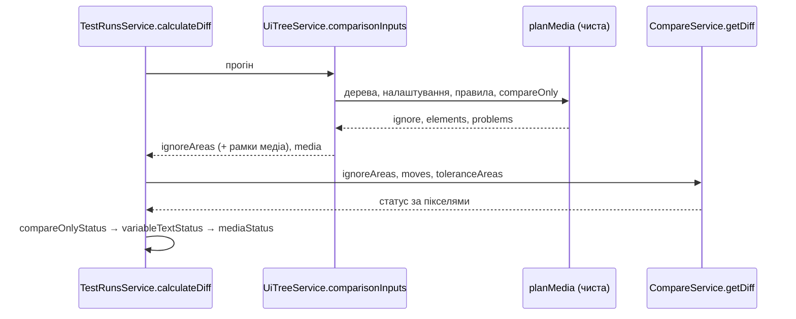

# 060 — Дизайн

## Підхід

Медіа — ще один вхід порівняння з UI-дерева, поруч із системними панелями, правилами елементів і
«порівнювати лише». Усе вирішує одна чиста функція `planMedia`. Сервіси лише вантажать дерева й
налаштування й передають її результат далі. LLM і змін SDK немає (ADR-0007, правило 5).

1. **Що медіа.** У новому модулі backend/src/ui-tree/media-elements.ts лежить
   вбудований перелік за форматом дерева (REQ-060-01), і є функція `mediaNodes(tree, settings,
   rules)`. Вона бере вузли з переліку площею до 50 % знімка (REQ-060-03), вузли зі свого списку
   (REQ-060-04) і з правил «Лише рамку». Вузли, які забирає інше правило, вона пропускає
   (REQ-060-19). `ProgressBar` у переліку немає (REQ-060-02). Для `progress` у вебі парсер
   дерева дописує вузлу `indeterminate`, коли немає атрибута `value`.
2. **План.** `planMedia(nodes з еталона, nodes зі знімка, compareOnly)` зіставляє медіа за
   ключем (REQ-060-12) і повертає:
   - `ignore`: рамки з обох дерев із тим самим відступом 2 px, що й у правил;
   - `elements`: рядок на кожен медіа-елемент зі станом `same`, `removed`, `added`, `resized`,
     `moved` чи `unchecked` (REQ-060-13…15, 17), рамками «було/стало» і джерелом (REQ-060-28);
   - `problems`: елементи зі зміною рамки.

   Пороги — 1 px у пікселях знімка, а не dp, як у `diffTrees`: так написано в REQ-060-14, 15.
   «Змінив місце» вимикається, коли `computeMoves` вважає елемент зсунутим (REQ-060-15).
3. **Порівняння.** `UiTreeService.comparisonInputs` додає `media.ignore` до `ignoreAreas` і
   повертає план у полі `media`. Через ці області пікселі медіа не порівнюються (REQ-060-10).
   `outsideAreas` викидає зі структурних змін усе всередині медіа: нащадків і сам елемент
   (REQ-060-11). Тоді змінені місця й історія шуму 054 медіа не бачать (REQ-060-21). Кадр, що
   збігся рамкою, нічого не змінює, тож статус той самий, що без змін (REQ-060-16).
4. **Статус.** `mediaStatus(status, problems)` будується за зразком `compareOnlyStatus` і
   `variableTextStatus`. Він переводить `ok` в `unresolved`, коли змінилась рамка, бо пікселі
   цього вже не покажуть. Викликаємо його в `TestRunsService.calculateDiff` поруч із двома
   іншими.
5. **Дерево з одного боку** (REQ-060-17). Рамки беремо з того дерева, яке є, і на тому самому
   місці викидаємо з обох картинок. Стан рядка — `unchecked` з позначкою, з якого боку немає
   дерева. `comparisonInputs` зараз виходить одразу, коли немає дерева знімка, тож цю гілку
   доповнюємо так само, як для `planCompareOnly`.
6. **Чи різнився кадр** (REQ-060-30). `UiTreeService.structure` порівнює `areaHash` рамки на
   еталоні й знімку (`backend/src/ui-tree/screen-checks.ts`, уже рахує так компоненти) і пише
   `contentChanged` у рядок плану. Рахується лише на запит вкладки «Зміни», не при прийомі.
7. **Правила.** `ElementRuleAction` отримує дві дії: `frame` («Лише рамку») і `content` («Увесь
   вміст»). «Нічого» — наявне `ignore` (REQ-060-34). Правила лежать у JSON налаштувань, тож нова
   дія — це лише значення в DTO (`@IsIn`), без міграції.
8. **Налаштування.** `UiTreeSettings.media = { enabled, selectors }`, типово `{ enabled: true,
   selectors: [] }` (REQ-060-40). `parseUiTreeSettings` відкидає записи, що не є `id:`/`class:`,
   повтори й усе понад 50 (REQ-060-42, 43). Вимкнений `enabled` прибирає вбудований перелік і
   свій список, але не правила `frame` (REQ-060-45).
9. **Інтерфейс.**
   - `StructureInfo.media` несе план у вкладку «Зміни».
   - `whatsCompared.helper` додає групу `frame` після `compare` (REQ-060-27), а `changedAreas`
     додає рядки змін рамки з «було/стало» (REQ-060-31).
   - Позначки на знімках і схемі — пунктир кольору медіа (REQ-060-25, 29).
   - Речення під результатом — у `verdict` (REQ-060-30).
   - Блок «Що перевіряти» — в `ElementPopover` (REQ-060-32).
   - Розділ налаштувань — новий компонент у `ProjectForm` (REQ-060-40…43).
   - Позначка «Бета» — наявний `BetaChip` (REQ-060-46).

Рішення застосовувати правила, яких ніхто не створював, — це новий принцип для Vision.
Пропоную для нього [ADR-0031](../../decisions/0031-automatic-media-rules-from-ui-tree.md).

## Компоненти

| Компонент | Шлях | Роль |
|---|---|---|
| Медіа-елементи | новий backend/src/ui-tree/media-elements.ts | `BUILT_IN_MEDIA`, `mediaNodes`, `planMedia`, `mediaStatus`, `mediaContentChanged` — чисті функції |
| Налаштування й правила | `backend/src/ui-tree/comparison-inputs.ts` | `ElementRuleAction` + `frame`, `content`; `UiTreeSettings.media`, його розбір; `resolveRules` не обводить `frame`/`content` як області |
| Веб-дерево | `backend/src/ui-tree/web-tree.parser.ts`, `backend/src/ui-tree/ui-tree.types.ts` | `UiNode.indeterminate?` для `progress` без `value` |
| Входи порівняння | `backend/src/ui-tree/ui-tree.service.ts` | `comparisonInputs` → `media`, рамки в `ignoreAreas`, гілка без дерева знімка; `structure` → `media` з `contentChanged` |
| Статус | `backend/src/test-runs/test-runs.service.ts` | `mediaStatus` у `calculateDiff` |
| Групи змін | `backend/src/test-runs/change-groups.service.ts` | рамки медіа поруч із `variableTextAreas`, щоб кадр не ділив групи |
| DTO правила | `backend/src/test-runs/dto/element-rule.dto.ts` | `@IsIn` + `frame`, `content` |
| Типи | `frontend/src/types/insights.ts` | `MediaInfo`, `MediaElement`, нові дії правила |
| Межі порівняння | `frontend/src/_helpers/whatsCompared.helper.ts`, `frontend/src/components/TestDetailsDialog/WhatsCompared.tsx`, `frontend/src/components/TestDetailsDialog/ComparedMap.tsx` | група «Лише рамка», рядки, джерела, «Бета», схема |
| Перелік змін і результат | `frontend/src/components/TestDetailsDialog/changedAreas.ts`, `frontend/src/components/TestDetailsDialog/ComparisonVerdict.tsx` | рядки змін рамки, речення про кадр |
| Позначки на знімках | `frontend/src/components/TestDetailsDialog/TestDetailsModal.tsx` | пунктир кольору медіа, підпис при наведенні |
| Що перевіряти | `frontend/src/components/TestDetailsDialog/ElementPopover.tsx`, `frontend/src/components/TestDetailsDialog/ElementActions.tsx` | позначка «медіа», три варіанти й область дії, Undo |
| Налаштування проєкту | `frontend/src/components/ProjectForm/ProjectForm.tsx` + новий `MediaSettings.tsx` | вимикач, вбудований перелік, свій список |
| Колір | `frontend/src/theme.ts` | `media`, `mediaSoft` в обох палітрах |
| Тексти | `frontend/src/i18n/en.ts`, `frontend/src/i18n/uk.ts` | ключі `media.*` |

## Дані

- Нових таблиць і колонок немає. `media` лежить у JSON `Project.uiTreeSettings`, а правила
  `frame` і `content` — у тих самих `elementRules` і `checkRules`.
- Старі налаштування без `media` читаються як `{ enabled: true, selectors: [] }`, тож функція
  вмикається для всіх проєктів одразу (рішення власника).
- Збережені результати перевірок не перераховуються (REQ-060-44). Новий план з'являється при
  наступному порівнянні чи перерахунку після правила.
- Відкат: старіша версія Vision не знає поля `media` і дій `frame`/`content`. Поле вона
  відкине, а правило з невідомою дією нічого не знайде, бо `resolveRules` дивиться лише на свої
  дії.

## Потік

Вкладка «Зміни» викликає `structure`. Там той самий план доповнюється `contentChanged`, а
фронтенд будує групу, рядки змін і речення.

## Ризики

| Ризик | Що робимо |
|---|---|
| Ціла перевірка мовчки перестає порівнюватись (`SurfaceView` на весь екран, карта, Flutter) | ліміт 50 % площі для автоматичних (REQ-060-03), порівняння за коротким ім'ям класу, а не за підрядком; тест на повноекранний `SurfaceView` і `FlutterSurfaceView` |
| Після ввімкнення для всіх частина перевірок перестане йти на рев'ю й хтось пропустить справжній баг у кадрі | позначка «Бета» і вимикач (REQ-060-46, 40); рядок у групі показує, що саме не порівнювалось; чорний кадр — у «Поза межами» |
| Межі в дереві не збігаються з картинкою (iOS, точки → пікселі) | поріг 1 px після переведення в пікселі знімка (002) і відступ 2 px, як у правил; фікстура iOS з `ActivityIndicator` |
| Атрибут `value` у `progress` не доходить від `collect-tree.js` | тест на фікстурі, зібраній `web-tree/make-fixtures.cjs`; без атрибута `progress` вважається звичайним |
| `areaHash` на кожен запит вкладки коштує часу | лише для медіа-елементів і лише в `structure`, без запису в базу |
| Знімки поведінки `structure.characterization` зміняться | це зміна поведінки за цією специфікацією; оновлюємо разом із нею, переглянувши різницю |

## Перевірка вимог

| Вимога | Перевірка |
|---|---|
| REQ-060-01 | план: backend/src/ui-tree/media-elements.spec.ts › takes video, Lottie and canvas from the built-in list on every platform |
| REQ-060-02 | план: backend/src/ui-tree/media-elements.spec.ts › leaves an Android ProgressBar compared |
| REQ-060-03 | план: backend/src/ui-tree/media-elements.spec.ts › does not take a media element over half the screenshot by itself |
| REQ-060-04 | план: backend/src/ui-tree/media-elements.spec.ts › takes what the project's own selectors find |
| REQ-060-10 | план: backend/src/ui-tree/ui-tree.service.spec.ts › leaves the frame of a media element out of the pixels on both sides |
| REQ-060-11 | план: backend/src/ui-tree/media-elements.spec.ts › drops changes inside a media element |
| REQ-060-12 | план: backend/src/ui-tree/media-elements.spec.ts › matches media elements by key, repeats by number |
| REQ-060-13 | план: backend/src/ui-tree/media-elements.spec.ts › calls a hidden or missing media element gone, a new one added |
| REQ-060-14 | план: backend/src/ui-tree/media-elements.spec.ts › calls a media element resized above one pixel |
| REQ-060-15 | план: backend/src/ui-tree/media-elements.spec.ts › calls a media element moved unless moves are compensated |
| REQ-060-16 | план: backend/src/test-runs/test-runs.service.spec.ts › passes a check whose only difference is a video frame |
| REQ-060-17 | план: backend/src/ui-tree/media-elements.spec.ts › leaves the frame out in place and says it is unchecked when one side has no tree |
| REQ-060-18 | план: backend/src/ui-tree/ui-tree.service.spec.ts › compares the whole screenshot when neither side has a tree |
| REQ-060-19 | план: backend/src/ui-tree/media-elements.spec.ts › lets the element's own rule or an ignored parent win |
| REQ-060-20 | план: backend/src/ui-tree/media-elements.spec.ts › checks media inside compared elements and leaves the rest without effect |
| REQ-060-21 | план: backend/src/ui-tree/ui-tree.service.spec.ts › names no changed element for a media frame that held |
| REQ-060-25 | план: frontend/integration_tests/test/mediaElements.spec.ts › outlines media on both pictures and names it on hover |
| REQ-060-26 | план: frontend/src/theme.test.ts › gives media its own colour with 3:1 contrast in both themes |
| REQ-060-27 | план: frontend/src/_helpers/whatsCompared.helper.test.ts › puts media in a frame-only group after compared |
| REQ-060-28 | план: frontend/src/_helpers/whatsCompared.helper.test.ts › tells the state and the source of each media row |
| REQ-060-29 | план: frontend/src/components/TestDetailsDialog/ComparedMap.test.tsx › draws media as a dashed frame |
| REQ-060-30 | план: frontend/src/_helpers/whatsCompared.helper.test.ts › explains a changed frame of media under no changes |
| REQ-060-31 | план: frontend/src/components/TestDetailsDialog/changedAreas.test.ts › lists a changed media frame with before and after |
| REQ-060-32 | план: frontend/src/components/TestDetailsDialog/ElementPopover.test.tsx › offers what to check for a media element |
| REQ-060-33 | план: frontend/integration_tests/test/mediaElements.spec.ts › saves the choice at once and undoes it |
| REQ-060-34 | план: backend/src/ui-tree/media-elements.spec.ts › reads frame and content rules and ignore as nothing |
| REQ-060-35 | план: frontend/integration_tests/test/mediaElements.spec.ts › offers frame only in the full rule form and the row menu |
| REQ-060-36 | план: frontend/src/components/TestDetailsDialog/ElementPopover.test.tsx › shows what is checked without choices to a viewer |
| REQ-060-40 | план: backend/src/ui-tree/comparison-inputs.spec.ts › turns media on for settings saved before it |
| REQ-060-41 | план: frontend/integration_tests/test/projectSettings.spec.ts › lists built-in media and the iOS note |
| REQ-060-42 | план: frontend/integration_tests/test/projectSettings.spec.ts › adds and removes the project's own media |
| REQ-060-43 | план: backend/src/ui-tree/comparison-inputs.spec.ts › keeps only id and class media selectors, once, up to fifty |
| REQ-060-44 | manual: змінити вимикач у проєкті з порівняною перевіркою → її результат той самий, доки її не порівняють знову |
| REQ-060-45 | план: backend/src/ui-tree/media-elements.spec.ts › keeps frame rules when media is turned off |
| REQ-060-46 | план: frontend/integration_tests/test/mediaElements.spec.ts › marks media as beta in settings, the group and the popover |
| REQ-060-50 | план: frontend/src/i18n/i18n.test.ts › has every media text in both languages |
