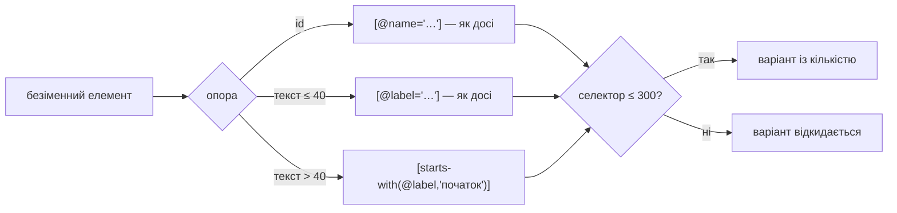

# 060 — Дизайн

## Підхід

Зміна лишається в межах вузької мови XPath з [ADR-0021](../../decisions/0021-xpath-selectors-from-stable-elements.md).
Опора отримує другу форму умови, а все інше не змінюється:

- `[@атрибут='значення']`: рівність, як досі;
- `[starts-with(@атрибут,'значення')]`: значення атрибута починається з рядка.

**Розбір** (`parseXpath`). Спершу розбираємо опору в обох формах, а перевірки на функції, `or` і
осі проганяємо вже по решті виразу. Так `starts-with()` дозволено лише як умову опори
(REQ-060-08), а `contains()` чи `starts-with()` у кроці й надалі дає `function`. Якщо значення
`starts-with()` порожнє, повертаємо `anchor`: така опора знаходила б кожен елемент з атрибутом.
Розібрана опора отримує поле `match: 'equals' | 'start'`.

**Обчислення** (`anchorsOf`). Для `start` вузол підходить, коли `attributeOf(...)` починається
зі значення. Ключ кешу опор включає `match`. Вартість не змінюється: це той самий один прохід
по вузлах.

**Побудова** (`anchorStep` у `selector-variants.ts`). Для опори без id нова чиста функція
`textStart(value)` повертає початок значення:
- до 40 графем (`Intl.Segmenter`, щоб не різати емодзі чи сурогатну пару; граничний випадок
  специфікації);
- обрізаний по останньому пробілу в межах 40 графем; якщо перше слово довше, лишаються просто
  40 графем (REQ-060-01);
- без кінцевих пробілів;
- значення беремо з атрибута як є, без `trim`, бо `starts-with` порівнює із сирим значенням.

Якщо значення має не більше 40 графем, опора будується за рівністю, як досі (REQ-060-02,
SC-060-04). Лапки обираємо за тим, що справді входить у вираз: за початком, а не за цілим
текстом (REQ-060-06). Ідентифікатори (`resource-id`, `name`, `id`) і далі йдуть рівністю.

**Межа довжини** (REQ-060-04). Межа 300 символів стає однією константою
`MAX_SELECTOR_LENGTH` у `comparison-inputs.ts`. Її використовують DTO правил, `selectorVariants`
(варіант, довший за межу, відкидається) і `textFields` (довший `stableSelector` для
нестабільного тексту, 033, не пропонується). Елемент, у якого не лишилось варіантів, не
пропонується вже за наявною логікою `pickableElements` ([027](../027-nameless-elements/spec.md)).

**Кілька збігів** (REQ-060-03, варіант «б»). Початок не подовжуємо. `count` варіанта вже рахує
знайдене, `rank` у `selectorVariants` уже ставить текстову опору після id, а підказка вже
показує кількість ([027](../027-nameless-elements/spec.md)). Нового коду тут немає, потрібен лише тест.

**Попередження** (REQ-060-07). `SelectorVariant` отримує `anchorMatch?: 'start'`, а `anchor`
для такої опори дорівнює самому початку (≤ 40 графем). `ElementPopover` показує новий ключ
`select.textAnchorStart` з `{text}`. Для рівності лишається `select.textAnchor`.

**Збережені правила** (REQ-060-09). Розбір рівності не змінюється, тож правила з повним текстом
знаходять те саме. Міграції немає.

## Компоненти

| Компонент | Шлях | Роль |
|---|---|---|
| `parseXpath`, `anchorsOf`, `ParsedXpath.anchor.match` | `backend/src/ui-tree/xpath-selector.ts` | друга форма опори: розбір і обчислення |
| `textStart`, `anchorStep`, `SelectorVariant.anchorMatch`, фільтр за довжиною | `backend/src/ui-tree/selector-variants.ts` | початок тексту в опорі; варіанти, які сервер прийме |
| `MAX_SELECTOR_LENGTH` | `backend/src/ui-tree/comparison-inputs.ts` | одна межа для DTO й побудови |
| `textFields` | `backend/src/ui-tree/ui-tree.service.ts` | `stableSelector` не довший за межу |
| `@MaxLength(MAX_SELECTOR_LENGTH)` | `backend/src/test-runs/dto/element-rule.dto.ts` | та сама межа, без зміни значення |
| `SelectorVariant.anchorMatch` | `frontend/src/types/insights.ts` | тип відповіді |
| попередження | `frontend/src/components/TestDetailsDialog/ElementPopover.tsx` | `select.textAnchorStart` з початком тексту |
| тексти | `frontend/src/i18n/en.ts`, `uk.ts` | `select.textAnchorStart`; `panel.selectorProblem.anchor` і `.function` згадують `starts-with()` в опорі |

## Дані

Без змін схеми. Збережені правила й дерева не переписуються.

## Потік

## Ризики

| Ризик | Що робимо |
|---|---|
| Наш `starts-with` не збігається з Appium (пробіли, нормалізація) | Порівнюємо сире значення атрибута без `trim`. Очікування тесту записуємо з еталонного `xpath@0.0.34` над сирим XML фікстури, як у тестах 027. |
| Початок однаковий у багатьох рядках, і правило бере всі | Рішення власника (REQ-060-03): показуємо кількість; варіант від id іде першим. |
| Початок довгого підпису сам мінливий (дата) | Попередження називає цей початок (REQ-060-07); SC-027-03 міряє, як часто ламається. |
| Розширення мови XPath | Лише одна функція, лише в опорі. Доповнюємо ADR-0021 розділом «Доповнення 2026-11-16 (060)», без нового ADR. |

## Перевірка вимог

| Вимога | Перевірка |
|---|---|
| REQ-060-01 | план: backend/src/ui-tree/selector-variants.spec.ts › anchors on whole words up to 40 characters of a long label |
| REQ-060-02 | план: backend/src/ui-tree/selector-variants.spec.ts › keeps the whole text of an anchor of 40 characters or fewer |
| REQ-060-03 | план: backend/src/ui-tree/selector-variants.spec.ts › counts every row whose label starts the same way |
| REQ-060-04 | план: backend/src/ui-tree/selector-variants.spec.ts › drops a variant longer than the server takes |
| REQ-060-05 | `backend/src/ui-tree/xpath-selector.spec.ts › finds what XPath over the page source finds` |
| REQ-060-06 | план: backend/src/ui-tree/selector-variants.spec.ts › quotes the start of a label that has both quotes further on |
| REQ-060-07 | план: frontend/src/components/TestDetailsDialog/ElementPopover.test.tsx › names the start of the text the rule hangs on |
| REQ-060-08 | план: backend/src/ui-tree/xpath-selector.spec.ts › accepts starts-with() only as the anchor's condition |
| REQ-060-09 | `backend/src/ui-tree/xpath-selector.spec.ts › accepts an anchor with steps down or steps up` |
