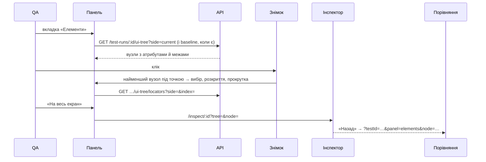

# 060 — Дизайн

## Підхід

Дерево вже лежить у файлі кожної перевірки (розібране, gzip JSON, `UiTreeService.load`), тож
нове — лише читання.

- **Бекенд.** Дві чисті функції в `src/ui-tree/inspector-tree.ts`:
  - `inspectorTree(tree)` перекладає `UiNode` у вузол для перегляду. Це атрибути під назвами
    платформи з межами в одиницях дерева, межі на знімку (або `null` і причина) і коротка назва.
  - `nodeLocators(tree, node)` будує селектори Vision (`selectorForNode` і `selectorVariants`,
    як у режимі вибору) і локатори для тестів (Appium або веб), кожен із кількістю збігів у дереві.

  Сервіс лише завантажує дерево потрібного боку. Позначки змін і знахідок не рахуються тут: вони
  вже є в `structure` (`changes`, `invisible`) і в звіті доступності, які діалог і так вантажить,
  тож вкладка бере їх за ключем вузла. Так позначки збігаються з вкладками «Зміни» й
  «Доступність» (REQ-060-17) без другого розрахунку.
- **Фронтенд.** Логіка дерева — у чистому хелпері `_helpers/treeInspector.helper.ts`:
  - видимі рядки, згортання, початкове розкриття;
  - пошук і фільтр із предками;
  - вузол під точкою, клавіші;
  - позначки за ключем;
  - адреса інспектора.

  Компонент `ElementsTab` показує дерево й картку вузла в наявних елементах панелі (`Tabs`,
  `TextField`, `SlidingToggleGroup`, `StatusPill`, `tokens`, `type`, `radius`), тож вигляд — той
  самий, що в «Зміни» й «Доступність» (REQ-060-02). Він живе і в панелі порівняння, і на сторінці
  інспектора.

  На знімках діалог малює рамки вузлів через наявні `overlayRects` у `DrawArea`. Клік і
  наведення беруть наявний режим `pickMode` з іншими обробниками, поки відкрита вкладка й не
  ввімкнено вибір елементів чи області.
- **Дії над елементом.** Для вузла, що є серед `structure.elements`, вкладка відкриває той самий
  `ElementPopover`, що режим вибору, через стан `selection` діалогу. Нових дій і правил немає
  (REQ-060-26).
- **Сторінка інспектора** `/inspect/:testRunId?tree=&node=`. Вона вантажить перевірку, знімки,
  дерево, `structure` і звіт доступності. Знімки — звичайні `` з рамками поверх: масштабу й
  панорами Konva тут не треба. «Назад» і Esc ведуть на порівняння з
  `testId=…&panel=elements&node=…`, і діалог відкриває панель на «Елементи» з цим вузлом.

## Компоненти

| Компонент | Шлях | Роль |
|---|---|---|
| `inspectorTree`, `nodeLocators` | `backend/src/ui-tree/inspector-tree.ts` | чисті функції: вузли з атрибутами платформи; селектори й локатори з кількістю збігів |
| `UiTreeService.inspector`, `.locators` | `backend/src/ui-tree/ui-tree.service.ts` | вантажить дерево боку перевірки й викликає функції вище |
| `GET /test-runs/:id/ui-tree?side=` | `backend/src/test-runs/test-runs.controller.ts` | дерево для вкладки; `null`, коли дерева цього боку немає; `@ProjectFrom(inParam('id','testRun'))` |
| `GET /test-runs/:id/ui-tree/locators?side=&index=` | там само | селектори й локатори вибраного вузла |
| типи `InspectorTree`, `InspectorNode`, `NodeLocators` | `frontend/src/types/insights.ts` | дзеркало відповідей |
| `insightsService.getUiTree`, `.getLocators` | `frontend/src/services/insights.service.ts` | виклики API |
| хелпер | `frontend/src/_helpers/treeInspector.helper.ts` | рядки, розкриття, фільтри, вузол під точкою, клавіші, позначки, адреса |
| `ElementsTab` | `frontend/src/components/TestDetailsDialog/ElementsTab.tsx` | дерево, пошук, «Поточне / Еталон», фільтр, картка вузла, локатори, дії, стани |
| `useInspectorTrees` | `frontend/src/components/TestDetailsDialog/useInspectorTrees.ts` | ліниве завантаження обох дерев, повтор після помилки |
| `InsightsPanel` | там само | третя вкладка `elements`, кнопка «На весь екран» |
| `TestDetailsModal` | там само | рамки вузлів на знімках, клік і наведення на вкладці, відкриття `ElementPopover` з дерева, `panel=elements&node=` з адреси |
| `InspectorPage` | `frontend/src/pages/InspectorPage.tsx` | сторінка інспектора; маршрут у `Router.jsx`, `routes.INSPECT_PAGE` |

## Дані

Нічого нового в базі й у файлах: дерева вже збережені. Старі дерева без `checked`/`selected`
показуються без цих атрибутів.

## Потік

## Ризики

| Ризик | Що робимо |
|---|---|
| Дерево на тисячі вузлів гальмує панель | рядки фіксованої висоти, рендеримо лише видимі в прокрутці (віртуалізація у `ElementsTab`), пошук — по підготовленому рядку вузла |
| Дерево в кеші сервісу змінюється викликом | функції лише читають `UiTree`, нових полів у кешовані об'єкти не пишуть |
| Атрибути не ті, що в Appium | назви й одиниці (`bounds` Android у px, iOS — у точках) — з парсера, тести на кожну платформу |
| Клік по знімку на вкладці ламає малювання областей і вибір | обробник вкладки діє лише поки вибір елементів і області вимкнені |

## Перевірка вимог

| Вимога | Перевірка |
|---|---|
| REQ-060-01 | `frontend/integration_tests/test/elementsTab.spec.ts › lists Elements third, opens on Changes and picks from the screenshots` |
| REQ-060-02 | manual: відкрити вкладку в світлій і темній темі — кольори, шрифти й відступи як у «Зміни»; `npx eslint` без порушень правил кольору й шкали |
| REQ-060-03 | `frontend/src/components/TestDetailsDialog/ElementsTab.test.tsx › shows each node with its short class, id and text` |
| REQ-060-04 | `frontend/src/_helpers/treeInspector.helper.test.ts › hides the children of a folded node` |
| REQ-060-05 | `frontend/src/_helpers/treeInspector.helper.test.ts › opens two levels and the way to every marked node` |
| REQ-060-06 | `backend/src/ui-tree/inspector-tree.spec.ts › names Android attributes as UiAutomator writes them` |
| REQ-060-07 | `frontend/src/components/TestDetailsDialog/ElementsTab.test.tsx › explains a check without a UI tree` |
| REQ-060-08 | `frontend/src/components/TestDetailsDialog/ElementsTab.test.tsx › shows that the tree is loading` |
| REQ-060-09 | `frontend/src/components/TestDetailsDialog/ElementsTab.test.tsx › offers Try again when the tree cannot be loaded` |
| REQ-060-10 | `frontend/src/_helpers/treeInspector.helper.test.ts › outlines the hovered node dashed and the chosen one solid` |
| REQ-060-11 | `frontend/src/_helpers/treeInspector.helper.test.ts › outlines the chosen node on the baseline by its key` |
| REQ-060-12 | `frontend/src/_helpers/treeInspector.helper.test.ts › picks the smallest positioned node under the point` |
| REQ-060-13 | manual: на вкладці «Елементи» вести курсор знімком — пунктир на елементі й підсвічений рядок у дереві |
| REQ-060-14 | manual: увімкнути рамки доступності, перейти на «Елементи» — нумерованих рамок немає |
| REQ-060-15 | `frontend/src/components/TestDetailsDialog/ElementsTab.test.tsx › dims a node without a position and says why` |
| REQ-060-16 | `frontend/src/components/TestDetailsDialog/ElementsTab.test.tsx › warns that a tree without positions is not drawn on the screenshot` |
| REQ-060-17 | `frontend/src/_helpers/treeInspector.helper.test.ts › marks nodes by the change and the finding on their key` |
| REQ-060-18 | `frontend/src/_helpers/treeInspector.helper.test.ts › gives the baseline value of a changed attribute` |
| REQ-060-19 | `frontend/src/components/TestDetailsDialog/ElementsTab.test.tsx › switches to the baseline tree` |
| REQ-060-20 | `frontend/integration_tests/test/elementsTab.spec.ts › lists Elements third, opens on Changes and picks from the screenshots` |
| REQ-060-21 | `frontend/src/_helpers/treeInspector.helper.test.ts › keeps only changed and flagged nodes with their ancestors` |
| REQ-060-22 | `frontend/src/_helpers/treeInspector.helper.test.ts › keeps matches and their ancestors whatever the case` |
| REQ-060-23 | `backend/src/ui-tree/inspector-tree.spec.ts › builds an id, accessibility id and xpath for an Android element` |
| REQ-060-24 | `frontend/src/components/TestDetailsDialog/ElementsTab.test.tsx › copies a locator and says Copied` |
| REQ-060-25 | `frontend/src/_helpers/treeInspector.helper.test.ts › steps through the visible rows with the arrow keys` |
| REQ-060-26 | `frontend/src/components/TestDetailsDialog/ElementsTab.test.tsx › offers the element actions to those who can edit` |
| REQ-060-27 | `frontend/src/components/TestDetailsDialog/ElementsTab.test.tsx › leaves the actions out for those who cannot edit` |
| REQ-060-28 | manual: `npx tsc` без помилок (пропущений переклад — помилка типів); перемкнути EN/UK — кожен текст вкладки перекладено |
| REQ-060-29 | `backend/src/projects/project-access.routes.spec.ts › answers not found on every route of a project without access` |
| REQ-060-30 | `backend/src/ui-tree/inspector-tree.spec.ts › counts how many nodes each locator finds` |
| REQ-060-31 | `frontend/src/_helpers/treeInspector.helper.test.ts › keeps the check, the tree and the node in the inspector address` |
| REQ-060-32 | `frontend/integration_tests/test/elementsTab.spec.ts › opens the inspector on the node and comes back to it` |
| REQ-060-33 | `frontend/src/_helpers/treeInspector.helper.test.ts › reads the tree and the node back from the inspector address` |
| REQ-060-34 | `frontend/integration_tests/test/elementsTab.spec.ts › the inspector says when the linked element is not in the tree` |
| REQ-060-35 | `frontend/src/_helpers/treeInspector.helper.test.ts › returns to the comparison on the Elements tab with the node` |
| REQ-060-36 | manual: сторінка інспектора при ширині 800 px — знімок, дерево й картка одне під одним, горизонтальної прокрутки немає |
| REQ-060-37 | `backend/src/projects/project-access.routes.spec.ts › answers not found on every route of a project without access` |
