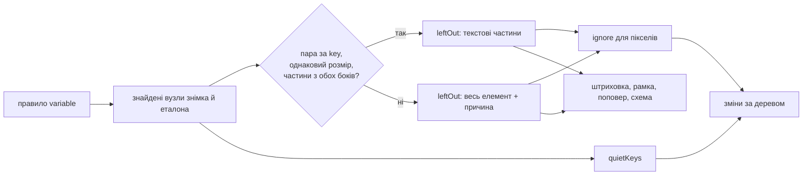

# 066 — Дизайн

## Підхід

Уся логіка «що саме не порівнюється» — у чистій функції бекенду поруч із `resolveRules`
(`backend/src/ui-tree/comparison-inputs.ts`), бо саме вона вже дає області правил і пікселям
(`ignore`), і змінам за деревом, і позначкам на знімку (`found`). Новий результат —
`leftOut`: на кожне правило нестабільного тексту й кожен знайдений елемент — що з нього
прибрано з порівняння на кожному боці (текстові частини або весь елемент) і чому весь.

- **Текстові частини (REQ-066-01).** Нащадки знайденого вузла (за ланцюжком `parent`), видимі й
  ненульові, чий видимий текст проходить `checkVariableText(rule.parts, …)`. Видимий текст — `text`; `label` лише на iOS і не в зображень: content-desc і aria-label не намальовані, і значок із підписом «clock» під правилом «будь-яке слово» інакше став би текстовою частиною. Сам вузол — не
  частина: якщо текст лише на ньому, частин немає.
- **Пара еталон ↔ знімок (REQ-066-02, 03).** Знайдений вузол знімка зіставляємо з вузлом еталона
  за `key` (той самий, що й у `diffTrees`). Нема пари, нема дерева еталона, у будь-якого боку нема
  частин або ширина чи висота в пікселях різні → увесь елемент на обох боках, як досі
  (`reason: 'own-text'`, `'resized'` або `'unpaired'`). Рівність розміру — точна: запасний шлях (увесь елемент)
  безпечний, а різниця в 1 px на краях дала б хибну зміну. Вузол еталона без пари в знімку
  (елемент зник, «Елемента немає» у 033) — увесь елемент, як досі.
- **Пікселі.** У `ignore` ідуть області з `leftOut` з тим самим `RULE_PADDING_PX`, а не межі
  елемента.
- **Зміни за деревом (REQ-066-04; у 033 зміна тексту й розміру знайденого елемента — не зміна).** Досі їх відсікала та сама область: усе, що
  всередині елемента, мовчало, зокрема значок. Тепер `ResolvedRules.quietKeys` — ключі самих
  знайдених вузлів на обох боках: їхні зміни (текст, підпис, розмір, новий ключ безіменного вузла)
  не рахуються, як і раніше; зміни текстових частин відсікає їхня область; зміни значка й інших
  нащадків рахуються. Фільтр `outsideAreas` отримує ці ключі; `variableTextAreas` для груп змін
  (так у 033) повертає області з `leftOut` і ключі.
- **Показ (REQ-066-05…07).** `structure.rules[*].leftOut` іде у фронтенд. Позначки на знімку
  малюють штриховку по `areas`, а коли прибрано лише текст — рамку без штриховки по `element`.
  Схема знімка штрихує `areas` поточного боку. Поповер знаходить запис свого елемента за межами
  й показує рядок «Не порівнюється лише текст» або «Не порівнюється весь елемент» з причиною.
  Без `leftOut` (старий сервер) — як досі, за `found`.
- **Текст на екрані (REQ-066-08, 09).** `PickableElement` отримує `labelOnly: true`, коли текст
  елемента — лише підпис. Фронтенд серед вибираних елементів шукає нащадків (за `parent`) з
  текстом; рівно один → рядок і дія, що переводить вибір на нього й одразу відкриває шматки.
- **Лише слова (REQ-066-10…12).** Чиста функція `wordsOnly(parts)` у
  `_helpers/variableText.helper.ts`: жодна незмінна частина не має літери чи цифри, а кожне місце
  (за `sample`, без нього — за виразом без `\d`) — лише літери й пробіли. Рядок під шматками
  після попередження про еталон і в блоці правила.

Нової схеми даних немає: правило те саме, змінюється лише те, як його застосовують, тож уже
збережені правила діють за новими вимогами з наступного порівняння (рішення власника,
spec.md «Граничні випадки»). Окремий ADR не потрібен.

## Компоненти

| Компонент | Шлях | Роль |
|---|---|---|
| `textParts`, `leftOutOf`, `resolveRules` (+`leftOut`, `quietKeys`), `variableTextAreas` | `backend/src/ui-tree/comparison-inputs.ts` | текстові частини, що прибрати з порівняння, ключі без змін |
| `outsideAreas` (+ключі), `countedChanges`, `comparisonInputs` (+`quietKeys`), `structure` (`leftOut` у правилі), `PickableElement.labelOnly` | `backend/src/ui-tree/ui-tree.service.ts` | фільтр змін, віддача в UI |
| групи змін | `backend/src/test-runs/change-groups.service.ts` | `variableTextAreas` з ключами |
| типи | `frontend/src/types/insights.ts` | `LeftOut`, `ScreenRule.leftOut`, `PickableElement.labelOnly` |
| `wordsOnly`, `textOnScreen`, `leftOutFor` | `frontend/src/_helpers/variableText.helper.ts` | чисті функції показу |
| позначки на знімку | `frontend/src/components/TestDetailsDialog/TestDetailsModal.tsx` | штриховка по `areas`, рамка по `element`; перехід на вкладений текст |
| схема | `frontend/src/_helpers/whatsCompared.helper.ts` | прямокутники правила з `leftOut` |
| поповер | `frontend/src/components/TestDetailsDialog/ElementPopover.tsx` | рядок «що не порівнюється», «Текст на екрані», попередження про слова |
| словники | `frontend/src/i18n/en.ts`, `uk.ts` | нові тексти |

## Дані

Без змін у базі. Відповідь `structure` отримує необов'язкові поля `rules[*].leftOut` і
`elements[*].labelOnly`.

## Потік

## Ризики

| Ризик | Що робимо |
|---|---|
| Збережені правила на кнопках почнуть відправляти на рев'ю через значок | погоджено власником; це зміни, які правило ховало |
| Межі вкладеного тексту в дереві вужчі за намальований текст (тінь, курсив) | той самий запас `RULE_PADDING_PX`, що й у всіх правил; якщо в реальних деревах буде мало — збільшити запас окремим рішенням |
| Кнопка змінює розмір на 1 px через рендер | точна рівність → увесь елемент, як досі; це не гірше, ніж зараз |
| Дерево зі списком: рядки з однаковим `key#n` поміняються місцями | розмір і частини перевіряються для кожної пари; невдала пара → увесь елемент |

## Перевірка вимог

| Вимога | Перевірка |
|---|---|
| REQ-066-01 | `backend/src/ui-tree/comparison-inputs.spec.ts › takes as text parts the descendants whose text passes the check` |
| REQ-066-02 | `backend/src/ui-tree/comparison-inputs.spec.ts › leaves out only the text parts when the element keeps its size` |
| REQ-066-03 | `backend/src/ui-tree/comparison-inputs.spec.ts › leaves out the whole element when its text is its own or its size changed` |
| REQ-066-04 | `backend/src/ui-tree/comparison-inputs.spec.ts › counts a change of the icon next to a variable text` |
| REQ-066-05 | `frontend/src/_helpers/variableText.helper.test.ts › marks the text parts hatched, with no frame round the element` |
| REQ-066-06 | `frontend/src/components/TestDetailsDialog/ElementPopover.test.tsx › says what of the element is not compared` |
| REQ-066-07 | `frontend/src/_helpers/whatsCompared.helper.test.ts › maps what a variable-text rule leaves out` |
| REQ-066-08 | `frontend/src/components/TestDetailsDialog/ElementPopover.test.tsx › offers the text shown on the screen for a label-only element` |
| REQ-066-09 | `frontend/src/components/TestDetailsDialog/ElementPopover.test.tsx › moves the marking to the shown text` |
| REQ-066-10 | `frontend/src/_helpers/variableText.helper.test.ts › tells a check of words only` |
| REQ-066-11 | `frontend/src/components/TestDetailsDialog/ElementPopover.test.tsx › says plainly that any word may stand in a saved rule's whole-word place` |
| REQ-066-12 | `manual: знято в 073 — окремого попередження немає` |
