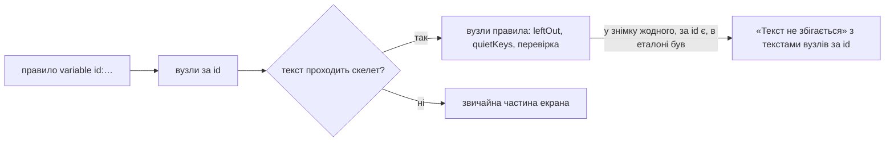

# 069 — Дизайн

## Підхід

Правило з id відбирає елементи вже наявним «скелетом» перевірки: незмінні частини дослівно, у
місцях — будь-що (`skeleton` у `variable-text.ts`, яким 033 відрізняє «Текст не збігається» від
«Не відповідає виразу»). Нова логіка — одна чиста функція `variableNodes(tree, rule)` поруч із
`findBySelector`: для правила `variable` з селектором `id:` вона лишає серед знайдених за id лише
вузли, чий текст (`text`, без нього — підпис) проходить скелет (REQ-069-01). Інші селектори —
без змін: `text:/…/` уже містить незмінну частину, шлях вказує на один елемент.

- **Пікселі й зміни (REQ-069-01, 02).** `resolveRules` бере вузли правила `variable` з
  `variableNodes` на обох боках: від них ідуть `leftOut`, `quietKeys`, `found`, `matches`.
  Рядок іншого вигляду туди не потрапляє, тож його пікселі й зміни за деревом рахуються, як без
  правила.
- **Перевірка тексту (REQ-069-03).** Коли в знімку `variableNodes` порожній, а за id вузли є, і в
  еталоні `variableNodes` не порожній, перевіряються вузли за id: жоден не проходить скелет, тож
  кожен дає `reason: 'text'` — «Текст не збігається» з текстами перших трьох, як у 033.
  `gone` у цьому разі хибне. Коли за id у знімку нічого — `gone` («Елемента немає»), як у 033.
- **Лічильники (REQ-069-04).** `matches` і `found` уже беруться з відібраних вузлів. У поповері
  під час позначення шматків лічильник рахує фронтенд (`countFor` у `TestDetailsModal.tsx`):
  тепер він отримує й поточні шматки й для `id:` відбирає елементи новим хелпером
  `variableCount(selector, parts, elements)` з тим самим скелетом.
- **Старі правила (REQ-069-05).** Правило не змінюється: відбір відбувається на кожному
  порівнянні за збереженими `parts`.

Скелет на фронтенді повторює бекендовий (`.*?` у місцях, пробіли як `\s+`), як уже повторюють
`partsRegex` і `fitsParts`. ADR не потрібен: це уточнення застосування правила 033.

## Компоненти

| Компонент | Шлях | Роль |
|---|---|---|
| `fitsSkeleton` (експорт скелета) | `backend/src/ui-tree/variable-text.ts` | чи має текст усю незмінну частину |
| `variableNodes`, `resolveRules` | `backend/src/ui-tree/comparison-inputs.ts` | відбір вузлів правила; перевірка за id, коли не відібрано жодного |
| `variableCount`, `fitsSkeleton` | `frontend/src/_helpers/variableText.helper.ts` | лічильник у поповері |
| `countFor` | `frontend/src/components/TestDetailsDialog/TestDetailsModal.tsx`, `ElementPopover.tsx` | передає шматки в лічильник |

## Дані

Без змін у базі й у форматі правила.

## Потік

## Ризики

| Ризик | Що робимо |
|---|---|
| Зламалась незмінна частина в усіх рядках, а «Текст не збігається» тепер показує тексти всіх рядків з id | причина з 033 уже обмежена трьома текстами й кількістю |
| Скелет фронтенду й бекенду розійдуться | обидва покриті тестами на тих самих прикладах з рядками історії |
| Правило без незмінної частини з літерами чи цифрами відбирає все | так і задумано (граничний випадок у spec) |

## Перевірка вимог

| Вимога | Перевірка |
|---|---|
| REQ-069-01 | `backend/src/ui-tree/comparison-inputs.spec.ts › finds by id only the rows that keep the rule's fixed text` |
| REQ-069-02 | `backend/src/ui-tree/comparison-inputs.spec.ts › compares a row of another kind with the same id as any part of the screen` |
| REQ-069-03 | `backend/src/ui-tree/comparison-inputs.spec.ts › tells the text does not match when no row with the id keeps the fixed text` |
| REQ-069-04 | `frontend/src/_helpers/variableText.helper.test.ts › counts by id only the elements that keep the fixed text` |
| REQ-069-05 | `backend/src/ui-tree/comparison-inputs.spec.ts › applies to a rule saved before, by its parts` |
