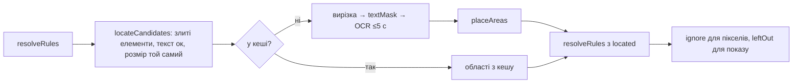

# 071 — Дизайн

## Підхід

Пошук шматків — розпізнавання слів на вирізці елемента (OCR, Tesseract у `tesseract.js`,
[ADR-0031](../../decisions/0031-ocr-to-locate-variable-text.md)) і зіставлення розпізнаних слів із
текстом елемента з дерева. Читати текст з нуля не треба: текст відомий, OCR лише каже, де стоять
слова, тож помилки розпізнавання окремих літер майже не заважають.

Логіку ділимо на чисті функції й тонкий асинхронний шар:

- **Кандидати (REQ-071-01).** `resolveRules` лишається чистою й синхронною. Нова чиста
  `locateCandidates(rules, trees)` повертає пари вузлів (знімок ↔ еталон) правил `variable`, для
  яких `leftOutOf` дав би весь елемент з причиною `own-text`: пара за `key`, однаковий розмір,
  текст обох боків проходить `checkVariableText`. Кожен кандидат несе значення місць на кожному
  боці (`placesOf(parts, text)` — значення позначених місць за порядком).
- **Пошук (REQ-071-06…08).** `TextLocatorService` (`backend/src/ui-tree/text-locator.service.ts`)
  тримає один обробник `tesseract.js` (мови `ukr+eng`, моделі з пакетів `@tesseract.js-data/*`
  `4.0.0_best_int` з `node_modules`, `langPath` локальний, без `cachePath` у мережі), створює його
  ліниво при першому кандидаті й ставить вирізки в чергу по одній. Для вирізки: обрізати PNG за
  межами елемента, підготувати чистою `textMask(png)` (піксель, що відрізняється від медіани
  свого рядка пікселів більш ніж на 40 одиниць яскравості, — чорний, решта — біла: так знаходиться
  і сірий дрібний текст, і текст на кольоровому банері), розпізнати слова з межами. Таймаут 5 с
  на елемент; понад 20 кандидатів на знімок — решта без пошуку з причиною `timeout`.
- **Зіставлення (REQ-071-02).** Чиста `placeAreas(text, places, words)`: токени тексту з дерева
  (за пробілами) жадібно зіставляються з розпізнаними словами за порядком (схожість за відстанню
  Левенштейна після нормалізації ≥ 0,6, вікно 4 слова вперед); область місця — об'єднання меж
  слів, у яких лежать токени цього місця, якщо вони в одному рядку тексту. Не знайдено хоча б
  одне місце → `null` з першим не знайденим значенням.
- **Застосування (REQ-071-03…05).** `resolveRules(rules, trees, located?)`: для кандидата з
  `located` (області на обох боках) `leftOutOf` дає записи без `reason` з цими областями й межами
  елемента, як для текстових частин 066; без — увесь елемент з новими причинами
  `not-found-current`, `not-found-baseline` (з `missing`) або `timeout`. `quietKeys` — без змін,
  тож зміни за деревом самого рядка не рахуються (REQ-071-05), а пікселі решти рядка — так.
- **Сервіс.** `UiTreeService.comparisonInputs` після першого `resolveRules` збирає кандидати,
  просить `TextLocatorService` про області (знімок і еталон беруться через `StaticService`) і
  рахує правила вдруге з `located`. Повторні виклики (`structure`, рев'ю, групи змін) не
  розпізнають заново: результат кешується в пам'яті за ключем
  `імʼя знімка + межі + значення місць` (LRU на 500 записів; імена знімків незмінні).
- **Показ (REQ-071-09…11).** Записи `leftOut` без `reason` з областями вже малюються як «лише
  текст» (штриховка на областях, рамка на елементі) і на схемі знімка. Поповер: для такого запису
  на злитому елементі — «Не порівнюються лише позначені шматки» (новий прапорець
  `LeftOut.located`), для нових причин — нові тексти. EN/UK.

Групи змін (`change-groups.service.ts`) викликають `variableTextAreas` синхронно без знімків:
вони й далі отримують увесь елемент. Це безпечно (група лише ширше мовчить про рядок) і
описане в ризиках.

## Компоненти

| Компонент | Шлях | Роль |
|---|---|---|
| `placesOf` | `backend/src/ui-tree/variable-text.ts` | значення позначених місць у тексті |
| `locateCandidates`, `resolveRules(…, located)`, `LeftOut` (+`located`, нові `reason`, `missing`) | `backend/src/ui-tree/comparison-inputs.ts` | кандидати й застосування знайдених областей |
| `textMask`, `placeAreas` | `backend/src/ui-tree/text-locate.ts` | підготовка вирізки, зіставлення слів із текстом |
| `TextLocatorService` | `backend/src/ui-tree/text-locator.service.ts` | обробник OCR, черга, таймаут, ліміт, кеш |
| `comparisonInputs` | `backend/src/ui-tree/ui-tree.service.ts` | два проходи `resolveRules` |
| залежності | `backend/package.json` | `tesseract.js`, `@tesseract.js-data/ukr`, `@tesseract.js-data/eng` — точні версії |
| типи, поповер | `frontend/src/types/insights.ts`, `frontend/src/components/TestDetailsDialog/ElementPopover.tsx` | нові причини й рядок «лише позначені шматки» |
| словники | `frontend/src/i18n/en.ts`, `uk.ts` | нові тексти |
| ADR | `docs/decisions/0031-ocr-to-locate-variable-text.md` | нова залежність і межі її застосування |

## Дані

Без змін у базі. Кеш — лише в пам'яті API. Моделі мов (~5 МБ) — у `node_modules` образу; у
мережу нічого не йде (SC-071-04).

## Потік

## Ризики

| Ризик | Що робимо |
|---|---|
| OCR не знаходить місце (сірий дрібний текст, градієнт) | весь елемент, як досі, з причиною в поповері; `textMask` перевірений на реальних знімках |
| Оновлення бібліотеки чи моделі зсуває межі слів | точні версії в `package.json`; оновлення — разом із тестом на фікстурі |
| Навантаження на API поруч із продом VRT | один обробник, черга, 5 с на елемент, ≤ 20 елементів, кеш; ліміти контейнера з `DEPLOY.md` |
| Пам'ять обробника (~150 МБ) | створюється ліниво, лише коли є кандидати |
| Групи змін мовчать про весь злитий рядок | так і було до 071; групи — підказка, рішення приймає рев'ю |
| Запас по краях (`RULE_PADDING_PX`) замалий для курсиву чи тіні | той самий, що в 066; збільшити окремим рішенням за реальними прикладами |

## Перевірка вимог

| Вимога | Перевірка |
|---|---|
| REQ-071-01 | `backend/src/ui-tree/comparison-inputs.spec.ts › looks for the marked pieces only in a merged element of the same size whose text holds` |
| REQ-071-02 | `backend/src/ui-tree/text-locate.spec.ts › finds each place among the recognised words in the order of the text` |
| REQ-071-03 | `backend/src/ui-tree/comparison-inputs.spec.ts › leaves out only the found pieces and compares the rest of the row` |
| REQ-071-04 | `backend/src/ui-tree/comparison-inputs.spec.ts › leaves out the whole row when a piece is not found` |
| REQ-071-05 | `backend/src/ui-tree/comparison-inputs.spec.ts › counts a change of the icon in a merged row` |
| REQ-071-06 | `backend/src/ui-tree/text-locator.service.spec.ts › finds the pieces of a rendered history row offline, the same each time` |
| REQ-071-07 | `backend/src/ui-tree/text-locator.service.spec.ts › gives up on an element after five seconds` |
| REQ-071-08 | `backend/src/ui-tree/text-locator.service.spec.ts › looks in at most twenty elements of a screenshot` |
| REQ-071-09 | `frontend/src/_helpers/variableText.helper.test.ts › marks the found pieces of a merged element hatched` |
| REQ-071-10 | `frontend/src/components/TestDetailsDialog/ElementPopover.test.tsx › says only the marked pieces are not compared, or which was not found` |
| REQ-071-11 | `frontend/src/_helpers/whatsCompared.helper.test.ts › maps the found pieces of a merged element` |
