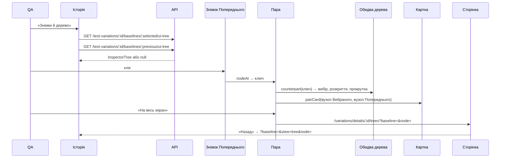

# 079 — Дизайн

## Підхід

Дерево кожної прийнятої версії вже збережене: `Baseline.uiTreeName` пишеться при прийнятті
(`TestVariationsService.addBaseline`) і видаляється разом з еталоном. Тож нове — лише читання й
показ. Логіку дерева беремо з вкладки «Елементи» (062, 063) без змін, а нове лише зводить два дерева
в одну пару.

- **Бекенд.** Новий маршрут `GET /test-variations/:id/baselines/:baselineId/ui-tree`. Він віддає
  той самий `InspectorTree`, що `GET /test-runs/:id/ui-tree`, через ту саму чисту
  `inspectorTree(tree)`.
  - Сервіс шукає версію за `id` і `testVariationId`. Версія чужої перевірки — 404, тож доступ
    перевіряється за перевіркою (`@ProjectFrom(inParam('id', 'variation'))`), як у
    `GET /test-variations/details/:id` (REQ-079-23). Нового `ProjectRef` не треба.
  - Версія без дерева дає `null` (REQ-079-06).
  - `UiTreeService.inspectorOf(name)` вантажить і перекладає дерево за назвою файлу, а наявний
    `inspector(testRun, side)` тепер викликає його.
- **Фронтенд.** Чисті функції — у новому `_helpers/baselineTrees.helper.ts`:
  - `counterpart(nodes, key)` — вузол другої версії за ключем (REQ-079-10, 15);
  - `pairOutlines(nodes, chosen, pointed)` — рамки вибраного й наведеного на знімку версії
    (REQ-079-11, 13);
  - `pairCard(selected, previous)` — рядки картки: назви атрибутів обох версій у порядку
    платформи, «—» для порожнього, `null` для версії без елемента (REQ-079-14, 15);
  - `baselineTreesLocation`, `historyLocation` і `readHistoryPlace` — адреса сторінки на весь екран, історії й назад
    (REQ-079-18, 19).

  Решта — наявні функції `treeInspector.helper.ts` (`visibleRows`, `initialOpen`, `nodeAt`,
  `treeOutlines`).
- **`ElementsTab`** отримує проп `viewOnly`. З ним вкладка ховає:
  - перемикач «Поточне / Еталон»;
  - чипи «Змінені» й «Доступність», перехід між змінами й позначки;
  - кнопку й клавішу копіювання селектора;
  - власну картку вузла з локаторами й дії.

  Лишаються рядки, обгортки, пошук, чип «Клікабельні», «Розгорнути / Згорнути все» й клавіші
  (REQ-079-03, 21). Без `structure` і звіту позначок і так немає. `initialOpen` без позначених
  вузлів розгортає два рівні (REQ-079-04).
- **`BaselineTreePair`** — новий компонент пари. На кожну версію він показує знімок із рамками
  (`TreeScreen`) і `ElementsTab viewOnly`, а під парою — `PairNodeCard`.
  - Вибір і наведення тримає як **ключ** елемента, не індекс. Для кожного дерева індекс шукає
    `counterpart`, тож одна дія вибирає вузол в обох деревах (REQ-079-11…13). Якщо вузла немає,
    у цьому дереві нічого не вибрано, а на знімку немає рамки.
  - Клік по знімку бере `nodeAt` дерева цієї версії (REQ-079-12).
- **`TreeScreen`** — знімок з рамками з `InspectorPage`, винесений у спільний компонент без змін
  поведінки. Ним користуються і сторінка інспектора, і пара; пара ховає його підпис
  (`caption={false}`), бо версію вже названо в її заголовку.
- **Історія еталона** (`TestVariationDetailsPage`):
  - над парою стоїть `SlidingToggleGroup` «Знімки / Знімки й дерево»;
  - у режимі «Знімки» пара та сама, що зараз (REQ-079-01, SC-079-03);
  - у режимі дерева замість двох `pane` показується `BaselineTreePair`;
  - вибрана версія, режим і ключ вибраного елемента живуть в адресі
    (`?baseline=&view=tree&node=`), щоб «Назад» зі сторінки на весь екран їх відновив, а інша
    версія лишала той самий елемент, якщо він у ній є (REQ-079-09, 19).
- **Сторінка на весь екран** `/variations/details/:id/trees?baseline=&node=` (`BaselineTreesPage`)
  показує той самий `BaselineTreePair` з `fill` на всю ширину. Esc і «Назад» ведуть на історію з
  `view=tree` (REQ-079-17…19).
- **Ліниве завантаження.** Хук `useBaselineTrees(variationId, selectedId, previousId, wanted)`
  вантажить обидва дерева лише коли `wanted`, кожне окремо, з `retry` (REQ-079-05, 07). Він
  повертає ту саму форму `TreeLoad`, що й `useInspectorTrees`. Якщо `uiTreeName` версії порожній,
  хук не робить запиту й одразу віддає `ready` з `null` (REQ-079-06). «Спробувати ще» знову
  вантажить лише те дерево, що не вдалося.

## Компоненти

| Компонент | Шлях | Роль |
|---|---|---|
| `UiTreeService.inspectorOf` | `backend/src/ui-tree/ui-tree.service.ts` | дерево за назвою файлу → `InspectorTree`; `inspector()` викликає його |
| `TestVariationsService.getBaselineUiTree` | `backend/src/test-variations/test-variations.service.ts` | версія цієї перевірки або 404; `null` без дерева |
| `GET /test-variations/:id/baselines/:baselineId/ui-tree` | `backend/src/test-variations/test-variations.controller.ts` | маршрут; `@ProjectFrom(inParam('id', 'variation'))`, `JwtAuthGuard` |
| модуль | `backend/src/test-variations/test-variations.module.ts` | імпорт `UiTreeModule` (через `forwardRef`, якщо буде цикл) |
| тип `Baseline.uiTreeName` | `frontend/src/types/baseline.ts` | поле, яке `details` вже віддає |
| `testVariationService.getBaselineUiTree` | `frontend/src/services/testVariation.service.ts` | виклик API |
| хелпер | `frontend/src/_helpers/baselineTrees.helper.ts` | `counterpart`, `pairCard`, адреси |
| `useBaselineTrees` | `frontend/src/components/BaselineTrees/useBaselineTrees.ts` | ліниве завантаження двох версій, повтор |
| `BaselineTreePair`, `PairNodeCard` | `frontend/src/components/BaselineTrees/` | пара знімків з деревами, спільний вибір, картка двома колонками |
| `TreeScreen` | `frontend/src/components/TreeScreen.tsx` | знімок з рамками й точкою під курсором (з `InspectorPage`) |
| `ElementsTab` | `frontend/src/components/TestDetailsDialog/ElementsTab.tsx` | проп `viewOnly` |
| `TestVariationDetailsPage` | `frontend/src/pages/TestVariationDetailsPage.tsx` | перемикач, пара з деревами, стан в адресі |
| `BaselineTreesPage` | `frontend/src/pages/BaselineTreesPage.tsx` | на весь екран; маршрут у `Router.jsx`, `routes.BASELINE_TREES_PAGE` |
| словник | `frontend/src/i18n/en.ts`, `uk.ts` | «Знімки», «Знімки й дерево», «Немає в цій версії», «дерева немає» тощо |

## Дані

У базі й файлах нічого нового (ADR-0003 не зачеплено). Версії, прийняті до того, як тести почали
надсилати дерево, мають `uiTreeName = null` і показують пояснення.

## Потік

## Ризики

| Ризик | Що робимо |
|---|---|
| Два дерева по 3 000 вузлів удвічі навантажують сторінку | та сама віртуалізація рядків `ElementsTab`; дерева вантажаться лише в режимі дерева (SC-079-02) |
| `viewOnly` ламає вкладку «Елементи» в порівнянні | проп типово вимкнений; наявні тести `ElementsTab` і `elementsTab.spec.ts` лишаються без змін і мають бути зелені |
| Ключ збігається в кількох вузлів | `counterpart` бере перший за порядком дерева, як рамка на еталоні у вкладці «Елементи» (062) |
| Цикл модулів Nest (`TestVariations` ↔ `UiTree`) | `forwardRef`, як уже з `TestRunsModule` |
| Виносимо `TreeScreen` з `InspectorPage` | лише переміщення; `elementsTab.spec.ts` (інспектор) перевіряє, що поведінка та сама |
| Клавіші двох дерев на одній сторінці | `ElementsTab` відповідає лише з фокусом у своєму дереві (як зараз) |

## Перевірка вимог

| Вимога | Перевірка |
|---|---|
| REQ-079-01 | `frontend/integration_tests/test/baselineHistoryTree.spec.ts › opens on screenshots and shows both trees on switching` |
| REQ-079-02 | `frontend/integration_tests/test/baselineHistoryTree.spec.ts › opens on screenshots and shows both trees on switching` |
| REQ-079-03 | `frontend/src/components/TestDetailsDialog/ElementsTab.test.tsx › view only keeps search and wrappers but no marks, copying or side switch` |
| REQ-079-04 | `frontend/src/_helpers/treeInspector.helper.test.ts › opens two levels when nothing is marked` |
| REQ-079-05 | `frontend/src/components/BaselineTrees/useBaselineTrees.test.tsx › loads the trees only once they are wanted` |
| REQ-079-06 | `frontend/src/components/BaselineTrees/BaselineTreePair.test.tsx › explains a version without a tree and shows the other`; `frontend/src/components/BaselineTrees/useBaselineTrees.test.tsx › asks nothing for a version accepted without a tree` |
| REQ-079-07 | `frontend/src/components/BaselineTrees/BaselineTreePair.test.tsx › offers Try again for the tree that failed only`; `frontend/src/components/BaselineTrees/useBaselineTrees.test.tsx › asks again for the failed tree only` |
| REQ-079-08 | `frontend/src/components/BaselineTrees/BaselineTreePair.test.tsx › shows one version and a one-column card for the first baseline` |
| REQ-079-09 | `frontend/integration_tests/test/baselineHistoryTree.spec.ts › keeps the trees and the element when another version is picked` |
| REQ-079-10 | `frontend/src/_helpers/baselineTrees.helper.test.ts › finds the same element in the other version by its key` |
| REQ-079-11 | `frontend/src/components/BaselineTrees/BaselineTreePair.test.tsx › outlines the pointed element on both screenshots` |
| REQ-079-12 | `frontend/integration_tests/test/baselineHistoryTree.spec.ts › a click on the previous screenshot chooses the element in both trees` |
| REQ-079-13 | `frontend/src/components/BaselineTrees/BaselineTreePair.test.tsx › outlines the chosen element on every screenshot that has it` |
| REQ-079-14 | `frontend/src/_helpers/baselineTrees.helper.test.ts › lays the attributes of both versions side by side with a dash for empty` |
| REQ-079-15 | `frontend/src/components/BaselineTrees/BaselineTreePair.test.tsx › says Not in this version and chooses nothing there` |
| REQ-079-16 | `frontend/src/components/BaselineTrees/BaselineTreePair.test.tsx › dims an element without a position and draws no outline` |
| REQ-079-17 | `frontend/integration_tests/test/baselineHistoryTree.spec.ts › opens full screen on the element and comes back to it` |
| REQ-079-18 | `frontend/src/_helpers/baselineTrees.helper.test.ts › keeps the version and the element in the full screen address` |
| REQ-079-19 | `frontend/integration_tests/test/baselineHistoryTree.spec.ts › opens full screen on the element and comes back to it` |
| REQ-079-20 | manual: історія еталона при ширині 800 px у режимі дерева — версії одна під одною, горизонтальної прокрутки немає |
| REQ-079-21 | `frontend/src/components/TestDetailsDialog/ElementsTab.test.tsx › view only keeps search and wrappers but no marks, copying or side switch` |
| REQ-079-22 | manual: `npx tsc` без нових помилок (пропущений переклад — помилка типів), `npx eslint` без порушень правил кольору й шкали; перемкнути EN/UK і світлу/темну тему |
| REQ-079-23 | `backend/src/projects/project-access.routes.spec.ts › answers not found on every route of a project without access`; `backend/src/test-variations/test-variations.service.spec.ts › answers not found for a version of another check` |
